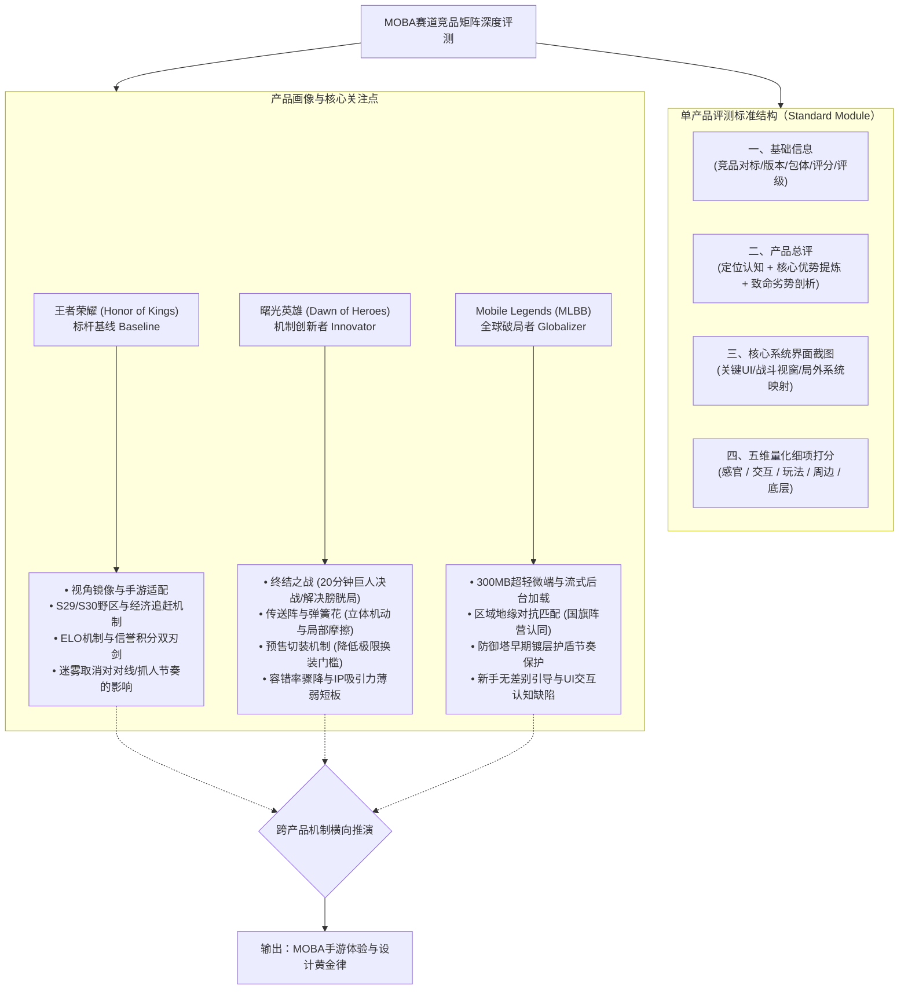
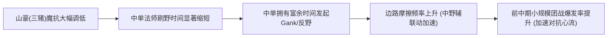
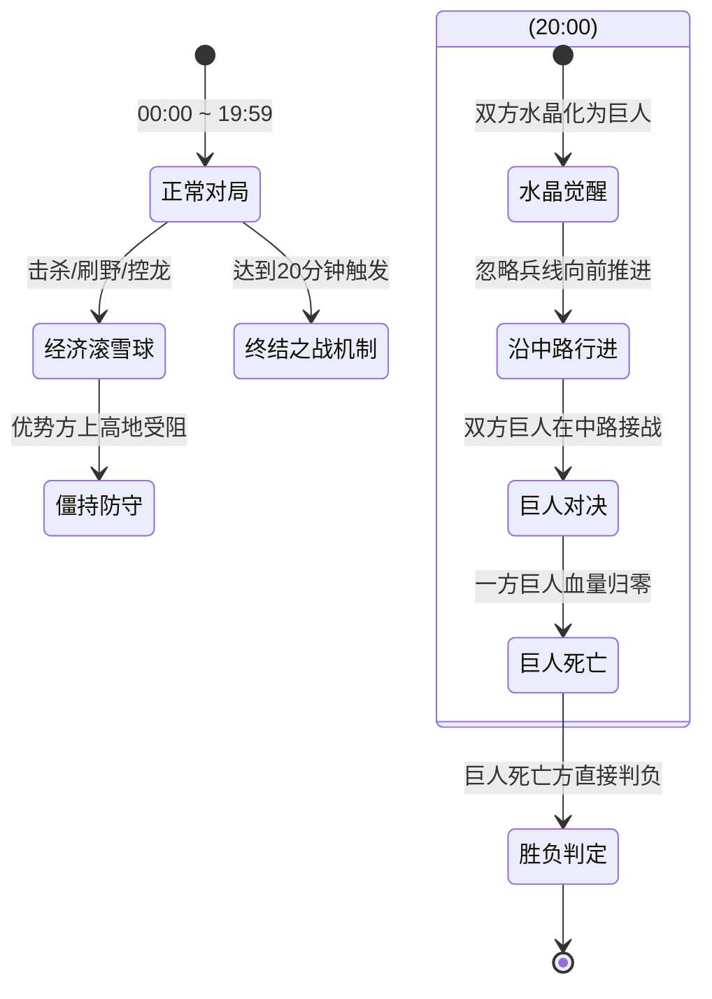

# 《王者荣耀》及同赛道MOBA竞品评测报告 · 深度拆解与方法论剖析

> **报告版本**：V1.0  
> **分析对象**：`E:\游戏策划案\拆解案（20份）\1、《王者荣耀》评测报告.pdf`  
> **评审人**：资深游戏主策划 / 游戏行业导师  
> **报告归档路径**：`E:\游戏策划案\拆解案分析报告\01_王者荣耀评测报告_深度分析.md`

---

## 目录
- [一、拆解案基本信息与架构全貌](#一拆解案基本信息与架构全貌)
  - [1.1 核心档案与评测对象矩阵](#11-核心档案与评测对象矩阵)
  - [1.2 文档性质与评测维度体系](#12-文档性质与评测维度体系)
  - [1.3 文档行文与横向对比逻辑架构图](#13-文档行文与横向对比逻辑架构图)
- [二、这篇拆解案“好在哪里”（深度亮点剖析）](#二这篇拆解案好在哪里深度亮点剖析)
  - [2.1 工业化标准评测模板：构建量化基准与评估闭环](#21-工业化标准评测模板构建量化基准与评估闭环)
  - [2.2 见微知著：对MOBA核心机制版本演进的精准捕捉](#22-见微知著对moba核心机制版本演进的精准捕捉)
  - [2.3 竞品横评视野：从同质化中抽离差异化“破局点”](#23-竞品横评视野从同质化中抽离差异化破局点)
  - [2.4 兼顾商业化、底层包体与生态治理的全局视角](#24-兼顾商业化底层包体与生态治理的全局视角)
- [三、体现了策划的什么核心能力（能力模型对照）](#三体现了策划的什么核心能力能力模型对照)
  - [3.1 逆向工程与系统拆解能力（Reverse Engineering）](#31-逆向工程与系统拆解能力reverse-engineering)
  - [3.2 玩家体验与心流调控感知力（Player Experience & Flow）](#32-玩家体验与心流调控感知力player-experience--flow)
  - [3.3 机制双刃剑批判性思考能力（Critical Systemic Thinking）](#33-机制双刃剑批判性思考能力critical-systemic-thinking)
  - [3.4 工业化文档规范与结构化表达能力（Documentation Standards）](#34-工业化文档规范与结构化表达能力documentation-standards)
- [四、学习如何写策划拆解案（实战指南与方法论提炼）](#四学习如何写策划拆解案实战指南与方法论提炼)
  - [4.1 工业级评测/拆解案可复用标准骨架](#41-工业级评测拆解案可复用标准骨架)
  - [4.2 策划新人/进阶者必须掌握的高分技巧](#42-策划新人进阶者必须掌握的高分技巧)
  - [4.3 本文存在的局限与深度避坑指南](#43-本文存在的局限与深度避坑指南)
  - [4.4 拆解案在求职应聘与项目立项中的高阶应用实战](#44-拆解案在求职应聘与项目立项中的高阶应用实战)

---

## 一、拆解案基本信息与架构全貌

### 1.1 核心档案与评测对象矩阵

本份文档虽然主标题为《王者荣耀》评测报告，但深入其文本结构与内容编排，本质上是一份**“MOBA赛道横向竞品矩阵式深度评测报告集”**。原作者通过完全一致的评测模型与评价标尺，针对当时中国及海外移动端MOBA最具代表性的三款标杆产品（统治者、差异化突围者、海外出海霸主）进行了同一周期内的定性与定量评测。

| 评估维度 | 产品1：《王者荣耀》(Honor of Kings) | 产品2：《曙光英雄》(Heroes Evolved/Dawn) | 产品3：《Mobile Legends: Bang Bang》 |
| :--- | :--- | :--- | :--- |
| **开发商 / 发行** | 腾讯游戏 / 天美L1工作室 | 竞技世界 (JJ World) | 沐瞳科技 (Moonton / 字节跳动) |
| **评测版本** | 8.2.1.8 (Res: 8.2.1.44) / S30赛季 | 1.0.13.0 (Res: 1.0.13.9) | 1.7.59.826.2 (客户端) |
| **标杆竞品定位** | 《英雄联盟》(端游降维移植标杆) | 《王者荣耀》(国内同生态挑战标杆) | 《王者荣耀》(全球化/低配下沉标杆) |
| **包体量级** | 4.0 GB (重度高精资源) | 1.6 GB (中度折中资源) | 301.4 MB (极速轻量/后台流式加载) |
| **评测时间** | 2023-03-10 ~ 2023-03-12 | 2023-03-10 (同日速测) | 2023-03-18 ~ 2023-03-20 |
| **最终评分** | **81.25 分** | **83.75 分** | **75.00 分** |
| **评级结果** | **A 级** | **B 级** *(注：规则映射下疑似笔误)* | **B 级** |
| **核心战略定位** | 国内国民级DAU生态垄断者 | 主打局内创新对抗与终结机制的破局者 | 瞄准新兴市场、弱网低端机与地缘社交的霸主 |

---

### 1.2 文档性质与评测维度体系

该评测案属于研发前/研发生命周期中的**“标杆竞品体验评测与系统逆向报告（Benchmark Evaluation & Reverse Engineering Report）”**。其采用的评估模型是行业内典型的**五维加权扣分评估体系**：

```
综合得分 Formula:
Score = (感官表现得分 + 交互设计得分 + 玩法内容得分 + 周边系统得分) / 4 - 程序底层扣分项
```

#### 评测层级划分（等级标准）
- **S 级（91 ~ 100 分）**：行业颠覆级神作，各维度无短板且拥有开创性壁垒。
- **A 级（81 ~ 90 分）**：工业化成熟度极高的头部产品，核心玩法扎实，商业与生态健康。
- **B 级（71 ~ 80 分）**：合格的商业化产品，有鲜明特色但存在明显短板或体验割裂。
- **C 级（61 ~ 70 分）**：勉强及格或存在严重系统/手感/性能缺陷的产品。

#### 三款产品五维得分对比雷达拆解
- **《王者荣耀》**：感官 85 | 交互 80 | 玩法 80 | 周边 80 | 程序 通过（0扣分） $\rightarrow$ **81.25 (A)**
- **《曙光英雄》**：感官 90 | 交互 80 | 玩法 85 | 周边 80 | 程序 通过（0扣分） $\rightarrow$ **83.75 (B/实际属A)**
- **《Mobile Legends》**：感官 75 | 交互 75 | 玩法 75 | 周边 75 | 程序 通过（0扣分） $\rightarrow$ **75.00 (B)**

---

### 1.3 文档行文与横向对比逻辑架构图



---

## 二、这篇拆解案“好在哪里”（深度亮点剖析）

### 2.1 工业化标准评测模板：构建量化基准与评估闭环

这份评测案最值得称道之处，在于其展现了**极强的工业化标准化意识**。很多初级策划在写评测时，往往容易陷入散文式、随笔式的感性宣泄（如“手感很好”、“画面炫酷”、“玩起来很爽”），导致多款产品之间无法建立统一的评估基准（Baseline）。

1. **统一量化算式与清晰权重**：
   文档确立了 `评分 = (感官 + 交互 + 玩法 + 周边) / 4 - 程序扣分` 的客观公式。将主观的游戏体验收敛到感官、交互、玩法、周边四个同权模块中，同时设立“程序底层”作为一票否决/扣分项。这种设计极其贴近游戏工委或一线大厂（如腾讯IEG、网易互娱、莉莉丝等）的用研评测模型。
2. **多版本快照追踪**：
   明确记录了评测时的 App Version 与 Resource Version（例如王者荣耀的 8.2.1.8 与 8.2.1.44，曙光英雄的 1.0.13.0 与 1.0.13.9）。在网络游戏特别是重度数值/版本平衡型MOBA中，脱离版本号谈平衡性是伪命题。作者精准锁定了评测时间截点（2023年3月），使报告具备了版本考证价值。

---

### 2.2 见微知著：对MOBA核心机制版本演进的精准捕捉

作者并没有泛泛而谈“王者荣耀是个5v5推塔游戏”，而是深入到了当时的**最新版本补丁（S29 ~ S30赛季）的核心微观机制改动**中，展现了一线战斗/关卡策划的敏锐洞察力：

#### （1）S29 经济追赶机制的心理博弈
- **底层诉求**：解决MOBA手游滚雪球过快、劣势方垃圾时间长、挂机率高的问题。
- **设计推演**：作者指出“劣势方一定程度上有几率翻盘，并让优势方选择开团更谨慎”。策划在设计逆风补偿时，本质是在调控**“优势方容错率衰减速率”**。击杀高连杀/高经济目标所释放的团队悬赏金，改变了优势方的风险收益比（Risk-Reward Ratio），迫使优势方从“无脑单抓/冲塔”转向“稳健控野拿龙推塔”，拉长了终结比赛的战术博弈深度。

#### （2）S30 野区生态重构对全局节奏的辐射
- **蓝Buff地形改造**：增加了入侵野区的撤退路径与草丛视野盲区，变相提升了反野方的“沉没成本与被包夹风险”，对弱势打野起到前期保护作用。
- **边路野怪增设（边野/赤甲）**：打破了以往边路战士单纯对线互耗的单调博弈，将“线权争夺”转化为“野区资源争夺”，增加了对抗路摩擦频率，为打野提供了边路蹭线之外的合法补发育点。
- **山豪（三猪）魔抗降低**：这一极其细微的数值改动被作者敏锐捕捉。魔抗降低后，法师（中单）在清完中线后能够以极低的时间成本刷掉或偷掉敌方山豪，极大地赋能了游走型中单（Roamer Mage），加速了中野联动的启动速度。



---

### 2.3 竞品横评视野：从同质化中抽离差异化“破局点”

面对MOBA这个高度固化的红海赛道，作者在分析《曙光英雄》和《Mobile Legends》时，没有停留在“抄袭王者”这种浅层舆论视角，而是**精准解构了两款竞品的微创新如何试图解决同类痛点**：

#### （1）《曙光英雄》：对抗时长的终极手术——“终结之战”
- **痛点解构**：传统MOBA（如王者荣耀）到达20分钟后极易陷入“膀胱局”（高地塔难以攻破、风暴龙王拉扯互不接团、兵线进不去），导致单局心流拉长，违背移动端碎片化体验。
- **机制创新**：20分钟水晶化身巨人走向中路决战。作者既赞赏了其“极大程度避免僵持局面，缓解中后期单调性”，又极为犀利地指出了其负面代价——**“容错率的断崖式暴跌”**。前期通过长达15分钟建立的六神装与经济优势，在20分钟巨人中路一波对拼中，可能因为一次走位失误导致水晶瞬间被推。这种“前期运营权重被机械降神剥夺”的负面体验，作者一针见血地予以指出。
- **操作门槛降维——预售切装机制**：传统MOBA在后期极度依赖“复活甲秒换名刀/辉月”的六指或极限手速，对泛用户是极高的微操壁垒；曙光英雄引入装备预售与快速替换流，大幅降低了非硬核玩家的操作门槛。

#### （2）《Mobile Legends (无尽对决)》：极速微端与地缘政治社交
- **超轻量化工程哲学**：301.4MB包体配合非游戏对局期间后台流式下载，是沐瞳打穿印尼、菲律宾、拉美等第三世界国家智能机与弱网环境的决定性护城河。
- **国别对抗阵营化**：匹配系统优先匹配同国家/地区，甚至在对局载入界面直接展示国旗（印尼 vs 菲律宾等），将游戏内胜负升格为“国家荣誉感”，形成了极为强韧的部族认同感与社交病毒式传播。

---

### 2.4 兼顾商业化、底层包体与生态治理的全局视角

这份评测案跳出了单纯的“战斗关卡策划”窄门，展现了主策级别的全景视野：

1. **生态治理的双刃剑考量（信誉积分与举报系统）**：
   - 作者指出王者荣耀加强信誉惩处虽净化了环境，但也严重扼杀了部分合法的非主流战术流派——例如“献祭流雅典娜”。系统由于采用死板的“KDA/死亡次数算法”判定消极比赛，导致高玩利用死亡机制打出全局视野与断线收益的战术被系统封禁，伤害了战术多样性。
2. **商业化分类提炼**：
   - 梳理了“游戏内微交易（外观皮肤、英雄售卖、通行证/战令、充值活动）”与“泛娱乐IP生态（电竞赛事分成、转播权、IP衍生周边授权）”的双轨商业体系，展示了成熟的商业化认知架构。

---

## 三、体现了策划的什么核心能力（能力模型对照）

通过分析这份文档的行文逻辑与内容深度，可以清晰映射出作者作为专业游戏策划的几大关键能力，并对标游戏行业资深主策划的能力雷达：

```mermaid
radar
    title 资深策划能力模型映射
    "逆向工程与系统解构": 85
    "玩家心流与体验洞察": 88
    "机制双刃剑批判思维": 82
    "商业化与大局观": 78
    "工业化文档结构化": 80
    "底层数据与公式闭环": 65
```

### 3.1 逆向工程与系统拆解能力（Reverse Engineering）
* **能力体现**：能够透过纷繁复杂的表层画面与操作，迅速抽离出游戏的核心状态机与规则网。
* **案例印证**：
  - 敏锐指出王者荣耀与端游LOL的关键适配差异在于**“取消战争迷雾与视距锁定”**、**“对称视角镜像翻转算法（解决红方从上往下丢技能的右手遮挡问题）”**。
  - 拆解曙光英雄的地图机动机制：传送阵（上下路战略联动）、弹簧花（局部追击逃生），说明作者在体验游戏时，能够主动将地图元素与“玩家移动速度、时间窗口、空间支援半径”等底层关卡参数挂钩。

### 3.2 玩家体验与心流调控感知力（Player Experience & Flow）
* **能力体现**：不仅关注“游戏好不好玩”，更关注“不同阶层玩家在不同时段的挫败感与正反馈曲线”。
* **案例印证**：
  - **ELO机制的本质洞察**：作者指出王者荣耀早期ELO机制的核心是“通过动态配平胜率照顾中低端泛用户，维持大盘活跃度，但代价是高端硬核玩家面临1v9的极度挫败感与负反馈连败循环”。能从这种宏观匹配算法中看到阶层撕裂，体现了成熟的运营心流感知力。
  - **新手引导分层建议**：在评测MLBB时，作者敏锐指出其新手教学采用了“一刀切强引导”，未对“MOBA老玩家”和“纯白新用户”进行动态聚类分流，导致老玩家极度烦躁，新玩家认知过载，切中用研痛点。

### 3.3 机制双刃剑批判性思考能力（Critical Systemic Thinking）
* **能力体现**：初级策划看机制往往非黑即白（“这个功能太棒了”或“这个策划脑残”），而资深策划必须具备**“系统性权衡（Trade-off）”思维**——任何机制的引入都在解决一个问题的同时引入新的代价。
* **案例印证**：
  - 分析曙光英雄“终结之战”：解决了对局拖沓（+），却破坏了前期经济积累的确定性并带来了单次失误容错率极低的崩盘感（-）。
  - 分析王者荣耀“举报系统强化”：净化了言语辱骂与送头挂机（+），却由于规则模板化误伤了特定英雄的极端玩法（献祭流雅典娜）（-）。
  - 分析取消“战争迷雾”：大幅降低手游认知负荷与对局阻力（+），却降低了高阶玩家隔墙视野卡位与侦察博弈的策略成就感（-）。

### 3.4 工业化文档规范与结构化表达能力（Documentation Standards）
* **能力体现**：文档排版严谨，信息层级分明。
* **案例印证**：
  - 采用模块化四段式输出（基础元数据 $\rightarrow$ 高维宏观总评 $\rightarrow$ 直观视觉实证 $\rightarrow$ 五维微观量化）。每一款游戏都严格遵循相同的结构模版，使任何第三方读者（无论是制作人、技术负责人还是发行运营）均能在30秒内快速提取核心优劣势并横向比对。

---

## 四、学习如何写策划拆解案（实战指南与方法论提炼）

很多策划新人在撰写拆解案时，最常见的致命病症是：**“截图堆砌图册”**、**“操作说明书流水账”**、**“UI按钮说明文”**、**“脱离商业与底层的自嗨”**。结合本份文档的精华与瑕疵，我们提炼出一套可直接复用并升级的**顶级工业化策划拆解案方法论**。

### 4.1 工业级评测/拆解案可复用标准骨架

如果你需要向上级制作人汇报或向面试官展示一份无可挑剔的拆解案，可直接采用如下框架：

```markdown
# [游戏名称] 深度系统拆解与竞品评测报告

## 0. 执行摘要 (Executive Summary)
- 评测版本、测试环境、设备型号
- 一句话定位与核心竞争壁垒
- 综合评分与核心评级 (五维雷达矩阵)
- 3条核心优势 / 3条核心痛点与风险

## 1. 核心战斗与微观机制逆向 (Core Loop & Micro Mechanics)
- 战斗循环图 (Input -> Action -> Feedback -> Reward)
- 地图与关卡时空设计 (移动速度 / 兵线行进时间 / 视野机制 / 资源刷新轴)
- 战斗手感与交互设计 (摇杆施法判定、索敌优先级、智能施法算法)
- 数值模型初探 (伤害公式、成长曲线、滚雪球与经济追赶模型)

## 2. 宏观系统架构与闭环分析 (Meta-Systems & Game Loop)
- 系统拓扑关系图 (成长、收集、日常、赛季、社交等子系统的流转)
- 匹配机制与天梯生态 (ELO/MMR、胜率调控、分段心流体验)
- 留存驱动体系 (短期关卡目标 -> 中期战令赛季 -> 长期社交资产)

## 3. 商业化模型与经济系统 (Monetization & Economy)
- 货币流通拓扑图 (产出 -> 消耗 -> 回收)
- 付费点分层 (外观性付费 / 强度性付费 / 进度性付费 / 社交炫耀性付费)
- 商业化节奏与运营活动排期策略

## 4. 竞品矩阵横向对标 (Competitive Matrix)
- 选取2-3款同赛道典型竞品 (对标基准、特色创新者、海外破局者)
- 关键差异化机制深度对比表 (机制原理、解决痛点、付出代价、市场反馈)

## 5. 缺陷诊断与再设计方案 (Critique & Redesign Proposals)
- 明确指出当前设计缺陷 (附带玩家行为数据/舆论佐证)
- 根因分析 (根本矛盾在于数值？体验？技术瓶颈？还是商业妥协？)
- 落地可行的改进方案 (系统改案 / 数值调整方案 / 交互原型示意图)
```

---

### 4.2 策划新人/进阶者必须掌握的高分技巧

要在拆解案中体现出“专业策划”而非“游戏玩家”的视角，必须做到以下四点跃迁：

#### 技巧一：从“展示现象”跃迁到“推导动机”（不仅写What，更要写Why）
- **新手写法**：“王者荣耀S30赛季改了三猪，法师更容易打了。”
- **高分写法**：“S30赛季将山豪（三猪）魔法抗性下调，其**底层设计目的**是为了降低中路法师的清野时间成本（Time Cost），促使法师在01:30第一波线后能快速刷野升3级并游走支援，从而缩短前期中野辅联动的启动时间窗口，加速对局前中期的摩擦爆发频率。”

#### 技巧二：用“状态机与流程图”替代冗长的文字罗列
- 不要纯文字解释复杂的逻辑。对于如“预售切装机制”、“终结之战判定”、“索敌机制优先级”，使用清晰的 Mermaid 状态图或时序图呈现，瞬间展现工程化素养。



#### 技巧三：坚持“收益与代价并存”的系统论视角
- 任何系统机制的提出，必须分析其“正外部性”和“负外部性”。如同本文作者分析“终结之战”与“信誉积分强化”，既要看到其抑制顽疾的效果，更要预判其对玩家自主策略性的挤压。

---

### 4.3 本文存在的局限与深度避坑指南

尽管这份评测报告立意高远、结构完整，但在专业评审视角下，仍存在若干**典型缺陷**，各位策划在实战中必须引以为戒：

#### 避坑点1：杜绝“打分规则与评级结果”自相矛盾的低级失误
- **原文瑕疵**：在《曙光英雄》评测中，作者计算出的得分为 **83.75 分**，但在评分标准中明确定义：`A级：81~90；B级：71~80`。然而报告首页赫然标注评级为 **“B”**。
- **导师警示**：在正规研发评审或求职面试中，这种自相矛盾的低级失误会严重动摇评审人对报告量化严谨性的信任，必须反复核对元数据与映射规则的一致性。

#### 避坑点2：避免缺乏量化公式与边界条件的“定性猜测”
- **原文瑕疵**：提到“S29增加了经济追赶机制”，但未给出具体的补偿公式、梯度曲线或触发阈值（例如：劣势方落后多少经济启动？是全队平分还是落后最多的人享受？悬赏金击杀公式为何？）。
- **优化实战**：应当补充底层数值逻辑，例如：
  $$\text{悬赏额外金币} = \text{BaseGold} + \Delta E \times k \quad (\Delta E = \text{团队经济差}, k = \text{追赶系数})$$
  并说明其在不同分段触发的边界条件。

#### 避坑点3：切忌截图仅作为“占位图”，必须具备标注与设计指引
- **原文瑕疵**：第三部分“截图”虽然插入了图片，但缺乏对截图具体UI布局、热区分布、视线流线（Eye-tracking Flow）的红圈标注与分析文字。
- **优化实战**：截图必须配合标注箭头（Callout Arrows）和说明文字（如：“此处红圈为预售装备呼出快捷键，其痛点在于占用了原本的信号轮盘区域，易引发误触”）。

#### 避坑点4：避免“只抛出问题，不给出解法”的评测烂尾
- **原文瑕疵**：在劣势分析中提到“战斗中锁敌目标血量最低锁定，是百分比血量还是数值最低，需要进一步细化”、“商城已购买装备图标仍是灰暗，不利于认知”，但之后未给出具体的再设计方案。
- **优化实战**：优秀策划必须“提出问题 + 归因分析 + 落地解决方案（甚至提供线框图或交互状态转移表）”。

---

### 4.4 拆解案在求职应聘与项目立项中的高阶应用实战

一份真正能够成为你“职场敲门砖”或“立项推进器”的拆解案，应当如何包装和升华？

1. **用于大厂面试（校招/社招）**：
   - **不要面面俱到，而要纵深突破**：选定一个核心子模块（如：王者荣耀与英雄联盟手游的索敌机制对比、或不同MOBA的野区资源控制曲线），把该模块的代码级逻辑、状态流转、边界异常、数学公式彻底拆透。
   - **准备好再设计案**：面试官最爱问：“如果你是这个版本的主策划，针对你指出的这个缺陷，你会怎么改？为什么他们没这么做？是不是有你没考虑到的技术或运营约束？”
2. **用于项目实战立项（研发团队）**：
   - **建立竞品功能数据库**：将竞品的所有核心机制（如预售切装、传送阵、水晶决战、轻包体流式下载）建立功能特性清单（Feature Matrix），标注各机制的研发成本（人天）、预期收益与技术风险，为制作人的自研产品功能剪裁提供扎实的数据决策支持。

---

> **结语**：这篇《王者荣耀》及同赛道竞品评测报告，展现了一位具备敏锐版本嗅觉与工业化标准意识的策划视角。通过本篇深度剖析，我们不仅厘清了移动MOBA在对局节奏、野区生态、底层轻量化与阶层体验上的博弈玄机，更确立了一套兼具广度、深度与落地性的专业策划拆解方法论框架。
