# 《英雄联盟》深度逆向拆解分析报告（系统、数值、战斗）

> **分析对象**：`E:\游戏策划案\拆解案（20份）\2、《英雄联盟》拆解（系统、数值、战斗）.pdf`（共36页）  
> **拆解作者**：hzy（LOL王者 / 资深数值策划 / 计算机专业 / 20年核心玩家）  
> **报告撰写**：Principal Game Designer & Game Industry Mentor  
> **报告定位**：顶尖商业级 MOBA 核心战斗、底层数值与网络同步状态机深度逆向分析

---

## 1. 拆解案基本信息与架构全貌

### 1.1 文档基本属性与定位
- **文档名称**：《英雄联盟》拆解（系统、数值、战斗）
- **文档体量**：36页 PDF（由 Markdown/Typora 原生编写转录，信息密度极高，全篇无废话，涵盖系统状态机、数学推导、反编译级 Python 算法、真值表与设计验证方案）
- **文档性质**：**硬核底层逆向工程白皮书（Advanced Reverse-Engineering & Technical Teardown）**。区别于业内常见的“UI/功能表象罗列”或“宏观体验评价”，本文档是一份极具计算机工程深度、竞技洞察力与数值严谨性的**MOBA核心底层机制逆向范本**。
- **作者背景画像（强特征）**：
  - **段位水平**：英雄联盟王者（具备顶尖竞技直觉，敏锐捕捉平A前摇、判定帧、指令队列、高低地瞄准视差等核心痛点）；
  - **专业背景**：计算机科学（具备极强的软件架构思维、网络协议时序、状态机、多线程模型及客户端/服务端校验安全意识）；
  - **岗位经历**：商业游戏数值策划（擅长经济模型、成长曲线、等效公式与边界防御设计）；
  - **产出目的**：顶级研发团队求职/专家级能力证明附件（基于 2017~2022 年长期实机实测与黑盒验证沉淀成果）。

### 1.2 分析对象与核心模块全景
本文档针对全球 MOBA 标杆《英雄联盟》（League of Legends）的核心机制进行了抽丝剥茧的底层剖析，涵盖五大核心层级：
1. **底层物理投影与几何图层**：透视相机成像投射、Z轴图层高程差引起的技能瞄准视差偏移、碰撞检测与弹道；
2. **底层战斗状态机与指令队列**：普通攻击前摇/后摇计时器、自动攻击（A键）20+实体索敌真值表、指令缓冲队列（技能排列）、技能搭载、超线程技能、技能闪（Flash Buffering）与客户端合法性校验时序绕过；
3. **底层数值计算管线与属性模型**：四层护甲穿透计算链、等效生命值（EHP）模型、非线性移动速度软硬上限（收税与补贴分段函数）、韧性 5 区段加乘混合算法、72%~128% 二次递增成长属性曲线、技能急速（Ability Haste）双曲变换模型；
4. **底层随机数与网络同步层**：暴击伪随机（PRD）漏洞与音频波形反编译分析法、服务器 30Hz Tickrate 物理攻速天花板、超冷却技能状态结算异常；
5. **周边战斗系统层**：饰品视野系统充能状态机、利用全场平均等级除数差实现的“饰品永动机”漏洞数学证明及修复展望。

### 1.3 整体架构与行文逻辑结构图

```mermaid
flowchart TD
    ROOT["《英雄联盟》底层设计与逆向拆解"] --> L1["第一层：底层空间与指令系统"]
    ROOT --> L2["第二层：核心战斗状态机"]
    ROOT --> L3["第三层：数值计算与属性管线"]
    ROOT --> L4["第四层：机制漏洞与设计哲学"]

    L1 --> L1_1["透视相机视差"]
    L1_1 --> L1_1_1["3D空间透视投影 vs 2D平面碰撞"]
    L1_1 --> L1_1_2["河道与高地高程差瞄准偏移"]
    L1 --> L1_2["输入缓冲与指令队列"]
    L1_2 --> L1_2_1["技能排列 / 指令顶替机制"]
    L1_2 --> L1_2_2["绕过本地客户端蓝耗合法性检验"]

    L2 --> L2_1["普通攻击状态机"]
    L2_1 --> L2_1_1["攻击计时器: 前摇/发射/后摇重置"]
    L2_1 --> L2_1_2["A键索敌20+单位真值表 (Truth Table)"]
    L2_1 --> L2_1_3["Tickrate 30Hz与攻速物理天花板"]
    L2 --> L2_2["技能状态机与衔接"]
    L2_2 --> L2_2_1["超冷却技能机制与打断结算异常"]
    L2_2 --> L2_2_2["技能搭载 / 强制搭载位移"]
    L2_2 --> L2_2_3["技能闪分类学: 锁定/固定/转向/相对/迷惑闪"]

    L3 --> L3_1["防御与穿透结算链"]
    L3_1 --> L3_1_1["固定削甲 -> 百分比削甲 -> 百分比穿甲 -> 固定穿甲"]
    L3_1 --> L3_1_2["EHP等效生命与负抗性线性增伤"]
    L3 --> L3_2["动态移速平衡模型"]
    L3_2 --> L3_2_1["高移速收税与低移速补贴分段函数"]
    L3_2 --> L3_2_2["减速抵抗溢出反向加速Bug"]
    L3 --> L3_3["成长与收益曲线"]
    L3_3 --> L3_3_1["成长属性72%-128%防滚雪球二次曲线"]
    L3_3 --> L3_3_2["技能急速AH替代CDR的双曲函数模型"]

    L4 --> L4_1["黑盒机制逆向工程"]
    L4_1 --> L4_1_1["音频波形替换逆向暴击伪随机"]
    L4_1 --> L4_1_2["利用全场平均等级构造饰品永动机"]
    L4 --> L4_2["设计意图与心流权衡"]
    L4_2 --> L4_2_1["艾希被动+Q分裂箭平滑暴击DPS收益"]
    L4_2 --> L4_2_2["团队异步开发导致韧性5区段算法灾难"]
```



---

## 2. 这篇拆解案“好在哪里”（深度亮点剖析）

本文档之所以在大量策划拆解案中脱颖而出，达到业内极其罕见的“特优级”，核心在于其**将系统设计、数值算法与计算机工程实现进行了无缝焊合**，拒绝任何浮于表面的主观定性。

### 2.1 深度与视角：从“有什么”直击“底层代码怎么写”与“为什么这么做”

#### 亮点 1：护甲削减与穿透计算时序的代码级还原
普通拆解只会列出“护甲、魔抗、破甲”，而本文档精准还原了英雄联盟战斗底层的**四步串联结算算法**：
$$\text{目标原始抗性} \xrightarrow{1. \text{固定削减}} \xrightarrow{2. \text{百分比削减}} \xrightarrow{3. \text{全额/额外百分比穿透}} \xrightarrow{4. \text{固定穿甲}}$$
作者手写了标准的 Python 算法逻辑进行验证，揭示出极度硬核的底层规则：
- **削甲（Reduction）改变目标防御实体数据，穿透（Penetration）仅在伤害结算上下文无视抗性**；
- 固定削甲优先扣除额外抗性，不足部分扣除基础抗性，且**固定削甲是全游戏唯一能将目标抗性降至负数的途径**；
- 一旦目标抗性被固定削甲降为负数，随后的百分比削甲与百分比穿透均强制失效跳过；
- **客户端排版欺骗揭秘**：面板显示的总百分比穿甲居然是“额外百分比 + 全额百分比”的文字假象，而底层实际运行的是乘法独立叠加：
  $$P_{total} = 1 - (1 - P_{bonus}) \times (1 - P_{all})$$

#### 亮点 2：等效生命值（EHP）与负抗性机制的数学本质剖析
针对许多玩家和新手策划所谓的“护甲堆高了收益递减”谬论，作者以严格的数学推导予以驳斥：
$$\text{EHP} = \frac{\text{HP}}{1 - \text{免伤率}} = \text{HP} \times \left(1 + \frac{\text{Resist}}{100}\right)$$
证明**每一副抗性对物理/魔法有效承受上限的提升是绝对线性的（恒定为 +1% 最大生命值）**。所谓“收益递减”本质是**生命值与抗性之间的单位金币边际收益动态平衡问题**。
在此基础上，作者剖析了拳头对“负抗性”的特殊粗暴处理：
- 当 $\text{Resist} \ge 0$ 时：承伤率 $= \frac{100}{100 + \text{Resist}}$
- 当 $\text{Resist} < 0$ 时：承伤率 $= 2 - \frac{100}{100 - \text{Resist}}$（即直接镜像翻转，使 $-25$ 抗性受到 $120\%$ 伤害，$-100$ 抗性受到 $150\%$ 伤害）。

#### 亮点 3：虚空之杖（百分比法穿）价值认知的专业纠偏
作者通过导数与伤害增益函数，打破了行业与赛场上“法穿杖只针对纯肉坦克”的刻板印象：
- 只要敌方魔抗达到 $40 \sim 50$（绝大部分英雄 18 级裸装魔抗均在 $38 \sim 52$ 区间），40% 的法穿杖就能带来超过 $15\%$ 的纯伤害净增益；
- 在敌方魔抗未刻意堆叠时，法穿杖的收益就已超越大部分单纯堆叠高额 AP 的装备。

---

### 2.2 数据、公式与逻辑严谨度：极限边界探寻与硬核黑盒测试

#### 亮点 1：移动速度计算的“收税与补贴”分段函数
普通设计者以为移速就是简单的线性乘加，本文档揭开了《英雄联盟》隐藏的移速软上限非线性压缩机制：
- **原始移速（Raw MS）** $M_{raw}$ 计算：
  $$M_{raw} = (\text{基础} + \text{固定加成} - \text{固定削减}) \times (1 + \sum \text{百分比加成}) \times (1 + \sum \text{总百分比加成}) \times (1 - \text{百分比削减})$$
- **实际移速（Actual MS）** $M_{act}$ 的分段收税与补贴方程：
  $$\begin{cases} 
  M_{raw} > 490 & M_{act} = M_{raw} \times 0.5 + 230 \quad (\text{超高移速收税 50\%}) \\
  415 < M_{raw} \le 490 & M_{act} = M_{raw} \times 0.8 + 83 \quad (\text{中高移速收税 20\%}) \\
  220 \le M_{raw} \le 415 & M_{act} = M_{raw} \quad (\text{无税区}) \\
  M_{raw} < 220 & M_{act} = M_{raw} \times 0.5 + 110 \quad (\text{低移速补贴 50\%})
  \end{cases}$$
- 极限边界构造：作者结合克烈（下马 285）、芮尔（披甲 250）、璐璐变形（-60 固定移速）以及 99% 极限减速，测算出全英雄联盟最低物理极限移速为 **110~112**，并推导出减速抗性超过 100% 导致减速变加速的底层代码越界 Bug。

#### 亮点 2：声学波形逆向工程（Acoustic Waveform Reverse-Engineering）
这是全篇最具震撼力的方法论神来之笔：**如何黑盒破解未公开的随机算法？**
为了验证拳头的暴击机制是伪随机（PRD）还是自研算法，作者没有停留在主观猜想，而是设计了一套精密的计算机逆向实验：
1. **解包客户端**：提取普攻音频 `Attack_OnCast.wem` 与暴击音频 `CritAttack.OnCast.wem`；
2. **信号特征改造**：利用音频编辑工具将普攻音频替换为三角波，将暴击音频替换为半圆形强脉冲，环境背景音全部静音置零；
3. **自动化打桩录音**：在训练模式下固定攻速进行数万次打桩，持续录制声卡音轨；
4. **数字信号分析**：用音频波形识别软件自动统计三角波与脉冲波的分布间隔与连续概率。
由此严格证伪了“LOL 使用标准单一 C 值的 PRD 算法”，并从底层揭秘了早期“S3 蛮王通过取消普攻存暴击 Bug”以及“英雄与小兵暴击随机序列独立分离”的技术演进。

#### 亮点 3：服务器 Tickrate（30Hz）与有效攻速物理天花板
理论上无限火力或卑尔维斯（Bel\'Veth）被动攻速可堆叠至 5.0、10.0 甚至无限大。作者敏锐地指出：**英雄联盟服务器的逻辑帧更新频率（Tickrate）仅为 30Hz（即 33.3ms 一帧）**。
- 一秒内服务器最多只能执行 30 次有效状态判定与伤害结算；
- 就算面板攻速显示为 99.0，物理层面的**真实有效攻速天花板锁死在 30.0 次/秒**；
- 作者利用训练模式下【盈能】（Energized）装备“每次攻击充能固定点数，100点释放”的计数器特性，实测打桩 1 分钟内的触发频次，严格通过数学倒推证明了 30Hz 物理瓶颈的客观存在。

---

### 2.3 业务洞察与商业/留存考量：机制设计服务于竞技体验

#### 亮点 1：等级成长属性曲线从“线性”改为“二次递增（72%~128%）”的博弈平衡
作者深刻洞察了英雄升级属性公式的演变：
- 升级所需经验逐级剧增（$180 + 100n$），且击杀小兵经验恒定并附带落后追赶补偿；
- 前期英雄技能点稀缺，多升 1 级带来的技能基础伤害飞跃极大；
- 如果后期成长属性依然线性分配，在 6 神装数千金币属性稀释下，“等级”的存在感将被彻底湮没；而如果在前期给予同等属性，对线期等级压制将直接打崩劣势方导致雪球不可控。
- **解决方案**：拳头设计了 $0.72 + 0.035 \times (n-1)$ 的动态加权斜率，1 级升 2 级仅获得平均成长的 72%，而 17 升 18 级获得 128%。**前期压抑属性放大个人微操容错，后期陡峭提升确立等级战术地位**，完美实现了心流控制与竞技翻盘博弈。

#### 亮点 2：A键与自动攻击的20+单位索敌真值表（Truth Table）
作者系统梳理了普攻索敌规则背后的心智负担优化：
- 普攻炸药桶、蜜糖果实、爆裂球果：**自动攻击 = 0，移动攻击 = 0**（防止野区走位时误触自爆或坑杀队友）；
- 正在战斗状态的野怪：**自动攻击 = 1，移动攻击 = 1**（方便 ADC 边拉怪边走 A）；
- 非战斗状态野怪：**自动攻击 = 0，移动攻击 = 0**（防止穿行野区时暴露视野引怪）。
这种穷举式的索敌状态机，体现了顶级 MOBA 对“降低垃圾操作输入，专注高光博弈”的极致打磨。

#### 亮点 3：饰品系统“贴心老板”与“饰品永动机”漏洞反推
- **人性化体验设计**：未买饰品离开高地自动赠送监视图腾，出门预充能消除读取快慢带来的视野内卷不公平；
- **底层架构技术债披露**：由于重买饰品时算法错误引用了“全场平均等级”而非玩家当前等级计算充能差值，导致高等级玩家可以通过回城快速切换饰品形成负时间差，构造出“饰品永动机”（无限插眼/排眼）。这直接证明了商业级团队在系统迭代过程中多程序员协作产生的技术债。

---

## 3. 体现了策划的什么核心能力（能力模型对照）

通过本篇拆解，我们可以精准映射出一名**资深/专家级游戏策划（Staff/Principal Game Designer）**所必备的四维核心能力模型：

| 能力维度 | 评级 | 拆解案中的具象化体现与事实依据 |
| :--- | :---: | :--- |
| **逆向工程与系统拆解** | **S+** | • 通过解包音频文件提取波形，逆向分析暴击随机数生成机制；<br>• 通过客户端与服务器时延差，推导出指令预排列绕过本地蓝耗校验的漏洞原理；<br>• 从防御面板的显示错误反推底层代码中全额与额外穿透的数据结构分离。 |
| **数学建模与数值严密性** | **S+** | • 熟练运用微积分求导分析法强与法穿的边际收益率交叉点；<br>• 精确复原移速分段税收公式，并建立不等式组求解“加速与减速等效相对平衡点”；<br>• 解析韧性在 5 个底层代码区段中的混合加乘逻辑，指出数值膨胀导致的 120% 溢出失控。 |
| **战斗机制与状态机把控** | **S+** | • 将普通攻击精准解构为“前摇 - 弹道判定 - 攻击计时器 - 后摇重置”的有限状态机（FSM）；<br>• 提炼全英雄 7 大类“技能闪”机制（锁定/固定/转向/相对/迷惑闪），明确区分位移搭载与碰撞盒分离；<br>• 深刻理解 Tickrate 物理时钟对高频动作判定的离散化约束。 |
| **Bug挖掘与系统鲁棒性设计** | **S** | • 独立复现并数学推导“饰品永动机”漏洞（利用商店重置与全场平均等级除数偏差实现无限眼）；<br>• 指出瑟提 W 技能因“施法开始给盾、结束进入冷却”在死亡瞬间产生的无 CD 机制缺陷；<br>• 提出针对减速抗性超过 100% 溢出 Bug 的健壮性边界修正方案：`max(0, 1 - sum)`. |

---

## 4. 学习如何写策划拆解案（实战指南与方法论提炼）

对于游戏策划从业者与进阶学习者，本篇拆解案堪称**技术向、战斗向、数值向拆解案的行业典范**。我们可以从中提炼出一套极具杀伤力的专业写作骨架与方法论。

### 4.1 优秀的拆解案模板与行文骨架（可复用模板）

```markdown
# [游戏名] 核心系统/战斗机制逆向拆解案

## 1. 机制总览与设计目标
- 机制业务定位：在宏观循环中扮演什么角色？（如：经济转化率、战斗心流调控、容错缓冲）
- 体验痛点与设计诉求：解决什么交互冲突？提升哪些心流体验？

## 2. 状态机模型与交互时序（FSM & Pipeline）
- 核心状态拆解：Idle -> Windup (可中断期) -> CastPoint (判定帧) -> Recovery (后摇/缓冲期)
- 指令缓冲队列与输入仲裁：按键覆盖规则、取消机制、连招预输入窗口
- 状态转移 Mermaid 流程图

## 3. 数值数学模型与算法推导
- 基础结算公式与参数定义
- 分段函数与边界抑制：软上限、硬上限、收税公式、保底补贴
- 边际收益推导与等效量化（如 EHP 模型、金币价值换算法）
- 算法验证伪代码（Python / C++ 风格）

## 4. 边界条件、漏洞挖掘与黑盒验证
- 极限极值测试（零值、负值、99% 极限、溢出边界）
- 网络时序与前后端校验（客户端预测、延迟补偿、Tickrate 截断）
- 实机黑盒验证方案设计（如特定英雄技能叠加、音频/录屏数据统计）

## 5. 设计反思与重构建议
- 现有机制的历史包袱与技术债（如韧性区段失控、描述与实际不符）
- 优化修复方案（给出具体数学公式修正或状态流转伪代码）
```

---

### 4.2 应借鉴的高分技巧与闪光点

1. **以程序员与架构师的视角思考问题**：  
   不要用文学化的辞藻描述战斗，直接抽象出“变量名、作用域、计算顺序、触发时机”。例如本文档中将英雄基础抗性与额外抗性抽象为 `armor[0]` 和 `armor[1]`，将护甲削减与护甲穿透分别封装为独立函数。
2. **善用真值表（Truth Table）穷举多实体交互**：  
   在拆解“索敌逻辑”、“控制抵消”、“技能搭载”时，用表格列出所有可能情况（如 20 多种召唤物与野怪的自动攻击与移动攻击响应），这种严密性在任何评审会或面试中都是绝对的加分项。
3. **黑盒实证主义，用数据与实验说话**：  
   学习作者“利用音频脉冲统计暴击”、“利用盈能计数器测算服务器 30Hz 物理限制”的科研思维。当官方文档不公开时，自己设计实验验证，这是顶级策划与平庸策划的分水岭。
4. **探究设计意图背后的博弈平衡**：  
   拆解不仅是“逆向还原代码”，更是“推导策划初心”。例如分析艾希被动暴击转化为稳定减速+加伤，并用 Q 技能 5 段分裂箭保证对新目标首刀只丢失 20% 增益——这种对玩家操作挫败感的细腻补偿，是系统策划最高境界的同理心。

---

### 4.3 需要避开的四大低级误区

1. ❌ **界面走马观花流水账**：贴大量商城截图、主界面截图，通篇抄写技能说明书文字（“造成X点物理伤害，冷却Y秒”），没有任何逆向分析与公式归纳。
2. ❌ **主观定性无定量依据**：动辄使用“前期很强、后期略弱、手感很好、数值平滑”等空洞主观形容词，缺乏 EHP 模型、成长斜率、伤害收益拐点等硬核定量分析。
3. ❌ **忽视网络架构与服务器环境**：将网络竞技游戏当成纯单机环境分析，忽视输入缓冲队列、客户端预测回滚、Tickrate 同步频率、本地非法指令拦截等核心网络层约束。
4. ❌ **缺少漏洞反思与再设计方案**：只对游戏机制照单全收、盲目吹捧，无法识别出暴击存刀、饰品永动机、韧性 5 分区混乱等系统架构缺陷，更无法提出符合工程逻辑的高质量优化方案。

---

### 4.4 在个人求职与商业项目实战中的应用建议

> [!TIP]
> **主策划 / 制作人视角建言**：
> 1. **在作品集中打造技术壁垒**：HR 和面试官每周要看几十份千篇一律的竞品拆解。一份能给出状态机伪代码、能推导分段函数、能逆向网络校验时序的深度拆解案，具有压倒性的区分度，能直接帮你敲开一线大厂（腾讯、网易、米哈游、拳头等）核心系统/战斗/数值岗位的大门。
> 2. **在项目实战中提前规避技术债**：本文中揭露的“韧性 5 区段加乘混乱”、“瑟提 W 死亡未进 CD 导致无冷却”、“饰品回城买卖刷全场平均等级”等案例，都是极度宝贵的实战前车之鉴。在立项与系统设计初期，就必须明确：**状态机转移与资源扣除必须原子化、跨系统数值叠加必须统一定义计算管线、时间换算必须使用唯一权威时钟源**。
