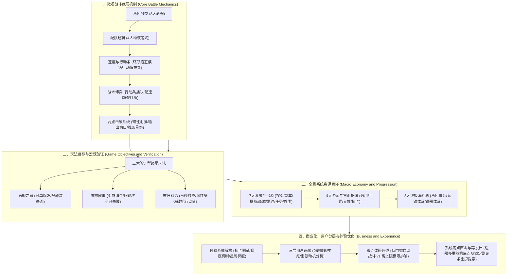

# 《星穹铁道》核心玩法拆解 · 深度分析与策划能力评估报告

> **分析对象**：`E:\游戏策划案\拆解案（20份）\3、《星穹铁道》核心玩法拆解.pdf`  
> **报告类型**：游戏系统与核心战斗逆向拆解深度评审 / 资深策划能力模型诊断  
> **撰写视角**：资深游戏主策划 / 制作人 / 行业导师  

---

## 1. 拆解案基本信息与架构全貌

### 1.1 文档基本信息
- **文档名称**：《星穹铁道》核心玩法拆解
- **文档篇幅**：10页（包含系统机制拆解、公式推导与高清系统资源循环大图）
- **文档类型**：**深度系统与核心战斗逆向工程拆解案**（涵盖战斗底层机制、队伍生态、验证型关卡、经济养成大闭环、商业化模型与体验评价）
- **分析对象**：《崩坏：星穹铁道》（米哈游研发运营的银河冒险题材回合制RPG）
- **核心模块覆盖**：
  1. **角色分类与配队生态**（8大命途定位、队伍构筑范式、多流派主C构筑逻辑）
  2. **回合制底层战斗设计**（速度环形跑道模型、行动值公式推导、调轴机制、弱点击破与输出窗口）
  3. **游戏目标与验证体系**（忘却之庭、虚构叙事、末日幻影三大终局副本的策略分工）
  4. **系统资源全景循环**（7大输入源、4大资源池、3大终极消耗池的全景拓扑）
  5. **商业化与体验分层评述**（抽卡保底、星魂梯度下放、三类用户画像、遗器随机性痛点及优化提案）

---

### 1.2 整体架构与行文逻辑结构图

本文档的行文逻辑极其严密，遵循了工业级策划分析的**“底层机制 $\rightarrow$ 上层生态 $\rightarrow$ 目标验证 $\rightarrow$ 经济循环 $\rightarrow$ 商业与体验洞察”**逐层递进逻辑：



---

## 2. 这篇拆解案“好在哪里”（深度亮点剖析）

### 亮点一：穿透黑盒表现，精准逆向出回合制底层数学模型（“环形跑道”与“行动值公式”）
多数初中级策划在分析《星穹铁道》回合制时，往往只停留在“速度高的先出手”、“速度快可以多出手”等感性定性描述。而本拆解案直接穿透到了底层白盒数学模型：
1. **环形跑道抽象模型**：
   - 将行动条抽象为全长为 $10000$ 的固定环形跑道；
   - 角色每单位时间（行动值）跑动的距离等同于角色的当前面板速度 $Speed$；
   - 剩余需要跑完的距离除以速度，即为到达终点获得行动机会所需的行动值（$AV$, Action Value）：
     $$AV = \frac{10000}{Speed}$$
2. **严密推导忘却之庭行动阈值**：
   - 拆解案准确指出了忘却之庭的轮次行动值规则：**第一轮固定为 150 点行动值，后续每轮固定为 100 点行动值**。
   - 进而推导出在实战和攻略圈中被奉为圭臬的“核心配速断点”：
     - **首轮二动阈值**：要在首轮 150 点行动值内跑完两次跑道（$2 \times 10000 = 20000$），角色速度必须满足：
       $$Speed \ge \frac{20000}{150} \approx 133.33 \implies 134$$
     - **首轮三动阈值**：
       $$Speed \ge \frac{30000}{150} = 200$$
     - **两轮四动阈值**：在两轮总行动值 $150 + 100 = 250$ 点内跑完 4 圈：
       $$Speed \ge \frac{40000}{250} = 160$$
3. **从数值模型升华到战斗体验掌控**：
   - 作者指出速度的本质是**“时间维度上的统治力”**——通过提速压缩敌方的行动窗口，扩张己方的回合数（如希儿再现、流萤2魂再动），形成正向滚雪球；
   - 结合终结技“强制无视行动条立即插队”的设定，构成了《星铁》动静结合的独特战斗节奏。

---

### 亮点二：抓住战斗博弈的核心心流设计——“韧性条”与“输出窗口期”的双重交织
本案对《星穹铁道》战斗系统的解构，精准命中了米哈游在传统回合制上做出的最大微创新：
1. **削韧机制的非数值膨胀特性**：
   - 明确指出不同技能类型的削韧量级规律：**终结技 > 战技 > 普攻**；
   - 犀利点出：除阮·梅等特定机制角色外，**绝大多数角色的削韧效率固定，不受角色练度、攻击力或暴击率影响**。这是一套独立于传统数值成长之外的硬性机制，确保了无论数值如何膨胀，机制克制与破韧节奏依然是高难副本的核心策略门槛。
2. **弱点击破的心流双重收益（防守打断 + 爆发窗口）**：
   - **防守端**：破坏敌方蓄力机制（如打断外宇宙之冰的灭团级AOE蓄力、银枝的高增益爆发），直接化解灭团危机；
   - **进攻端**：破韧后敌方获得行动延后并附加 $10\%$ 独立易伤，形成明确的**“策略准备期 $\rightarrow$ 弱点击破 $\rightarrow$ 输出爆发窗口期”**的高潮心流体验；
   - **流派拓展**：破韧伤害直接挂钩“击破特攻”与“角色等级/属性系数”，与双暴乘区完全解耦，为流萤、乱破、波提欧等击破C奠定了自成一派的底层数值土壤。

---

### 亮点三：全景闭环式“系统资源循环图”，展现工业级系统掌控力
拆解案第6页插入的高清系统资源循环大图，堪称整篇文档的“压舱石”，具备极高的专业水准：
1. **7大输入层（左侧系统入口）**：
   - **探索系统**（细分不可再生的宝箱/解密/世界货币，以及可再生的合成素材/怪物）；
   - **副本系统**（花萼金、花萼赤、凝滞虚影、历战余响周本）；
   - **商城系统**（小月卡、大月卡、星芒/余烬兑换、首充梦华）；
   - **挑战系统**（三大终局验证副本）；
   - **常驻系统**（模拟宇宙、差分宇宙、日常委托）；
   - **任务系统**（开拓任务、续闻、同行任务、冒险任务）；
   - **外围系统**（梦境护照、钟表小子雕像、潮汐馈赠等箱庭探索收集体系）。
2. **4大中间资源与货币池（中间枢纽）**：
   - 通用货币（信用点、黑塔债券、流光余晖）；
   - 稀有货币（星琼、古老梦华）；
   - 世界货币（黑塔币、冬城盾、巡镝、金表钞、艾迪恩代币等）；
   - 养成与抽卡物资（专票、通票、自塑尘脂、变量骰子等）。
3. **3大终极消耗池（右侧养成归宿）**：
   - 光锥体系（获取 $\rightarrow$ 等级 $\rightarrow$ 突破 $\rightarrow$ 精炼）；
   - 角色体系（获取 $\rightarrow$ 等级 $\rightarrow$ 突破 $\rightarrow$ 天赋 $\rightarrow$ 命座）；
   - 遗器体系（外圈4件套 + 内圈位面饰品2件套，主副属性多重强化）。
4. **闭环思维**：完整展示了以**“开拓力（体力）为时间节拍器”、“星琼/现金为付费调节杠杆”**的大型二次元商业游戏经济大循环。

---

### 亮点四：商业化设计与用户分层（User Persona）的心理动机剖析
拆解案跳脱出单纯的“列举充值档位”，而是从**商业心理学与玩家分层**角度进行了深度解构：
1. **0氪 / 微氪用户**：
   - 诉求：追求角色获取多样性与基底通关体验；
   - 行为：严密规划囤积星琼，放弃专武抽取，使用黑塔商店5星光锥或万金油4星光锥（如“舞舞舞”）作为下位替代；日常高额产出依托自动化挂机，维持高黏性留存。
2. **中氪用户**：
   - 诉求：性价比质变与核心战斗循环改善；
   - 行为：精准锁定**关键1星魂（机制优化/全队增益）与关键2星魂（行动机制质变）**。例如流萤2魂击破再动、黄泉2魂快速叠层、飞霄2魂追击加速充能、知更鸟1魂全队全属性抗性穿透；
   - 商业洞察：**米哈游将改变游戏机制的质变点前置在1-2星魂，极大地降低了付费心理门槛**，促使原本只抽0命的中低氪群体产生追加付费冲动。
3. **重氪用户**：
   - 诉求：极致大数字与绝对无视环境的碾压快感，直奔 6+5 与满魂机制全解禁。

---

### 亮点五：敏锐直击长线负反馈顽疾，并提出务实可落地的再设计提案
在对养成系统的分析中，作者毫不避讳地指出了《星铁》遗器养成带来的严重挫败感：
- **痛点拆解**：内外圈6个部位，等级上限15级，每3级强化一次副词条（共5次强化）。副词条池高达11-12种，且主属性排除对应百分比副属性。想要获得一个主属性对齐且强化5次均不歪的极品遗器，数学概率低至数万分之一；
- **现状批评**：现有的“自塑尘脂”（定向主词条）与“变量骰子”（重掷副词条），本质上只加速了胚子初筛，**未能解决强化过程中的多次随机偏歪与沉没成本过高的挫折感**；
- **策划再设计提案**：提出**“在使用骰子重掷之前，允许玩家消耗额外资源锁定1条满意的副词条”**。该提议非常克制且务实，既保护了玩家的核心付出底线，又维持了次要词条的随机长尾追求，避免了数值直接膨胀崩盘。

---

## 3. 体现了策划的什么核心能力（能力模型对照）

通过对该拆解案的文本与图表细节进行全方位审视，作者展现了一名成熟高级/主策划所应具备的五大核心能力：

| 策划核心能力维度 | 在本拆解案中的具体体现与证明 | 评级 / 水准 |
| :--- | :--- | :---: |
| **逆向工程与系统建模能力** | 能将复杂的动态行动条还原为“10000点环形跑道模型”，并推导出忘却之庭134速、160速等严密行动值断点；清晰解构削韧、易伤与击破特攻的独立乘区。 | **卓越 (Senior+)** |
| **全景系统架构与闭环思维** | 绘制出极高完成度的7大源头、4大枢纽、3大沉淀池的系统资源大循环图，具备工业化大型端手游的全局宏观架构视野。 | **卓越 (Lead级)** |
| **体验节奏与心流把控能力** | 深刻剖析弱点击破带来的“打断蓄力（防守安心感）+ 10%易伤与行动延后（爆发爽快感）”双重情绪曲线；理解自动战斗在日常降肝上的用户心智减负。 | **优秀 (Senior)** |
| **商业化与用户分层洞察能力** | 跳出表面数值，从0氪、中氪、重氪三类用户心理出发，透视“关键命座前置（1-2魂质变）”对拉动中氪转化的商业操盘手腕。 | **优秀 (Senior)** |
| **批判性思维与务实改版能力** | 直击遗器强化5次多重随机的负反馈痛点，不盲目提“全自选”等破坏经济寿命的幼稚案子，而是提出“锁定一条满意副词条后重掷”的务实平衡案。 | **优秀 (Senior)** |

---

## 4. 学习如何写策划拆解案（实战指南与方法论提炼）

从本篇优秀的《星穹铁道》拆解案中，我们可以提炼出一套可直接复用于求职作品集、竞品分析或立项前调研的高分拆解方法论。

### 4.1 优秀拆解案的工业化行文骨架（可复用模板）

```markdown
# [游戏名称] 核心玩法与系统逆向拆解分析报告

## 一、 核心战斗机制深度解构（底层白盒模型）
   1. 基础时空规则：时间/行动轴/行动点计算模型（数学公式推导）
   2. 交互与博弈循环：核心博弈点（如削韧、打断、硬直、属性克制）
   3. 队伍构筑与流派生态：职业/命途矩阵、配队协同乘区

## 二、 验证型玩法与目标牵引
   1. 核心循环验证：终局挑战副本的分工与针对性要求（对单/对群/机制攻坚）
   2. 目标递进阶梯：从主线引导到长线极限验证的心流阶梯

## 三、 全景系统资源流向与经济循环
   1. 系统拓扑大图：产出源 (Sinks) -> 货币与中间体 -> 消耗池 (Faucets)
   2. 时间与体力节拍器：日常/版本产出上限与资源回收控制

## 四、 商业化变现与用户分层模型
   1. 付费模型解构：抽卡期望、保底概率、付费深度与梯度设计
   2. 用户分层画像 (User Persona)：0氪、小中氪、大R的心理诉求与付费触发点

## 五、 系统评述与再设计（策划核心竞争力展现）
   1. 设计亮点剖析：好在哪里？解决了什么行业痛点？
   2. 体验缺陷诊断：长线负反馈点在哪里？导致了什么玩家流失风险？
   3. 优化与再设计方案：具体、可落地、兼顾商业与体验的改进设计案
```

---

### 4.2 应借鉴的高分技巧与闪光点
1. **用数学公式与逻辑模型取代文学修辞**：
   - 严禁写“速度很快，能打很多下”，必须写“跑道总长10000，忘却之庭首轮150AV，速度 $\ge 134$ 达成首轮二动”。数学推导是策划专业度的第一分水岭。
2. **务必绘制清晰的“全景系统架构/资源流向图”**：
   - 一张专业绘制的资源循环大图胜过万字白描。它不仅展示了你对被拆解游戏的理解，更直接向面试官或团队证明了你具备搭建大型复杂系统的能力。
3. **引入“User Persona（用户分层画像）”**：
   - 游戏不是为一种人设计的。将系统设计拆解到不同氪度、不同精力投入的玩家行为上，能立刻体现出高级策划的业务大局观。
4. **建议案必须兼顾“玩家体验”与“开发商利益”**：
   - 提建议最忌讳“玩家视角狂欢”（如要求遗器词条全自选）。优秀的策划方案必定是在“提升玩家保底体验”与“维持长线追求与养成卡点”之间找到最佳平衡点（如本案的“锁定1条后重掷”）。

---

### 4.3 必须规避的四大误区
1. **误区一：游戏说明书化与界面流水账**
   - 大幅截取游戏UI界面，花费大量篇幅写“点击这个按钮可以强化，强化需要消耗材料”。这种属于纯粹的内容搬运，零思考含量。
2. **误区二：只分析“是什么”，不探究“为什么”**
   - 知道《星铁》有8种命途不算本事，能讲清楚为什么分为8种命途、虚无命途为何会分化出DOT与黄泉直伤两个完全不同的分支、为什么必须有弱点击破独立于攻击力，才是真正的策划思维。
3. **误区三：割裂战斗与经济系统**
   - 很多拆解案只聊战斗怎么打，或者只列商城卖什么，忽视了“战斗机制（击破/弱点） $\rightarrow$ 养成驱动（遗器词条/行迹） $\rightarrow$ 体力消耗与限时轮换 $\rightarrow$ 商业化卡池”的联动链条。
4. **误区四：空洞批评缺乏建设性提案**
   - 仅抱怨“遗器太坑、概率太毒”，但给不出具体的数值期望缓解方案和系统机制补丁，这是普通玩家的吐槽，而非专业策划的分析报告。

---

### 4.4 在求职与项目实战中的应用指南
- **对于求职者（应聘数值/战斗/系统策划）**：
  - 如果在作品集中呈现一份类似本案包含“环形跑道公式推导 + 终局三副本分层 + 资源循环全景图 + 务实重掷锁定改版”的拆解案，能瞬间击败90%以上仅有主观感想与UI截图的竞争者。
- **对于在研项目团队（二次元回合制立项/调优）**：
  - 本拆解案可直接作为“现代轻度化回合制RPG”的标准参考标杆：如何用“自动战斗+弱点击破+行动插队”解决传统回合制枯燥慢节奏的通病，如何前置核心机制以激活中端用户付费，具有极高的实战参考价值。
