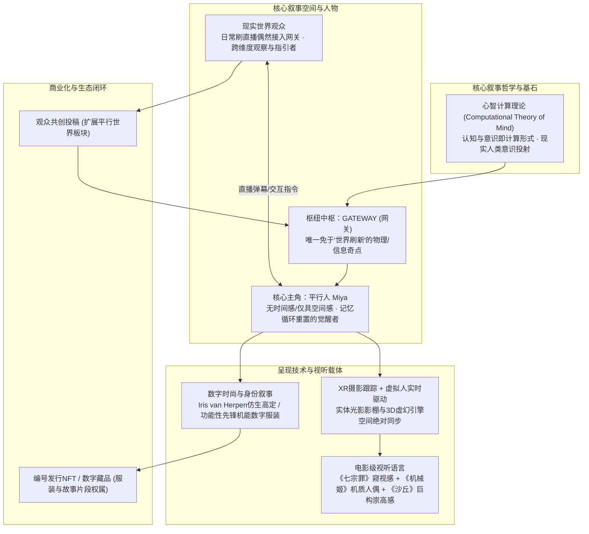
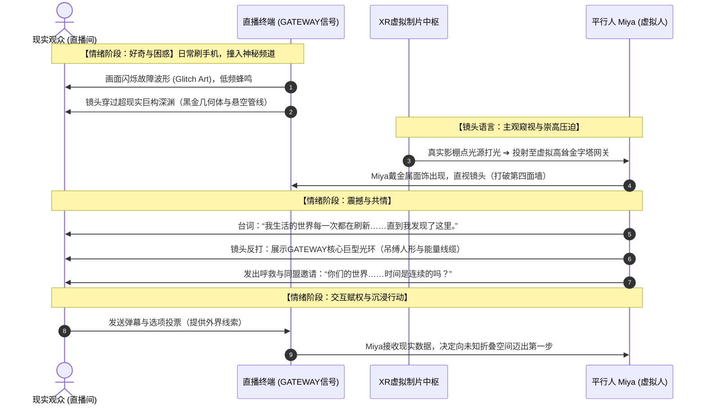
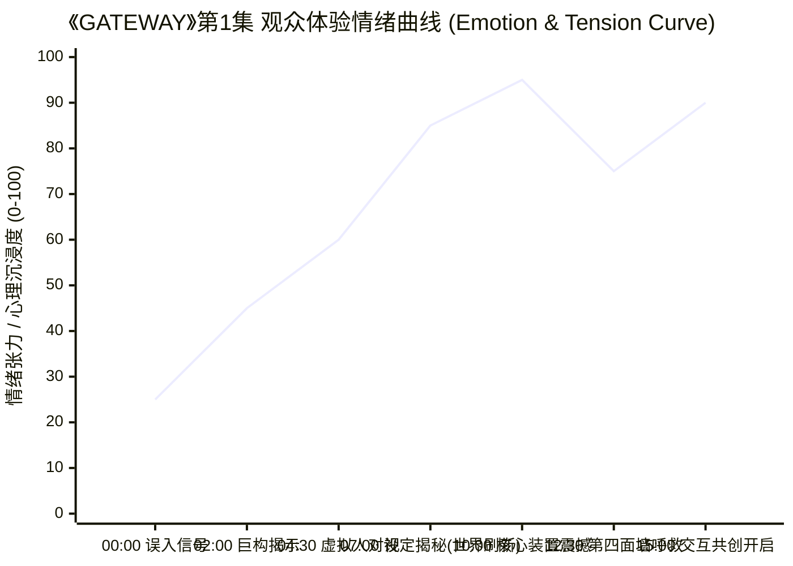

# 深度分析报告：GATEWAY 电影脚本与交互叙事企划案

> **文档基本信息**
> - **文档原名**：`4、GATEWAY 电影脚本.pdf`
> - **出品组织/品牌**：ORIMENTAL（创建于 2022年3月）
> - **文档体裁**：元宇宙/XR直播互动电影剧场 · 叙事IP概念企划与电影脚本
> - **分析专家**：资深游戏主策划 / 叙事总监 (Principal Game Designer & Narrative Lead)
> - **报告保存路径**：`E:\游戏策划案\拆解案分析报告\04_GATEWAY电影脚本_深度分析.md`

---

## 1. 拆解案基本信息与脚本架构全貌

### 1.1 企划定位与跨媒介叙事属性
《GATEWAY》并非一份传统的单机线性电影剧本，亦非标准的游戏系统GDD（Game Design Document），而是一份具有极高前瞻性的**“跨媒介XR直播互动电影剧场”（Live-Streaming XR Interactive Cinema & Metaverse Narrative IP）企划兼第1集电影脚本设定案**。

该方案诞生于2022年初（Web3、数字人与XR技术交汇的高峰期），其核心是将**硬科幻哲学假说（心智计算理论 CTM）**、**XR虚拟制片实时直播（Virtual Production & Motion Tracking）**、**数字时尚（Digital Haute Couture）**与**观众参与式共创叙事（Participatory Narrative）**进行深度四位一体融合。



---

### 1.2 故事大纲与第一集《序幕—秘密地》视听镜头逻辑

文档展示的故事内核带有强烈的**后人类主义（Posthumanism）**与**模拟假说（Simulation Theory）**色彩：
- **世界设定（Ontological Trap）**：Miya所处的平行世界是一个“不定期执行全面垃圾回收与重置（Garbage Collection & Memory Flush）”的计算切片。每次世界重置，地形拓扑重构、人群凭空蒸发，住民的记忆随之清空。
- **觉醒机制（The Anomaly）**：Miya在某次重置的临界点发现了系统豁免区——GATEWAY（网关）。在此处，她保留了跨周期的记忆连续性，直面了庞大闪烁的未知机械装置，并意外捕获了现实世界的网络直播信号。
- **跨维度交互（The Trans-dimensional Contact）**：Miya的认知从“习以为常的荒诞日常”瞬间跃迁为“自我为囚徒、现实人类为神明/外部观察者”的本体论震撼（Ontological Shock），进而向直播间屏幕另一端的现实观众发起求助与交流。

#### 第1集《序幕—秘密地》叙事节奏、视听镜头与情绪曲线流转图





---

## 2. 这篇策划/脚本“好在哪里”：深度亮点剖析

### 2.1 叙事哲学底座坚实：从认知科学与哲学引申出的世界观
绝大多数互动剧或虚拟人企划往往停留在简单的“赛博朋克霓虹灯 + 换装少女”的浮层，而《GATEWAY》在第4页直接引入了认知哲学史上著名的**心智计算理论（Computational theory of mind, CTM）**与**麦卡洛克-皮茨神经元模型（McCulloch-Pitts Neuron, 1943）**。
- **底层逻辑的闭环**：该设定巧妙地将“虚拟世界的Bug、卡顿、资产重置、图层刷新”从程序技术限制，升华为**游戏世界内的物理法则与哲学宿命**。
- **人性的新试验场**：现实人类的每一次直播围观、互动、弹幕发送，在CTM理论下均被定义为“人类集体意识算力的投射”。这种设定赋予了玩家/观众正当的“创世者”与“外部观察者”身份，完全消解了传统虚拟人直播中“皮套人表演”的虚假感。

### 2.2 叙事核动力（Dramatic Engine）：独特的认知不对称与“时间 vs 空间”哲学反差
在第5页的故事大纲中，策划构建了一个极为精妙的角色认知缺陷：
> *“每一次世界刷新，她的记忆也被刷新，所以她没有概念中的时间，只有空间的意识。这些空间以一种奇特的结构交错连接，她从来没有真正去探索过她的世界，因为她生活的地方每一次都是崭新的。”*

- **打破常规的感知设定**：一般穿越/循环作品（如《土拨鼠之日》《开端》《命运石之门》）均依赖角色累加“时间维度的记忆经验”来破局；而Miya却拥有**“空间拓扑觉醒、时间线性剥离”**的逆向属性。
- **驱动力设计**：GATEWAY是全宇宙唯一不受垃圾回收机制影响的“静态缓存区”。Miya在此处驻留，获得了全宇宙唯一的“跨周期记忆持久化”特权。这种“孤独觉醒者面对冷酷刷新机制”的剧作矛盾，天然具备惊悚悬疑与悲剧崇高感。

### 2.3 顶级视觉通感与视听语言标杆（Moodboard & Visual Directing）
文档第6至10页展现出专业电影导演级别的构图考量与美术审美品味：
1. **《七宗罪》（Se7en）的窥视与局促**：狭窄盒缝的视线裁切，代表人类窥探未知次元时的战栗与未知。
2. **《机械姬》（Ex_Machina）的仿生异化感**：半透明颅骨、暴露的线缆与冷色背光，暗示Miya乃至所有平行人可能皆为运行在底层硬件上的代码具象化。
3. **《沙丘》（Dune）的巨物崇高感（Gigantism）**：巨大的几何立方体、倒三角核心反应堆、漫天悬挂的高压线束与吊缚人像，通过极致的人神体量对比（Human vs Monolith），唤起观众对计算法则的敬畏。
4. **先锋数字高定（Digital Haute Couture）**：参考Iris van Herpen与Met Gala前卫造型（Grimes等），将数字服装从简单的“游戏皮肤”转变为“携带底层算法内涵与维度扩展密钥的叙事载体”。

### 2.4 XR虚拟制片与工业化管线落地性（Page 10关键洞察）
文档第10页给出了极具工业价值的对比图：
- **左图**：实体物理影棚内的真实演员动捕表演、体积雾与线性阵列物理聚光灯；
- **右图**：虚幻引擎（UE）中完全对应的数字孪生巨构长廊、倒三角发光圣所与高反射地面积水。
这证明作者不仅具备天马行空的编剧想象力，更完全通晓**虚拟制片（VP, Virtual Production）与XR摄影机跟踪（Camera Tracking）的视差匹配与光影映射逻辑**。策划在撰写脚本时，就已经在为实际XR影棚的灯光机位、动捕空间、Actor视线交互做工程化推演。

---

## 3. 体现了策划的什么核心能力（能力模型对照）

| 策划核心能力维度 | 在本案中的具体体现与证明 | 评级 (S/A/B) |
| :--- | :--- | :---: |
| **世界观构建与哲学抽象能力** | 能将认知哲学（CTM理论）与神经计算学无缝降解为通俗易懂但立意极高的叙事舞台，跳出传统换皮网游流水线套路。 | **S** |
| **视听语言与镜头导演思维** | 熟练运用主观窥视、景深对比、巨物几何构图、冷暖撞色等电影级视听语法，使文字提案具备强烈的画面感与沉浸预设。 | **S** |
| **跨媒介交互与系统闭环思维** | 将直播弹幕、XR动捕、观众共创投稿（UGC）、数字时尚（NFT）串联为相互输送营养的叙事生态，而非孤立模块。 | **A+** |
| **新兴工业化制片认知** | 深刻理解LED虚拟影棚/XR虚实融合管线，知道如何将真实演员物理表演无缝映射到虚拟空间角色身上。 | **A+** |
| **待补强：交互规格书与分支落地细节** | 方案偏向宏观高概念与宣发级Pitch Deck，缺少游戏策划案必备的“弹幕交互触发条件”、“分支树逻辑”与“具体演出对话脚本”。 | **B+** |

---

## 4. 学习如何写游戏剧情脚本与叙事拆解案（实战指南与方法论提炼）

从《GATEWAY》这份充满前锋艺术感与前沿技术融合的提案中，游戏文案策划与叙事设计师可以提炼出极具实战价值的高阶创作方法论。

### 4.1 高概念交互电影/叙事案标准模板骨架（可复用框架）

```markdown
# [项目代号/世界观名] 跨媒介交互叙事策划方案

## 一、高概念定位 (The High Concept & Proposition)
1. 一句话核心玩法与叙事钩子 (Logline & Narrative Hook)
2. 哲学/科学基石理论 (Theoretical Foundation，如CTM、量子纠缠、社会达尔文等)
3. 媒介载体与技术选型 (Engine / XR / Live Interactive Pipeline)

## 二、世界观法则与底层机制 (World Bible & Mechanics)
1. 世界核心运转法则 (The Prime Laws，如时间重置、能量守恒、记忆擦除等)
2. 异常与打破点 (The Anomaly，主角觉醒的物理/程序原罪)
3. 空间与地理拓扑 (Spatial Topology，固定中枢 vs 动态刷新区)

## 三、角色生态与认知模型 (Character Arc & Cognitive Models)
1. 主角认知限制与动机 (What they know vs What they lack)
2. 玩家/观众的维度身份定位 (Spectator / Hacker / God / Guardian Angel)
3. 角色视效与服装设计语义 (Costume as Narrative & Lore)

## 四、分集大纲与交互演出逻辑 (Episodic Beats & Interaction Logic)
1. 每集核心戏剧节拍 (Dramatic Beats) 与情绪曲线
2. 分镜头视听语言与影棚/引擎机位预设 (Cinematography & Lighting)
3. 观众输入与剧情分支状态机 (Input ➔ State Machine ➔ Rendered Branch)

## 五、生态闭环与商业化衍生 (Ecosystem & Monetization)
1. UGC共创接入管线 (Community Co-creation Pipeline)
2. 虚拟资产/数字周边衍生规范 (Digital Assets / Fashion IP)
```

---

### 4.2 策划应借鉴的高分技巧与闪光点

1. **“把技术缺陷转化为世界观核心魅力”**
   - 在XR和实时渲染项目中，模型丢失、场景刷新、网络延迟是常见技术痛点。《GATEWAY》反其道而行之，把“内存刷新导致的世界重构”设计为世界核心物理定律，不仅合理解释了虚拟资产的热更新，更让主角的探索具有了哲学层面的悲怆感。
2. **“为观众的每一次输入寻找游戏世界内的正当性解释（Diegetic Justification）”**
   - 很多互动游戏（如《底特律：成为人类》《黑镜：潘达斯奈基》）中玩家的按键只是纯粹的上帝UI指令。而本案将直播观众解释为“现实世界的真实人类偶然抓取了泄露的网络网关信号”，观众发弹幕、选选项即是在向虚拟世界传输“外界真实意识算力”。**让UI界面世界观化（Diegetic Interface），是顶级叙事策划的必修课。**
3. **“数字时尚（Digital Fashion）赋能叙事深度”**
   - 不要把角色外观当成纯粹的“卖皮肤”。像《GATEWAY》一样，将服饰的面料、材质流动、异化几何口罩与角色所处的阶级、运算层级、记忆封印状态深度绑定，让资产具备收藏价值与文化附加值。

---

### 4.3 需要警惕与规避的误区（针对本案的反思与改进）

虽然《GATEWAY》在概念、哲学与视觉表现上堪称惊艳，但若将其作为一份合格进入工业量产阶段的**“游戏剧情脚本/策划拆解案”**，它仍存在明显的**“空灵有余、工程细节不足”**的硬伤：

1. **误区一：止步于“故事大纲”，缺乏分镜头脚本（Script Breakdown）与台词台本**
   - *问题*：第7页第一集仅有短短4行文字概述，没有写出Miya与现实观众具体说了什么台词，没有镜头景别（全景/中景/特写）、摄像机运动方式（推拉摇移）以及音效（SFX/BGM）标记。
   - *改进指南*：必须补齐好莱坞标准两列表格或标准剧本格式（包含场景头 Slugline、动作描写 Action、人物名 Character、对白 Dialogue 及括号提示 Parenthetical）。
2. **误区二：交互机制过于理想化，缺乏“异常弹幕与恶搞风控”方案**
   - *问题*：方案设想“观众共创投稿”、“直播弹幕深度互动”，但在真实直播流中，网络喷子（Trolls）、复读机弹幕和破坏性输入会迅速摧毁严肃高冷的硬科幻氛围。
   - *改进指南*：策划必须设计**“语义过滤器”与“结构化交互面板”**（例如限制为3个带有不同态度倾向的指令投票，或采用AI大模型进行语义分类后再生成符合人设的动态回应）。
3. **误区三：商业化概念（NFT/Web3）与内容体验的割裂风险**
   - *问题*：在文档第2页赫然列出“编号发行NFT”，如果在未建立扎实的IP情感共鸣前急于兜售NFT，极易被当代年轻玩家视为“圈钱泡沫”而引发心理抵触。
   - *改进指南*：叙事策划应当坚持**“故事价值优先”**，先用过硬的短片内容积累忠实受众，再将共创成功的经典桥段或专属定制皮肤作为荣誉铭刻进行数字化确权。

---

### 4.4 策划求职与项目实战中的应用实操建议

如果你要在求职作品集（Portfolio）或项目提案中输出类似《GATEWAY》的高概念叙事企划，请牢记以下**制作人维度的审查准则**：
- **拒绝空中楼阁，给出技术原型的落地路径**：如果你写了“XR跟踪”或“AI交互”，在企划案最后务必附带一页简单的**技术架构拓扑图**（如：UE5 + Live Link Face + OptiTrack + 本地部署DeepSeek/GPT驱动虚拟人对话）。
- **情绪曲线量化呈现**：用坐标图直观呈现你的关卡/剧集情绪曲线（紧张度、悲伤度、解谜快感），向制作人证明你懂得精确操控玩家的心流节奏。
- **提供一段样板级台词剧本（Vertical Slice Script）**：即使只写第1集，也要挑出最核心的3分钟高潮片段，展示你精湛的对白潜台词把控力与视听镜头调用能力。

---
*报告生成完毕，已结构化归档至策划知识库。*
