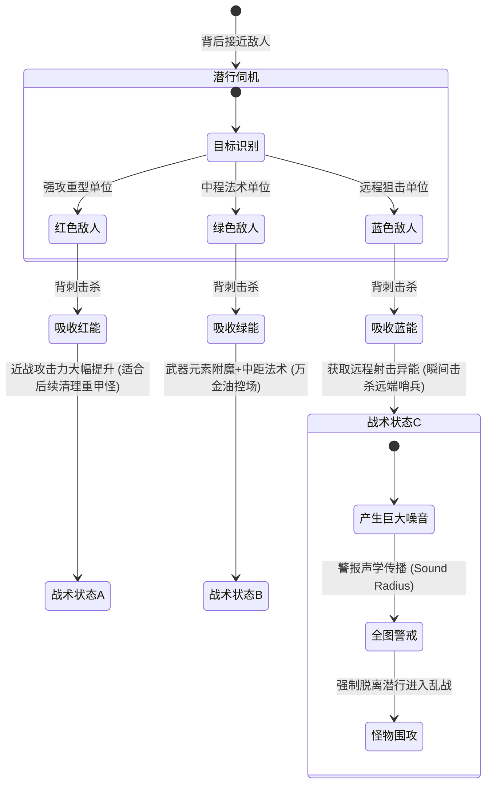

# <深度分析报告：关卡设计作品集（郭奕明）>

---

## 1. 拆解案基本信息与架构全貌

### 1.1 作品集基本信息与定位属性

- **文档名称**：关卡设计作品集（Game Design / Level Design Portfolio）
- **设计作者**：郭奕明（个人主页：https://guoyiming.net/ / 邮箱：gym7667@163.com）
- **文档体量**：15页 PDF 幻灯片作品集
- **核心定位属性**：复合型关卡设计师（Level Designer / Technical Designer / Technical Artist）校招与初阶求职作品集。该作品集打破了国内传统策划“纯文案设定”或“纯数值倒推”的单薄局限，涵盖了 **3D动作潜行关卡设计**、**2D机制叙事解谜关卡设计**、**45°俯视角派对玩法设计**、**开放世界大地形环境美术（TA）**、**AIGC反派概念设计** 以及 **底层程序化生成算法复现（WFC + Marching Cubes）** 六大复合模块。
- **分析对象模块矩阵**：

| 模块编号 | 项目名称 | 游戏类型 / 领域 | 核心设计命题 / 技术验证 | 核心关卡与玩法机制 |
| :--- | :--- | :--- | :--- | :--- |
| **Module 1** | **噩梦旅馆 (Hotel Nightmare)** | 第三人称3D恐怖冒险 | 线性压抑空间动线、地标视线诱导与潜行暗杀策略分流 | 走廊中枢透视终点、暗杀三种敌人（红/绿/蓝）窃取异能、隐藏BOSS与密道绕路双选择 |
| **Module 2** | **找回猫猫 (Find Cat)** | 45°俯视角多人派对 | 空间动态博弈、公共资源争夺与多阶段规则约束 | 四阶段任务循环（找猫/买用品/体检/洗澡）、红黄绿灯全局状态机、随机车辆碰撞惩罚 |
| **Module 3** | **Balloon** | 2D横版跳跃心理恐怖 | 机制与空间叙事互锁（叙事玩法合一）、反向成长机制 | 逆向超级马里奥机制（自残致角色变弱/缩小/减重），利用狭小地形通道通关，映射抑郁症创伤 |
| **Module 4** | **落袈岛 (Cassock Falls Island)** | 开放世界环境美术 / 地编 | 真实地形程序化重构、卡通渲染管线与视距性能预算 | 舟山洛珈岛高度图导入 Gaea 强化垂直高差与侵蚀，Unity Toon Shader、Splat Map分层与三级LOD剪影优化 |
| **Module 5** | **宿命之眼 (Eye of the destiny)** | 概念角色设计 / AIGC | 关卡反派BOSS视觉语义构建、ControlNet工作流落地 | “执念/时间/幻象”核心三词、“圆母题”提炼，克苏鲁+Scorn生物科技，精准Prompt与生图筛选管线 |
| **Module 6** | **Townscaper 玩法代码复现** | 玩法程序开发 / PCG技术 | 几何网格拓扑拟合、波函数坍缩与等值面网格提取 | 正六边形两次四边形细分、松弛有机网格迭代（Relax times 100~200）、3D空间顶点8位二进制状态码查表 |

---

### 1.2 核心关卡空间动线与拓扑架构（以《噩梦旅馆》为例）

在《噩梦旅馆》中，设计者采用了经典的 **“中心走廊脊柱（Spine/Hub-and-Spoke）+ 区域透视（Visual Framing）+ 终端分支选择（Branching Climax）”** 的拓扑架构。从新手长廊开始，玩家即可一眼望穿终点核心（Weenie地标原则），但在推进过程中通过空间转折、遭遇战切断、异象房间穿插，在保障强方向感的同时制造恐怖悬疑与心流波动。

```mermaid
flowchart TD
    subgraph S1["阶段一：新手启程与宏观视线锚定"]
        A["起点：故事引导与新手教学区"] --> B["笔直长廊：视线框架 (Visual Framing)"]
        B -. "视线直贯（保留悬念）" .-> H["终点：噩梦核心 (Nightmare Core)"]
    end

    subgraph S2["阶段二：战斗机制展开与战术博弈"]
        B --> C["遭遇战区域 (Combat Encounter)"]
        C --> C1["潜行暗杀红怪：大幅提升攻击力（近战破盾流）"]
        C --> C2["潜行暗杀绿怪：武器附魔+中距魔法（均衡流）"]
        C --> C3["潜行暗杀蓝怪：获远程枪械，但触发巨大声响全图警报（高风险）"]
        C1 & C2 & C3 --> D["战术结算与状态恢复"]
    end

    subgraph S3["阶段三：超现实空间变奏与心流释放"]
        D --> E["魔幻变换场景（跳跃平台 + 经典恐怖片彩蛋致敬）"]
        E --> E1["收集品探寻：黄色能量球（支线诱因）"]
        E --> F["空间开阔区：自由探索与心流休整 Hub"]
    end

    subgraph S4["阶段四：高潮决策与通关路径双轨分流"]
        F --> G1["路径A：隐藏BOSS竞技场（高风险·高回报·直接抵达）"]
        F --> G2["路径B：环境解谜与隐藏密道（低风险·探索收益·绕路通关）"]
        G1 & G2 --> H
        H --> I["梦境净化 / 游戏通关结算"]
    end

    style B fill:#1f3a5f,stroke:#4a90e2,stroke-width:2px;
    style H fill:#5c1d1d,stroke:#e74c3c,stroke-width:2px;
    style C fill:#2d4a22,stroke:#2ecc71,stroke-width:2px;
    style G1 fill:#784212,stroke:#f39c12,stroke-width:2px;
    style G2 fill:#114b5f,stroke:#1abc9c,stroke-width:2px;
```



---

### 1.3 关卡节奏心流波形图（Level Pacing & Beat Sheet）

关卡设计师必须精通 **“紧张度（Tension）与释放（Release）”** 的曲线编排。在作品集中，《噩梦旅馆》展现出了教科书般的8节拍心流结构：

```
紧张度 (Tension)
 100% |                                      [节拍7A: 隐藏BOSS战]
      |                                              /\
  80% |                  [节拍2: 潜行遭遇战]           /  \      [节拍8: 净化核心]
      |                        /\                   /    \            /\
  60% |                       /  \   [节拍4: 惊悚彩蛋] /      \          /  \
      |                      /    \      /\        /        \        /    \
  40% |    [节拍1: 长廊远眺]  /      \    /  \      /   [节拍7B: 密道绕行]  /      \
      |         /\          /        \  /    \    /          \      /        \
  20% |  教学  /  \ 悬疑压抑/          \/      \  /            \    /          \ 通关释放
      |  ___/    \________/                    \/              \__/            \______
   0% +----------------------------------------------------------------------------->
      Beat 1     Beat 2       Beat 3   Beat 4   Beat 5  Beat 6    Beat 7A/7B   Beat 8
       引导       遭遇战       异象收集  心理惊悚 复合玩法  自由探索   Boss/密道决策  梦境净化
```

#### 《噩梦旅馆》关卡节拍表（Level Beat Sheet）深度拆解：

| 节拍编号 | 关卡阶段 | 空间尺度 / 几何特征 | 核心玩法与心流体验 | 情绪关键词 |
| :--- | :--- | :--- | :--- | :--- |
| **Beat 1** | 新手教学与长廊远眺 | 极度狭长且笔直的封闭走廊，远处留有强光源与目的地轮廓 | 完成基础移动交互教学，利用长廊建立视线框架（Visual Framing），直击终点但隔绝细节 | 压抑、神秘、好奇 |
| **Beat 2** | 潜行战术遭遇战 | 多转角、带有视线遮挡柱体与巡逻路径的封闭大厅 | 引入三色潜行击杀机制。红色（近战）、绿色（魔法）、蓝色（远程+全图警报），形成动态博弈 | 紧张、屏息、策略抉择 |
| **Beat 3** | 异象变换与收集品引导 | 重力失真、空间翻转的噩梦畸变空间 | 穿插平台跳跃与黄色光球收集，提供战斗后的认知释放，利用面包屑（Breadcrumbs）引导探索 | 惊奇、探索、轻微心流释放 |
| **Beat 4** | 经典恐怖致敬与环境叙事 | 狭窄转角与特定构图的闭合房间 | 向经典恐怖电影/游戏致敬的环境道具（如血手印、双胞胎、留声机），深化心理恐怖 | 惊悚、心理压迫、共鸣 |
| **Beat 5** | 复合机制联动区 | 包含高低差平台、门禁机关与潜行敌人的垂直复合结构 | 跳跃、战斗、轻度环境解谜（获取钥匙/开启电闸）立体融合，机制综合考验 | 专注、烧脑、心流峰值 |
| **Beat 6** | 自由探索中枢（Hub） | 开阔、多连接口、带有安全庇护感与微弱暖光的空间 | 关卡后期缓冲带。切断主线压迫感，给予补给，允许自由搜集资源并铺垫决战情报 | 喘息、准备、安全感 |
| **Beat 7** | 路径分流高潮（二选一） | **分支A**：高压圆形竞技场（Arena）<br>**分支B**：幽暗曲折的通风管道/密道 | **路径A**：正面硬刚隐藏BOSS，高难度操作换取丰厚掉落与捷径；<br>**路径B**：细致环境侦测，找到狭窄密道绕行避战 | 极限刺激（Boss）/ 谨慎成就感（密道） |
| **Beat 8** | 核心净化与终局结算 | 宏大穹顶神殿，中央悬浮噩梦核心 | 摧毁梦境核心，视觉由昏暗猩红转为明亮纯净，完成叙事弧光与心理闭环 | 释放、宣泄、救赎感 |

---

### 1.4 核心机制展开图与博弈逻辑

以作品集中的两个代表性项目为例，展示其机制与关卡地形的强耦合：

#### ① 《噩梦旅馆》暗杀夺能三元博弈机制（Rock-Paper-Scissors with Sound Propagation）


#### ② 《Balloon》逆向超级马里奥机制（Mechanic-Level Coupling Matrix）
传统横版跳跃的底层循环是“吃道具 $\rightarrow$ 角色增大/强化 $\rightarrow$ 砸碎巨石/跳得更高 $\rightarrow$ 突破物理障碍”。
而在《Balloon》中，作者反其道而行之，构建了 **“逆向削弱（Inverse Progression）”** 机制：

$$\text{交互特定道具（创伤/自残隐喻）} \longrightarrow \text{角色形体缩减 / 质量减轻 / 失去跳跃能力} \longrightarrow \text{得以穿透极狭小裂缝 / 顺应上升气流} \longrightarrow \text{解锁全新推进动线}$$

这种机制让关卡空间的物理几何尺寸（狭窄孔隙、极低横梁）与角色的生理形态变化产生了不可逆的深度绑定。

---

## 2. 这篇作品集“好在哪里”（深度亮点剖析）

作为一个综合性关卡设计作品集，其专业成熟度远超普通初级策划应届生的作品。以下从关卡设计专业维度的四个核心亮点展开深入剖析：

### 2.1 空间语言与视觉引导体系的高水准运用

在 3D 关卡设计中，最忌讳的是让玩家在昏暗复杂的场景中“无所适从、迷失方向”。作者在《噩梦旅馆》中展现了老道的主机级关卡构图技巧：

1. **“地标原则（The Weenie Principle）”的前置透视运用**：
   - 作品集第4页与第5页明确指出：“利用旅馆笔直的走廊，方便玩家从最初就能看到关卡的最终目的地，明确关卡的方向和引导”。
   - 这与迪士尼乐园用灰姑娘城堡（Castle）、《风之旅人》用发光的远山（Mountain Peak）、《半条命2：第一章》用17号城核心城塔（Citadel）在开局为玩家注入“北极星目标”的设计手法如出一辙。玩家在整个长达数十小时的潜行与迷茫中，脑海中始终保留着终极空间坐标。
2. **“面包屑（Breadcrumbs）”视觉线索指引**：
   - 关卡中清晰标注使用“黄色发光球体（Yellow Orbs）”作为收集品和视线诱饵。在阴暗压抑的蓝黑色恐怖主色调中，黄色高明度光源不仅是收集要素，更在无形中充当了指引玩家探索岔路、高低落差台阶的“视觉路标（Visual Signposting）”。
3. **“框架构图（Visual Framing）”与电影化视线遮挡**：
   - 利用狭长的走廊形成天然的单点透视框景，两旁的门框、破败管道形成前景遮挡，将玩家的摄像机视线死死锁在终点的微光上，极大增强了幽闭恐惧（Claustrophobia）与向前探索的张力。

---

### 2.2 叙事与玩法的深度互锁（Ludonarrative Resonance）

普通策划做关卡往往是“美术画个好看的图，策划在上面放几个怪”，机制、故事和空间完全脱节。本作品集最惊艳的亮点之一在于 **将沉重的心智叙事完美转化为关卡底层动力学**：

1. **《Balloon》的“反向马里奥”生理机制与心理疾病映射**：
   - 探讨抑郁症、自残与躯体化障碍是一个极高难度的叙事命题。作者摒弃了“旁白念诗、文字独白”的廉价叙事，而是设计了“戳破气球缩小自身”的自残机制。
   - 玩家要想通关，必须主动承受伤害、削弱自身机能、缩减体积，钻入压抑逼仄的孔洞。在关卡体验上，玩家切身体会到抑郁症患者“不得不伤害自己才能勉强在狭窄缝隙中生存”的窒息感。机制与关卡空间的物理咬合，达成了顶级的“叙事玩法合一”。
2. **《噩梦旅馆》潜意识投影的生态构建**：
   - 作家的噩梦化作旅馆空间，沿途向经典恐怖片致敬的碎片化陈列（Environmental Storytelling），本质是作家潜意识中恐惧记忆的涌现。敌人不是无由来的野怪，而是心魔的具象化，最终通过刺杀梦魇、净化梦境核心达成心智救赎。

---

### 2.3 遭遇战设计的动态博弈与声学边界（Tactical Encounter Design）

在《噩梦旅馆》的战斗区域设计中，作者没有设计单一的数值对决，而是设计了一个兼具“战术策略”与“物理环境反馈”的潜行遭遇战系统：

1. **差异化能力赋予（Ability Siphoning）**：
   - 击杀红怪获近战爆发、绿怪获附魔中程、蓝怪获高爆狙击。关卡策划在房间内通过怪物的站位组合，直接塑造了不同的解题策略（Puzzle Combat）。
2. **声学传播半径机制（Sound Propagation & Alert Level）引入的极高风险**：
   - 文档中极其敏锐地指出：“暗杀蓝色敌人可获得远程射击能力，**但暗杀蓝色敌人会发出巨大声响并惊动附近所有敌人**”。
   - 这一设计堪称点睛之笔！它打破了传统潜行游戏“远程无脑虐AI”的无敌平衡漏洞，给强力能力挂上了“警报引怪（High Risk, High Return）”的负面代偿。玩家在选择刺杀蓝怪前，必须精确推演自身走位、周围敌人的巡逻视线和声学警戒半径，让遭遇战具备了极高的重玩价值与紧张感。

---

### 2.4 罕见的跨界“技术关卡/TA”全栈落地能力

作品集后半部分（第10-15页）展现出的技术工程硬实力，足以在众多只会做PPT的策划求职者中形成降维打击：

1. **开放世界大地形（Gaea $\rightarrow$ Unity）地编管线闭环**：
   - 选取现实舟山洛珈岛高度图，利用 Gaea 侵蚀算法人为加大山峰高差与水流下切沟壑，将自然地形“戏剧化/关卡化（Dramatization of Topography）”；
   - 提出多通道 Splat Map 材质融合，并制定严格的性能预算策略：近景 LOD0 具备边缘描边与双色阶 Toon 渲染，远景 LOD1 切换为无描边深色剪影，极远处利用距离雾完全剔除。这一逻辑完全符合商业级主机/大世界项目的地编工程规范。
2. **Townscaper 算法级复现（WFC + Marching Cubes）**：
   - 作者不仅理解关卡的美学与动线，更深入到底层网格生成逻辑：
     - 正六边形 $\rightarrow$ 三角形/平行四边形 $\rightarrow$ 全四边形（Quads）的两级细分；
     - 敏锐记录了网格松弛拟合算法中 `Relax times` 参数从 0、5、100 到 5000 的形变演变，科学选定 100~200 作为有机方网格平衡点；
     - 在 3D 堆叠中运用 Marching Cubes 经典的 8 位二进制顶点状态编码（$2^8=256$ 种拓扑查表），并设计了全1（`11111111`）时判定为模型内部空腔、执行背面剔除（Back-face/Internal Culling）以节约 Draw Call 的性能优化方案。
   - 这证明了作者具备成为 **技术关卡策划（Technical Level Designer, TLD）** 或 **程序化关卡策划（PCG Designer）** 的绝佳底子。

---

## 3. 体现了策划的什么核心能力（能力模型对照）

结合网易、腾讯、育碧等国内外一线大厂对 **关卡策划（Level Designer）** 的核心能力胜任力模型，本作品集映射出的能力图谱对照如下：

```
关卡策划胜任力雷达图 (Level Design Competency Radar)
                    空间几何规划 (Spatial Layout)
                             [ 9.0 ]
                               /\
                              /  \
     玩法机制与白模互锁     /    \     遭遇战与心流编排
    (Mechanic-Coupling)     /      \   (Encounter & Pacing)
          [ 8.5 ]          /        \        [ 8.0 ]
                          /          \
                         /            \
                        /              \
    环境叙事与氛围塑造  <---------------->  引擎工程与算法落地
    (Narrative Resonance)                   (Technical & TA)
          [ 8.5 ]                                [ 9.5 ]
```

### 3.1 核心胜任能力剖析

| 核心能力维度 | 本作品集中的具体体现 | 业界对标评级 |
| :--- | :--- | :--- |
| **空间几何与白模规划能力**<br>(Spatial & Blockout) | 熟练手绘 2D 俯视平面图（Top-Down Blueprint），能清晰标注主线长廊、视线汇聚点、战术死角、遮挡掩体与隐藏分支。空间功能明确，具备强烈的尺度感知。 | **Senior (资深初阶/中阶)** |
| **关卡心流与节奏把控**<br>(Pacing & Flow Control) | 精确设计了从“压抑引入 $\rightarrow$ 机制教学 $\rightarrow$ 战术遭遇 $\rightarrow$ 视觉奇观 $\rightarrow$ Hub自由休整 $\rightarrow$ Boss/密道高潮二选一”的完整节拍表，张弛有度。 | **Experienced (成熟熟练)** |
| **机制与关卡耦合能力**<br>(Mechanic-Level Coupling) | 在《Balloon》中将“自残体积变小”与横版通行动线完美咬合；在《噩梦旅馆》中将“三色暗杀异能”与房间怪物配置、声学告警半径咬合。机制非纸上空谈，必须在特定地形中生效。 | **Senior (资深级洞察)** |
| **环境叙事与空间修辞**<br>(Environmental Storytelling) | 擅长运用隐喻手法，将作家的心魔、抑郁症患者的精神创伤具象化为关卡物理阻碍与场景彩蛋，具备罕见的人文深度与艺术通感。 | **Experienced (表现优异)** |
| **技术关卡与程序化生成**<br>(Technical LD & PCG) | 掌握 Gaea 地形生成、Unity 셰이더/LOD 地编管线；独立用 C# 复现基于波函数坍缩（WFC）与 Marching Cubes 的有机网格生成，掌握拓扑二进制编码与面剔除优化。 | **Exceptional (顶尖稀缺优势)** |

---

### 3.2 客观审视：作品集的短板与进阶提升点

作为资深主策划评审，若要以 **3A 级工业化关卡设计标准** 来严苛考量，该作品集仍存在以下可被面试官挑剔的“毛刺与进阶点”：

1. **缺乏标准化人体工学度量标尺（Metrics & Grid Scale）的明确定义**：
   - 优秀的关卡白模案（Blockout Spec）必须在最前端规定角色核心运动学参数：如玩家跑动速度（$m/s$）、极限跳跃距离（Horizontal Jump Span）、单次跳跃最大高度（Jump Height）、掩体全遮挡高度（Full Cover: 180cm）与半身掩体高度（Crouch Cover: 100cm）、走廊最小可通过宽度（Corridor Width: 150cm）。
   - 本文的手绘平面图中未标明具体的单位网格（Grid Size / Unreal Units / Meters），容易被工程程序质疑“落地到引擎中尺度失真”。
2. **遭遇战（Combat Encounter）缺乏波次与掩体防御线量化**：
   - 《噩梦旅馆》虽然定义了红绿蓝三种怪的击杀奖励与声音惩罚，但未深入画出 **AI巡逻动线图（Patrol Routes）**、**玩家潜行切入点（Infiltration Angles）**、**AI视锥体范围（FOV 60°/15m）** 以及 **警报拉响后刷怪波次点（Spawn Points）**。
3. **缺乏灰盒测试（Playtest）的数据回流与迭代痕迹**：
   - 3A 关卡设计极其看重“验证与迭代”。作品集直接展示了最终效果，若能补上一页“第一版白模测试中发现玩家在XX长廊容易产生30%的迷失率，通过在转角增设发光壁灯与降低护栏高度，将目标识别时间从 12 秒缩短至 3 秒”的迭代日志，将直接锁定主策甚至制作人的录用评级。

---

## 4. 学习如何写/做关卡设计案与作品集（实战指南与方法论提炼）

针对希望进入游戏行业从事 **关卡策划（Level Designer）** 或制作专业作品集的设计师，本节从该作品集提炼出可完全复用的实战方法论体系。

### 4.1 工业级关卡设计文档（LDD）标准模板与行文骨架

一份标准的大厂工业级关卡设计案（Level Design Document），推荐采用以下六步标准化结构：

```markdown
# [项目代号] 关卡设计文档 (LDD): [关卡名称]
## 1. 关卡核心设计意图 (Intent & Emotional Goals)
   - 核心体验诉求 (Core Experience)：一句话定义关卡给玩家的情感反馈（如：孤立无援的潜行绝杀）。
   - 叙事背景与世界观衔接 (Context)：玩家为何来到此处？本关在主线中的承上启下作用。
   - 关卡引入的新机制/新道具 (New Mechanics Introduced)：本关承载的教学任务。

## 2. 尺度规范与角色运动学度量 (Metrics & Movement Capabilities)
   - 运动参数基线：走/跑/冲刺速度、跳跃跨度、攀爬高度、视锥体角度。
   - 空间建筑标尺：门高宽、楼梯坡度、掩体高度、走廊净宽、天花板净高。

## 3. 关卡空间拓扑与2D总平面图 (Top-Down Layout & Bubble Diagram)
   - 空间气泡图 (Bubble Diagram)：区域功能划分（教学区 -> 遭遇战 -> 缓冲区 -> 高潮区）。
   - 2D建筑平面蓝图 (Architectural Blueprint)：标定玩家主路径 (Golden Path)、隐藏支线 (Side Paths)、
     视线焦点 (Sightlines/Weenies)、光源分布、物理遮挡物与触发器 (Triggers)。

## 4. 关卡节拍表与心流曲线 (Level Beat Sheet & Pacing Curve)
   - 节拍分解表：每个区域的玩家输入、预期心理、预计耗时、紧张度数值 (0~100%)。
   - 机制引入“四步教学法”落地映射：
     ① 绝对安全区引入 (Introduce) -> ② 基础障碍验证 (Test) ->
     ③ 混合复杂环境进阶 (Twist) -> ④ 极限压力挑战 (Mastery/Boss)。

## 5. 遭遇战与解谜空间分解设计 (Encounter & Puzzle Specifications)
   - 遭遇战白模图 (Combat Blockout)：掩体布局、高低地势差 (High Grounds)、AI刷怪点与视线巡逻动线。
   - 战术策略分支：正面硬刚路径 vs 潜行刺杀路径 vs 环境互动杀路径。
   - 动态调整与容错保底 (Fail-safe Mechanisms)：暗杀失败后的逃跑路径与重置脱战点。

## 6. 3D灰盒实机验证与白模截屏 (3D Blockout & Sightline Analysis)
   - 第一视角/第三视角实机机位抓拍 (Framing Camera Shots)。
   - 关键地标（Weenie）在动线拐弯处的暴露时机与露头面积（Visual Reveal）。
```

---

### 4.2 关卡策划必须掌握的高分技巧与行业暗号

在制作作品集或撰写设计案时，融入以下专业技巧将极大提升专业质感：

1. **三维视线诱导“组合拳”**：
   - **地标诱导（Weenie）**：远景高耸发光物，确定终点（如《噩梦旅馆》的长廊端点）。
   - **面包屑引导（Breadcrumbs）**：利用金币、微弱光斑、被破坏的门窗引导微观行动动线。
   - **明暗对比（Light Guiding / Chiaroscuro）**：人眼天然趋光，暗角藏危险，明处藏出口或交互台。
   - **视觉引导线（Leading Lines）**：利用场景中的地砖走向、天花板管道、倾斜电线杆指向目的地。
2. **“漏斗-竞技场（Choke-Point & Arena）”空间交替法则**：
   - 永远不要让玩家连续穿行在相同尺度的空间中。
   - 标准的空间韵律必须是：**狭窄逼仄的单向管道（Choke Point，用于积蓄压力与限制视角） $\rightarrow$ 豁然开朗的多向竞技场/中枢（Arena/Hub，用于战术展开与探索释放）**。
3. **“风险与收益对等（Risk vs Reward）”的关卡分支设计**：
   - 学习《噩梦旅馆》中的后期双轨设计：主路径如果是高难度Boss战，击杀必须给予强力传奇装备或极度跳关捷径；支线如果是密道绕行，必须通过复杂的场景侦测解谜来消耗时间成本。让不同技能水平（Hardcore vs Casual）的玩家都能找到通关尊严。
4. **展示“跨界工程化素养”建立绝对壁垒**：
   - 纯文案策划在招聘市场极易过饱和。作品集中若能像本案一样，加入 **Unity/UE实机白模演示录屏二维码**、**Gaea/Houdini程序化管线展示**、**甚至一段C#关卡逻辑代码**，便能瞬间脱颖而出，证明自己具备“与程序、TA无障碍对话”的落地工程素养。

---

### 4.3 关卡设计作品集必须避开的致命误区

1. **误区一：把关卡设计做成“美术插画集 / 场景原画展示”**
   - *警惕现象*：通篇都是漂亮的 AI 场景概念图，没有任何平面动线、没有灰模方块、没有玩家尺寸。
   - *主策批注*：关卡策划的核心是 **“空间几何与玩法动线的设计师”**，不是概念原画师。没有尺寸和阻挡的画作对关卡落地毫无价值。
2. **误区二：无意义的“迷宫化（Mazification）”与无引导穷举**
   - *警惕现象*：为了增加难度，设计九曲十八弯的重复墙体，让玩家到处撞墙试错。
   - *主策批注*：优秀的设计是“在开阔的空间中让玩家觉得自由，但无形中被引导走向终点”，迷宫是最低级也是最令现代玩家挫败的设计方式。
3. **误区三：机制孤立（Mechanic Disconnect）**
   - *警惕现象*：角色有一堆花哨技能，但关卡地形从头到尾就是平地加几堵墙，技能在地形中没有空间互动。
   - *主策批注*：机制必须与几何互动。二段跳是为了跨越特定尺度的深渊；抓钩是为了飞跃高耸屋檐；缩小机制（如《Balloon》）是为了穿越特定孔洞。没有关卡地形的承载，机制就是无源之水。
4. **误区四：通篇单一路线，剥夺玩家自主权（Agency）**
   - *警惕现象*：一根肠子通到底的狭长走廊，除了向前跑没有任何选择。
   - *主策批注*：即使是线性叙事游戏（如《神秘海域》《最后生还者》），在微观战斗与探索区域也必须提供“潜行绕后、高点狙击、正面冲锋”的至少两种策略分支空间。

---

### 4.4 针对个人求职与大厂实战的落地建议

1. **精简呈现，凸显核心爆款**：
   - 本作品集内容跨度极广（涵盖3D、2D、派对、地编、AIGC、程序开发）。在求职大厂专精岗位时，建议根据目标岗位进行客制化定制：
     - 若投递 **关卡策划（LD）**：将《噩梦旅馆》和《Balloon》扩充至前4页，详细展示白模尺寸、AI巡逻线与心流图；
     - 若投递 **技术策划 / TA**：将《落袈岛》和《Townscaper代码复现》置顶，突出 Shader 代码、网格细分算法与性能优化。
2. **务必附带实机运行视频链接 / 交互 Demo 二维码**：
   - 在作品集首页或关键页面角落放置 B站 / YouTube 录屏链接或itch.io可玩网页版链接。静态截图无法呈现视线跟随、手感（Game Feel）与空间顿挫感，30秒的流畅实机白模走位视频，胜过一万字的静态描述。
3. **强化关卡白模中的尺寸标注规范**：
   - 建议在今后的设计案中，使用统一标准的 Metric Grid。在平面图左下角明确标定比例尺（例：$1 \text{ Grid} = 1m \times 1m$），在关键掩体旁标注数字（如 `H: 1.2m`, `W: 2.0m`），展现严谨的工业化素养。

---

## 5. 总结与综合评审评语

**【总评】**：
这份作品集是一份极具稀缺性的 **“技术与设计复合型关卡作品集”** 典范。它既具备扎实的关卡空间手绘功底与电影化叙事美学，又深刻理解机制与关卡地形的互锁逻辑，更罕见地展现出算法级程序化生成（WFC/Marching Cubes）和开放世界 TA 地编的深厚硬实力。作者跳出了传统策划“重空想、轻落地”的沉疴，体现了高度务实、工业化可落地的综合设计素质。虽然在微观人体工学标尺和遭遇战波次量化上仍有精细化打磨空间，但整体已展现出迈向成熟主线关卡设计师/技术关卡策划的巨大潜力。
