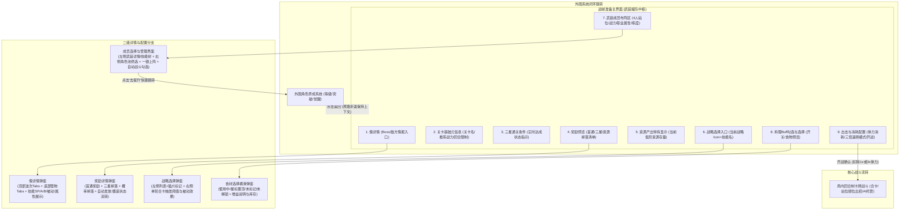
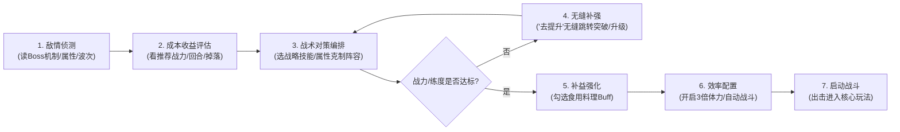
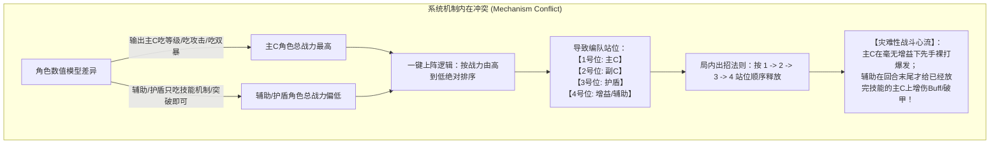
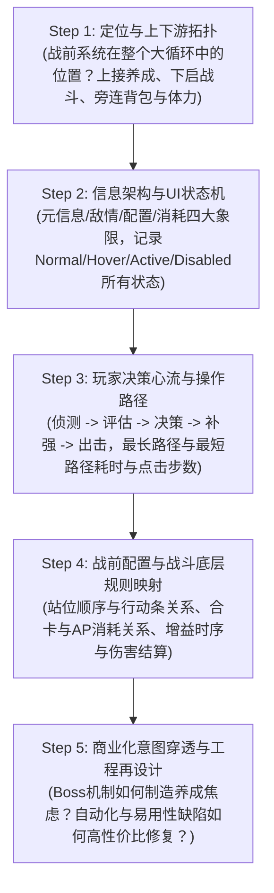

# 《猫之城》战前准备系统拆解 · 深度分析与策划能力评估报告

> **分析对象**：`E:\游戏策划案\拆解案（20份）\6、猫之城战前准备系统.pdf`  
> **报告类型**：游戏系统逆向拆解深度评审 / 资深系统策划能力模型诊断  
> **撰写视角**：资深游戏主策划 / 制作人 / 行业导师  

---

## 1. 拆解案基本信息与架构全貌

### 1.1 文档元数据与拆解对象
- **文档名称**：猫之城战前准备系统
- **文档篇幅**：6页（图文混排，包含UI线框示意标号、二级弹窗细节、微交互描述及优化提案）
- **文档类型**：**系统功能与交互逻辑深度逆向拆解案**（侧重于战前决策枢纽、UI/UX微交互状态机、战前战中逻辑联动与易用性缺陷再设计）
- **分析对象**：《猫之城》（Cat Fantasy，番糖网络研发的猫拟人潮酷都市策略卡牌RPG）
- **拆解核心系统**：**战前准备系统（游戏内包装名称：武装编队）**
  - 在卡牌RPG的经典架构中，“战前准备”是横跨在**“外围角色养成（卡牌RPG数值池）”**与**“局内卡牌战斗（合卡策略与属性克制）”**之间的核心枢纽。它不仅承担信息透视（敌情/关卡限制/掉落目标）与策略配置（战略技/队伍构成/料理Buff）功能，更是决定玩家单局心流起点与操作流畅度的关键触点。

---

### 1.2 整体架构与系统交互流转图

本文档对战前准备界面进行了极其细致的结构性切片，以主界面 9 大核心功能区为中枢，向各个二级详情与跳转分支辐射。以下为该拆解案所呈现的完整交互拓扑结构：



---

### 1.3 战前玩家决策心流与信息流转模型

优秀的战前准备系统本质是为玩家构建一条**“感知敌情 $\rightarrow$ 评估差距 $\rightarrow$ 战术克制 $\rightarrow$ 弥补练度 $\rightarrow$ 确认出击”**的闭环决策链路。本拆解案清晰提炼出了玩家在此界面的心流推进路径：



---

## 2. 这篇拆解案“好在哪里”（深度亮点剖析）

### 亮点一：细致入微的交互细节捕捉与 UI/UX 状态机反查
多数初学者写系统拆解往往沦为“页面截屏加名字”，只描述“有什么按钮”，但本案作者展现出扎实的人机交互（HCI）观察力，对**静态排版、动态边界、交互反馈与状态迁移**进行了像素级的记录：
1. **边界物理动效与手势反馈**：
   - 敏锐记录了所有弹窗列表（傀详情、奖励预览、战略列表）在触摸滑动时的**“上下滑动超过一定范围时会弹回原位”**（即标准的 iOS/Unity ScrollView 弹性回弹 Clamp Elastic 动效），展现了对前端交互体验的直觉敏锐度。
2. **多态视觉反馈与防呆状态机**：
   - **三星条件状态**：未达成显示白色，达成转为蓝色并在末尾追加“√”标记；
   - **奖励预览状态流转**：未获得 $\rightarrow$ 目标达成后自动发放 $\rightarrow$ 奖励图标变灰（置灰不可交互） $\rightarrow$ 打上“√”已领取标签 $\rightarrow$ 排序下沉至列表最底部（防视觉干扰）；
   - **战略选中态**：当前使用中置顶并打“当前”角标，临时选中时右侧出现“猫头图标”高亮激活；
   - **料理使用态**：未选为常规色，激活后按钮变粉色并变更文案为“使用中”，且在横向列表中自动置顶排在最左侧。
3. **空状态与默认态定义**：
   - 明确指出初次进入关卡无上阵角色时，左侧信息区规范显示空态占位符文案——**“请选择任意武装”**；且再次进入时具备**关卡阵容记忆逻辑**（无需重复上阵），符合现代手游“减少无意义重复操作”的体验基线。

---

### 亮点二：敏锐抓住“去提升”闭环跳转——维持心流的关键 UX 设计
拆解案在第 4 页中精准提炼出战前准备系统中极具代表性的高分设计点：
- **痛点场景还原**：在很多老式或体验粗糙的卡牌游戏中，玩家进入战前发现某张针对性对策卡等级不够，必须点击返回 $\rightarrow$ 退出关卡选关 $\rightarrow$ 返回主界面 $\rightarrow$ 点击角色列表 $\rightarrow$ 查找角色 $\rightarrow$ 升级突破 $\rightarrow$ 重新点击关卡 $\rightarrow$ 重新配置阵容。长达 6~8 步的中断会导致极强的挫败感与心流断裂。
- **拆解案的深度点评**：作者准确指出了《猫之城》在此处设计的**“去提升”直接穿透跳转逻辑**：
  > “点击去提升后会直接进入到角色强化界面，玩家可随时强化，强化返程后点击返回可以直接回到战前准备界面。当玩家发现关卡需要一个角色时，可以迅速将该角色战力拉满，不需要反反复复去打开关闭界面，玩家能够更舒适的体验游戏的核心玩法。”
- **专业升华**：这一段评析不仅看到了功能本身，更从**心流保护（Flow Maintenance）**和**操作动线最短化（Shortest Task Path）**的策划高度进行了定性，体现了作者对玩家心理摩擦力（Friction）的深刻同理心。

---

### 亮点三：穿透战前表象，直击商业化与数值养成的深层博弈
拆解案在开篇系统定位（Page 1）中，没有使用假大空的教科书套话，而是用极其辛辣而清醒的专业视角指出了战前策略与数值坑的内在联系：
> “这也使得即使自身的战力很低也可以通过策略去战胜强大的敌人。**但实际一切还是在策划的掌控当中，策划通过不同类型的Boss改变玩家的进攻策略，逼迫玩家大量养成。**”

这一洞察极为深刻地揭示了**二次元抽卡/卡牌RPG的核心商业逻辑**：
1. **战前系统的信息透明化**（弱点属性、护盾类型、免伤机制、致命技能）表面上赋予了玩家“以弱胜强、策略致胜”的成就感空间；
2. 但其深层本质是**“制造对策卡需求”**。如果一个阵容可以打通所有关卡，商业化抽卡池就会迅速枯竭；
3. 策划通过在战前界面向玩家极尽清晰地展示 Boss 的克制需求，实际是在给玩家派发“考卷”——从而推动玩家为了应对“红/绿/蓝属性克制”、“对单/对群机制”、“驱散/护盾/免控对策”，去不断抽取并横向养成更多角色（扩展养成池宽度）。

---

### 亮点四：硬核逆向推导“AI出招逻辑”与“一键上阵缺陷”的系统级冲突
这是整篇拆解案中最具**主策划级批判性思维（Critical Thinking）与工程落地价值**的高光模块（Page 5-6）：

#### 1. 自动战斗与出牌优先级的逆向推演
作者通过细致观察，逆向还原了《猫之城》底层 AI 出牌与编队顺位的交互逻辑：
- 基础出招序列按战前编队位置 $1 \rightarrow 2 \rightarrow 3 \rightarrow 4$ 依次出牌；
- 但遇到合卡机制时，若第 1、2 号位的技能卡可以合成升星，AI 将打断原定出招顺序，优先合并 1、2 号卡牌；
- 此时单轮行动轮次计数（Action Point）被合卡消耗，导致原本顺位靠后的 3、4 号位角色的技能出招机会被顺次剥夺或延后。

#### 2. 直击“一键上阵按战力排序”与“回合制战斗逻辑”的致命矛盾
作者尖锐地揭露了游戏内“一键上阵”功能的设计自相矛盾：

- **商业卡牌普遍规则**：先辅助铺场（降防、加攻、破盾） $\rightarrow$ 后核心输出爆发（吃满乘区爆发）。
- **猫之城一键上阵的低级错误**：粗暴地用“战力高低”决定“出招站位”，直接逆反了卡牌策略的基本常识，导致一键配置出的队伍在自动战斗时伤害断崖式下跌。

#### 3. 给出具备高可行性、低改动成本的再设计提案
作者不仅指责缺陷，更提出了两种落地思路并做了权衡取舍：
- **方案 A（预设队伍模式）**：
  - 将粗暴的“一键上阵”改为“预设队伍 1/2/3”（标签支持“对单队”、“对群队”），支持战前滑动切换。
  - **作者评估**：开发成本极低，最符合卡牌玩家心智，容错率最高。
- **方案 B（标签加权智能推荐）**：
  - 给角色打上标签（输出、增益、护盾），关卡配置推荐标签。系统检测玩家达到及格线的角色，按“增益 $\rightarrow$ 护盾 $\rightarrow$ 输出”的合理战术站位填充。
  - **作者评估**：算法较复杂，规则维护成本高。
- 最终明确建议采纳**方案 A**，体现了极佳的工程性价比意识（ROI 思维）。

---

## 3. 体现了策划的什么核心能力（能力模型对照）

通过对照腾讯、网易、米哈游等头部大厂的**系统策划 / 战斗策划能力模型**，本文档体现出的策划核心素养如下：

| 能力维度 | 对应策划层级 | 拆解案中的具体体现与证据 | 评分 (1-5) |
| :--- | :--- | :--- | :---: |
| **逆向工程与状态拆解** | 资深系统策划 | 将战前准备拆解为主界面 9 大模块 + 4 大二级子系统；完整还原各组件在不同条件下的显示态、隐藏态、置灰态与边界回弹交互。 | **4.6** |
| **底层规则洞察力** | 资深系统/战斗策划 | 能够穿透表层 UI，敏锐发现“编队顺位”、“战力计算权重”、“AI出招合卡逻辑”与“Buff生效时序”之间的深层耦合与死锁。 | **4.8** |
| **UX与心流把控** | 资深交互/系统策划 | 极度关注“跳转返程闭环”对体验断点的修复（去提升逻辑）；关注三星达成变色、奖励下沉置底对玩家目标感与清晰度的正面价值。 | **4.5** |
| **再设计与工程落地方案** | 主策 / 系统专家 | 面对系统缺陷不抱怨，能提出两套具备实际代码落地可能性的优化方案，并基于研发成本和玩家心理模型给出明确取舍建议。 | **4.7** |
| **商业化与设计目的推演** | 主策 / 数值策划 | 准确点明战前情报透明化的终极商业诉求——不是为了做纯粹的策略免费送通关，而是通过机制差异化驱动玩家的卡池横向扩张。 | **4.5** |
| **文档规范与专业表达** | 初级策划痕迹（短板） | 出现了口语化注记（`//如何描述？`、`断网了没办法`、`没测出来功能--星星`）以及主观性武断定性（`无用功能`、`无用显示`）。 | **2.8** |

---

## 4. 深度反思：文档中暴露的初中级短板与改进建议

尽管该拆解案在逻辑穿透和体验洞察上极其惊艳，但在**文档专业度、客观推导与体系化规范**上，暴露出若干非常典型的初中级策划痕迹。这也为我们提供了极佳的反面教材：

### 短板一：带有情绪化与主观武断的“无用功能”草率定性
- **案中文档表述**：
  - Page 1 标注某 UI 为“无用功能”；
  - Page 2 描述：“5. 仅在资源关卡显示，仅显示关卡对应当前持有的最低阶资源数量，**无用显示，不再介绍**”。
- **资深主策诊断**：
  - **致命误区**：在商业游戏工业界，“存在即有其历史原因或受众诉求”。资源关卡显示玩家当前持有的对应低阶材料存量，绝非“无用”，其核心设计意图是：**让刷材料的玩家在战前直接得知“我还差多少个材料即可合成/突破”，结合战前可调节的“三倍体力倍率”，决定这把到底刷几次！** 避免玩家退出到背包去数材料。
  - **改进范式**：成熟策划绝不可在拆解案中直接宣称某功能“无用”。应当写为：“【设计意图反推】：此处显示当前低阶资源存量，旨在降低玩家核对背包材料的记忆负担；【当前设计缺陷】：仅显示低阶材料而未显示当前目标所需总数，信息传达不完整，导致实用性折损，建议优化为‘当前拥有/合成目标所需’的对比进度条”。

### 短板二：遗留草稿痕迹与口语化日记体
- **案中文档表述**：
  - Page 3：“每一个战略页签中的内容有...**没测出来功能--星星**”；
  - Page 4：“出战位置根据之前排序分为1、2、3，再进行4位置的成员选择。**//如何描述？**”；
  - Page 4：“AI出招的顺序根据测试（**眼测，断网了没办法**）”。
- **资深主策诊断**：
  - 这种将个人测试阻碍（断网、测不出来、不知如何组织语言）直接留在正式交付案中的做法，在专业评审或求职面试中是**重大扣分项**，会显得极不严谨、草率且缺乏职业素养。
  - **改进范式**：
    - 未探明的机制应查阅官方公告、WIKI 或拆包，若确实受限于测试环境，应规范表述为：“【待验证项】：当前版本该星级图标推测为战略技能的进阶等级或专精效果，因测试账号权限受限，有待后续验证”；
    - 绝不允许把“草稿自问自答”或“网络吐槽”暴露在正文中。

---

## 5. 学习如何写策划拆解案（实战指南与方法论提炼）

通过对本篇《猫之城战前准备系统》的剖析，我们可以提炼出一套专门针对**“战前准备 / 编队系统 / 策略配置模块”**的工业级拆解案写作标准范式。

### 5.1 战前系统拆解的“黄金五步分析法”



---

### 5.2 战前准备系统拆解案标准结构模板（可复用模版）

如果让你在求职作品集或立项拆解中撰写一份战前系统案，推荐采用以下工业级目录骨架：

```markdown
# [游戏名称] 战前准备与编队系统 (Pre-battle Formation) 深度拆解案

## 1. 系统概述与战略定位
   1.1 业务定位与设计目标 (连接局外养成与局内战斗的核心决策枢纽)
   1.2 系统边界与上下游关联拓扑 (角色池、体力系统、关卡配置、战斗模块)

## 2. 界面信息架构与交互流转 (IA & UI Flow)
   2.1 主界面四大功能区规划 (情报区 / 关卡元数据 / 编队配置区 / 出击消耗区)
   2.2 UI 状态机与微交互规范 (未达成/达成、激活态、默认空态、回弹物理曲线)
   2.3 快捷闭环动线评估 (角色培养深层跳转与原路返回机制分析)

## 3. 战前策略配置体系拆解
   3.1 敌情透明化与克制模型 (属性克制系数、Boss特殊机制与破局手段)
   3.2 战术/环境变数系统 (全局战略技能、场地天气、料理/消耗品Buff)
   3.3 编队槽位与站位规则 (槽位解锁条件、站位顺序对战斗结算的影响)

## 4. 战前与战斗底层的深层耦合逻辑
   4.1 编队站位与局内行动时序映射 (顺位出招、速度调轴、AP点分配)
   4.2 自动战斗 (AI) 决策树逆向工程 (技能释放优先级、合卡机制、斩杀判定)
   4.3 自动化辅助功能 (一键上阵、推荐阵容) 的算法逻辑与体验边界

## 5. 商业化与系统留存导向推演
   5.1 关卡机制如何反哺卡牌横向养成深度 (对策卡刚需与多队培养压力)
   5.2 三倍体力/扫荡模式对在线时长与经济流通的调控

## 6. 系统痛点诊断与工业级再设计方案
   6.1 核心体验断点与逻辑冲突剖析 (例如：战力排序一键上阵破坏出招时序)
   6.2 方案 A (低成本高体验改动：预设队伍切页与对单对群标签)
   6.3 方案 B (深度算法重构：基于角色职能标签与关卡弱点的加权匹配)
   6.4 投入产出比 (ROI) 与落地排期建议
```

---

### 5.3 资深策划避坑指南（求职与工作实战）

1. **切忌“流水账列菜单”**：不要只写“这里有个战斗力，那里有个开战按钮”。每个UI元素背后都有它的**信息层级（Hierarchy）**。为什么推荐战力放在正上方？为什么三星条件在中间？必须从视觉流向（F型或Z型动线）去解释“为什么这么摆”。
2. **切忌“缺乏战斗联动的孤立看系统”**：战前准备绝对不是一个孤立的UI界面！它的站位对应着战斗里的出手顺序；它的战力对应着数值门槛；它的克制提示对应着战斗底层的伤害计算公式。像本文作者一样敏锐发现**“战力排序导致出牌顺序颠倒”**，就是将系统策划能力打通到战斗策划层面的极佳体现。
3. **保持极致客观严谨的职业文风**：
   - 永远不要在文档中出现未经验证的“无用”字眼，要分析其原初意图；
   - 绝不把个人测试的客观阻碍（断网、卡bug）当成吐槽写进正文，使用规范的工程待办（TODO/待验证）标注；
   - 关键逆向推导必须辅以逻辑流程图、因果逻辑图（如 Mermaid），而非大段口语化文字。

---

## 6. 报告总结与综合评审定级

- **综合评级**：**B+（优秀进阶级 / 具备极佳的系统深挖潜质，但需经过职业化规范打磨）**
- **核心价值提炼**：
  - 这是一份**瑕不掩瑜、见解极其犀利**的实战拆解案。作者没有被繁杂的二次元UI表象所迷惑，而是直奔战前准备系统的最核心痛点——**操作闭环流畅度（去提升）**与**自动化出牌逻辑冲突（战力一键上阵 vs 出招时序）**。
  - 这种敏锐的**系统间冲突嗅觉**是成为优秀主策划不可或缺的天赋。只要在今后的文案规范中剔除初学者的口语化与情绪化注记，补齐严谨的数值克制乘区与系统拓扑图，其产出将迅速跃升为工业级顶级案。
