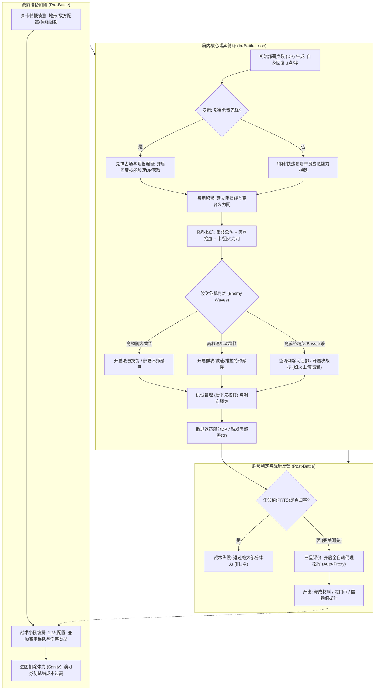
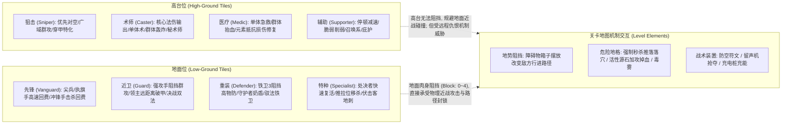
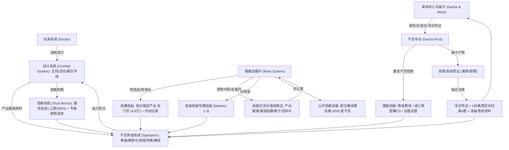

# 深度分析报告：《明日方舟》拆解分析（PPT/PDF拆解案深度剖析与架构补全）

---

## 1. 拆解案基本信息与架构全貌

### 1.1 文档基本信息与属性判定

- **文档名称**：《明日方舟》拆解分析
- **文件格式**：PDF（由 16:9 宽屏汇报型 PowerPoint 幻灯片导出，共 10 页）
- **分析对象**：《明日方舟》（Arknights，上海鹰角网络 Hypergryph 自主研发运营，Unity 引擎驱动的二次元即时战术塔防手游）
- **文档核心定位**：宏观系统层级导览与系统拓扑关系初梳案（典型的高校游戏设计课程期末汇报 / 初级游戏策划实习应聘提纲）。
- **文档体量与元素特征**：
  - 幻灯片共 10 页，正文核心篇幅约 5 页；
  - 包含游戏主界面（UI）与作战终端（Terminal）的高清功能标注截图；
  - 包含一张规范的抽卡货币兑换流转图（第 8 页）与一张包含 83 个矢量形状元素的大型“核心系统关系网络拓扑图”（第 9 页）；
  - 文本总量精炼（约 800 字），偏向视觉化与图表化呈现。

---

### 1.2 文档行文逻辑与实际交付内容反差诊断

在分析本篇拆解案时，资深主策划必须指出一个极其典型且致命的行业文档通病——**“承诺过高与交付断层（Over-promising and Under-delivering）”**：

```
[作者在 Slide 2 / 4 的立项承诺]
├── 游戏总览（已交付：Slide 5-6 UI入口标注）
├── 商城系统（已交付：Slide 7 界面截图 + Slide 8 抽卡兑换流转）
├── 战斗系统（承诺分析核心算法与亮点 ── 实际严重缺失！）
├── 角色系统（干员职业、天赋、成长 ── 实际仅在关系图中带过词条）
├── 玩家系统（博士体力、等级 ── 实际仅在关系图中带过词条）
└── 基建系统（设施流转、心情 ── 实际仅在关系图中带过词条）
[作者在 Slide 9-10 的实际收尾]
└── Slide 9 单张宏观关系图汇聚所有词条 -> Slide 10 感谢观看（全案戛然而止）
```

- **原案立项目标**：在 Slide 2 明确提出*“概括介绍游戏，将游戏拆解为核心系统，针对每个系统列出其核心算法，相关功能机制的设计思路和亮点”*；并在 Slide 4 给出了涵盖“战斗、角色、玩家、基建、商城”的完整六大目录。
- **实际交付断层**：文档完成第 8 页的抽卡流转图后，并未按目录逐级展开“战斗系统（塔防算法、DP模型、阻挡判定）”与“角色系统”，而是将战斗、基建、干员、玩家四大模块强行压缩至第 9 页的一张《明日方舟核心系统关系》网络图中，随后在第 10 页直接“感谢观看”。
- **主策划定性**：本篇拆解案属于典型的**“架构草案（Skeleton Draft）”**。原作者具备优秀的全局系统宏观感知力与信息可视化能力，但严重缺乏系统向下拆解到实操、公式、逻辑边界的执行力，导致核心玩法（战斗系统）形成巨大空白。为此，本深度报告将在后文进行**“主策划级”的核心机制与算法深度补全**。

---

### 1.3 核心架构图与系统全貌（补全与升华）

为了完整展现《明日方舟》的设计灵魂，弥补原案的结构性残缺，以下通过三大标准化架构图，还原《明日方舟》的底层战斗循环、干员关卡战术交互矩阵与宏观商业经济闭环：

#### 架构图 1：明日方舟核心战斗心流与部署决策循环（Combat Flow Loop）



---

#### 架构图 2：干员职业职能体系与关卡战术交互矩阵

《明日方舟》战术深度的核心在于**“8大基础职业”与“高低台/阻挡/伤害类型”**的三维交叉，这是原案未曾提炼但不可或缺的设计基石：



---

#### 架构图 3：宏观系统闭环与资源生态全貌（基于原案 Slide 9 重构扩充）

原案第 9 页尝试构建一个宏观闭环，但在细节逻辑链条上缺乏量化与动力机制。以下为主策划级重构的宏观闭环拓扑：



---

## 2. 这篇拆解案“好在哪里”（深度亮点剖析）

虽然本案受制于 PPT 篇幅和完成度，未能交付完整的战斗推演，但在**架构认知、商业逻辑与图表表达**上，依然体现了一名潜力策划的重要闪光点：

### 2.1 亮点一：宏观系统关系的“生态闭环思维”（Slide 9 深度剖析）

在许多初级策划的拆解案中，系统通常是孤立割裂的（如“这是商城，这是背包，这是抽卡，这是战斗”），彼此毫无流动。而本案作者在 **Slide 9《明日方舟核心系统关系》** 中展现出了难能可贵的**“系统生态观”**：
- **准确捕捉到“基建系统”在二次元卡牌长留存中的轴心地位**：作者敏锐地把【基建系统】放在了整张关系图的正中央，连接了玩家、干员、战斗与采购中心。在《明日方舟》中，基建不是单纯的“挂机小游戏”，而是整个游戏资源产出（约占中后期玩家龙门币与经验书 60% 以上日常来源）、心情消耗恢复、技能专精突破、信用点社交与公开招募刷新的物理承载核心。
- **打通了“信赖值”与“心情”的情感/数值流转**：作者捕捉到了干员系统中的“心情（Morale）”与基建宿舍恢复、信赖值每日宿舍交互的机制，表明作者不仅看到数值硬循环，也看到了二次元游戏核心的“角色情感羁绊软循环”。

---

### 2.2 亮点二：抽卡经济模型与溢出代币闭环的清晰建模（Slide 8 深度剖析）

在 **Slide 8《抽卡系统设计思路》** 中，作者提炼的货币兑换与代币回流链路非常扎实：
- **核心汇率的精准锚定**：准确指出了基础代币的恒定换算比例——$1 \text{ 源石} = 180 \text{ 合成玉}$，单抽需要 $600 \text{ 合成玉}$，即 $1 \text{ 抽} = 3.33 \text{ 源石}$（折合人民币约 20 元/抽）。
- **副产物分层流转机制**：将抽卡获取物严谨划分为三个不同层级的去向：
  1. **干员主体/限定干员**：直接进入队伍养成；
  2. **资质凭证（绿票）与高级凭证（黄票）**：构成了著名的**“抽卡返还内循环”**。尤其是高级凭证（黄票），每抽到重复干员或公开招募 4/5/6 星时产出，积攒到 180 张可在采购中心直接定向兑换当期六星干员（即“黄票进店”保底机制），或者以 258 张黄票换取 38 抽寻访凭证；
  3. **干员信物（Token）**：用于潜能提升（降低部署费用 1-2 点、再部署时间减少、天赋效果增强），并在潜能满级后可在商店二次回收换取黄/绿票。
- **设计点评**：作者用一张简洁的自上而下的流转图，把这套兼顾了“轻氪保护、重氪溢出回收、微氪长线攒票”的商业化闭环清晰可视化，具备极佳的工程导向性。

---

### 2.3 亮点三：信息架构（IA）层级与界面功能映射的专业呈现（Slide 5-6）

在 Slide 5 与 Slide 6 中，作者采用了游戏工业界标准的**“UI-to-Feature（界面-功能拓扑映射）”**表达方式：
- **以主界面为枢纽的发散式标注**：将主界面的 8 大功能按钮（战斗、卡面管理、看板助理、采购、寻访、任务、每日签到、活动轮播）用规范的指引线引出，逻辑清晰，无多余废话。
- **对终端（Terminal）二级层级的功能聚类**：在 Slide 6 中，作者准确将作战终端归纳为“塔防战斗产出常规资源”、“剿灭任务产出每周合成玉”、“模组任务产出专精材料”和“主线任务产出源石”。这说明作者在体验游戏时具备良好的层级归纳意识，能够从复杂的视觉界面中提炼出背后的业务职能。

---

## 3. 核心机制深度补全与工业级拆解（塔防战斗与数值算法）

由于原案在 Slide 4 承诺了战斗与算法分析却在后文严重缺失，作为主策划，我们在此对《明日方舟》的底层塔防战斗模型进行**硬核工业级重构与深度剖析**，这正是任何一名优秀战斗/系统策划必须掌握的底层机理：

---

### 3.1 部署费用曲线（DP, Deployment Points）与战局心流调控

《明日方舟》区别于传统塔防（如《植物大战僵尸》《王国保卫战》）最关键的机制就是**“严格受控的动态费用模型”**：

#### 1. 费用产出数学模型
局内部署点数 $DP(t)$ 的演化公式可抽象为：
$$DP(t) = DP_0 + \int_0^t v_{\text{natural}}(\tau) d\tau + \sum \Delta DP_{\text{vanguard}} + \sum \Delta DP_{\text{kill}} - \sum DP_{\text{deploy}}$$
- **初始费用 $DP_0$**：一般为 $10 \sim 20$ 点（突袭关卡或特定危机合约词条可压制到 $5$ 点甚至 $0$ 点）。
- **自然回复速率 $v_{\text{natural}}$**：常规关卡恒定为 $1.0 \text{ 点/秒}$（即每 1 秒自然恢复 1 点费用）。
- **先锋主动回费 $\Delta DP_{\text{vanguard}}$**：
  - **执旗手（如桃金娘/极境/琴柳）**：彻底放弃阻挡与普攻，换取极高的回费效率（如 8 秒内持续回复 14 点 DP，平均产费速率达 $1.75 \text{ 点/秒}$）；
  - **尖兵（如德克萨斯/推进之王）**：兼顾阻挡 2 与间歇性爆发回费（每次回 9-12 点）；
  - **冲锋手（如红豆/风笛）**：击杀回复 1 点，撤退返还全部初始部署费用。

#### 2. 费用曲线驱动的“四阶段战术节奏”
```
战局时间轴 (Time Elapsed)
├─ 00:00 - 00:15 [开局铺场期]：DP紧张 (0-15)，高移速杂兵/低阶猎犬冲线。核心解法：低费先锋/快活下场占坑防漏。
├─ 00:15 - 00:45 [阵型构筑期]：DP攀升至 (30-60)，出现中甲近战怪与无人机。核心解法：部署阻挡2-3近卫/重装，高台补狙击对空。
├─ 00:45 - 02:00 [高压决战期]：DP充裕 (>60)，高物防大盾、高法抗法术大师、Boss出场。核心解法：高费术师、决战大招交替轮转。
└─ 02:00 - 结束  [残局容错期]：漏怪/减员危机。核心解法：撤退低效干员返费，空降快速复活/特种强行拦截垫刀。
```

---

### 3.2 阻挡机制（Block Count）与漏怪防线设计

“阻挡（Block）”是《明日方舟》将塔防与 RPG 角色属性深度结合的精髓机制：

1. **阻挡数判定准则**：
   - 当干员与敌方单位碰撞框发生接触时，若该干员当前已阻挡数 $< \text{BlockMax}$，则触发阻挡状态；
   - **阻挡状态下**：敌方移速瞬间降为 $0$，仇恨强制锁定为被阻挡干员，双方进入普攻互殴状态；
   - **一旦超载**：当第 $N+1$ 个敌人通过时，由于无空余阻挡数，敌人将直接穿模通过。这创造了《明日方舟》最具张力的**“漏怪危机感”**。
2. **阻挡梯度与战术定位**：
   - **阻挡数 0**：地刺（地底伏击客如水月/狮蝎）与全部高台干员。不受地面近战攻击，专职输出或控制；
   - **阻挡数 1**：冲锋手先锋、无畏者近卫（斯卡蒂/耀骑士）。单挑高攻血厚精英怪，防止因多拉怪导致猝死；
   - **阻挡数 2**：常规尖兵、群卫、领主。平衡清怪与生存的标准站桩线；
   - **阻挡数 3~4**：重装铁卫（塞雷娅/年/星熊）。阵型的最终防线，聚集大量敌人配合高台群攻 AOE 集中轰炸。

---

### 3.3 攻击范围（Range）与九宫格朝向几何学

不同于传统塔防的“圆形同心圆攻击圈”，《明日方舟》采用了基于**网格（Grid）与空间朝向（Directionality）**的几何离散设计：

```
[典型干员攻击范围矩阵]

1. 经典单体狙/术师 (前向三行延伸):
   [   ] [ X ] [ X ] [ X ]
   [ O ] [ X ] [ X ] [ X ]  (O 为干员站位, 朝向右侧)
   [   ] [ X ] [ X ] [ X ]

2. 轰炸术师 / 伊芙利特 (特化直线无限穿透):
   [ O ] [ X ] [ X ] [ X ] [ X ] [ X ] ... 直至地图边缘

3. 领主远卫 (低地前向拓展含贴身两侧):
   [   ] [ X ] [   ]
   [ O ] [ X ] [ X ]
   [   ] [ X ] [   ]
```

- **朝向的不可逆决策沉没成本**：
  - 干员部署时必须选择 **上、下、左、右** 四个方向之一；
  - 一旦放下，攻击范围与受击朝向即刻固定，**无法在局内旋转**。如果方向选错，唯一的修正途径是**手动撤退干员 -> 承担数十秒再部署 CD 与费用损失**。这一机制极大地拉高了玩家战前读图与即时战术决策的犯错成本。

---

### 3.4 高低台地形与仇恨判定算法（Threat & Priority Algorithm）

明日方舟的战场由**低地地格（Low-Ground）**与**高台地格（High-Ground）**两类几何拓扑构成，并依托三大仇恨规则运转：

#### 1. 核心仇恨三大铁律
1. **最后部署优先原则（LIFO - Last In First Out）**：
   - 敌方远程攻击单位在射程内存在多个可选目标时，**优先锁定最后部署到场上的干员**（俗称“后下先挨打”）。
   - **战术应用**：玩家必须严格遵守部署次序——先下高台脆皮输出/医疗，最后部署重装坦克，由重装吸引敌方远程狙击与术士火力，形成经典的“护卫闭环”。
2. **阻挡锁定原则**：
   - 敌方近战单位一旦被阻挡，仇恨强制锁定阻挡者，无视最后部署规则。
3. **隐匿与特殊索敌权级**：
   - 拥有【隐匿】词条的敌人不可被普通阻挡外技能索敌；
   - 拥有【嘲讽】天赋的干员（如斥罪/年）强制提升自身受击优先级，覆盖最后部署规则。

---

### 3.5 底层伤害计算公式与数值平衡哲学

《明日方舟》的数值底层被誉为二次元手游中极其硬核且优雅的典范，其伤害公式分为物理与法术两大截然不同的计算模型：

#### 1. 物理伤害公式（减法机制）
$$\text{Damage}_{\text{Phys}} = \max\left( \text{Attack} \times (1 + \mu_{\text{atk}}) - \text{Defense} \times (1 - \lambda_{\text{shred}}), \; \text{Attack} \times 5\% \right)$$
- **“抛光（Scrape）”现象**：当干员攻击力低于敌方防御力时，仅能造成 $5\%$ 的微弱保底伤害。例如：能天使普攻单发 600，面对防御 1000 的大盾怪，单发伤害被减为 $600 \times 5\% = 30$ 点，出现完全不破防的“刮痧抛光”。
- **极端收益拐点**：一旦配合削弱辅助（如初雪减防、华法琳加攻），当攻击力反超防御力的瞬间，输出会呈现**超线性的爆炸式增长**。

#### 2. 法术伤害公式（乘法比例机制）
$$\text{Damage}_{\text{Arts}} = \text{Attack} \times \left(1 - \frac{\max(\text{Res} - \Delta \text{Res}, 0)}{100}\right)$$
- 法抗（Resistance）是以百分比减伤呈现（例如 Res = 50 表示减免 50% 法术伤害）。法抗几乎不可能完全减至 0 造成绝对免伤，因此法术伤害天生具备抗压保底特性，专克高护甲大盾。

#### 3. 真实伤害（True Damage）
$$\text{Damage}_{\text{True}} = \text{Attack}$$
- 无视物防与法抗（如凯尔希召唤物 Mon3tr 的熔毁、耀骑士临光的微光），作为高难危机合约关卡处理极端词条数值怪的“终极战略核武”。

---

## 4. 体现了策划的什么核心能力（能力模型对照）

通过对这份原案及其对应游戏原型的深度审视，我们可以清晰对照出资深游戏策划的能力模型维度：

| 能力维度 | 原案体现水平与表现 | 优秀/资深策划对照标准 | 能力差距与进阶方向 |
| :--- | :--- | :--- | :--- |
| **系统逆向拆解能力** | **中等（6/10）**<br>能梳理出基建、干员、关卡、商城的网状拓扑；准确提炼了抽卡凭证的三级流转。 | **卓越（9/10）**<br>不仅能画出系统关系网，更能推导出各系统间的**动态资源吞吐平衡**（如每日产出多少体力、合成多少经验、基建与主线体力的配比）。 | 进阶为**量化系统策划**：从定性画线跃迁到定量建模，计算资源通货膨胀周期与玩家养成消耗曲线。 |
| **战斗机制与玩法理解** | **薄弱（2/10）**<br>目录中列出战斗系统，但正文完全缺失，未涉及任何战术博弈与关卡解构。 | **卓越（9/10）**<br>深入拆解 DP 曲线、高低台地形限制、攻击范围朝向决策、阻挡漏怪机制、仇恨优先级算法及伤害公式。 | 进阶为**核心战斗策划**：建立关卡时间轴与怪物波次（Wave Design）数学模型，用有限参数创造多维策略解。 |
| **商业化与经济循环认知**| **良好（7/10）**<br>第 8 页抽卡流转图逻辑严密，正确表达了源石/合成玉汇率及黄绿票沉淀机制。 | **优秀（8/10）**<br>进一步计算**抽卡期望值**（50抽后每抽递增2%概率的综合出率计算，平均约 34.6 抽出一六星）、月卡与微氪玩家的资源获取周期。 | 进阶为**数值/商业化策划**：设计防崩盘代币回收池、阶梯式礼包性价比曲线与抽卡体验平滑算法。 |
| **文档规范与执行闭环** | **较差（3/10）**<br>严重脱节；前言承诺列出核心算法与机制，后文仅 10 页便戛然而止，属于未完成草案。 | **严谨（10/10）**<br>严格遵循“所写即所列”的契约精神；结构严整，每个章节有论点、图解、实机数据佐证与设计反思。 | 恪守**工程化交付素养**：宁可缩减目录范围，也要确保已写章节的极致深度与逻辑闭环，杜绝“空头目录”。 |

---

## 5. 学习如何写策划拆解案（实战指南与方法论提炼）

针对本案展现出的亮点与典型教训，任何希望从事游戏策划的新人与开发者，都应汲取以下实战方法论：

### 5.1 工业级策略/塔防类拆解案标准结构框架（可复用模版）

一份能够拿到一线大厂（腾讯、网易、鹰角、米哈游）面试通行证的拆解案，必须具备以下严谨骨架：

```
《XX游戏》工业级深度拆解报告标准骨架
├── 1. 产品定位与核心商业盘梳理
│   ├── 核心玩法定义 (Core Gameplay)
│   ├── 核心受众画像 (User Persona) 与竞品差异化护城河
│   └── 商业化大盘数据 (流水曲线波动与核心卡池事件相关性)
├── 2. 核心战斗底层机制拆解 (Core Combat Engine)
│   ├── 时空博弈模型 (网格、地形、朝向、阻挡与位移)
│   ├── 动态资源节拍 (费用/能量产出曲线与波次时间轴压力图)
│   ├── 索敌与仇恨算法 (优先级树、LIFO规则、特殊词缀判定)
│   └── 数值公式体系 (伤害结算、防御穿透、抗性衰减、攻速帧率)
├── 3. 角色职业与策略矩阵设计 (Character Archetypes)
│   ├── 职能九宫格划分 (生存/输出/控制/辅助/产费)
│   ├── 单体特色机制 (天赋、技能形态、充能机制、再部署维度)
│   └── 关卡解法多样性验证 (单解关 vs 逃课解 vs 通解模型)
├── 4. 局外养成与宏观资源经济生态 (Economy & Meta-Loop)
│   ├── 资源产出与消耗闭环网 (体力和放置收益的动态平衡)
│   ├── 抽卡与代币多层回收模型 (保底机制、重复产物沉淀)
│   └── 长线留存钩子 (社交、成就、羁绊、模组拓展)
├── 5. 逆向缺陷反思与再设计案 (Redesign & Proposal)
│   ├── 识别痛点 (如：代理指挥偶发性崩盘、某些子职业仓管边缘化)
│   └── 落地改良设计 (机制修改规则、UI原型图、改动预期收益与风控)
```

---

### 5.2 拆解案撰写必须避开的“五大天坑”

1. **天坑一：目录欺诈与承诺落空（The Phantom Blueprint）**
   - *病症表现*：如本案一般，在目录页写满“六大系统深度剖析与核心算法”，翻到正文却发现根本没有对应页面，草草致谢收尾。
   - *主策划警示*：这是面试与项目汇报的大忌，直接暴露文档编写者的严重拖延、不负责任或把控力崩塌。**宁写精悍的三页深度剖析，也不写十页空洞的目录纲要。**
2. **天坑二：截屏连环画与 UI 流水账（Screenshot Scrapbook）**
   - *病症表现*：把游戏各个界面截个图，箭头一拉，写上“这是好友界面，这是抽卡界面”。
   - *主策划警示*：策划不是“说明书抄写员”。界面拆解的重点绝不在于“它是什么按钮”，而在于**“信息架构的层级关系”**、**“玩家的点击心智流”**以及**“为什么这样布局能降低认知负荷”**。
3. **天坑三：纯定性描述，拒绝碰触数值与算法（Math Phobia）**
   - *病症表现*：通篇“伤害很高”、“回费很快”、“防御很强”，没有任何公式推演。
   - *主策划警示*：系统与战斗策划的基石是逻辑与数学。分析《明日方舟》却不谈物理减法、不谈 $1 \text{ 点/秒}$ 的回费节奏、不谈阻挡数与移速的乘积关系，拆解便失去了灵魂。
4. **天坑四：只有赞美，缺乏批判与再设计（Cheerleader Syndrome）**
   - *病症表现*：通篇“鹰角网络太强了”、“这个设计堪称完美”。
   - *主策划警示*：没有任何一款商业游戏是完美的。《明日方舟》早期同样存在基建换班极其繁琐（“基建上班人”折磨）、突袭关卡试错惩罚过高、代理指挥随练度提升因帧率差异导致“偶发性漏怪崩盘”等痛点。**展示你发现缺陷并给出落地方案的能力，才是展示主策潜质的最佳舞台。**
5. **天坑五：割裂观察，无视系统交织（Silo Mentality）**
   - *病症表现*：分析战斗时不考虑干员养成阶段，分析抽卡时不考虑黄绿票与公招系统的代币对冲。
   - *主策划警示*：始终牢记游戏的“蝴蝶效应”——抽卡产出信物，信物影响潜能减费，减费影响开局 1 秒内的下卡时机，最终决定能否守住第 1 只高移速原石虫。

---

### 5.3 个人求职与实战应用建议：如何用一份《明日方舟》拆解征服主考官

如果你正在准备一份《明日方舟》的拆解案用于一线游戏大厂求职，请务必执行以下“降维打击”策略：
1. **挑选一个极致微观的切口深入到底**：
   - 不要试图在几十页内讲完整个明日方舟。选择**《明日方舟：先锋干员回费模型与开局 30 秒节奏设计》**，或者**《物理减法公式对狙击干员数值环境的制约与解法演变（从能天使到水陈）》**。切口越小，剖析越深，越能展现专家级素养。
2. **手绘关卡战术时间轴与波次热力图**：
   - 选取经典关卡（如主线 7-18 爱国者之战，或危机合约黄石峡谷），拉出以秒为单位的时间轴：横轴为时间（0~180s），纵轴为当前波次敌人血量总和/护甲峰值，下方标注玩家此时的理论 DP 上限与技能开启时机，证明你具备顶级关卡节奏掌控力。
3. **附带完整的可执行再设计原型（GDD Sample）**：
   - 针对游戏内某项机制（例如：集成战略肉鸽玩法中的藏品平衡，或干员第二模组设计），提供包含**字段定义、逻辑判定树、异常状态处理、UI交互线框图**的标准策划功能案，直接向主考官证明：“我入职第二天就能直接对接程序和美术开工”。
