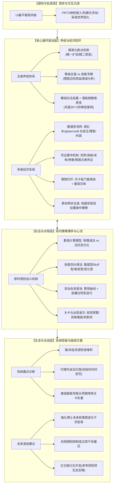

# 深度分析报告：《明日方舟游戏案例拆解》（21页PDF）

---

## 1. 拆解案基本信息与架构全貌

### 1.1 文档基本信息
* **文档名称**：明日方舟游戏案例拆解.pdf
* **文档规格**：共 21 页，图文混排（包含 18 处高清晰度游戏截图、UI解析图、成本收益曲线图与系统表格），文字量约 1.5 万字。
* **文档类型**：**全景系统与数值深度逆向拆解案（Full-System & Economy/Combat Reverse Engineering Report）**。
* **分析对象**：鹰角网络自研二次元策略塔防手游《明日方舟》（Arknights）。
* **核心拆解模块**：
  1. **表现层**：UI设计哲学与PRTS世界观拟真沉浸机制；
  2. **养成层**：五维成长体系（等级/技能/精英化/信赖/潜能/模组）及“理智等价成本曲线”；
  3. **经济层**：源石-合成玉-凭证五级循环、体力（理智）调节杠杆与基建转化沉淀；
  4. **战斗层**：伤害公式、网格攻击域、技能四大模型（数值/Buff/取舍/变化）、双资源约束（费用与部署位）及出怪波次心流曲线；
  5. **运营与基建层**：基建房间效能与专精绑定、多维任务体系（日常/危机合约自选词条）；
  6. **评测与迭代层**：系统优缺点归纳、商业生态短板与长线IP泛娱乐演进建议。

---

### 1.2 整体架构与行文逻辑结构图

该拆解案没有陷入传统策划案“想到哪写到哪”的随意性，而是遵循了**“感官沉浸 $\rightarrow$ 核心循环（养成+经济） $\rightarrow$ 玩法微观机制（战斗+关卡） $\rightarrow$ 宏观生态评测与破局”**的严谨递进逻辑。



---

## 2. 这篇拆解案“好在哪里”（深度亮点剖析）

相较于市面上大部分停留于“抄录UI界面、复述技能描述、整理抽卡概率”的平庸拆解案，本篇报告展现出**资深系统策划所具备的穿透性视野与量化推导能力**，在以下四个维度尤为亮眼：

### 亮点一：理智标尺量化推导——洞察策划的“数值引导交叉点”
* **现象解构**：常规拆解往往只会罗列干员升到90级要多少龙门币、专三要多少材料，属于“数据搬运工”。
* **本篇深度**：
  * 作者引入了**“理智等价物（Sanity-Equivalent）”**统一度量衡，将极为复杂的复合养成材料（紫材料、蓝材料、龙门币、技巧概要）全部折算为体力消耗。
  * **实证数据交叉**：以“银灰”三技能【真银斩】为例，计算出专精1/2/3消耗约为 **492、1265、2337 理智**；对比精二干员等级消耗（65~69级消耗474理智，70~79级消耗1340理智，80~90级消耗2224理智）。
  * **结论提炼**：专精与等级提升的理智消耗在特定区间呈现惊人的**对称重合**。作者由此一针见血地指出：**精二70级之后干员白值成长的边际效益呈指数级衰减，这并非数值失误，而是策划刻意设立的“隐性引导断点”——通过高昂的沉没成本逼迫玩家将体力与注意力从“面板数值堆砌”转移至“技能机制专精与队伍多样性构筑”上**。这直接论证了《明日方舟》“重心在玩法设计而非纯数值卡点”的底层立项哲学。

---

### 亮点二：微数值与蝴蝶效应——揭示“潜能与模组”的离散质变
* **现象解构**：潜能系统在许多人眼中被误读为“抽到同卡加点蚊子腿攻击力/减1点费用”的常规氪金深坑。
* **本篇深度**：
  * 作者敏锐地捕捉到了塔防机制中的**“离散时间片（Tick/Second）”与“阈值跃迁”**。
  * **经典案例拆解（风笛天赋）**：风笛的天赋使全队先锋初始SP+6，而五潜后天赋增强为SP+8。在数值上看似仅增加了微不足道的“2点SP”，但转化到战局中即意味着“全队投降先锋/先锋干员的爆发技能**提前整整2秒启动**”。在高难关卡或危机合约顶层词条下，这2秒是决定能否在怪物冲线前阻挡并开启费用良性循环的生与死的分水岭。
  * **受众分层定位总结**：作者提炼出极其精辟的设计定位：**“潜能对于普通玩家不必要，对于极限玩家不可缺”**。这解释了为何明日方舟既能保持平民玩家的良性口碑，又能促使头部大R玩家持续为极限竞速买单的高维平衡机制。

---

### 亮点三：四维归纳法解构技能树与动态资源流转
* **技能分类学抽象**：面对全游200多名干员、数百种纷繁复杂的技能，作者没有流水账式列举，而是高度凝练出策略塔防的**四类技能元模型**：
  1. **数值型**：基础白值倍率增强，作为低星基石与教学过渡；
  2. **Buff型**：多单位联携与光环，提供跨干员组合策略深度；
  3. **取舍型（High Risk, High Return）**：伴随负面惩罚（眩晕/掉血/自爆），作为破局底牌；指出超高收益会促使其跨越为强泛用技能；
  4. **变化型**：动态条件触发（斩杀线、特定状态追加），丰富实战微操。
* **时空动态博弈分析**：
  * 不仅分析了干员面板，更将**“费用（Cost）增长曲线”**与**“部署位（Deployment Limit）”**视作关卡时间轴上的博弈约束；
  * 解析了“先锋铺场回费 $\rightarrow$ 核心主力站场 $\rightarrow$ 撤退返费与战术再部署（阵型动态更迭）”的塔防阵型演进节奏。

---

### 亮点四：直击经济与循环断层的犀利批判
* **二级代币缓冲心理学**：拆解了抽卡产物通过五种凭证（资质/高级/采购/寻访参数/情报凭证）构建的次级货币补偿网，既维护了源石的稀缺购买力，又让玩家在抽卡失利时通过副产物兑换维持正向情绪反馈。
* **直言系统设计病灶**：
  1. **基建沉淀死锁**：深入指出“碳”系列材料在基建满级后彻底沦为废纸、“赤金”生产与龙门币转化严重受制于贸易站订单节拍，加工站无法消化过剩资源的闭环断裂；
  2. **体验反直觉的“伪挂机”**：严厉指出在移动端碎片化趋势下，明日方舟坚持“无扫荡券、必须看PRTS代理作战录像”的顽疾，增加了无意义的设备占用与挫败感，击中玩家生态最真实的痛点。

---

## 3. 体现了策划的什么核心能力（能力模型对照）

通过对该文档的系统性复盘，可以反推作者在游戏设计与系统规划上展现出极为扎实的高阶策划职业素养：

| 核心策划能力维度 | 文档中的具体体现与证据 | 业内资深评语 |
| :--- | :--- | :--- |
| **逆向工程与数值折算能力**<br>*(Reverse Engineering & Quantitative Analysis)* | 能穿透表层复杂的素材品类，运用“理智等价物模型”拉平等级经验、晋升材料与技能专精的研发成本，精确测算出“精二70级与专三消耗相当”的数值交叉点。 | 具备主数值/系统数值策划的底层功底，能透过游戏表面数据看穿开发组的控制线与投放意图。 |
| **底层机制抽象与分类学能力**<br>*(Taxonomy & Mechanic Abstraction)* | 面对数百名干员的海量技能，没有被表现形态迷惑，而是提炼出“数值/Buff/取舍/变化”四大元模型，并将关卡出怪提炼为“探路-成型-高压-间歇”心流节奏。 | 拥有系统主策划必备的抽象建模思维，擅长将离散的设计点升华为标准化、模块化的设计框架。 |
| **心流曲线与关卡战术把控力**<br>*(Level Pacing & Spatial-Temporal Dynamics)* | 解析关卡不仅看地图格子，更洞悉“出怪时间轴”、“前松后紧/双峰波次”以及“音乐骤变、特定音效、红线路径”等前置视听警报对玩家策略决策的心理预热作用。 | 展现出深厚的关卡策划（LD）素养，理解视听反馈、时空压力与心流管道理论的有机结合。 |
| **商业化心理与经济系统洞察**<br>*(Econ Balancing & Monetization Psychology)* | 深度拆解“凭证商店五级缓冲池”对抽卡挫败感的稀释效应；剖析月卡高性价比定位对非氪/微氪玩家的转化漏斗效应。 | 具备成熟的商业化策划视角，理解货币的沉淀、回收、心理防线与支付门槛设计。 |
| **客观辩证与闭环再设计能力**<br>*(Critical Thinking & System Iteration)* | 不盲目吹捧爆款，敢于敏锐指出“基建建材死锁”、“代理作战时间惩罚”、“主线章节内难度曲线骤升陡峭”、“强力干员过早数值膨胀”等硬伤，并给出针对性解法。 | 具备主策划/制作人层面的全盘诊断能力，避免了“幸存者偏差”，能清醒分辨产品是因为品质成功还是机制成功。 |

---

## 4. 学习如何写策划拆解案（实战指南与方法论提炼）

本篇报告为游戏策划新人及从业者提供了一套极佳的拆解范式。结合本篇长处与行业标准，提炼出可完全复用的实战方法论：

### 4.1 优秀拆解案的“黄金行文骨架”
撰写高质量深度拆解案时，切忌采用“功能模块流水账”，推荐使用**“感官-体验-机制-数值-商业-迭代”六层漏斗框架**：

```
第一层：世界观与交互感知（Immersion & UX）
   └─ UI视觉基调、动效拟真、设定与界面的叙事融合度

第二层：核心玩法与微观规则（Core Combat & Mechanics）
   └─ 伤害计算逻辑、时空空间限制（阻挡/网格）、资源约束（Cost/人口）
   └─ 技能元模型分类、关卡出怪节拍与心流波次（双峰曲线/预警节奏）

第三层：中台养成与成长驱动（Progression & Sinks）
   └─ 养成维度的层级划分（阶段断点/横向拓宽/垂直数值）
   └─ 引入统一度量衡（如体力折算、时间折算）绘制投入产出比曲线，寻找交叉点

第四层：底层经济与资源流转（Econ Loop & Circulation）
   └─ 货币产出-流转-消耗全景图（一级硬通货 $\rightarrow$ 二级抽卡币 $\rightarrow$ 次级凭证补偿）
   └─ 资源沉淀、通胀控制与死锁风险诊断（如基建材料、溢出金币）

第五层：商业模式与用户分层（Monetization & Segmentation）
   └─ 免费/微氪/重氪玩家的差异化诉求闭环（如月卡杠杆 vs 极限竞速潜能需求）
   └─ 挫败感防线设计（保底、副产物兑换）

第六层：客观批判与演进方案（Pain Points & Re-design）
   └─ 剖析3~5个核心病灶（交互冗余、长草期、数值膨胀等）
   └─ 提出切实可落地、符合原产品定位的改进原型与长线IP规划
```

---

### 4.2 应借鉴的高分技巧与闪光点

1. **确立“统一度量衡”进行跨系统等价折算**：
   * *技巧*：遇到材料繁杂的游戏，必须找到其最本质的“硬通货底层”（通常是体力/理智或游戏时间）。将角色升1级所需的金币/经验，和技能升1级所需的专精材料，全部反向推导为“需要消耗多少点体力”。唯有拉平至同一坐标轴，才能精准抓出策划的平衡性拐点。
2. **抓取“边缘极端案例”验证机制本质**：
   * *技巧*：研究一个被大众认为是“蚊子腿”的系统（如潜能、洗炼属性、细微天赋），不要泛泛而谈，而是寻找其在极端高压场景（如危机合约、竞速榜单、PVP斩杀线）下的临界跃迁效应（如风笛SP提前2秒启动），以此揭示系统对高端硬核用户的牵引力。
3. **建立直观的分类学标签（Taxonomy）**：
   * *技巧*：拒绝将技能一个一个抄录。应按照设计意图给技能打标签（数值型/机制型/连携型/风险型），展现出结构化归纳能力，让阅读者看到你的“设计库”思维。

---

### 4.3 需要避开的四大致命误区

| 常见拆解误区 | 典型反面表现 | 本文的正确示范 |
| :--- | :--- | :--- |
| **误区一：UI截图说明书** | 贴数十张界面截图，文字全是“点击这里可以打开商城，里面有源石”等操作说明。 | 仅截取核心对比图与机制图，重点分析PRTS世界观包装、陀螺仪微动如何服务于科幻代入感。 |
| **误区二：脱离语境的空洞批评** | 脱离塔防轻度手游定位，盲目批评“为什么不能自由走位、为什么不能实时对战”。 | 立足于“碎片化时间手游与二次元内容型产品”的商业基调，精准指出“代理作战无扫荡增加无效时长”的结构性矛盾。 |
| **误区三：无推导的定性臆测** | 随口说出“这个游戏后期升级很贵、养成很慢”，缺乏支撑。 | 列出具体理智折算数据（492/1265/2337对比474/1340/2224），用扎实的量化证据链说话。 |
| **误区四：只见单卡，不见阵容与战场** | 拆解角色只盯着单个角色的技能有多炫酷，忽略了整体队伍生态。 | 将角色置于12人编队限制、先锋开局回费、阵型更迭迭代、阻挡数与出怪波次的战术大盘中考量。 |

---

### 4.4 在个人求职与实战中的应用建议

1. **用于策划求职作品集（Portfolio）**：
   * 若应聘**系统策划**：应重度强化“经济循环流转图、资源沉淀预警、五级货币与凭证闭环”部分，并在文末增加1个可落地的“基建溢出资源回收新玩法系统案”作为加分附件；
   * 若应聘**数值策划**：必须将“理智折算模型”做成附带公式的Excel交互表截图，展示出你对等级曲线、专精曲线、边际递减斜率的数学推导能力；
   * 若应聘**关卡策划**：应将第17页关于“出怪路径、时钟节拍、高压波次与预警机制”单独展开，附带一张主线标杆关卡（如7-18或H8-4）的怪物波次时序甘特图（Wave Timeline）。
2. **用于项目立项竞品调研（Benchmarking）**：
   * 重点提炼本文的“缺点与未来发展”部分，作为自研新立项的“避坑指南”。例如在立项之初就规划好“减负扫荡机制”、“副产物永久回收途径”以及“长草期异步轻量挑战玩法”，将竞品的短板直接转化为己方产品的差异化卖点。

---
*报告生成于系统逆向分析引擎 · 资深游戏主策分析组*
