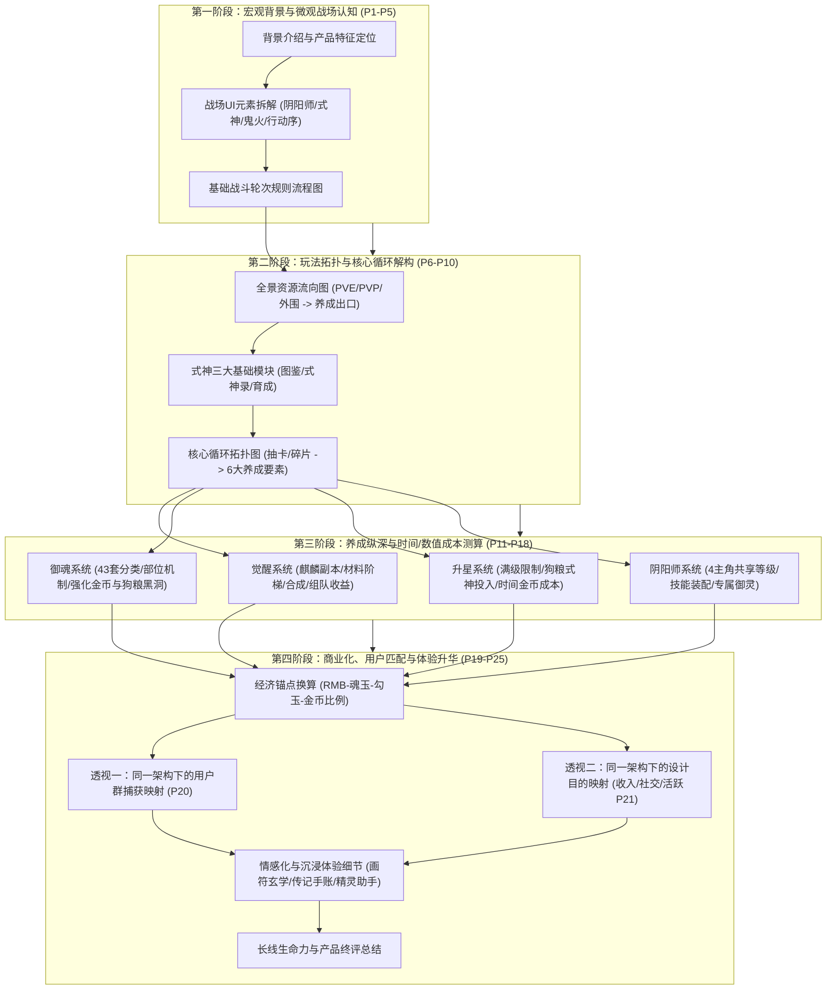
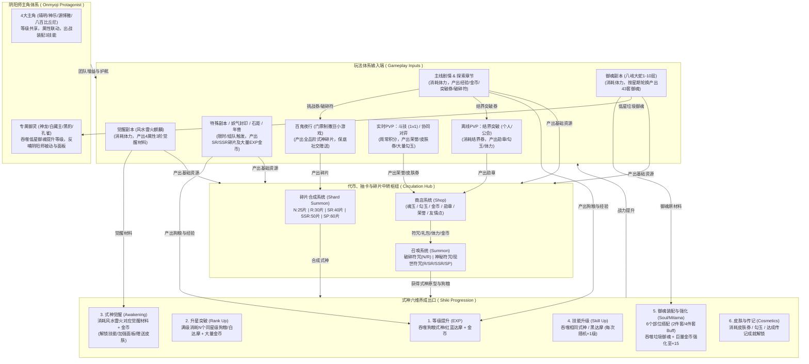
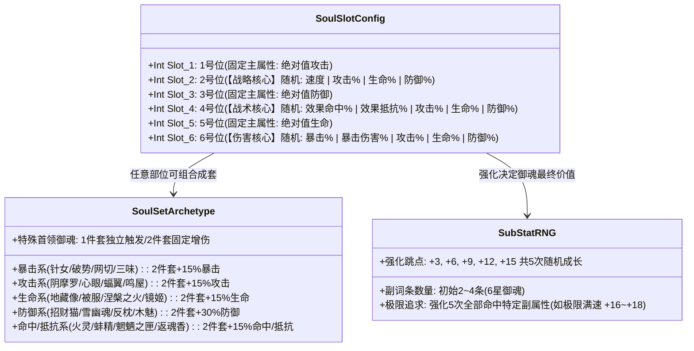
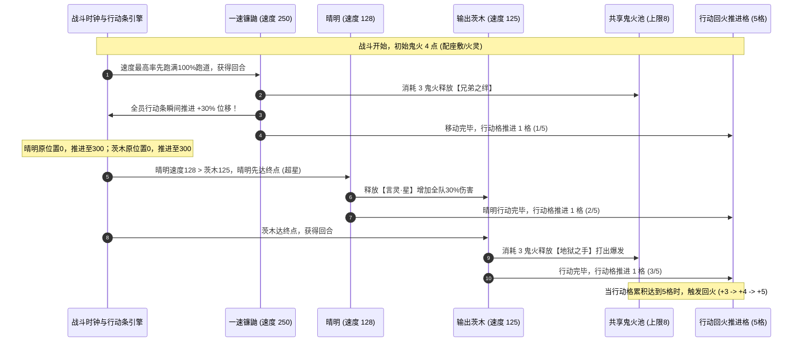
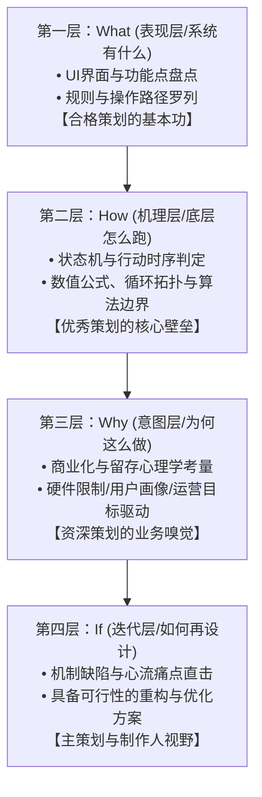

# 《阴阳师》系统与核心循环拆解 · 深度分析与策划能力评估报告

> **分析对象**：`E:\游戏策划案\拆解案（20份）\9、阴阳师拆解.pdf`  
> **文档版本**：Ver 1.7.5.716971（处于游戏运营成熟期，已实装SP式神、43套御魂、十层魂十与觉醒十层）  
> **报告类型**：经典卡牌RPG系统逆向拆解深度评审 / 资深游戏策划能力模型诊断  
> **撰写视角**：资深游戏主策划 / 制作人 / 行业导师  

---

## 1. 拆解案基本信息与架构全貌

### 1.1 文档基本信息与定位
- **文档名称**：9、阴阳师拆解.pdf
- **文档格式与篇幅**：25页横版PPT演示文档（高清PDF导出版）
- **分析标的**：《阴阳师》（网易游戏于2016年自主研发并发行的3D日式和风回合制卡牌RPG标杆级产品）
- **文档类型定位**：**系统架构与玩法流向逆向拆解案**。该文档重点围绕《阴阳师》的“战斗概览、玩法产出、全景资源流向、核心养成循环、六大式神养成维度、阴阳师/御灵系统、商城经济比率、目标用户画像匹配、设计目的透视，以及非核心体验细节”展开系统化解构。
- **拆解覆盖的核心系统**：
  1. **战斗系统概览与规则**（战场布局要素、基础出手逻辑、技能与鬼火UI）
  2. **全景资源流向图**（主线/探索/觉醒/御魂等PVE、结界突破/斗技等PVP、百鬼夜行与商店向六大式神养成及阴阳师御灵的输入输出）
  3. **核心循环大拓扑**（碎片召唤与抽卡双通道、觉醒/技能/升级/升星/御魂/皮肤六大消耗出口）
  4. **式神养成核心子系统**（觉醒副本门槛与材料合成、御魂43套分类与强化、升星狗粮机制与时间成本）
  5. **阴阳师与御灵系统**（主角等级共享、技能装配与升级、专属御灵消耗低星御魂提升数值）
  6. **商业化汇率锚点**（人民币、魂玉、勾玉、金币之间的兑换比例）
  7. **三维透视投影**（同一套资源流向底图下的“用户群捕获”与“设计目的：收入/社交/活跃”映射）
  8. **体验细节剖析**（画符召唤仪式感、网易精灵助手、式神传记与手账评价系统）

---

### 1.2 整体架构与行文逻辑结构图

原文案展现出极强的工业化归纳与图表化行文逻辑，其推导脉络由表及里，又由系统层上升至业务目的层：

---

### 1.3 核心循环与全景资源流向重构

原作者在 Slide 6 与 Slide 10 中绘制了高度结构化的资源循环图，在此将其整合升级为具备完整数学与逻辑流向的工业级架构图：

---

### 1.4 御魂搭配生态与部位随机学全貌

御魂系统是《阴阳师》长线策略深度与“无限养成追求”的基石。原文案仅提及“43套御魂、6个部位、强化15级”，作为深度分析，必须在此将御魂的**部位规则、词条分布池、两件套/四件套战术生态**进行完整解构：

- **部位设计的战略心机**：
  1. **1、3、5号位为“数值保底位”**：主属性绝对值固定，主要追求优秀的副词条（如高双暴、高速度）。
  2. **2、4、6号位为“质变机制位”**：
     - **2号位速度**：全游戏先手权的命门，出速度主属性已属小概率，副属性再出速度并强满5次更是万里挑一。
     - **4号位效果命中 / 效果抵抗**：控制流式神（兵俑、雪女、凤凰火）与驱散解控式神（雨女、数珠）的核心对抗指标。
     - **6号位暴击 / 暴击伤害**：打手式神从“满暴击（100%）”跨越到“超高爆伤（250%+）”的终极分水岭。

---

### 1.5 行动条拉条推条与鬼火战斗机制全景还原

原拆解案在 Slide 4 和 Slide 5 的战斗规则流程图中出现了**重大常识性偏差**（误将ATB行动条当成普通速度排序回合制）。在此给出网易《阴阳师》真实的底层战斗状态机与行动条时钟算法：

#### 核心数学模型：连续时间跑道（Continuous Action Bar Model）
设行动条跑道总长度为 $L = 1000$。全场所有式神和阴阳师的初始位置 $P_i = 0$。
- **自然推进机制**：游戏时钟按微分步长推进。每个单位的前进速度为其实时面板速度 $V_i$。到达终点所需时间为：
  $$T_i = \frac{L - P_i}{V_i}$$
  系统判定 $\min(T_i)$ 的单位到达终点（$P_i \ge L$），触发该单位的“行动回合（Turn）”。行动完毕后，该单位位置重置回 $P_i = 0$。
- **拉条机制（Action Bar Advance）**：如山兔【兔子舞】增加友方 $30\%$ 行动条，即令友方单位的位置产生瞬时正向位移：
  $$P_i' = \min(L, P_i + 0.3 \times L)$$
- **推条机制（Action Bar Knockback）**：如食发鬼【真实之颜】击退敌方 $30\%$ 行动条：
  $$P_i' = \max(0, P_i - 0.3 \times L)$$
- **超车与超星（Overtake & Star-Crossing）**：若拉条后友方输出式神的新剩余时间 $T_{\text{dps}}' = \frac{L - P_{\text{dps}}'}{V_{\text{dps}}}$ 仍然大于敌方首个式神的剩余时间 $T_{\text{enemy}} = \frac{L - P_{\text{enemy}}}{V_{\text{enemy}}}$，则敌方将发生**超车插队**。因此催生了经典的“双拉条体系（镰鼬+山兔）”与“精准卡速调轴”。

---

## 2. 这篇拆解案“好在哪里”（深度亮点剖析）

尽管原案存在部分底层规则细节的偏差，但作为一份工业级逆向工程PPT，其在**架构归纳、业务透视、成本量化、外围情感体验分析**等方面展现出极高的策划水准与洞察力。

### 亮点一：“一张底图，多维透视”的系统架构表达范式
原案最亮眼、最具高级策划素养的技巧在于 **Slide 6（资源流向） $\rightarrow$ Slide 20（捕获用户群） $\rightarrow$ Slide 21（设计目的）** 的连续三层“同构映射法”：
- **第一层（基石）**：在 Slide 6 建立完整的“系统输入（PVE/PVP/活动） $\rightarrow$ 资源中转（货币/符咒） $\rightarrow$ 养成出口（式神六维/主角御灵）”物理拓扑图。
- **第二层（用户透视）**：在 Slide 20 中，原作者完全保留 Slide 6 的架构底图，直接将目标用户群用半透明色块贴合标注在对应节点上：
  - 主线剧情PVE $\rightarrow$ 标记【文字爱好者】；
  - 实时斗技/协同对弈 $\rightarrow$ 标记【策略PK喜好玩家】；
  - 召唤/碎片合成/图鉴 $\rightarrow$ 标记【收集控】；
  - 皮肤/传记 $\rightarrow$ 标记【外观党】。
- **第三层（商业与运营透视）**：在 Slide 21 中，再次复用同一底板，用菱形图标将策划的设计终极目的印刻在各系统之上：
  - 商店/抽卡/御魂金币坑/皮肤 $\rightarrow$ 标记【收入（Revenue）】；
  - 探索章节/单人副本/离线突破 $\rightarrow$ 标记【活跃（DAU/Time）】；
  - 组队PVE/多人副本/公会突破/实时斗技 $\rightarrow$ 标记【社交（Social Bind）】。
> **主策划点评**：这是极高级的策划图表表达技巧！初级策划往往画完系统图后，用数万字文字去空泛叙述商业化与用户画像；而原作者通过“单底图多维投影”，让审阅者一眼看穿**每一个系统功能存在的商业与运营意义**，体现了极佳的宏观系统策划结构化思维。

---

### 亮点二：时间成本与经济黑洞的敏锐量化直觉
很多系统拆解案仅满足于说明“觉醒需要材料，升星需要狗粮”，原作者则敏锐地将这些机制换算成了**玩家直观感知的“时间成本”与“体力/货币消耗公式”**：
1. **觉醒门槛梯度测算**（Slide 12）：
   - 觉醒 R 式神：150 体力 + 约 0.5 小时；
   - 觉醒 SR 式神：600 体力 + 约 2 小时；
   - 觉醒 SSR 式神：1200 体力 + 约 4 小时；
   - 敏锐指出：觉醒副本是日常获取材料的唯一途径，其高额体力消耗构成了初中期拉升在线时长（保活跃）与售卖体力的第一道变现闸门。
2. **升星“狗粮大山”的时间量化**（Slide 15）：
   - 明确指出从2星培养至6星需要消耗大量的消耗品式神、耗资520,000金币，以及“数百小时”的游戏时间。
3. **金币黑洞定位**（Slide 14）：
   - 指出强化单个5星御魂至15级需消耗超过40万金币与大量低星御魂素材（折合约60小时积累），深刻揭示出《阴阳师》看似卡牌抽卡，实为**金币与狗粮极度通缩的数值调控本质**。
4. **硬通货汇率锚定**（Slide 19）：
   - 清晰推导出：$1 \text{ RMB} = 1 \text{ 魂玉} = 5 \text{ 勾玉} = 6000 \text{ 金币}$（以 $648 \text{元} = 3240 \text{勾玉}$ 为基准锚点），为全篇的经济循环提供了统一的价值标尺。

---

### 亮点三：敏锐捕捉“非核心外围细节”对IP长线生命力的乘数效应
在 Slide 22 至 Slide 24 中，原作者没有将目光局限在冰冷的战力与数值上，而是深刻提炼了《阴阳师》在情感化设计上的三大“出圈护城河”：
1. **画符玄学与召唤仪式感**（Slide 22）：
   - 玩家在屏幕上手绘五角星、各类图案甚至录制语音抽卡。作者准确提炼出“仪式感（Ritual）”能够增强玩家对世界观的认同，将原本冷酷的随机抽卡（Bernoulli Trial）转化为玩家自发传播的“玄学社交话题”。
2. **手账与式神评价系统（国内最早的内嵌弹幕社区）**（Slide 24）：
   - 《阴阳师》在式神录中内置了留言板。作者敏锐指出这是国内手游最早实装的角色同好交流平台，极大促进了二次元群体的“厨力共鸣”与同人UGC生态沉淀。
3. **网易精灵助手**（Slide 23）：
   - 在客户端内置智能问答库，降低复杂卡牌机制与多达数十种御魂效果带来的新手认知负荷。

---

### 亮点四：组队机制对社交与活跃的杠杆洞察
原作者在 Slide 11、12、13、14 中反复强调了同一条设计逻辑：**“组队刷本可显著提高胜率并缩短战斗时间，让玩家更倾向组队”**。
- **机制背后的策划心理学**：
  - 单人挑战魂十/觉醒十需消耗 6 点体力，而组队挑战仅消耗 4 点体力（直接节省 $33.3\%$ 体力）；
  - 组队模式下，队员只需各出 1~2 个式神（如一人出打手，一人出打火机或拉条），大幅降低了单个玩家的通关阵容门槛；
  - 这一机制成功实现了网易经典的“强行将重度单机肝本转化为高频社交绑定”，让阴阳寮好友、师徒系统与现实微信群形成了极强的熟人社会连带，构成了高留存的粘合剂。

---

## 3. 体现了策划的什么核心能力（能力模型对照与深度诊断）

通过对该文档的深度复盘，可以对照工业界策划职级标准，对作者的各项核心专业能力进行客观评定：

### 3.1 策划能力模型雷达与评分

| 能力维度 | 评级（1-5星） | 核心优势表现 | 暴露的致命短板与硬伤 |
| :--- | :---: | :--- | :--- |
| **系统架构能力** | ★★★★☆ (4.0) | 全景资源流向图极其工整，输入/转化/出口层级分明，具备宏观全局视野。 | 对复合子系统的边界定义略显粗糙，缺少系统间数据交互接口规范。 |
| **战斗拆解能力** | ★★☆☆☆ (2.0) | 能准确标注战场UI与基础要素（角色、技能、鬼火条、出手顺位）。 | **产生常识性误读**：把核心的“跑道式ATB行动条”写成“每回合按速度排序”，完全遗漏拉推条、超星、反击与供火轴。 |
| **数值逆向能力** | ★★★☆☆ (3.0) | 具备宏观经济锚点感知，量化了觉醒、升星、强御魂的体力与时间成本。 | 缺少严谨的数学公式推导（如升星狗粮树的阶乘级计算、御魂跳点概率期望、伤害公式）。 |
| **运营与商业化洞察**| ★★★★☆ (4.0) | 独创性地在资源底图上叠印“用户画像”与“设计目的（收/社/活）”，业务穿透力强。 | 缺乏对各阶层ARPU值、抽卡保底期望与活动运营节奏的系统拆解。 |
| **用户体验与共情力**| ★★★★☆ (4.0) | 敏锐发掘画符仪式感、手账式神评论、式神传记等情感共鸣与社区裂变节点。 | 缺少对中后期“极度枯燥重复刷本（重肝）”带来的挫败感与心流疲劳的解决方案探讨。 |

---

### 3.2 深度诊断：主策划眼中的四大硬伤与能力盲区

如果这是一位向主策划或制作人汇报的系统/战斗策划，该案在展现出极强制图功底的同时，暴露出以下必须纠正的专业硬伤：

#### 致命硬伤一：战斗系统底层逻辑的降维误判（业余级疏漏）
- **问题所在**：在 Slide 5《战斗规则》流程图中，作者写道：“比较角色速度属性，由高到低行动 $\rightarrow$ 出手角色是否存活 $\rightarrow$ 行动 $\rightarrow$ 回合结束进入下一回合”。
- **专业深度批判**：
  - 这是对传统回合制（如《梦幻西游》、《宝可梦》每回合由速度决定选招顺序）的机械套用，完全违背了《阴阳师》参考自《魔灵召唤》的核心战斗基石——**基于时间推进的连续行动条跑道制（ATB）**。
  - 在《阴阳师》中，**不存在统一的“全场回合结束进入下一回合”**！每个式神的回合是异步且独立的。速度高的式神可以在速度低的式神跑满一圈前，跑满两圈甚至三圈（连续多次行动）。
  - 该误判直接导致作者在后文中**完全无法解释《阴阳师》最具深度、最富竞技博弈的战术体系**：例如“一速抢断”、“双拉条防超车”、“晴明128超星调轴”、“雨火流（雨女减速驱散+凤凰火眩晕）”、“反击流（狰御魂受击反击）”。

#### 致命硬伤二：供火机制（鬼火系统）的深度缺失
- **问题所在**：仅在 Slide 4 标出了“鬼火”和“鬼火消耗”，全文再未对鬼火的流转与博弈展开任何分析。
- **专业深度批判**：
  - 鬼火是《阴阳师》战斗资源管理的核心咽喉。全队6人（1阴阳师+5式神）共享一个上限为 8 点的公共鬼火池。
  - **回火推进格（5步一轮）**：全场（不分敌我，本方行动一次推进一格）每走满5格，产生一次回火，回火量依轮次递增（第一轮+3，第二轮+4，第三轮及以后固定+5）。
  - **供火生态的分层设计**：正因为公共鬼火的极度稀缺与动态回火规则，才诞生了整个“打火机式神谱系”——稳定供火但自残的座敷童子、靠行动与受击概率产火的辉夜姬、推条回火且提升全队攻击的追月神、以及御魂【招财猫】（行动时50%概率回2火）与【火灵】（开局送3火）。作者遗漏此机制，等于拆解《英雄联盟》却遗漏了法力值与技能CD机制。

#### 致命硬伤三：御魂随机性对长线留存的心理学黑洞未能穿透
- **问题所在**：Slide 13-14 对御魂的分析停留在“有43套，消耗低星升到15级，消耗40万金币”。
- **专业深度批判**：
  - 《阴阳师》之所以被称为“御魂师”，是因为式神抽到只是“毛坯”，御魂才是“精装修”。御魂拥有极其残酷的**四重伪随机（4-Tier RNG）机制**：
    1. **套装掉落随机**（周一至周五轮换池，周末大乱斗）；
    2. **部位与主属性随机**（2/4/6号位目标主属性出现率通常低于 $10\%$）；
    3. **初始副词条条数与类型随机**（满胚子必须是初始4条副词条，且包含速度/暴击等有效词条）；
    4. **强化跳点随机**（每提升3级随机强化一条副词条，强化5次全部命中目标属性的概率为 $(\frac{1}{4})^5 = \frac{1}{1024} \approx 0.098\%$）。
  - 这种“超低概率但一旦命中带来极其巨大爽感”的机制，在心理学上被称为**变比率强化日程（Variable Ratio Schedule of Reinforcement）**，是斯金纳箱（Skinner Box）在游戏设计中的终极应用，也是玩家在获得心仪式神后依然能够留存3~5年的根本动力源泉。原案未作深入分析，错失了最有价值的数值与心理学洞察。

#### 致命硬伤四：升星“狗粮树”缺少严谨的树状数学模型
- **问题所在**：Slide 15 仅给出一个笼统结论：“培养大量的消耗品式神，投入数百小时，消耗52万金币”。
- **专业深度批判**：
  - 优秀的数值/系统策划拆解，必须给出严密的**几何级数消耗树**。将一个2星式神升至6星，其底层狗粮树结构为：
    - 升6星：需1个满级5星本体 + **5个5星狗粮**；
    - 5个5星狗粮：需5个满级4星 + **20个4星狗粮**；
    - 20个4星狗粮：需20个满级3星 + **60个3星狗粮**；
    - 60个3星狗粮：需60个满级2星 + **300个2星狗粮（白蛋/N卡）**；
  - 结合奉为达摩（白蛋升级所需经验减半）的最优培育策略、姑获鸟/大天狗等“狗粮大队长”带队刷探索章节困难17/18本的单局经验收益，可以精确推导出培养一个6星式神的**纯体力期望与日历天数**。原案缺乏这一层推导，削弱了文档在数值领域的参考价值。

---

## 4. 学习如何写策划拆解案（实战指南与方法论提炼）

结合这份案例文档的突出长处与惨痛教训，我们为系统/战斗/数值策划提炼出一套可直接复用的**工业级拆解案方法论与实战框架**。

### 4.1 卓越拆解案的四层递进框架（从What到If）

一份能够直接征服主策划与面试官的拆解案，必须杜绝“流水账说明书”，严格遵循以下四层演进模型：

---

### 4.2 ATB回合制战斗的标准拆解模板与公式规范

当你拆解类似《阴阳师》、《崩坏：星穹铁道》、《魔灵召唤》、《第七史诗》等带有行动条机制的游戏时，**切记不可直接套用简单速度排序流程**，必须按以下三步进行标准解构：

#### 规范步骤：
1. **建立跑道数学模型**：
   - 明确行动条长度常数 $L$（如 1000 或 100%）。
   - 给出单位位移函数：$P(t) = \int V(t) \, dt$。
   - 定义行动判定条件：$\text{ActiveUnit} = \arg\min_i \left( \frac{L - P_i}{V_i} \right)$。
2. **拆解位移改变机制（拉条/推条）**：
   - 区分“增加速度（Buff，斜率改变）”与“直接推进跑道百分比（位移突变）”。
   - 建立“超车与插队判定逻辑”：判断在拉条发生后，受拉单位到达终点的时间 $T_{\text{new}}$ 是否小于当前排在第一位的单位的剩余时间 $T_{\text{first}}$。
3. **拆解公共资源槽（能量/鬼火）的生成与消耗平衡**：
   - 建立队伍“耗火-供火收支平衡表（Energy Balance Matrix）”：
     $$\sum_{\text{Turn}} \text{Cost} \le \sum_{\text{Turn}} \text{Regen}(\text{Natural} + \text{Shiki} + \text{Soul})$$
   - 分析极限配速下是否会发生“断火死锁”。

---

### 4.3 装备/御魂随机生成系统的拆解深度示范

拆解随机装备系统（御魂/圣遗物/器灵）时，必须提炼出**四维分析表格**：

| 分析维度 | 关键拆解要点 | 《阴阳师》实战对照 |
| :--- | :--- | :--- |
| **部位职能分工** | 区分“保底数值位”与“策略质变位” | 1/3/5号位固定攻防生；2号位承载速度，4号位承载命中抵抗，6号位承载暴击爆伤。 |
| **主属性权重分布**| 统计各主属性出现的实际概率权值 | 2号位速度与6号位暴击爆伤权重通常显著低于生命/防御百分比（存在隐形权重偏置）。 |
| **副词条洗练深度**| 计算“完美胚子”到“强化极品”的阶梯概率 | 初始4词条极品胚子获得率 $\times$ 强化5次全中特定词条概率（$\approx 1/1024$），测算期望毕业成本。 |
| **回收与沉淀机制**| 垃圾装备如何反哺系统，避免资源死锁 | 低星与淘汰御魂作为强化狗粮喂养；多余高星御魂在“神秘商人/御魂奉纳”中转化为金币、青吉鬼与勾玉。 |

---

### 4.4 策划拆解必须避开的四大误区

1. **误区一：把截图罗列当成系统拆解（UI流水账）**
   - *反思*：原案虽然截图清晰，但部分页面（如 Slide 7、8、9、16、17）几乎只有游戏截图与几行说明，未深入分析功能背后的交互逻辑与数据结构。
   - *纠正*：每一张截图必须配有**系统逻辑图或数据流向标注**，解释“玩家点击该按钮后底层发生了什么”。
2. **误区二：将复杂的连续动态机制降维成静态表象**
   - *反思*：原案在 Slide 5 犯下的“行动条写成固定回合速度排序”，就是将动态跑道降维成了静态顺序，丢失了灵魂。
   - *纠正*：遇到不确定的战斗机制，必须在客户端内通过实机录屏、慢放逐帧观察伤害跳字与行动条头像位移，甚至查阅官方底层说明，严禁凭直觉脑补。
3. **误区三：只谈数值结果，不讲推导过程**
   - *反思*：原案提及“需要培养大量消耗品式神、耗资52万金币”，未解释52万是如何由不同星级的合成费累加得出的。
   - *纠正*：在拆解案附录中附上简要的数学推导树或Excel公式，展现严谨的数值功底。
4. **误区四：缺乏再设计与优化提案（缺失第四层 If）**
   - *反思*：原案止步于对现状的总结，未指出《阴阳师》在运营中后期暴露出的“御魂强化弃件率极高导致挫败感强”、“魂十重复挂机过肝”等痛点。
   - *纠正*：优秀拆解案应在文末针对痛点提出可落地的改进方案（例如：御魂胚子副词条定向锁定道具、魂十批量扫荡或后台自律式神托管等）。

---

## 5. 总结与综合评价

### 5.1 对本篇拆解案的总体定级
- **综合评定**：**良好+（工业化中高级系统拆解水准，82/100分）**
- **核心价值**：
  1. 架构图绘制极度规范，Slide 6 的全景资源图与 Slide 10 的核心循环图具备极高的工业参考价值；
  2. Slide 20 与 Slide 21 的“底图多维透视映射法”是全案最大的教学级亮点，教科书般展现了系统与商业、用户之间的血肉联系；
  3. 敏锐抓住了和风卡牌的情感化体验细节（画符仪式、式神手账内嵌社区）。
- **主要遗憾**：
  战斗底层机制发生常识性降维误读，鬼火与行动条精妙博弈缺失；御魂多重随机与升星狗粮树缺乏纵向数学公式支撑。

### 5.2 给中初级策划的求职与成长启示
本篇拆解案展现了一个极具启发性的样板：**即便你在战斗底层或深层概率数学上有局部短板，只要你拥有卓越的宏观架构思维、清晰的可视化表达能力、以及强烈的商业与用户共情意识，你依然能够制作出一份令人眼前一亮的高质量方案**。

对于立志成为主策划或制作人的从业者而言，下一步的跃升就在于：**将宏观的架构力与微观的底层机制、严密的数值推导融会贯通**，既能仰望星空看清商业全景，又能脚踏实地写出无懈可击的状态机与算法规则。
