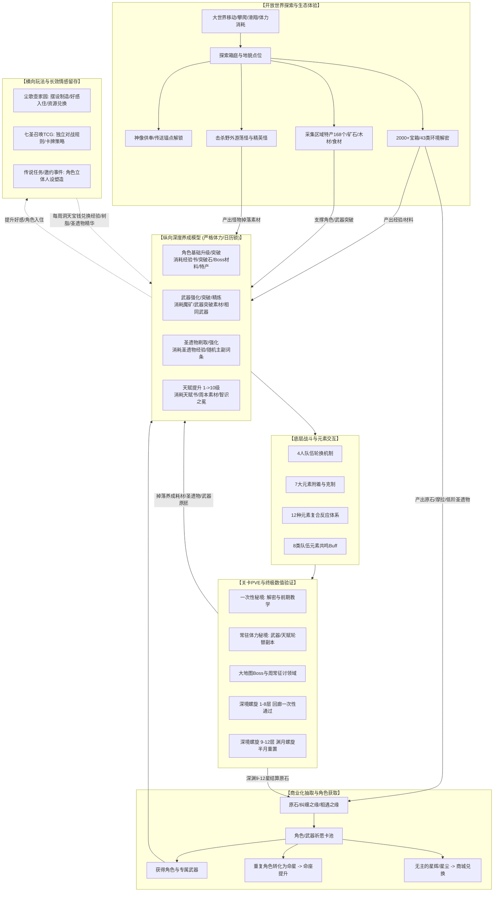
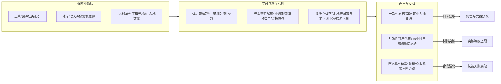
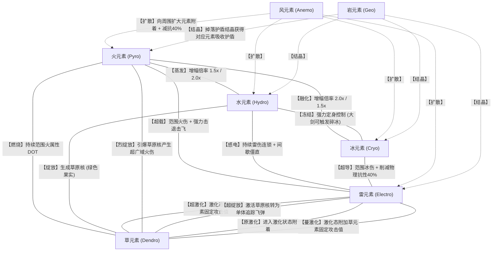
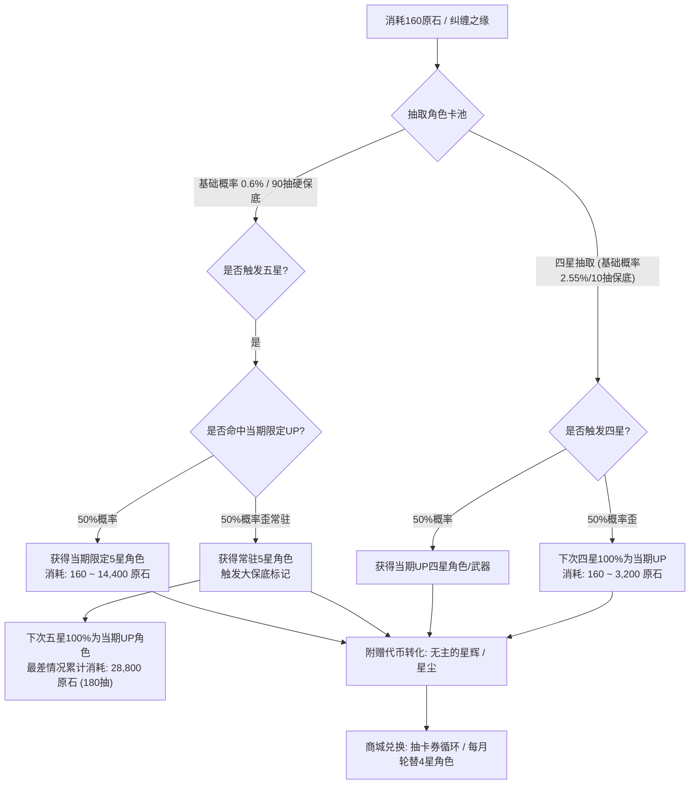

# 《原神篇 游戏系统与数值逆向深度拆解》深度分析报告

> **分析对象**：`E:\游戏策划案\拆解案（20份）\10、游戏拆解 原神篇.pdf`  
> **报告撰写**：资深游戏主策划 / 制作人 / 行业导师  
> **文档版本**：基于《原神》PC端 3.5 版本深度拆解（64页专业全案）  
> **研究目的**：深度剖析全球现象级二次元开放世界RPG的系统拓扑、数值模型、循环闭环与商业化架构，提炼工业级拆解案方法论与核心策划能力模型。

---

## 1. 拆解案基本信息与架构全貌

### 1.1 文档基本信息
- **文档名称**：游戏拆解 原神篇
- **文档规格**：64页完整PDF文档，图文并茂，包含界面交互走查、数值建模反推、系统定位剖析与工业级优缺点建议。
- **文档类型**：**全案级大型逆向系统拆解 + 养成数值精算建模 + 开放世界生态机制分析报告**。
- **拆解视角**：深度玩家体验 + 专业系统/数值策划双重视角（作者拥有2年游玩经验、冒险等阶58级、充值2000+元，具备坚实的玩家心流体感与高阶逆向推演功底）。
- **分析覆盖的核心模块**：
  1. **系统顶层框架与资源循环**（树脂体力体系、产销模型、周常与日历时间锁限制）
  2. **角色获取与商业化卡池**（保底算法、抽卡概率分布、四星/五星资源阈值、分层付费体系）
  3. **角色进阶纵向养成链条**（基础等级、武器系统、圣遗物词条与强化、技能天赋体系、命座与时装）
  4. **开放世界大世界生态**（地貌/空间探索、箱庭交互、解密机制、钓鱼、世界任务与成就体系）
  5. **底层战斗与元素反应系统**（7大元素、12种复合元素反应机制、队伍4人轮切、8类元素共鸣）
  6. **关卡与PVE验证体系**（地脉/秘境/首领Boss/周本、深境螺旋1-12层梯度与环境Buff）
  7. **横向拓展与长留存衍生子系统**（尘歌壶家园建造/种植/好感、七圣召唤内置TCG全套卡牌对战规则）
  8. **产品SWOT优劣势与长线运营策略建议**。

---

### 1.2 整体架构与系统逻辑拓扑图

原神的系统架构核心是**“以角色收集与长期养成”为支柱，以“开放世界箱庭探索”为内容体验载体，以“元素反应轮切战斗”为交互底层，以“深境螺旋/高阶秘境”为数值终极验证”的四位一体闭环**。



---

### 1.3 核心子系统拓扑专题

#### 专题一：开放世界大世界探索与资源循环拓扑
开放世界不是孤立的背景板，而是串联起角色收集、素材消耗、剧情代入和在线时长考核的巨型中枢。



#### 专题二：元素反应与配队相生拓扑矩阵
原神战斗系统彻底摆脱了传统MMO站桩输出的刻板印象，通过“元素附着”与“4人无缝轮切”构建了极其高上限的反应网：



#### 专题三：商业化抽卡保底与价值转化拓扑
拆解案对商业化概率分布与原石成本的严密量化推演：



---

## 2. 这篇拆解案“好在哪里”（深度亮点剖析）

这篇原神拆解案在市面流通的几百份游戏拆解中属于**极其罕见的、具备工业级严谨度的硬核之作**。作者不仅拥有58级2年以上的超长沉浸式游玩深度，更具备将游戏底层机制数学化、模型化的专业素养。

### 亮点一：震撼的养成周期逆向推算与“原粹树脂（体力）精算模型”
市面绝大多数二流策划案在提到养成时，往往用“需要消耗很多材料”、“养成周期偏长”等虚浮词汇带过。而本案作者**直接建立了以日产180点原粹树脂为基准的底层经济等价模型**，并给出了精确到个位数的数学推导：

#### 1. 角色 1->90 级满级突破模型推演
- **摩拉缺口**：2,092,530。扣除日常产出（13.2w/天）以及世界Boss挑战期间同步产出，计算出仍需额外消耗 **280 点原粹树脂** 刷取地脉藏金之花；
- **经验书缺口**：419本大经验书（折合798万经验）。扣除尘歌壶每周20本产出，结合地脉启示之花单次产出期望（4~5大书+6~7中书），精确推算出需挑战64次地脉，累计耗费 **1,440 点原粹树脂**（需8天日常体力）；
- **首领材料（46个）**：世界Boss每次固定掉落2-3个，需击败19次，消耗 **760 点原粹树脂**；
- **突破宝石（271碎屑当量）**：打Boss刷材料期间同步获得163个，尚缺108个碎屑，按Boss平均掉落8.6个碎屑折算，需额外挑战13次Boss，消耗 **520 点原粹树脂**；
- **区域特产（168个）**：大世界单次刷新上限不足168个，特产48小时自然刷新，硬性锁定 **至少需要3个自然日**；
- **小怪掉落物**：需初级18/中级60/高级36，大世界刷怪需耗费2天（每日1~1.5小时）；
- **【精算结论】**：单角色等级拉满需消耗原粹树脂 $280 + 1440 + 760 + 520 = 3000$ 点，**严格折合 16.67 天（约17个自然日）**！

#### 2. 五星专属武器 1->90 级突破模型推演
- 摩拉缺口结合日常收益，需额外消耗220点树脂；
- 武器突破秘境材料需通关20次，消耗400点树脂；
- 精锻用魔矿（907矿）通过大世界挖矿与任务弥补；
- **【精算结论】**：单把五星武器拉满消耗原粹树脂 $220 + 400 = 620$ 点，**折合 3.44 天（约4个自然日）**！

#### 3. 单角色3个天赋 1->10 级满级模型推演（死门门锁分析）
- 摩拉消耗高达 **4,957,500**（全游戏单一养成项目之最），额外摩拉树脂720点；
- 天赋秘境书折算需1224本二星书，保底通关153次，消耗 **3,060 点原粹树脂**；
- 3个“智识之冕”作为版本活动与神树供奉的战略硬通货；
- **最关键的自然周锁——周本Boss素材（18个）**：每次掉落2-3个，折中需8次击杀。由于周本受限于“每周仅限挑战领取一次”的硬性规则，无论消耗多少体力，**该角色满天赋成型时间被数学铁律死死锁定在 8 周（即 50 个自然日以上）**！

> **【主策划级深度洞见】**：
> 作者在报告中敏锐地捕捉并揭示了米哈游的卡池数值控制节奏：
> **角色升级（17天） + 武器拉满（4天） = 21天，恰好与原神每期角色祈愿卡池持续21天的轮换周期完全重合！**  
> 这绝非巧合，而是工业化数值设计的高度协同：当期新角色上线，玩家投入整个卡池期的自然体力刚好能把角色与专武拉到满级能用的状态；而若想追求极致满天赋，则必须跨越两个半卡池版本（50天以上）。这种“短期立即可用”与“长线深度卡脖子”的数值节拍，构成了原神极高留存率的核心心理锚点。

---

### 亮点二：圣遗物词条方差陷阱与“无限长草期泄洪”深度剖析
拆解案对圣遗物系统的剖析一针见血：
1. **主词条与副词条的分层设计**：生之花（固定生命）、死之羽（固定攻击）用于保证角色下限，降低新手配置难度；而时之沙、空之杯、理之冠的主词条采用大随机池，理之冠的双暴与空之杯的对应元素伤害更是设置了极低掉率，构筑起极高的数值壁垒。
2. **副词条4级随机强化跳档机制**：即使刷到初始4词条极品坯子，每升4级依然有25%的概率随机强化，极易“强化全歪防御”。
3. **定位剖析**：相较于角色等级、武器、天赋的“确定性保底反馈”，圣遗物是原神唯一的**“极高方差无底洞（Negative Variance Sink）”**。在版本更新间歇的长草期，正是圣遗物系统承担了海量玩家日常树脂的宣泄，防止核心数值迅速通货膨胀。

---

### 亮点三：元素反应系统的“非单向克制”与底层数值自洽
作者跳出了市面上“水克火、火克草”这种浅薄的五行生克认知，精准阐释了原神战斗机制的精妙：
1. **双向反应与倍率非对称性**：水打火（2.0倍蒸发）与火打水（1.5倍蒸发），让反应的先后手具有极高的操作讲究和配队收益；
2. **须弥3.x草系激化/绽放体系的系统性补全**：不仅记录了原激化、超激化、蔓激化的加算逻辑，更分析了草原核（Bloom）遇火引发“烈绽放（Burgeon）”和遇雷引发“超绽放（Hyperbloom）”的三元复合反应；
3. **战斗机制与大世界解密的统一性**：元素附着不仅用于怪物破盾与输出增幅，更无缝嵌入到了大世界交互中（火烧荆棘宝箱、冰冻水面渡海、草种粉碎石壁、雷元素激发弹跳蘑菇），大幅降低了玩家跨系统学习的心智负担。

---

### 亮点四：深境螺旋的漏斗模型与商业化驱动
拆解案对深境螺旋的拆解直击要害：
1. **体验梯度划分清晰**：1-8层（深境回廊）是一次性资源，提供前中期通关的正向反馈与自信心建立；9-12层（渊月螺旋）是每半月刷新的高压考核场；
2. **商业化与卡池强绑定**：后四层每期更替的“渊月祝福”与怪物分布，本质上是当期UP限定五星角色的“最佳售卖展示橱窗”。为了满星通关拿齐600原石，高练度玩家会自发产生强烈的配队克制焦虑，进而推动抽卡消费。

---

## 3. 体现了策划的什么核心能力（能力模型对照）

通过对这篇64页拆解报告的审视，可以清晰投射出撰写者作为优秀游戏策划的多维核心专业胜任力：

| 策划专业维度 | 文档中的具体体现与证明 | 对应能力模型层级 |
| :--- | :--- | :--- |
| **逆向工程与系统还原能力** | 能够穿透复杂的客户端表现，准确归纳出“获得途径、消耗数量、兑换比例、概率期望、掉落权重”的完整工业级系统规格。 | **高级系统策划 (Senior System Designer)** |
| **数值建模与精算推演能力** | 敏锐提炼出原粹树脂日产180点作为“游戏一般等价物”，并把摩拉、经验、Boss掉落、周本CD全部折算进数学公式，推算出21天卡池与17天养成的耦合规律。 | **专家级数值策划 (Expert Numerical Designer)** |
| **心流曲线与用户体验洞察** | 能够精准捕捉不同用户层（纯二次元受众、硬核ARPG玩家、休闲探索玩家、低氪零氪党）在面对抽卡、探索长草、深渊受挫时的情绪波动曲线。 | **资深主策划 (Principal Game Designer)** |
| **商业化与闭环架构思维** | 深刻洞悉免费体验、微氪月卡、中氪专武、重氪满命的阶梯定价逻辑，将商业化抽卡精准锚定为整个游戏循环的起点和核心驱动引擎。 | **商业化架构师 / 制作人 (Game Producer)** |
| **批判性思维与方案落地能力** | 拒绝盲目崇拜爆款，客观指出大世界后期宝箱正反馈疲软、副本刷取单调机械、社群低龄极端粉丝化等致命痛点，并提出切实可行的改善思路。 | **主策划 / 专家评审 (Game Director / Reviewer)** |

---

## 4. 学习如何写策划拆解案（实战指南与方法论提炼）

对于希望提升专业水平、冲击一线大厂的策划新人或在职策划，本份原神拆解案提供了极高的学习范本价值：

### 4.1 工业级系统拆解案标准骨架（可复用模板）
一份具备说服力的高水准拆解案，建议严格遵循以下**“宏观-中观-微观-数值-反思”五层递进骨架**：
```
1. 游戏概述与测试环境声明（平台、版本号、作者体验深度证明）
2. 顶层架构与系统拓扑总图（核心闭环图、资源流转拓扑、主要系统清单）
3. 核心子系统纵深拆解（按功能模块切片）：
   ├── 3.1 界面交互走查与信息架构分析
   ├── 3.2 核心规则与业务逻辑流转
   ├── 3.3 系统定位（用一句话概括其在全盘中的使命）
   ├── 3.4 设计目的（策划为什么要做这个系统？解决了什么诉求？）
   ├── 3.5 用户体验与心流反馈（玩家玩的时候怎么想？）
   └── 3.6 优点分析与设计亮点剖析
4. 核心数值与经济体系反推（产出/消耗平衡、养成周期精算、概率模型）
5. SWOT综合评估与再设计建议（客观优劣势、设计痛点根因、可落地的改善方案）
```

---

### 4.2 应借鉴的高分技巧与闪光点
1. **“四段式复盘规范”贯穿全案**：
   在分析角色、武器、圣遗物、天赋、家园、七圣召唤等每一个独立系统时，均严格使用**“系统定位 -> 设计目的 -> 用户体验 -> 优点分析”**四段论。这种结构化行文能让主策或制作人一眼看懂你的设计思考深度。
2. **善用“资源等价物”构建数值量化坐标**：
   在分析复杂资源体系时，必须寻找一个核心基准锚点（在原神中就是“原粹树脂”与“原石”）。将所有零散素材最终换算为“需要消耗多少树脂”和“需要等待多少个自然日”，瞬间让数值分析具备了不可辩驳的科学说服力。
3. **区分“体力时间”与“自然日历时间”**：
   养成周期的估算切忌只算战斗耗时，必须把“首领特产刷新周期（48小时）”、“周本重置周期（每周一凌晨4点）”、“限时版本活动产出（每40天一个版本）”等自然时间门锁考虑在内，这才是成熟策划与业余爱好者的分水岭。

---

### 4.3 必须规避的拆解案常见误区
- **误区一：说明书化与UI界面截图流水账**：
  大量低质拆解案把页面按钮和弹窗罗列一遍，写成《原神使用指南》。切记：**拆解案的灵魂在于探究“为什么这么做”（Why），而不是描述“这里有什么”（What）**。
- **误区二：缺乏数据支撑的感性空谈**：
  使用“很难升”、“概率极低”、“感觉还行”等口头禅。必须摆出基准概率（0.6%）、保底机制（90抽/180抽）、期望值和树脂折算数据。
- **误区三：丧失批判意识的狂热追捧**：
  爆款游戏绝非完美无瑕，必须指出其在运营周期中的弊病（如大世界中后期宝箱原石边际递减、无扫荡机制导致的日常疲惫感等），展示客观专业的策划鉴别力。

---

### 4.4 在求职作品集与项目实战中的应用落地
1. **大厂求职作品定制策略**：
   - **投递系统策划**：重点精修第二节与第三节，突出四段式结构和完备的交互逻辑流，证明自己能直接上手写系统策划案（GDD）；
   - **投递数值策划**：重点精修角色升级与天赋养成的树脂精算推导过程，附带建立附录Excel表格或Python推演脚本，证明自己的数学建模与经济调优实力；
   - **投递关卡/战斗策划**：重点深化元素反应交互矩阵与大世界箱庭视觉引导分析。
2. **商业项目立项研发启示**：
   - 学习原神**“卡池周期与角色养成周期强绑定（21天对齐）”**的节拍控制法，在立项之初就将商业化售卖节奏与基础数值成型节奏进行一体化设计，从根本上解决数值膨胀与长草期流失难题。
