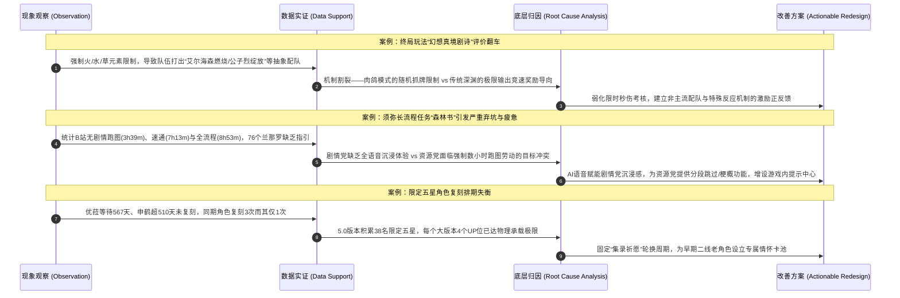
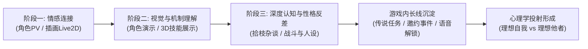
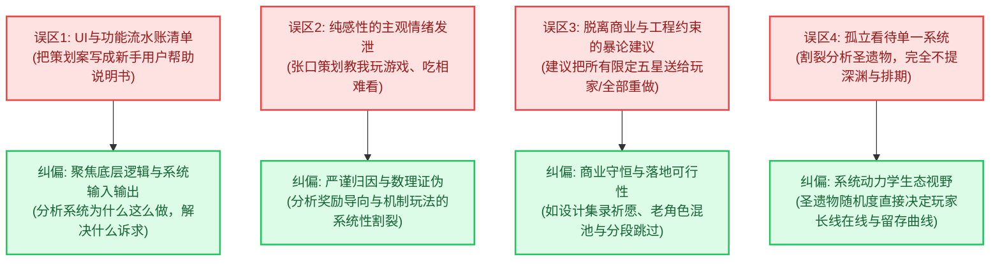

# 《原神》综合产品评测与生态演进报告 · 深度剖析与游戏策划方法论全景指南

> **报告版本**：V1.0  
> **分析对象**：`E:\游戏策划案\拆解案（20份）\12、原神测评.pdf`（共56页）  
> **版本锚点**：涵盖《原神》1.0公测至5.0纳塔上线（2020年9月 - 2024年秋季）  
> **评审人**：资深游戏主策划 / 制作人 / 行业导师  
> **报告归档路径**：`E:\游戏策划案\拆解案分析报告\12_原神测评报告_深度分析.md`

---

## 目录
- [一、拆解案基本信息与架构全貌](#一拆解案基本信息与架构全貌)
  - [1.1 核心档案与评测对象定位](#11-核心档案与评测对象定位)
  - [1.2 文档性质与评测维度全景矩阵](#12-文档性质与评测维度全景矩阵)
  - [1.3 原作八大模块评测逻辑架构图（Mermaid）](#13-原作八大模块评测逻辑架构图mermaid)
  - [1.4 行文脉络与“问题-成因-建议”推演闭环](#14-行文脉络与问题-成因-建议推演闭环)
- [二、这篇评测报告“好在哪里”（深度亮点剖析）](#二这篇评测报告好在哪里深度亮点剖析)
  - [2.1 机制拆解深度：穿透表层，逆向解构“高等元素论”数理模型](#21-机制拆解深度穿透表层逆向解构高等元素论数理模型)
  - [2.2 终局体验诊断：精准解剖“幻想真境剧诗”的核心玩法矛盾](#22-终局体验诊断精准解剖幻想真境剧诗的核心玩法矛盾)
  - [2.3 商业化与长线运营透视：限定卡池排期堰塞湖与抽卡经济学困局](#23-商业化与长线运营透视限定卡池排期堰塞湖与抽卡经济学困局)
  - [2.4 叙事工程学实证：以量化数据实锤“碎片化与长流程”的心流断裂](#24-叙事工程学实证以量化数据实锤碎片化与长流程的心流断裂)
  - [2.5 角色工业化包装与心理学投射：“理想自我”与“理想他者”的学术级拆解](#25-角色工业化包装与心理学投射理想自我与理想他者的学术级拆解)
  - [2.6 降维打击的IP生态跨界视野：从商业联名矩阵到非遗国粹文化破壁](#26-降维打击的ip生态跨界视野从商业联名矩阵到非遗国粹文化破壁)
- [三、体现了策划的什么核心能力（能力模型对照）](#三体现了策划的什么核心能力能力模型对照)
  - [3.1 底层系统逆向与数理建模能力（System Deconstruction & Math Modeling）](#31-底层系统逆向与数理建模能力system-deconstruction--math-modeling)
  - [3.2 用户分群与体验心流定量感知力（User Persona & Quantitative UX）](#32-用户分群与体验心流定量感知力user-persona--quantitative-ux)
  - [3.3 商业化长线生态与排期宏观把控力（Monetization Cadence & Live-Ops Vision）](#33-商业化长线生态与排期宏观把控力monetization-cadence--live-ops-vision)
  - [3.4 痛点外科手术诊断与重构设计力（Critical Diagnosis & Feature Redesign）](#34-痛点外科手术诊断与重构设计力critical-diagnosis--feature-redesign)
  - [3.5 工业化全景宣发与IP衍生操盘力（Transmedia Storytelling & Brand Ecosystem）](#35-工业化全景宣发与ip衍生操盘力transmedia-storytelling--brand-ecosystem)
- [四、学习如何写策划拆解案/评测报告（实战指南与方法论提炼）](#四学习如何写策划拆解案评测报告实战指南与方法论提炼)
  - [4.1 工业级评测/拆解案可复用标准骨架](#41-工业级评测拆解案可复用标准骨架)
  - [4.2 资深主策传授的进阶高分技巧](#42-资深主策传授的进阶高分技巧)
  - [4.3 评测报告常见致命误区与避坑清单](#43-评测报告常见致命误区与避坑清单)
  - [4.4 评测报告在求职与实战立项中的迁移转化路径](#44-评测报告在求职与实战立项中的迁移转化路径)

---

## 一、拆解案基本信息与架构全貌

### 1.1 核心档案与评测对象定位

| 属性维度 | 详细参数与核心特征 |
| :--- | :--- |
| **文档名称** | 《原神测评》（PDF文档，共56页，图文并茂，内含45张系统/场景实操截图与图表、25个量化对比表格） |
| **评测对象** | 《原神》（Genshin Impact）—— 米哈游（miHoYo）自主研发的全球多端开放世界动作角色扮演游戏（跨平台：PC / iOS / Android / PS4 / PS5） |
| **生命周期节点** | **5.0版本（纳塔上线初期，2024年秋）**，时间跨度完整覆盖了1.0公测（蒙德/璃月）、2.0稻妻、3.0须弥、4.0枫丹直至5.0纳塔开门红，并深入覆盖了4.7新加入的争议性战斗终局玩法“幻想真境剧诗” |
| **文档性质** | **商业级全景产品深度评测与系统设计反思报告（Game Evaluation & System Teardown Report）** |
| **评测核心视角** | 融合**资深系统/数值策划视角**（深挖高等元素论、卡池排期承载极限、多乘区公式）、**用户体验/用研视角**（心流断裂定量实证、高校心理学投射调研）、**商业化与制作人IP操盘视角**（周边象限矩阵、高规格交响音乐会、传统戏曲非遗传播） |

### 1.2 文档性质与评测维度全景矩阵

本份文档绝非普通玩家的“游戏体验感悟”，也不是浅尝辄止的新手策划“功能说明书”，而是一份具备**工业化广度与学术级深度**的综合性产品评测白皮书。文档全长56页，不仅囊括了开放世界探索、战斗机制、叙事系统、角色养成等**产品内核心玩法（In-Game）**，更进一步延伸至多端优化、经济模型、商业化排期、米游社社区生态、跨界联名、线下展会、交响音乐会与国粹戏曲传播等**产品外衍生生态（Out-of-Game）**。

其评测维度覆盖了游戏研发、发行、运营与IP沉淀的全生命周期链条：
1. **玩法与机制（Gameplay & Mechanics）**：大世界探索分级、主支线叙事结构与耗时定量、角色五维养成循环、深渊与剧诗终局玩法、高等元素论与配队深度；
2. **用户体验与操作交互（UX & Controls）**：跨端（PC/移动端）键位逻辑、UI界面信息层级与交互闭环；
3. **视听艺术与工业化包装（Aesthetic & Audiovisual）**：三渲二技术管线、角色三段式宣发预热（PV/演示/杂谈）、心理学“理想自我/理想他者”投射模型、HOYO-MiX音乐地域化定制；
4. **社交与社区生态（Social & Community）**：轻社交联机机制、尘歌壶家园建造、米游社辅助生态与多渠道问卷反馈；
5. **商业模式与抽卡经济（Monetization & Gacha）**：F2P免费内容边界、保底机制与抽卡定价横比、38位限定五星引发的排期危机与“集录祈愿”调控；
6. **市场营销与IP破壁（Marketing & Transmedia IP）**：单价与实用性周边矩阵、跨界联名象限、全球巡回交响音乐会工程规格、9位戏剧梅花奖得主翻唱《神女劈观》的非遗文化出海。

---

### 1.3 原作八大模块评测逻辑架构图（Mermaid）

```mermaid
flowchart TD
    classDef root fill:#1f2937,stroke:#111827,stroke-width:2px,color:#fff;
    classDef core fill:#2563eb,stroke:#1d4ed8,stroke-width:2px,color:#fff;
    classDef sub fill:#f3f4f6,stroke:#d1d5db,stroke-width:1px,color:#111827;
    classDef highlight fill:#dc2626,stroke:#b91c1c,stroke-width:2px,color:#fff;

    A["《原神》5.0全景产品深度评测报告"]:::root

    A --> B1["一、游戏概述与定位"]:::sub
    A --> B2["二、玩法与机制 (核心骨架)"]:::core
    A --> B3["三、用户体验与交互"]:::sub
    A --> B4["四、视觉与音效工业化"]:::core
    A --> B5["五、社交与玩家生态"]:::sub
    A --> B6["六、经济系统与抽卡商业化"]:::core
    A --> B7["七、市场营销与IP建设"]:::core
    A --> B8["八、总结与改善建议"]:::highlight

    B2 --> C1["大世界探索 (六国特色机制)"]:::sub
    B2 --> C2["叙事系统 (主线/长支线/碎片化)"]:::sub
    B2 --> C3["角色养成 (五维成长/圣遗物循环)"]:::sub
    B2 --> C4["终局战斗: 深境螺旋 vs 幻想真境剧诗"]:::highlight
    B2 --> C5["核心战斗创新: 高等元素论与附着消耗"]:::highlight
    B2 --> C6["玩法深度 (金数/循环) 与广度 (壶/牌/乐)"]:::sub

    B4 --> D1["角色工业化三段式包装管线"]:::sub
    B4 --> D2["心理学投射: 理想自我 vs 理想他者"]:::highlight
    B4 --> D3["HOYO-MiX地域化配乐与演艺规格"]:::sub

    B6 --> E1["抽卡机制演进 (50-50, 捕获明光, 定轨优化)"]:::sub
    B6 --> E2["长线排期危机: 38名限定五星堰塞湖"]:::highlight

    B7 --> F1["跨界联名与周边组合矩阵 (单价/功能)"]:::sub
    B7 --> F2["《神女劈观》9位梅花奖得主戏曲翻唱出海"]:::highlight

    B8 --> G1["四大核心优势提炼 (叙事/美术/玩法/音乐)"]:::sub
    B8 --> G2["三大关键痛点与落地改良方案"]:::highlight
```



---

### 1.4 行文脉络与“问题-成因-建议”推演闭环

文档整体采用了**“模块剖析 → 亮点拆解 → 痛点暴露（定量数据佐证） → 成因深挖 → 落地改善建议”**的严密推演范式。与常见的吹捧赞歌或情绪化差评截然不同，该评测在每一处指出游戏设计缺陷时，都构建了完整且令人信服的逻辑闭环：



---

## 二、这篇评测报告“好在哪里”（深度亮点剖析）

### 2.1 机制拆解深度：穿透表层，逆向解构“高等元素论”数理模型

绝大多数平庸的评测在谈及《原神》战斗时，往往仅罗列“水火蒸发、雷火超载、草水绽放”等官方宣发名词，停留在浅表感受。而本文档展示了**极其硬核的战斗数值策划级拆解水准**，直接深入提瓦特物理底层——**“高等元素论”**的数理规则：

1. **元素附着量与衰减模型（Elemental Gauge Theory）**：
   - 准确提炼出元素的强弱附着单位体系（弱元素 1U、强元素 2U、超强元素 4U）；
   - 揭示附着时的“元素衰减机制（Aura Tax）”：任何元素在附着到敌人本体的瞬间，初始元素量会直接按 $0.8$ 的衰减系数生效，即实际附着量为：
     $$E_{\text{applied}} = 0.8 \times E_0$$
   - 给出元素持续衰减的消耗函数：
     $$E(t) = E_0 - \frac{E_0}{T} \times t$$
     其中衰减周期 $T$ 在文档中通过表格精确列明：$1\text{U}$ 衰减时间为 $9.5\text{s}$，$2\text{U}$ 衰减时间为 $12\text{s}$，$4\text{U}$ 衰减时间为 $17\text{s}$。

2. **元素克制比与非对称消耗（Forward vs Reverse Reactions）**：
   - 文档深入分析了元素反应中消耗量的“非对称性”：
     - **顺克制（如水克火、冰克火）**：消耗比例为 $1:2$（1 单位反应水消耗 2 单位火底），挂火打水蒸发反应倍率为 $2.0\times$；
     - **逆克制（如火打水、火打冰）**：消耗比例为 $1:0.5$（1 单位反应火仅消耗 0.5 单位水底），挂水打火蒸发反应倍率为 $1.5\times$；
   - 这一数理机制直接解释了为何“胡行钟”（胡桃+行秋）体系能够实现胡桃招招吃蒸发（行秋高频弱水挂底，胡桃弱火单次仅消耗半数水元素，实现水底长存），论证了底层数值模型如何严密支撑顶级阵容配队逻辑。

3. **多乘区伤害结算公式的工业级解构**：
   文档清晰剖析了《原神》伤害计算的复合乘区矩阵：
   $$\text{Damage} = \text{基础攻击乘区} \times \text{技能倍率乘区} \times \text{增伤乘区} \times \text{暴击暴伤乘区} \times \text{反应乘区} \times \text{防御乘区} \times \text{抗性乘区}$$
   以此论证了为何原神能够形成极其庞大的角色养成驱动力与配队研究社区。

---

### 2.2 终局体验诊断：精准解剖“幻想真境剧诗”的核心玩法矛盾

4.7版本上线的常驻玩法“幻想真境剧诗”（Imaginarium Theater）是米哈游在深渊之外开辟的第二战斗终局，但在玩家社区中引发了长期的体验崩塌争议。本文档在此展现出了**顶级主策划的批判性诊断能力**：

- **抽象配队的具象化列举**：
  文档制作了专门的“抽象配队”对照表（表二-11），生动揭示了玩法错位：
  - *艾尔海森*（本应打蔓激化/超绽放）被迫与艾梅莉埃、托马搭配打**纯燃烧**；
  - *达达利亚*（核爆蒸发主C）被迫与纳西妲、班尼特、芭芭拉打**烈绽放**；
  - *嘉明* 被迫与艾梅莉埃、迪希雅、瑶瑶打**燃烧**；
- **矛盾的根源直指“玩法形态与奖励导向的割裂”**：
  作者深刻指出：剧诗在**玩法流程上采用了肉鸽的随机拼凑与限制**，但**通关奖励机制却依然沿用了深渊的高输出竞速考核（DPS Check）**。玩家被置于一种极度痛苦的心流剪刀差中——“策划逼我用残缺畸形的抽象队伍，却依然用顶级队伍的竞速指标来考评我”。
- **伪肉鸽体验与逆向焦虑**：
  真正的肉鸽模式依靠强力局内构筑（Blessing / Relic）带来爽感质变，而剧诗的增益微乎其微，随机性反而变成了“惩罚与锁卡枷锁”。玩家必须在开局前像做奥数题一样，精打细算把能破最终Boss盾的专用角色留到最后两幕（表二-12），严重背离了肉鸽玩法“随机应变、当场成型”的核心乐趣。

---

### 2.3 商业化与长线运营透视：限定卡池排期堰塞湖与抽卡经济学困局

在商业化分析中，文档跳出了常规的“原石定价贵不贵”的小学算术，而是直击长线二次元抽卡游戏必须面对的致命结构性危机——**角色通货膨胀与复刻排期堰塞湖**。

- **令人触目惊心的数据事实**：
  - 文档统计截至5.0版本，《原神》已推出 **38名限定五星角色**；
  - 角色复刻周期产生巨大撕裂：优菈曾创下 **567天** 未复刻记录；申鹤超 **510天** 未复刻；阿贝多超 **462天**；甘雨超 **440天**；
  - **横向不公平对照**：表二-7与表二-8揭示，与申鹤同期上线的夜兰经历了3轮复刻，魈复刻3次，而申鹤只有1次；与枫丹莱欧斯利同期的那维莱特仅用168天即复刻，娜维娅190天，芙宁娜210天，而莱欧斯利超过295天仍杳无音讯。
- **数学维度的物理瓶颈剖析**：
  一个大版本（约42天）分为上半与下半，在现行双UP池架构下最多只能容纳 **4个五星UP位**。一年9个大版本最多提供36个卡池坑位。当限定角色规模达到38+时，即便全年不推出任何新五星，卡池坑位也无法保证每个角色一年复刻一次！这直接导致“老角色抽不到、抽到了因数值过时新玩家也不买单、强行占用卡池坑位导致新老双输”的恶性循环。
- **评测给出的解局建议**：
  正是在这一客观瓶颈下，文档论证了官方推出“集录祈愿”（混池）的历史必然性，并犀利指出混池若不能保持固定的周期化更新，依然无法彻底根治堰塞湖。

---

### 2.4 叙事工程学实证：以量化数据实锤“碎片化与长流程”的心流断裂

在叙事与关卡体验板块，文档放弃了“须弥任务太长太枯燥”这种主观感性宣泄，而是采用了**极其严谨的用研量化统计手段**，拿出了令人叹服的数据支撑：

#### 1. 森林书耗时实证矩阵（表二-3）
文档调研了B站顶级攻略UP主（如“你的影月月”）、全剧情解析UP主的录屏切片与玩家实测，将《森林书》（4大章节、41个支线、76个无指引兰那罗）的真实游玩耗时进行了精准分类：

| 游玩状态 / 玩家分群 | 测算基准来源 | 实际耗时 | 心流与体验反馈剖析 |
| :--- | :--- | :--- | :--- |
| **极致压缩机械跑图** | 影月月跟跑攻略（剔除读剧情、打怪失误） | **3小时39分钟** | 纯工具化劳动，玩家沦为跑图打卡机器，代入感清零 |
| **常态速通（以原石为目标）** | 普通玩家跳过文本、正常解谜寻路 | **7小时13分钟** | 连续几日精力被严重透支，产生严重的“打卡疲劳与厌倦感” |
| **沉浸式阅读（剧情体验）** | 4K剧情全录屏、自动播放、纳西妲全NPC读心 | **8小时53分钟** | 文本量巨大但**全流程无角色配音**，长时间纯阅读产生剧烈视疲劳 |
| **极限考据向深度游玩** | 剧情解析UP实地探索与文本考据 | **超 13小时** | 仅适合极少数重度核心考据党，泛用户早已弃坑破防 |

#### 2. 散兵（斯卡拉姆齐）碎片化叙事版本跨度追踪（表二-2）
为了论证“过度碎片化叙事如何反噬角色塑造与玩家理解”，作者制作了一张横跨 **近四年、10个关键节点** 的散兵信息散布表：
- **1.1版本（2020.11）**：限时活动“未归的熄星”抛出“虚假之天”概念；
- **1.4版本（2021.03）**：【苍白之火】圣遗物文案，首次出现【倾奇者】人偶背景；
- **2.0版本（2021.07）**：踏鞴砂世界任务，借景之馆大炮轰击秘境碎片线索；
- **2.1版本（2021.09）**：稻妻主线邪眼工厂初次正面交锋；
- **2.2版本（2021.10）**：公子口述散兵携神之心叛逃潜逃；
- **2.3版本（2021.11）**：【华馆梦醒形骸记】圣遗物文案，揭露其被雷神封印的人偶往事；
- **2.6版本（2022.03）**：容彩祭活动主线，借万叶五歌仙揭露其毁灭雷电五传之仇；
- **2.8版本（2022.07）**：金苹果群岛万叶重申释怀仇恨；
- **3.1-3.3版本（2022年秋）**：须弥主线成为“正机之神”，后洗白化身“流浪者”；
- **4.8版本（2024.08）**：夏日活动希穆兰卡，作为勇者救赎恶龙杜林。

**主策级洞察**：
作者尖锐地指出，角色的核心前史居然被拆散在武器故事（桂木斩长正、波乱月白经津）、圣遗物背景、铁匠铺NPC碎语以及**早已绝版的限时活动**中。由于游戏内缺乏系统性的“角色纪事年鉴”，普通玩家只能看到主线中毒舌跋扈随后迅速洗白的断层表现，造成认知割裂与社区长期的舆论风波。这一分析不仅切中叙事结构死穴，更为二次元游戏的长线叙事工业化提供了教科书级别的警示。

---

### 2.5 角色工业化包装与心理学投射：“理想自我”与“理想他者”的学术级拆解

在分析《原神》的美术人设与商业变现根基时，文档跳出了美术画风好看与否的肤浅评价，构建了一套**“视频三段论预热管线 → 交互情感沉淀 → 心理学角色投射”**的闭环理论体系：



- **工业化三段式视频预热管线**：
  - **角色PV**：重在通过视听插画与Live2D塑造身份认知与核心性格反差；
  - **角色演示（Demo）**：重在3D镜头剪辑、战斗待机动作与专属音乐踩点（如神里绫华的扇舞与歪头特写）；
  - **拾枝杂谈（Miscellany）**：以戴因斯雷布的沧桑声线，完成战斗机制说明与提瓦特世界观背景闭环。
- **心理学问卷调研的跨界实证**：
  文档罕见地引入了**北京师范大学心理学部曾祥龙团队**针对原神玩家的大样本心理学科研数据，剖析玩家与角色的心理映射：
  - **理想他者（Ideal Other）**：将角色视作理想中的朋友、伴侣或精神寄托（绝大多数角色的得分均值显著高于理想自我）；
  - **理想自我（Ideal Self）**：将角色视作自己渴望成为的形象（如男性玩家普遍将**迪卢克**投射为理想自我，展现责任与暗夜英雄特质；而女性玩家则将迪卢克视为理想伴侣/他者；在**八重神子**的样本中，男女玩家均高频将其选为“理想自我”，折射出对从容、聪明、掌控全局人格的向往）。
  这种引入心理学实证研究的分析视角，将人设分析拉升到了顶级工业化IP运作的高维水准。

---

### 2.6 降维打击的IP生态跨界视野：从商业联名矩阵到非遗国粹文化破壁

在市场营销与IP外延章节，作者展示了一个合格大厂游戏操盘手必备的“商业生态全景图”：

1. **周边产品组合象限矩阵（图7-2）**：
   作者将原神周边衍生品划分为“单价（高/低）”与“功能属性（实用工具/纯精神审美）”四大象限：
   - **高单价+纯审美**：高精度手办、雕像（沉淀核心粉丝忠诚度与品牌格调）；
   - **高单价+高实用**：联名键盘、电竞椅、凯迪拉克CT4车贴涂装（挖掘泛科技与年轻用户钱包）；
   - **低单价+纯审美**：马口铁徽章（谷子）、亚克力立牌、色纸（极低门槛、高复购率、学生党社交货币）；
   - **低单价+高实用**：晴雨伞、史莱姆毛绒抱枕、联名奶茶（日常高频曝光，强化现实陪伴感）。

2. **顶流线下演艺工程规格（HOYO-MiX交响音乐会）**：
   文档以翔实的数据记录了2023-2024全球巡演的工业硬实力：跨越全球10个国家27场巡演；上海梅赛德斯-奔驰文化中心演出由**北京奥运会开幕式音响总工程师金少刚**担任音响总监，上海音乐学院安栋教授执棒；舞台占地近1000平米，调动1200盏专业舞美灯具，铺设地面工程材料超70吨。用国际一流演艺规格将“游戏原声带”升维为殿堂级艺术资产。

3. **传统戏曲文化破壁与非遗出海（表七-4）**：
   文档以戏曲剧目《神女劈观》（云堇）为核心案例，详细列出了**9位荣获中国戏剧最高荣誉“梅花奖”的国家一级戏曲艺术家**对该曲目的翻唱与传播矩阵，涵盖京剧、越剧、粤剧、川剧、秦腔、淮剧、评剧、滇剧、瓯剧等大剧种。这不仅证明了产品的社会文化价值溢出，更体现出评测者在考察产品时所具备的“宏观文化战略思维”。

---

## 三、体现了策划的什么核心能力（能力模型对照）

通过对这份评测的解构，我们可以清晰对照出一位顶级系统/主策划的五维核心胜任力模型：

### 3.1 底层系统逆向与数理建模能力（System Deconstruction & Math Modeling）
- **核心表现**：不被游戏炫丽的动画特效与外围包装所迷惑，能够像剥洋葱一样层层还原底层逻辑代码规则。
- **评测对照**：
  - 独立推演**元素附着衰减公式**与**附着税（0.8）**；
  - 准确提炼**顺逆克制消耗比（1:2 与 1:0.5）**；
  - 建立深渊竞速的**“金数成本限制规则”**（0金/4金/8金天梯模型），将角色造价与实战通关效率建立严密的数理对应。

### 3.2 用户分群与体验心流定量感知力（User Persona & Quantitative UX）
- **核心表现**：杜绝“我认为这很好玩/很无聊”的盲目主观臆断，能够建立精准的玩家画像分群，并用严谨的量化数据捕捉不同人群的心流断裂点。
- **评测对照**：
  - 将玩家精准划分为：**强度竞速党、剧情考据党、资源原石党、大世界休闲/二创党**；
  - 针对长支线任务《森林书》，通过三种游玩模式的实际录屏切片（3h39m vs 7h13m vs 8h53m），定量证明了原石资源党在机械劳动中的崩溃体验，与剧情党在“长篇哑剧”中的代入感缺失。

### 3.3 商业化长线生态与排期宏观把控力（Monetization Cadence & Live-Ops Vision）
- **核心表现**：不仅关注当期卡池流水高低，更能从3-5年的长生命周期视角，预判内容消耗速度与资产贬值压力。
- **评测对照**：
  - 敏锐捕捉到 **38名限定五星角色与双UP卡池物理吞吐量极限** 的系统性冲突；
  - 统计567天（优菈）、510天（申鹤）等长线未复刻异常值，指出其不仅伤害老角色核心粉丝忠诚度，更扼杀了新玩家的补强路径与付费转化链条。

### 3.4 痛点外科手术诊断与重构设计力（Critical Diagnosis & Feature Redesign）
- **核心表现**：优秀的策划不仅能提出批评，更能在既有工业管线与系统包袱的客观约束下，提出具备工程可行性的改良再设计方案。
- **评测对照**：
  - **剧诗玩法重构**：敏锐指出“随机抓牌机制”与“限时输出考核”的不可调和性，开出“将限时打桩考核转变为对多样化反应实验与非主流配队激励”的处方；
  - **长剧情救赎**：提出“AI语音赋能解决海量文本语音成本问题”+“为效率党提供带概要的快进跳过功能”，兼顾两极分化用户诉求。

### 3.5 工业化全景宣发与IP衍生操盘力（Transmedia Storytelling & Brand Ecosystem）
- **核心表现**：超越狭隘的“程序代码与表格策划”，具备现代游戏工业制作人必备的泛娱乐跨界视野。
- **评测对照**：
  - 建立角色三段式宣发漏斗模型；
  - 引入高校心理学科研模型剖析人设情感附着机制；
  - 梳理四象限周边矩阵、交响音乐会舞美工程参数与传统戏曲艺术矩阵。

---

## 四、学习如何写策划拆解案/评测报告（实战指南与方法论提炼）

通过对这份长达56页的标杆级评测案的全面复盘，我们可以为游戏行业从业者、在职策划以及志在斩获大厂Offer的应聘者，沉淀出一套**完全可落地的“工业级评测报告实战方法论”**。

### 4.1 工业级评测/拆解案可复用标准骨架

撰写一份主策/总监级别的产品评测报告，建议遵循以下五阶十六步递进式结构框架：

```markdown
# [游戏名称] 综合产品深度评测与商业化生态剖析报告

## 模块一：产品概述与宏观定位
1.1 产品基础元数据（版本、上线时间、研发发行、引擎、平台、主要商业模式）
1.2 核心目标用户画像与分群矩阵（Core / Sub-Core / Fringe Players）
1.3 核心玩法循环全景图（Core Gameplay Loop Diagram）

## 模块二：核心系统与机制底层逆向工程
2.1 核心战斗/探索规则与状态机流转（附状态机转换图）
2.2 底层数值模型还原（伤害公式、成长衰减曲线、资源产销平衡流）
2.3 特色创新机制剖析（核心差异化机制如何构建竞争壁垒）
2.4 系统耦合度与闭环网络（不同玩法系统之间的血液流通关系）

## 模块三：终局玩法与长线留存验证（Endgame & Retention）
3.1 终局玩法定位与梯度分布（PVE高难/PVP竞技/家园社交/UGC）
3.2 玩家心流曲线与挫败点测算（通过通关率、耗时、阵容多样性量化）
3.3 系统性缺陷诊断（规则冲突、逆向激励、目标割裂现象）

## 模块四：经济模型、抽卡循环与商业化排期
4.1 付费点结构分布（数值抽卡 / 外观饰品 / Battle Pass / 礼包体力）
4.2 抽卡期望、硬软保底机制与体验平滑度分析
4.3 长线内容资产通胀与卡池吞吐排期压力预测

## 模块五：外部生态、用户体验与再设计方案
5.1 跨平台交互体验与UI设计走查
5.2 角色IP工业化塑造管线与情感投射路径
5.3 运营生态、社群二创治理与跨界商业化赋能
5.4 缺陷优化与再设计提案（必须符合SMART原则，附落地技术路径）
```

---

### 4.2 资深主策传授的进阶高分技巧

在日常拆解与求职作品集编写中，拉开平庸策划与资深策划差距的，正是以下四大进阶技法：

| 进阶高分技巧 | 实施方式与实操法则 | 本文典范参考（Best Practice） |
| :--- | :--- | :--- |
| **1. 以数理推演代替主观感受** | 绝不只写“手感好/伤害高/节奏快”，必须逆推底层公式、状态判定帧数、衰减周期与克制乘区。 | 还原高等元素论的衰减方程 $E(t) = E_0 - \frac{E_0}{T}t$，附着税0.8，顺逆消耗比1:2与1:0.5。 |
| **2. 以实操用研数据实锤痛点** | 批评不能靠“玩家都在骂”，要拿出真实耗时切片、通关率、问卷统计等量化指标。 | 《森林书》3h39m无情跑图 vs 7h13m速通 vs 8h53m精读的全景测算矩阵。 |
| **3. 跨版本长线追踪演进脉络** | 评测不要只看当期静态切片，要回溯机制与剧情在过往3-5年中的版本演进痕迹。 | 散兵横跨1.1至4.8版本、分布在圣遗物/武器/活动中的碎片化出场记录表。 |
| **4. 引入交叉学科的专业视角** | 跳出代码与美术，引入心理学（自我投射）、传播学（文化模因）、商业经济学（排期吞吐）。 | 引用北师大心理学部“理想自我 vs 理想他者”科研成果剖析角色情感附着。 |

---

### 4.3 评测报告常见致命误区与避坑清单

在大量的应聘拆解案与内部评测报告中，经常出现以下导致评级不及格的严重误区：



---

### 4.4 评测报告在求职与实战立项中的迁移转化路径

一份高水准的拆解案绝不仅是一次性的作业，而是游戏人职业生涯中最硬核的“能力凭证（Proof of Work）”。针对不同策划岗位方向，本文档的写作技巧可以实现差异化的能力证明迁移：

1. **应聘 系统策划（System Designer）**：
   - **迁移重点**：重点吸纳本文对**终局玩法机制冲突**的诊断逻辑。向面试官展示你能够洞察到“随机抓牌模式（剧诗）”与“限时高伤考核（深渊）”之间的规则断裂，并能够输出结构化的状态机流转与改良方案。
2. **应聘 数值策划（Combat / Economy Designer）**：
   - **迁移重点**：彻底吃透本文对**高等元素论的附着衰减方程、反应克制消耗比与多乘区伤害公式**的逆向拆解。在作品集中展示你对元素附着量、ICD（内置CD机制）、产球充能循环以及卡池保底期望模型的严密推演能力。
3. **应聘 文案/叙事策划（Narrative Designer）**：
   - **迁移重点**：借鉴本文对**散兵碎片化叙事利弊**的剖析与《森林书》耗时痛点实证。展示你懂得“线性主线沉浸感”与“环境叙事碎片化”的平衡边界，懂得如何利用游戏内置信息年鉴防范玩家认知割裂。
4. **应聘 商业化/运营策划（Live-Ops / Monetization Designer）**：
   - **迁移重点**：复用本文对**38名限定五星排期危机与卡池吞吐极限**的推演。展示你不仅精通抽卡概率设计，更能基于长线生命周期建立“新角色产出速率 - 老角色保值度 - 混池去库存 - 玩家原石供给流”的动态大盘监控模型。
