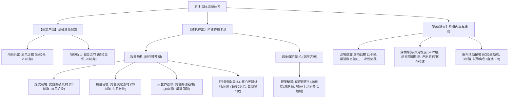
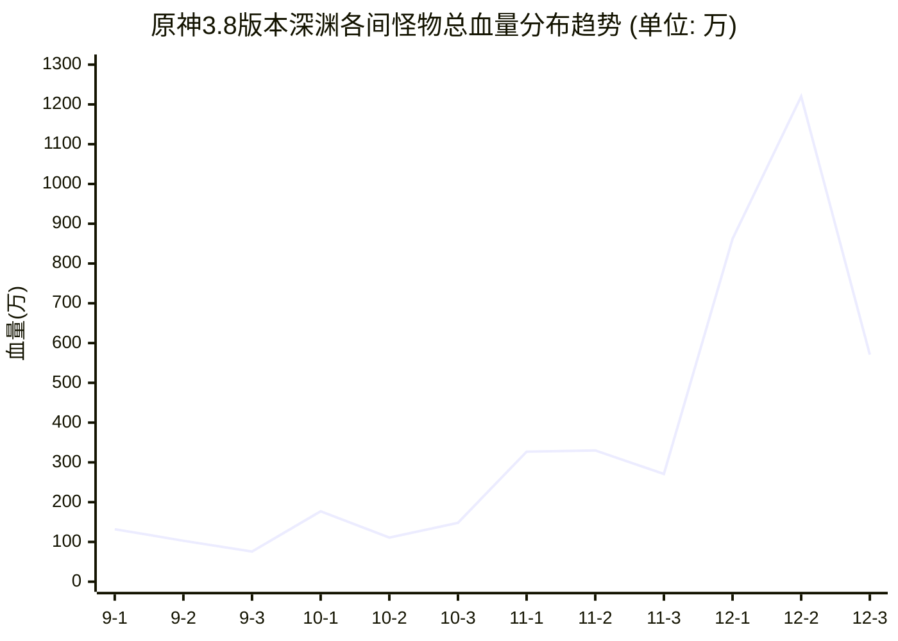

# 深度分析报告：《原神-副本系统拆解》

**分析对象**：`原神-副本系统拆解.pdf`  
**原作者**：王嘉琳  
**分析专家**：资深游戏主策划 / 制作人兼导师  
**报告归档路径**：`E:\游戏策划案\拆解案分析报告\13_原神副本系统拆解_深度分析.md`

---

## 报告摘要（Executive Summary）

本拆解案是一篇极具专业水准、逻辑闭环完整的**系统兼经济与关卡逆向拆解案**。作者以米哈游《原神》（Genshin Impact，分析基准聚焦于2.8至3.8版本生态）为研究蓝本，不仅系统梳理了副本的类型划分与挑战规则，更敏锐地抓住游戏的核心命脉——**“副本系统实质是受原粹树脂（体力）驱动的常驻经济系统与角色养成验证系统”**。

报告最核心的闪光点在于：
1. **宏微观穿透力**：从宏观的全局资源流转图，下切到微观单角色双天赋从1升9级所需510本基础素材的精确体力与天数测算（8天无轮换 vs 18天轮换）；
2. **商业化与关卡联动的逆向推导**：将深境螺旋（深渊）的渊月祝福、地脉异常与当期卡池UP角色精准映射，解构了“制造环境痛点 $\rightarrow$ 提供祝福甜头 $\rightarrow$ 引导抽取当期角色 $\rightarrow$ 驱动体力投入养成”的商业化版本运作闭环；
3. **机制对抗的反向防御分析**：揭示了高层深渊通过“环境元素机关挂抗性”防止成熟队伍（如雷神国家队、神鹤万心）“力大砖飞”的技术性手段。

---

## 1. 拆解案基本信息与架构全貌

### 1.1 文档元数据与核心定性

| 维度 | 属性与指标 |
| :--- | :--- |
| **文档作者** | 王嘉琳 |
| **拆解对象** | 《原神》（米哈游自研开放世界动作RPG） |
| **文档规模** | 16页 PDF（含7幅高精度架构图、算例截图、折线图及对照表格） |
| **版本切片** | 2.8版本（万叶/可莉复刻）至 3.8版本（须弥末期，涵盖3.0-3.7完整草反应演变） |
| **文档类型** | **系统经济循环 + 副本关卡机制 + 终极数值验证（深渊）复合拆解案** |
| **核心命题** | 副本系统如何通过体力消耗控制养成节奏、维持高DAU，并通过终极挑战驱动商业化卡池流水？ |

---

### 1.2 副本子系统分类与功能矩阵

作者在文档第5~6页将原神的副本体系进行了严谨的分类拆解，打破了传统游戏“地下城/副本”的狭隘认知，将其划分为**“固定产出”**、**“随机产出”**与**“数值验证”**三大职能象限：



#### 副本属性与挑战规则全览矩阵

| 副本官方分类 | 拆解定位 | 体力消耗 | 刷新/开放规则 | 核心产出物 | 敌人难度与血量区间 | 核心设计目的与体验定位 |
| :--- | :--- | :--- | :--- | :--- | :--- | :--- |
| **地脉衍出**（经验/藏金） | 基础资源保底 | 20 原粹树脂 | 大世界常驻，击败后地脉刷新 | 摩拉、大英雄的经验 | 30k ~ 130k（普通/精英大世界怪） | 前期与拉新角色时的刚需硬通货，0门槛快速转化体力 |
| **炼武秘境** | 武器突破养成 | 20 原粹树脂 | **每日轮换**（周一/四、周二/五、周三/六、周日通开） | 武器突破素材（绿/蓝/紫/金） | 100k ~ 400k（含地脉异常Debuff/环境伤） | 线性阶梯卡点，绑定特定登录日，提供平稳提升反馈 |
| **精通秘境** | 技能等级突破 | 20 原粹树脂 | **每日轮换**（同上，按地域天赋书轮换） | 角色天赋书（教导/指引/哲学） | 100k ~ 400k（元素机制考验，护盾克制） | 技能关键质变节点，材料合成线性可预期，限制成型速度 |
| **大世界首领**（BOSS） | 突破等级上限 | 40 原粹树脂 | 击杀后约3分钟刷新，常驻存在 | 角色突破特产（断片/原石/BOSS专有材料） | 200k ~ 650k（具备阶段锁定、属性免伤） | 等级突破门槛，强关联大世界探索与地域生态 |
| **征讨领域**（周本） | 核心天赋周常门禁 | **前3次30**，之后60树脂 | **每周一凌晨4点重置**，单BOSS每周限领1次 | 高级天赋材料（1/3几率）、武器原胚、角斗/乐团金圣遗物 | 200k ~ 1200k（多阶段形态、转阶段秒杀机制、短硬直） | 角色6级以上技能硬卡点（单角色2技能升9需4周）；促进周常留存与社交（可联机） |
| **祝圣秘境** | 终极毕业数值泥潭 | 20/40(浓缩)树脂 | 常驻开放，副本内含固定双套装 | 5星圣遗物（生/死/沙/杯/冠） | 100k ~ 400k（限定时间内清场） | **长留存终极抓手**。高随机主副词条，边际效应递减，消耗长草期无限体力 |
| **深境螺旋**（深渊） | 商业化练度试金石 | **0 体力** | 9-12层每月1日、16日重置两次 | 原石（满星600）、圣遗物匣、摩拉 | 760k ~ 12200k（3.8版本），复合护盾、隐身、侵蚀、能量吸取 | 检验BOX广度与练度深度；强推当期卡池；刺激玩家付费抽卡与刷体力 |

---

### 1.3 原神系统与资源流转全貌架构

文档第3页通过一张极为详尽的系统流转图（Boardmix绘制），揭示了原神中探索、任务、副本、抽卡、商城、养成、战斗等系统如何通过底层代币（原石、树脂、摩拉）完成价值流转。

```mermaid
graph TB
    subgraph Input_Systems["外部输入与资源源头"]
        Gacha["抽卡系统 (角色/武器池)"]
        Exploration["大世界探索系统 (宝箱/神瞳/解密)"]
        Quest["任务系统 (主线/支线/邀约/每日委托)"]
        Shop["商城系统 (大小月卡/礼包/尘辉)"]
    end

    subgraph Core_Currency["核心中介流动通货"]
        Primogem["原石 (Primogems)"]
        Resin["原粹树脂 (Resin, 160上限, 8分/点)"]
        Mora["摩拉 (Mora)"]
    end

    subgraph Dungeon_Hub["副本系统 (Dungeon / Domain Hub)"]
        LeyLine["地脉之花 (摩拉/经验)"]
        TalentWeapon["精通/炼武秘境 (天赋书/武器材料)"]
        WorldBoss["大世界BOSS (角色突破核)"]
        WeeklyBoss["征讨领域 (周本高阶材料/原胚)"]
        ArtifactDomain["祝圣秘境 (5星圣遗物套装)"]
    end

    subgraph Character_Growth["角色与养成系统 (Growth Loop)"]
        CharLevel["角色等级 (经验书 + 突破核)"]
        TalentLevel["技能天赋 (天赋书 + 周本材料 + 皇冠)"]
        WeaponLevel["武器等级 (精锻矿 + 炼武材料)"]
        ArtifactBuild["圣遗物装配 (部位套装 + 主副词条强化)"]
    end

    subgraph Ultimate_Sink["终极产出验证与反馈 (Sink & Verification)"]
        SpiralAbyss["深境螺旋 (Abyss 9-12层)"]
        CombatSatisfaction["战斗爽感 & 阵容毕业成就感"]
    end

    %% 资金流
    Shop -->|付费充值| Primogem
    Quest -->|活跃产出| Primogem
    Exploration -->|探索产出| Primogem
    SpiralAbyss -.->|阶段星级结算| Primogem

    %% 抽卡流
    Primogem -->|纠缠之缘/相遇之缘| Gacha
    Gacha -->|产出基础对象| CharLevel
    Gacha -->|产出高星武器| WeaponLevel

    %% 体力转换
    Primogem -.->|每日买体力 (递增成本)| Resin
    Resin -->|20树脂| LeyLine
    Resin -->|20树脂| TalentWeapon
    Resin -->|40树脂| WorldBoss
    Resin -->|30/60树脂| WeeklyBoss
    Resin -->|20/40树脂| ArtifactDomain

    %% 副本向养成输送
    LeyLine --> CharLevel
    TalentWeapon --> TalentLevel
    TalentWeapon --> WeaponLevel
    WorldBoss --> CharLevel
    WeeklyBoss --> TalentLevel
    ArtifactDomain --> ArtifactBuild

    %% 养成向验证输送
    CharLevel & TalentLevel & WeaponLevel & ArtifactBuild -->|形成队伍战斗力 DPS/生存/元素破盾| SpiralAbyss
    SpiralAbyss -->|提供极限心流与商业诱导| CombatSatisfaction
    SpiralAbyss -->|产生挫败感/缺失感| Gacha
```

---

### 1.4 副本核心挑战规则与联机交互结构

原神副本在单人与联机（Co-op）设计上保持了高度的轻度化与低门槛策略：
1. **挑战触发**：副本内均采用“中央地脉核心交互启幕”，清空场内怪物后结算宝树领奖；
2. **联机动态平衡**：
   - 支持2~4人匹配。怪物生命值根据联机人数动态上浮（双人约150%，四人约200%~250%），但怪物的AI逻辑与伤害并未呈倍数暴增；
   - 角色分摊机制：2人时每人出战2名角色；3人时房主2名、房客各1名；4人时每人出战1名角色；
   - 联机设计目的：**“以大带小”的生态缓冲垫**。让练度不足的新人玩家在无法单刷最高级祝圣/天赋秘境时，通过低门槛联机抱高练度“长草期老玩家”大腿，规避了由于副本过难而导致的弃坑流失。

---

## 2. 这篇拆解案“好在哪里”（深度亮点剖析）

王嘉琳的这份拆解案之所以在众多求职或同行拆解中脱颖而出，核心在于其**彻底摆脱了“界面UI描述式”的流水账**，直插游戏底层机制的设计意图（Game Design Intent）与商业闭环。

### 亮点一：以“时间门锁（Time-gate）与体力换算模型”剖析日常秘境

许多新手策划拆解天赋本，只会写“周一到周六每天掉落不同素材”。而该拆解案在第7~8页**引入了具体数学模型与算例**：
- **合成汇率法则**：以须弥“笃行”系列为例，绿（教导）：蓝（指引）：紫（哲学）严格遵循 $9:3:1$ 的3倍进制合成比。
- **目标设定与算例推演**：以新角色“流浪者”将2个核心天赋从1级提升至9级为例，计算所需总原料折算为最基础的“绿书”为 **510本**。
- **体力与概率底线测算**：单次最高级秘境（40体力）保底获得4绿4蓝，折合16本绿书。总刷取次数 $N = \lceil 510 / 16 \rceil = 32$ 次，对应体力需求为 $32 \times 40 = 1280$ 点树脂。
- **有无轮换机制的对比验证**：
  - *无轮换理想状态*：每日160体力全部投入，仅需 **8天** 即可刷齐；
  - *原神周轮换现实（周三/周六/周日开放）*：由于单周仅开放3天，即便体力全留，也必须横跨 **18天** 才能收集完毕。
- **深度洞察提炼**：作者犀利指出，此举绝非简单的限制养成，而是**“将角色的数值成长拉长为周期性习惯”，强制形成玩家周三、周六、周日的特定回流节奏，以极低的成本将内容消耗速度压缩至原有的 44%（8天/18天），极大提升了游戏的中长期留存率（D14/D30 Retention）**。

---

### 亮点二：圣遗物系统的“无限追求”与“挫败感双刃剑”

作者将各副本的期望养成周期做了横向对比表（文档第9页）：

```
【单角色拉满期望天数矩阵】
天赋/武器突破本： 18 天 （线性确定性）
大世界 BOSS 本 ：  6 天 （轻度随机性）
征讨 BOSS 周本  ： 28 天 （强时间门禁，4周完成双9级）
圣遗物祝圣秘境 ： 2~3 个月 （强随机发散，高方差无保底）
```

拆解案深刻洞察了圣遗物的底层逻辑：**“把数值卡点从传统的‘数值硬门槛’，转移为‘高随机的词条概率赌博’”**。
- 前期（天赋、突破）给玩家提供“付出体力即有100%线性增长”的确定性感，建立正向情绪；
- 后期将玩家引流至圣遗物副本，面对主属性随机、副属性四词条随机、强化五次加点随机的三重高阶方差。
- **策划的商业阳谋**：在内容消耗殆尽的长草期，给老玩家提供一个消耗过剩体力的无限黑洞，同时避免了数值过快膨胀（Power Creep）。作者在此处亦敏锐指出了负面效应：强随机性带来的高期望偏差会导致严重的“努力归零感”（高挫败），成为玩家退坑的核心诱因之一。

---

### 亮点三：周本（征讨领域）的双重设计目的与阶梯体力杠杆

拆解案在第9~10页精准拆解了周本的“每周前3次30体力、之后60体力”的设计精妙之处：
1. **性价比诱导与体力沉锚**：周一刷新时，玩家会优先消耗 $3 \times 30 = 90$ 体力去完成三次周本，锁定周初的登录行为；
2. **抑制过快毕业，平抑资源溢出**：若没有60体力的阶梯惩罚，强迫症玩家会一口气刷满全图所有周本（目前已有7~8个周本），导致整整两天的体力无法投入日常天赋或圣遗物中，进而加剧养成焦虑；
3. **天赋材料稀缺性铸造时间壁垒**：6级升9级必须消耗指定周本材料（单次掉落2~3个），即便使用“异梦溶媒”转化，单角色升满双技能至少需要4周，严格锁死了“当期新卡一键秒满”的可能，保证每个版本前半段的活跃度。

---

### 亮点四：深境螺旋（深渊）的血量膨胀曲线、机制分层与商业化联动

这是整篇拆解案含金量最高、分析最为惊艳的篇章（文档第11~15页）：

#### 1. 3.8版本9~12层怪物总血量梯度暴增统计
作者亲自统计提取了米游社底层数据，绘制了血量分布图：
- **9层**：怪物总血量在 $76万 \sim 132万$ 之间波动，检验练度入门；
- **10层**：怪物总血量在 $111万 \sim 177万$；
- **11层**：总血量陡增至 $271万 \sim 330万$；
- **12层**：12-1 达到 $862万$，12-2 **攀升至惊人的 1220万**，12-3 为 $571万$（由于BOSS机制单体锁定与多阶段无敌帧，实际有效DPS需求更高）。



#### 2. 怪物机制分级的“广度与深度”双重卡点
作者整理的机制表清晰揭示了随着层数递进，怪物机制是如何从“单纯血牛”演化为“机制考卷”的：
- **9~10层**：仅含基础水/雷护盾与高韧性海乱鬼；
- **11层**：引入遗迹歼击者的遁地无敌帧、深海龙蜥的**扣除大招充能与穿盾扣血**、深渊使徒的属性护盾高额锁血；
- **12层**：复合配置**侵蚀流血狗**（废弃传统纯护盾钟离安逸流，强抬群体奶妈心海/白术）、**半永恒统辖矩阵**（高额隐身，必须雷草激化破隐，DPS硬指标压制）、**黑蛇骑士**（打中护盾自身回血并加盾，反制护盾角色）。

#### 3. 商业化闭环：渊月祝福与当期卡池的“造神”映射
作者整理了横跨3.0至3.7版本的完整祝福表格，用颜色标注对应UP角色（文档第14页），论证了深渊如何作为卡池流水的“扩音器”：
- **2.8版本**：复刻万叶、可莉 $\rightarrow$ 9-11层群怪极度分散，地脉直接赋予75%火伤加成，无温迪/万叶聚怪体验极差，驱动补票万叶；
- **3.0~3.2草系大版本**：渊月祝福全面绑定草元素反应（原绽放增伤125%、激化增伤75%、草核迸发真实伤害冲击波），强推提纳里、赛诺、妮露、纳西妲；
- **增益数值幅度**：祝福增益高达 **$30\% \sim 60\%$**，作者点出关键：“在12层千万级血量的高压下，当期UP角色携带这 $50\%$ 的环境乘区增益，通关难度从‘地狱级’骤降至‘伐木级’。这直接驱动了追求满星的硬核玩家在卡池中氪金抽取新角色，并在副本中投入体力培养。”

#### 4. “防力大砖飞”与环境抗性反制
拆解案在第15页特别总结了米哈游的防泛滥设计：
随着老玩家练度提升，雷九万班、神鹤万心等“成熟通解队伍”容易一招鲜吃遍天。深渊通过在12-1加入每15秒自动为怪物提供高额雷抗/冰抗的环境机关，**强制切断单一队伍的统治力，迫使玩家不断拓展BOX广度，从而维系每个新卡池的商业价值**。

---

## 3. 体现了策划的什么核心能力（能力模型对照）

通过对该拆解案的研读，可以清晰提炼出作为一名优秀系统/数值/关卡策划所必备的五维核心能力：

```mermaid
radar-chart
    title "拆解案作者展现的专业策划能力雷达"
    axes
        "逆向工程与系统抽象": 92
        "经济循环与数值测算": 95
        "战斗机制与关卡心流": 88
        "商业化敏感度与运营视野": 94
        "批判性反思与痛点诊断": 85
```

### 3.1 逆向工程与系统抽象能力（Reverse Engineering）
- **不仅罗列现象，更提炼分类范式**：作者能够将五花八门的副本归纳为“固定产出、数量随机、词条随机、数值验证”四个核心维度，并画出清晰的四层树状结构图与全局资源流转图。
- **透过UI看逻辑**：把大世界散落的经验花、武器本、圣遗物本与终极深渊串联成一个完整的“生产-加工-质检”装配线。

### 3.2 经济循环与数值测算能力（Economy & Math Modeling）
- **量化算例推演**：不讲“天赋本需要刷很久”这种主观空话，而是拿出“510本绿书、单次最高掉落16本折算值、需32次、40体力/次、8天 vs 18天”的具体数据链条。
- **时间成本换算**：能够把体力、自然恢复时间（8分钟/点）、周常半价优惠、材料掉落概率分布换算为“日历时间（Calendar Days）”，这是高级数值策划的必备素养。

### 3.3 战斗机制与关卡把控能力（Combat & Level Design Insight）
- **怪物属性矩阵化解构**：从血量（HP Pool）、护盾类型（Elemental Shields）、硬直韧性（Poise/Stagger）、位移特征、输出窗口五个维度量化深渊敌人。
- **机制对策论**：深刻理解破盾学（元素克制反应）、控制学（聚怪吸附）、生存学（护盾 vs 穿盾流血），准确指出不同怪物配置对配队构筑（Team Comp）的硬性索求。

### 3.4 商业化敏感度与版本运营视野（Live-Ops & Monetization）
- **版本答案的造神逻辑**：敏锐地将关卡Buff（渊月祝福）与版本卡池（Gacha Banner）进行按月对照，看穿了“版本更新不是孤立的数值投放，而是关卡环境与卡池角色利益深度捆绑的综合营销战役”。
- **环境针对与防泛滥**：从“防力大砖飞”这一现象中提炼出官方维护角色寿命与卡池流水长青的博弈手段。

### 3.5 批判性反思与痛点诊断能力（UX Problem Identification）
- 报告未盲目吹捧，而在文末独立开辟章节剖析系统的负面体验：
  1. 重复刷取的枯燥疲惫感（单局体验缺乏动态变数）；
  2. 极度随机带来的努力沉没挫败感；
  3. 各副本战斗形式的高度单一化（千篇一律的限时打靶木桩）。

---

## 4. 学习如何写副本与关卡系统拆解案（实战指南与方法论提炼）

对于游戏策划从业者及求职者而言，王嘉琳的这份拆解案提供了极高价值的范本模板。在此提炼出一套可复用的**“高分副本/关卡拆解方法论”**。

### 4.1 副本系统拆解的“黄金结构骨架”（可复用模板）

```markdown
# [游戏名称] 副本与关卡系统深度拆解案

## 1. 系统定位与全局闭环
   - 副本系统在游戏宏观经济体系中的角色（资源中继站 / 消耗黑洞 / 最终验证场）
   - 全局资源流转拓扑图（树脂/门票 -> 副本产出 -> 角色养成 -> 副本验证 -> 产出货币）

## 2. 副本生态矩阵与规则剖析
   - 副本分类矩阵（按门票成本、刷新频次、产出确定性、难度梯度分类）
   - 核心挑战规则（胜利条件、失败惩罚、限时压力、场地机制）
   - 联机与单人交互架构（动态难度缩放、匹配机制、社交利得）

## 3. 核心子副本微观逆向与数值算例（核心加分项）
   - 单角色养成全生命周期测算（选定典型代表角色进行原料归一化折算）
   - 体力/门票消耗与日历毕业时间期望推演（公式、概率模型、轮换门锁影响）
   - 随机性设计分析（确定性收益 vs 高方差博弈的心理账户控制）

## 4. 高阶验证系统（周本/深渊/高难Raid）深度解构
   - 关卡难度递进模型（敌人血量膨胀折线、机制强度与抗性阶梯）
   - 关卡环境与商业化联动的实证推导（赛季Buff / 弱点属性与当期卡池映射表）
   - 机制对抗与防泛滥设计（如何针对老旧强力通用套路设置环境抗性）

## 5. 体验心流、商业价值与缺陷重构
   - 玩家情绪曲线分析（单调重复期 -> 突破成就期 -> 随机挫败期）
   - 系统的商业化与留存杠杆评估
   - 现存痛点与落地改进提案（针对枯燥重复、高随机挫败的具体优化方案）
```

---

### 4.2 应借鉴的高分推演技巧与闪光点

1. **“算例化”替代“概念化”**：
   - *低分写法*：“原神天赋素材本很难刷，限制了玩家的成长速度。”
   - *高分写法（本文范式）*：“以流浪者为例，双技能从1到9级需换算绿书510本。在周轮换（每周3天）限制下，即使每天把160体力全部打满，也必须耗费18天日历时间，将毕业周期硬性拉长了125%。”
2. **多维表格与可视化图表并行**：
   - 拆解案中利用折线图展示9~12层血量跨越两个数量级的暴增，利用彩色卡池对照表展示Buff与UP角色的强相关，极具视觉冲击力与专业说服力。
3. **深挖“为什么这么做”（Design Rationale）**：
   - 不仅解释周本减半规则是给玩家减负，更指出这是为了防范玩家将过多体力消耗在全图周本上，避免长草期体力分配体系崩溃。

---

### 4.3 必须规避的拆解误区与扣分项

> [!WARNING]
> **误区一：孤立看副本，忽略经济大盘**  
> 很多策划新人写副本拆解，只写进门怎么打、有什么技能，完全不提体力消耗、树脂恢复速率、材料合成比例。**在F2P长线运营游戏中，脱离经济与养成的副本拆解毫无意义**。

> [!CAUTION]
> **误区二：缺乏时间维度的静态分析**  
> 很多拆解案只抓取当下一个版本的单一副本截图，缺乏跨版本的纵向对比。本文横跨2.8至3.8版本，对照万叶聚怪环境与草系激化环境的演化，才得出了“深渊作为版本卡池销售先导”的深刻结论。

> [!IMPORTANT]
> **误区三：只有批判没有重构，或提出不切实际的方案**  
> 在指责“圣遗物词条随机导致挫败”时，新手容易提出“改成自选词条”这种直接破坏F2P游戏长线留存大盘的致命建议。优秀的拆解案应当指出其在维持在线率与消耗过剩产能上的利弊权衡，并给出折中保底优化思路（如定轨、洗练道具等）。

---

### 4.4 在求职与实战项目中的落地应用建议

1. **求职作品集呈现**：
   - 若应聘**系统策划**：重点突出如第1~2章的系统资源流转图、体力消耗阶梯表、数值算例推导；
   - 若应聘**战斗/关卡策划**：重点突出如第11~12页的深渊血量曲线、怪物机制分层矩阵、出怪波次与破盾机制对策；
   - 若应聘**数值/商业化策划**：重点展示卡池UP与环境Buff的联动对照表、单角色毕业时间期望模型与充值买体力性价比曲线。
2. **商业化反哺设计**：
   - 在立项设计高难挑战关卡（如爬塔、深渊、公会战）时，切勿将其做成纯粹的“木桩战”，而要像原神深渊一样，将其设计为**“当期核心角色机制的展示橱窗”**，通过环境Buff与弱点机制，让抽到新角色的玩家获得至少30%~50%的质变顺畅度，从而形成“抽卡-验证-爽感-再付费”的正向循环。

---

## 结语

王嘉琳的这份《原神-副本系统拆解》展现了一名合格乃至优秀的专业策划所具备的全局眼光、严谨的数学推算能力以及对商业化机制的敏锐洞察。它跳出了“抄界面、抄规则”的低水平内卷，是一份教科书级别、值得每一位游戏策划反复精读与模仿借鉴的优质拆解范本。
