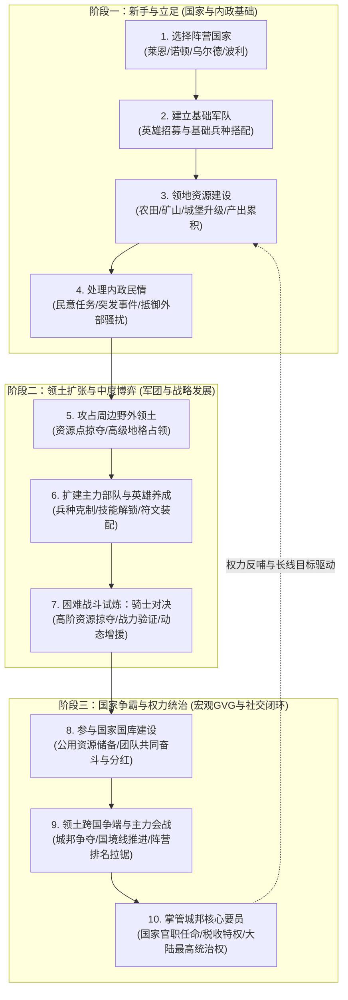
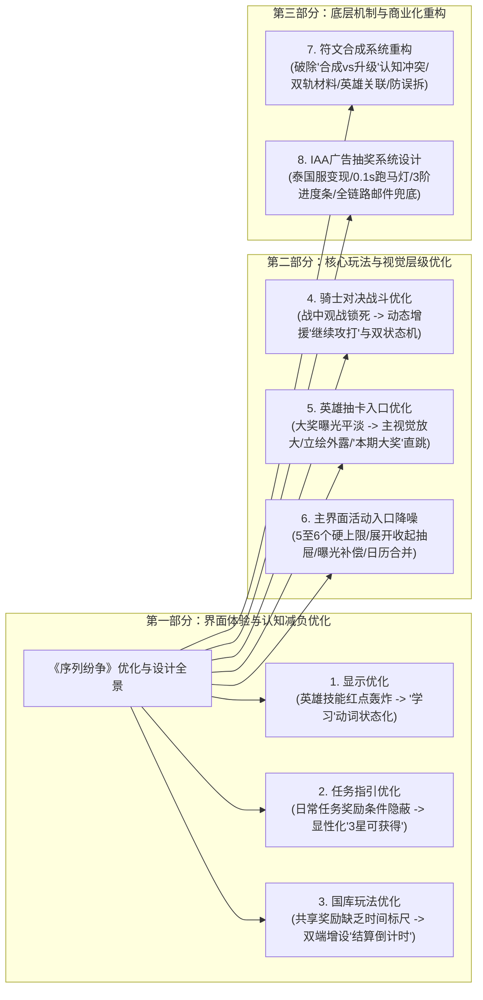
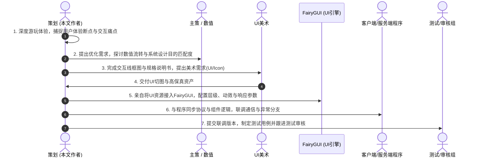
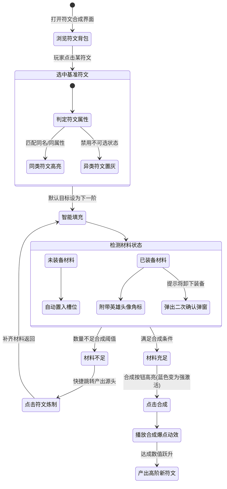
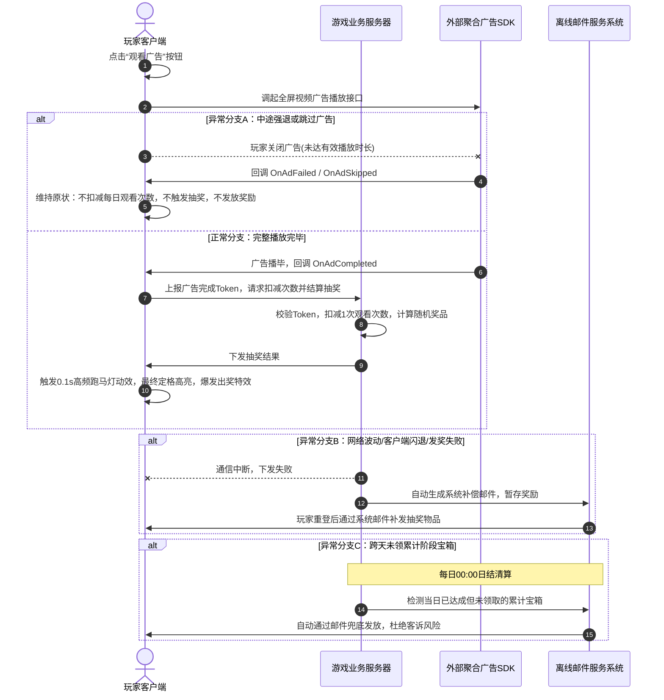
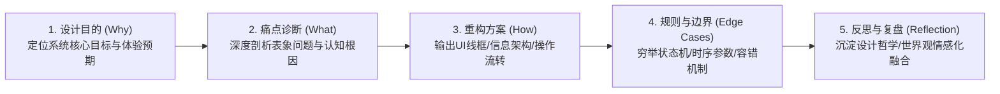
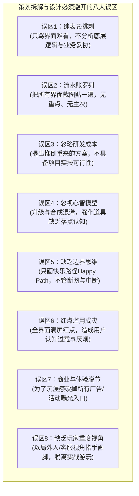

# 《序列纷争》（War for Dominance）系统交互优化与商业化设计拆解案 · 深度分析与策划能力评估报告

> **分析对象**：`E:\游戏策划案\拆解案（20份）\14、序列纷争拆解案.pdf`  
> **报告类型**：游戏系统优化拆解 / UI交互规范重构 / 海外商业化落地提案深度评审  
> **撰写视角**：资深游戏主策划 / 制作人 / 游戏行业导师  
> **输出路径**：`E:\游戏策划案\拆解案分析报告\14_序列纷争拆解案_深度分析.md`  

---

## 1. 拆解案基本信息与架构全貌

### 1.1 文档元数据与拆解对象
- **文档名称**：序列纷争拆解案（War for Dominance）
- **文档篇幅**：13页（16:9横屏排版，图文高保真混排，包含宏观路径、体验诊断、重构线框图、动效参数、时序状态机与设计反思）
- **文档类型**：**实战型系统交互优化诊断与商业化功能设计案**（由具备系统与交互复合能力的资深策划/体验主策撰写，深度兼具“逆向体验切片”、“底层认知模型重构”、“IAA激励广告变现设计”与“FairyGUI管线工程落地”）
- **分析对象**：《序列纷争》（War for Dominance，一款欧美魔幻大世界背景的重度4X SLG手游）
- **项目生命周期与商业背景**：
  - **背景设定**：艾席维亚（Aixivia）魔幻大陆，因光明之神陨落分裂为莱恩（Lion）、诺顿（Norton）、乌尔德（Urd）、波利（Polly）四大阵营国家。玩家扮演一国领主，开疆拓土，参与国战霸业。
  - **研发发行节点**：该项目曾开发上线**中国台服版本**；当前阶段的目标是进行**核心体验深度优化与交互重构**，为拓展**泰国及东南亚出海市场**铺平道路，并以**国服版本**作为核心测试与验证基地。

---

### 1.2 宏观核心游玩路径与SLG运转循环图

文档开篇精准提炼了《序列纷争》的六阶宏观核心游玩路径：**选择国家与建立军队 $\rightarrow$ 攻占领土与军力扩张 $\rightarrow$ 领地资源内政建设 $\rightarrow$ 处理民情与御敌防守 $\rightarrow$ 成为大陆主力国家 $\rightarrow$ 提升国家排名并掌管城邦要员**。

将其映射到4X SLG（eXplore 探索、eXpand 扩张、eXploit 开发、eXterminate 消灭）的底层逻辑中，形成如下核心生态闭环：



---

### 1.3 本拆解案的功能模块与优化拓扑全貌

这份文档并非泛泛而谈的评测，而是切中游戏上线运营后暴露的**“体验阻断、视觉过载、认知冲突、商业缺口”**四大核心痛点，分为**“六大体验优化模块”**与**“一大商业化变现新增系统”**：



---

### 1.4 策划全流程研发推进管线（从体验到工程落地）

文档第3页明确给出了专业策划团队的完整职能链路，展现了该策划不仅具备设计思维，更深度介入前端UI工程化（FairyGUI）与程序联调，展现出极强的研发闭环能力：



---

## 2. 这篇拆解案“好在哪里”（深度亮点剖析）

### 2.1 符文合成系统重构：“合成 vs 升级”底层心智模型的哲学剖析

在第7~9页中，策划针对“符文合成优化”展开的分析，堪称**游戏系统策划在认知心理学与交互逻辑层面的教科书级范例**。

#### 1. 痛点根源的深层解构
原系统界面让大量玩家产生严重困惑：“请放入2个相同的符文”文案与“确认升级”按钮并存，玩家不知道到底是在给某一个本体升级，还是将材料合成为新符文。
策划一针见血地指出了UI排版与心理落点的撕裂：
- **上方排版**：采用低星到高星的阶梯式展示，属于典型的**“升级交互（Upgrade）”**；
- **下方排版**：两个材料槽位并列同级，属于**“并列材料消耗（Combine）”**；
- **底层心智模型冲突（高光论点）**：
  > *“当前展示的交互偏向升级的展示形式，然而核心功能应该是合成，而并非升级。**区别在于合成不需要依赖本体，大家都是材料；而升级需要一个本体作为思维落点！**”*

#### 2. 重构后的交互状态机与闭环设计
基于上述认知解构，策划重新梳理了符文合成的底层逻辑与交互规则：
- **智能目标导向**：合成目标默认为选中材料的下一级，建立确定性心理预期；
- **双轨填充与撤销**：系统默认自动填充未装配材料，同时支持玩家自由卸下与手动微调；
- **破除装备墙，允许已装配符文参合**：
  - SLG玩家在中后期常因高品质符文已装配在二队英雄身上而缺乏流动性。优化案允许使用已装备符文，但在左下角强标注**英雄头像**，并弹出**“卸下该英雄符文”的二次确认提示**；
  - **防误触保险**：增加“隐藏已装备符文”勾选框，避免硬核玩家误拆核心主力英雄的符文；
- **排他性聚焦高亮（Exclusive Highlighting）**：玩家一旦选中某类型符文，系统立即**点亮所有同类型符文，其余无关符文全局置灰且不可选**，大幅降低视觉搜索成本；
- **短路径获取闭环**：在材料不足弹窗中，直接植入**“符文炼制”跳转入口**，打通“合成 $\rightarrow$ 缺材料 $\rightarrow$ 炼制 $\rightarrow$ 补齐合成”的闭环流转。



---

### 2.2 骑士对决机制优化：破解“战斗锁死”的动态兵力增援闭环

在第5页中，拆解案对核心战斗玩法“骑士对决”进行了极其关键的体验手术。

#### 1. 核心矛盾：漫长战斗与用户流失
“骑士对决”作为高难度PVE/PVP试炼，是拉动玩家战力验证与养成追求的核心玩法。然而原版设计存在严重的设计漏洞：
- 玩家派遣部队进入战斗后，再次打开该界面**仅能“观战”**；
- SLG战斗由于部队规模大、计算与回合推进漫长，玩家一旦参战就被强制锁定为被动观战者；
- 当战况不利或需要增援时，玩家无法继续投入新的军力，导致“战况漫长 $\rightarrow$ 无法干预 $\rightarrow$ 耐心耗尽 $\rightarrow$ 玩法参与度骤降”。

#### 2. 状态机改造：从“静态排队”到“动态增援”
策划通过状态机重构，打通了战中干预通道：
- **新增“继续攻打”动态派兵按钮**：在战斗尚未结算前，允许领主追加多支部队投入战场，把单次静态对决重塑为类似SLG城池拉锯战的“波次增援”体验；
- **显性化状态指示**：新增“正在观战中”状态标签，明确告知玩家已有队伍正在厮杀，并展示当前战损与推进进度；
- **心理预期重塑**：从“被动承受漫长垃圾时间”转变为“主动掌控战局博弈，通过追加兵力反败为胜”，极大地提升了玩家的变强诉求与参与积极性。

---

### 2.3 主界面入口降噪体系：沉浸式SLG与运营商业化曝光的精妙博弈

在第6页中，拆解案直击SLG手游在中后期运营中极易患上的**“界面牛皮癣综合征（UI Clutter）”**。

#### 1. 视觉矛盾诊断
随着运营活动、节日福利、限时礼包的增加，主界面往往被密密麻麻的活动Icon占满：
- 严重遮挡了领地城堡建筑、野外行军队伍与魔幻世界氛围，摧毁了玩家作为一国之主的沉浸感；
- 认知超载导致“视网膜遮蔽效应”，过多入口反而使玩家无所适从，关键活动曝光率不升反降。

#### 2. 四重降噪解决方案
策划提出了一整套兼顾**“视觉清爽度”**与**“商业化KPI指标”**的系统化方案：

| 维度 | 痛点现象 | 重构方案 | 机制精髓与深层逻辑 |
| :--- | :--- | :--- | :--- |
| **运营活动入口** | 数量不可控，屏幕两边排满Icon | **设定5至6个硬性最大显示上限**，超出部分收入“更多活动”滑动弹窗 | 结合不同机型屏幕宽高比自适应排布；弹窗点击外部任意区域即关闭，维持轻量交互。 |
| **玩法活动入口** | 正在进行的活动与未来预告活动混在一起 | **引入“展开 / 收起”抽屉式组件**，默认仅外露“进行中”，折叠“预告中” | 空间压缩50%以上；**首登曝光补偿**：每日首次上线在折叠按钮点亮小红点，保证预告活动不错过曝光。 |
| **游戏日程/日历** | 孤立设置“日程”Icon，空间占用严重 | **删除独立日程入口，将时间展示与游戏“季节系统”UI合并** | 点击季节/时间直接唤起日历；将冰冷的现实时间与SLG世界观季节更迭融为一体，提升代入感。 |
| **英雄招募入口** | 核心卡池奖励不显著，抽奖刺激不足 | **重构卡池UI排版**：立绘外放、增加“本期大奖”直跳详情 | 将常驻奖励移至左下角，右上角留给高星大奖立绘与跳转，强化抽卡变现吸引力。 |

---

### 2.4 IAA激励广告抽奖系统：针对出海下沉市场的商业化变现全链路

文档第10~12页是一份完整的**商业化系统详细设计案（System Design Specification）**，专门针对东南亚（泰国服）中轻度非R/小R玩家设计，引入激励广告抽奖玩法拉升整体LTV。

#### 1. 商业模型架构
- **奖池结构**：固定6格奖励（放回抽样，保持概率与池子恒定）；
- **每日限额**：设定每日观看广告上限，消耗完毕后隐藏观看按钮，显示“明日可继续观看”，防止广告价值衰减与脚本黑产刷量；
- **三阶累计激励**：配置3档累计观看宝箱（如看满2次、4次、6次），配合动态进度条成长，用确定性阶梯奖励驱动非R玩家将每日广告次数看满。

#### 2. 外部SDK调起与异常中断容错（大厂工程标准）
策划在交互规则中，严谨地定义了客户端与外部广告SDK的通讯握手与异常分支处理，避免发生“看了广告没发奖”或“利用漏洞白嫖奖励”：



#### 3. 微交互与动效参数量化
文档第11页对转盘抽奖的动效参数给出了明确规格：
- 6个奖品格子采用**0.1秒高频随机更换亮灯块**的跑马灯形式；
- 最终定格在目标格，触发**强调点亮动效（Flash Effect）与奖励弹窗爆开展现**；
- 累计进度条随观看次数即时按比例平滑填充，赋予强烈的视觉成长反馈。

---

### 2.5 细节体验感知与红点降噪：从“红点轰炸”到“状态动词”

在第3~4页中，策划展示了极高的微观体验把控力：
- **技能红点降噪**：原先英雄界面统一使用红色圆点闪烁提示，但SLG游戏英雄技能树繁杂，界面充斥着密密麻麻的红点，给玩家带来强烈的“待办事项压力（To-do Anxiety）”与视觉疲劳。优化案果断**取消红点提示，将其替换为明确的文字按钮“学习”**——将“强迫症警报”转变为“正面状态动词”，界面清爽度立即提升；
- **日常任务三星条件透视**：原任务奖励图标未标明获取门槛，玩家以为做完任务就能拿，结果由于未达三星而落空，产生受骗感。方案在主界面与弹窗内均强制显性标注**“3星可获得”**，消除了信息歧义；
- **国库结算倒计时**：作为国家社交与团队凝聚力核心玩法，增加“结算倒计时”，给全盟玩家提供明确的时间心理锚点，驱动玩家在刷新前冲刺公用库存。

---

## 3. 体现了策划的什么核心能力（能力模型对照）

结合游戏行业资深系统策划与主策划的能力模型矩阵，本拆解案体现了作者多维度的卓越专业素养：

```mermaid
radar
    "逆向拆解与体验痛点穿透" : 95
    "心智模型与认知交互构建" : 92
    "状态机穷举与容错闭环设计" : 90
    "全链路研发工程化落地(FairyGUI)" : 88
    "商业化敏感度与海外市场适配" : 85
    "宏观SLG循环与玩家心流把控" : 86
```

### 3.1 逆向工程与体验痛点穿透力（从UI表象下潜至底层逻辑）
普通初级策划分析游戏容易停留在表面：“这个界面好看”、“那个功能不好用”。而本文作者表现出极强的**根因分析法（Root Cause Analysis）**：
- 看到玩家抱怨符文升级难用，能直接穿透文案与排版，提炼出“合成 vs 升级”的哲学本质差异；
- 看到主界面混乱，能提出“活动上限阈值+抽屉折叠+首登曝光补偿”的系统化平衡机制，而不是盲目一刀切删除。

### 3.2 认知心理学与玩家心智模型映射能力
作者在第7页和第13页的设计反思中，展现出高度的**认知交互修养**：
- 深刻理解玩家在界面的“认知落点（Mental Anchor）”：升级以“本体”为锚，合成以“材料总和与产出目标”为锚；
- 洞悉红点心理学：过度的弱提示红点等同于噪音轰炸，反而导致玩家习得性忽略；明确的状态操作词（如“学习”）能激发掌控感；
- 强调情感化设计与世界观叙事：将抽象的系统倒计时与游戏内的“四季更替”结合，提升沉浸感。

### 3.3 状态机穷举与极端边界容错闭环能力
在IAA广告系统和符文合成方案中，作者展现了堪比高级主策划的**极端条件闭环思维**：
- **异常网络与中断**：考虑到了播放中途退出、SDK报错、离线断网等所有边缘场景；
- **跨日资产保护**：设计了每日0点定时扫描未领宝箱并通过邮件全自动补发机制，彻底封堵客诉隐患；
- **资产防误操作**：设计了已装备符文头像提示、二次弹窗确认与“隐藏已装备”过滤开关三重保险。

### 3.4 跨工种全流程研发工程化落地能力（策划+FairyGUI技术UI+程序联调）
在第3页的工作职责描述中，作者不仅撰写交互原型，还**亲自负责将UI资源接入FairyGUI引擎进行拼版、动效配置与程序对接**：
- 这表明作者是一名极其难得的**“懂引擎实现、懂研发管线”的复合型技术/交互策划**；
- 深刻理解UI组件化开发、动画时序（0.1s）、屏幕跨机型适配、图集打件与DrawCall控制等研发底层限制，提出的设计案具有100%的工程可落地性。

### 3.5 全球化发行与商业化变现敏锐度
针对项目开拓“泰国市场”的发行诉求，作者准确捕捉到了东南亚市场的用户画像：
- 东南亚市场用户付费渗透率较低，但用户在线时长长、对免费激励广告接受度高；
- 引入IAA激励广告，巧妙搭建了“看广告 $\rightarrow$ 跑马灯随机刺激 $\rightarrow$ 阶段累计宝箱 $\rightarrow$ 补强战力”的免费用户正循环，极大盘活了下沉生态，提升留存与非R玩家价值。

---

## 4. 学习如何写策划拆解案（实战指南与方法论提炼）

从本篇《序列纷争拆解案》中，我们可以提炼出一套极具实战指导意义的高分拆解与系统设计方法论。

### 4.1 优秀拆解案的黄金行文模板与逻辑骨架

一份能够打动制作人、主美与技术总监的高质量策划案，必须摒弃流水账，采用**“问题导向的五维闭环法”**：



#### 可复用的标准模块骨架表：
1. **背景与设计目的（Design Objective）**：说明为什么做这个系统/优化？解决什么业务或体验问题？（如：开拓泰国服IAA变现、解决符文合成认知障碍）；
2. **现状诊断与痛点挖掘（Problem Diagnosis）**：列出玩家真实体验断点，分析深层矛盾（排版撕裂、心智模型错位、反馈缺失）；
3. **交互与功能重构方案（Interactive Solution）**：给出清晰的UI线框草图、主次层级排布、显隐逻辑；
4. **状态流转与动效时序（State Machine & Motion）**：量化微交互参数（如0.1s变换、渐隐时间、按钮可用/置灰流转）；
5. **极端异常与容错兜底（Exception Handling）**：弱网断线、操作中断、跨天结转、误触保护等方案；
6. **设计反思与方法论升华（Methodology & Reflection）**：反思是否辅助达到系统目的，总结通用设计准则。

---

### 4.2 应借鉴的高分技巧与闪光点

1. **善用认知心理学术语阐述设计理念**：如本文提炼出的“合成不依赖本体，升级需要本体思维落点”，一句洞穿本质，比写数千字界面描述更有说服力；
2. **给数值与动效设定明确的量化参数**：如“设定运营活动硬上限5至6个”、“跑马灯隔0.1s更换一次光块”，杜绝“速度适中”、“图标适量”等模糊主观词汇；
3. **设计多层防呆与防误触机制**：对涉及玩家核心资产（如符文、装备、钻石）的操作，必须包含“前置筛选过滤”、“状态显性角标”、“二次强提醒弹窗”三道防线；
4. **重视全链路容错与兜底机制**：无论设计什么功能，永远要为“断网/服务器挂掉/玩家跨天漏领”预备“邮件自动补发”等兜底逻辑；
5. **展现端到端的研发管线掌控力**：在文档中体现出对UI制作工具（如FairyGUI/UGUI）、程序通信机制与测试验收标准的熟悉度。

---

### 4.3 需要坚决避开的八大致命误区



---

### 4.4 个人求职与实战项目中的降维打击策略

- **如果你正在准备大厂系统策划/交互策划求职作品集**：
  - 学习本文**“结合项目生命周期发力”**的思路：注明项目处于“海外发行拓展期”，针对特定市场（如泰国、东南亚）定制专属功能（如IAA混合变现方案）；
  - 挑选1~2个核心系统做**深层重塑（如符文合成与骑士对决）**，展现出你能穿透表象直达底层心智模型的深度思考；
  - 突出自己的**跨工种协作与工程化落地能力**：在作品集中体现你熟练使用FairyGUI拼版、制定完整状态机与异常流转的能力，这在游戏研发团队中是极具稀缺性的加分项！
- **如果你是一名一线在职策划**：
  - 牢记本文最后一页的真知灼见：*“积极参与游戏里的各个玩法，做到以一个爱好者的身份主动去玩，而不是以客服的身份去玩；成为项目的重度玩家，关心玩家可能关心的一切；在不查阅策划文档的情况下，仅通过游玩，对接触到的玩法怎么玩了如指掌，掌握自己的游玩策略。”*
  - 好的策划永远不是坐在电脑前空想规则的人，而是把自己的灵魂浸泡在游戏里，将玩家的每一个痛点化作严谨工程方案的设计师！
