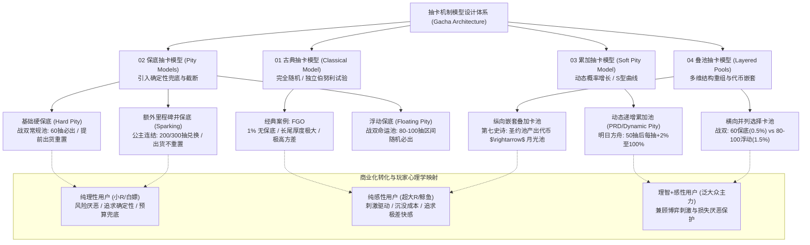
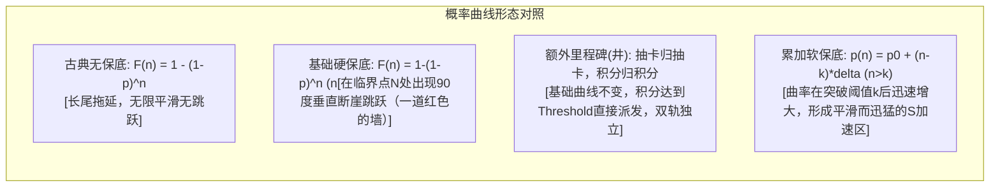
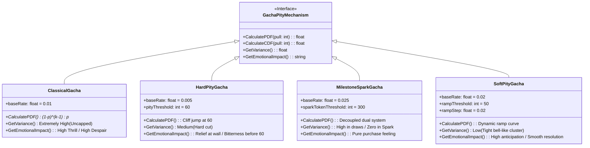
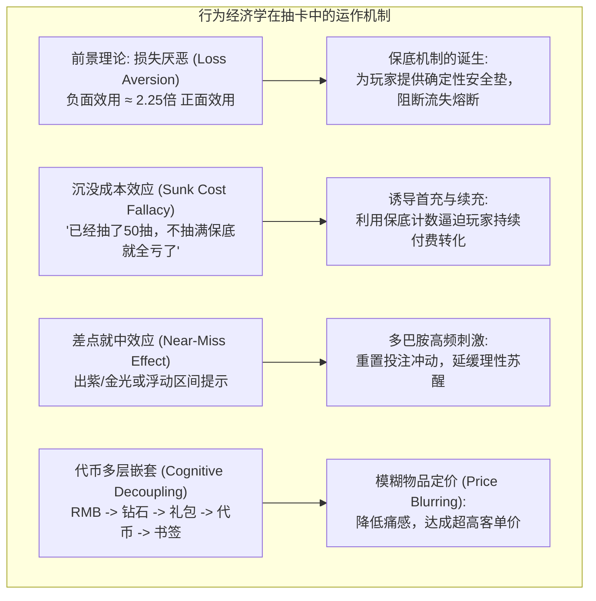

# 深度分析报告：抽卡机制模型设计调研报告

---

## 1. 拆解案基本信息与架构全貌

### 1.1 文档基本信息与分析对象
- **报告名称**：《抽卡机制模型设计调研》
- **完成时间**：2021年11月
- **文档体量**：31页演示文稿（含7大附录，包含万行级概率演化表、四款主流二次元/卡牌RPG真实商业卡池逆向拆解数据与图表）
- **文档类型**：**商业化数值体系与抽卡算法模型深度调研报告**（顶级商业化策划 / 首席数值策划标杆文档）
- **研究前提假设**：
  1. 仅针对具备奖池周期性更新、以抽取极品角色/道具（SSR / 6★ / S级）为核心变现手段的游戏；
  2. 聚焦最高价值产物（SSR角色/限定角色），剔除低价值伴生产物的干扰，简化分析模型；
  3. **基于真实公布规则的白盒假设**：排除了“大数据杀熟”、“免费钻与付费钻暗改概率”、“仓库智能检测”等隐性暗箱操作，建立在概率完全透明与规则可验证的基础之上；
  4. 引入统计学**置信度（Confidence Level > 95%）**作为玩家心理“必然出货”的临界判定标准。
- **调研对象与对标产品矩阵**：
  - **古典抽卡模型**：《Fate/Grand Order》（FGO，无保底纯随机独立伯努利试验）
  - **基础保底抽卡模型**：《战双帕弥什》（Punishing: Gray Raven，60抽硬保底，单抽0.5%）
  - **额外保底（井机制）模型**：《公主连结 Re:Dive》（Princess Connect! Re:Dive，200/300抽兑换井，单抽2.5%/3%）
  - **浮动保底抽卡模型**：《战双帕弥什》（命运降临卡池，80~100抽区间保底，单抽1.5%）
  - **累加抽卡模型（软保底/动态递增）**：《明日方舟》（Arknights，50抽后每抽+2%，99抽封顶）
  - **横向并列选择叠池**：《战双帕弥什》（固定保底池 vs 浮动保底池双轨并存）
  - **纵向嵌套叠加卡池**：《第七史诗》（Epic Seven，圣约召唤 $\rightarrow$ 银河书签 $\rightarrow$ 月光召唤高级池）

---

### 1.2 抽卡机制系统分类学与行文逻辑结构

该调研报告彻底摆脱了“按游戏名称流水账罗列”的业余写法，而是**以概率论与数学模型为第一性原理（First Principles）**，自底向上构建了系统化的抽卡模型分类学：



---

### 1.3 抽卡数学模型图与概率演化分布全景

报告通过数学几何图形直观刻画了五种核心模型在**累积出货置信度 $F(n)$** 上的演化规律与几何拓扑形态：

| 模型类型 | 代表游戏 | 单抽基础概率 $p$ | 保底机制形态 | 累积出货置信度 $F(n)$ 曲线特征 | 95% 置信度所需抽数 | 期望抽数 $E[X]$ |
| :--- | :--- | :--- | :--- | :--- | :--- | :--- |
| **古典抽卡模型** | FGO | 1.0% | **无保底** | 渐近指数平滑曲线，无限趋近于1但永远无法到达100% | **299 抽** (约3倍期望) | 100.00 抽 |
| **基础硬保底模型** | 战双（常规池） | 0.5% | 60 抽必出，出货重置 | 60抽前为平缓曲线，在第60抽处**垂直突变跃迁至100%（一道墙）** | **60 抽**（即硬保底数） | 51.72 抽 |
| **额外保底（井）** | 公主连结 | 2.5%~3.0% | 200/300 抽直接兑换，出货不重置 | 原基础抽卡曲线保持古典形态不变；在200/300抽节点**悬挂独立固定兑换点（天花板吊灯）** | **200/300 抽** | 125.49 抽 (含300井) |
| **浮动保底模型** | 战双（命运池） | 1.5% | 80~100 抽随机必出，出货重置 | 80抽前平缓，80~100抽区间内形成一个**阶梯形倾斜带宽（缓冲带）**，100抽达100% | **80~100 抽** | 49.14 抽 |
| **累加软保底模型** | 明日方舟 | 2.0% | 50抽后每抽+2%，出货重置 | 50抽前为对数渐进，50抽后曲率骤增，形成**高陡度S型跃迁曲线**，平滑切入100% | **68 抽** (99.55%) | 34.59 抽 |

#### 概率分布数学函数对照图（Mermaid 逻辑拓扑）


---

## 2. 这篇调研报告“好在哪里”（深度亮点剖析）

### 2.1 硬核数学建模与概率论第一性原理

市面上95%的游戏系统拆解案在分析抽卡时，往往仅停留在复述游戏内规则文本（如“单抽概率1.5%，60抽保底”），而这份调研报告展现出了**顶尖数值策划（Lead Economy / Mathematical Designer）**的数学严谨度：

#### ① 区分概率质量函数（PDF）与累积分布函数（CDF）
- **单次出货概率 $P(X=k)$**：
  在古典模型中遵循几何分布（Geometric Distribution）：
  $$P(X=k) = (1-p)^{k-1} \cdot p$$
- **累积出货置信度 $F(n) = P(X \le n)$**：
  $$F(n) = 1 - (1-p)^n$$
- 报告精准引入了统计学中**置信度（Confidence Level）> 95%** 的概念：在古典概率下，$1 - (1-0.01)^n \ge 0.95 \implies n \ge \frac{\ln(0.05)}{\ln(0.99)} \approx 298.07 \implies 299\text{抽}$。
  作者由此提炼出一条极其深刻的行业规律：**在无保底的古典抽卡模型中，想要达到玩家心理上的“必然出货”（>95%置信度），玩家所需付出的抽数约为数学期望的3倍（$299 \approx 3 \times 100$）**。这一结论直接量化了无保底卡池对长尾“非酋”玩家的毁灭性打击。

#### ② 截断几何分布（Truncated Geometric Distribution）的闭合期望推导
对于引入硬保底 $N$ 的基础保底模型，抽数 $X$ 的取值被严格截断在 $[1, N]$。其数学期望推导为：
$$E[X] = \sum_{k=1}^N P(X \ge k) = \sum_{k=0}^{N-1} (1-p)^k = \frac{1 - (1-p)^N}{p}$$
- **在战双 0.5% 基础单抽率、60抽保底的情况下**：
  $$E[X] = \frac{1 - (1 - 0.005)^{60}}{0.005} = \frac{1 - 0.740356}{0.005} \approx 51.93\text{抽}$$
  报告附录通过真实状态流转计算出综合期望为 **51.72 抽**，并敏锐地与官方公布的综合出率 2%（理论期望 $1/0.02 = 50\text{抽}$）进行对比，指出了理论计算与官方宣称值之间的微妙偏差。

#### ③ 动态递增概率（Soft Pity / PRD 变体）的马尔可夫链状态转移
报告对明日方舟的累加概率模型进行了精确刻画：
$$p_n = \begin{cases} 0.02, & 1 \le n \le 50 \\ 0.02 + 0.02 \times (n - 50), & 51 \le n \le 99 \end{cases}$$
生存概率函数（连续未出货概率）：
$$S(n) = \prod_{i=1}^n (1 - p_i)$$
- 前50抽不出货概率：$S(50) = (1 - 0.02)^{50} \approx 36.42\%$；
- 也就是说，**有高达 63.58% 的玩家在触发保底前已经自然出货**；
- 突破50抽后，概率以公差 $2\%$ 线性递增，到第68抽时累积置信度已突破 $99.55\%$；
- 实际数学期望被大幅压缩至 **34.59 抽**，实际综合出率高达 **2.89%**。
报告通过对比“古典模型100抽置信度63%”与“累加模型100抽置信度99.99%”，生动揭示了动态概率如何将玩家从“漫长的绝望折磨”中拯救出来。

---

### 2.2 伪随机PRD / 动态概率 / 硬保底 / 软保底的工程与方差控制对比

报告深入探讨了不同保底机制在工程实现与体验上的本质区别：



1. **硬保底（战双60抽）**：
   - **方差控制**：人为抹去长尾（Tail Risk），将方差硬性限制在 60 抽之内。
   - **心理痛点**：在接近60抽（如55~59抽）时，玩家由于知晓“即将保底”，抽卡的单抽期待感骤降至谷底，产生强烈的“被系统强制吃保底”的受害者心理。
2. **浮动保底（战双命运池 80~100抽）**：
   - **设计目的**：将单一点的悬崖断层平滑为一个随机区间 $[80, 100]$，打破“固定60抽吃保底”的呆板预期，重塑80抽之后的微观博弈感。
   - **期望对比**：浮动池单抽率高（1.5%），期望抽数 49.14 抽；固定池单抽率低（0.5%），期望抽数 51.72 抽。**以更高的波动风险换取理论上略低的期望成本**，为高风险偏好玩家提供选择空间。
3. **软保底/累加模型（明日方舟）**：
   - **方差极小化**：由于50抽后每抽递增2%，出货位置被高度压缩在 55~70 抽这一狭窄区间内（呈类正态钟形分布的尖峰）。玩家几乎不可能跨过75抽，极大消除了极端非酋体验，是当代二次元抽卡机制的最优解之一。

---

### 2.3 商业定价倒推与真实付费价值拆解

调研报告不仅停留于概率计算，更**将概率期望与现实货币（RMB）及游戏代币严格锚定**，完成了从“数学模型 $\rightarrow$ 经济系统 $\rightarrow$ 商业变现”的完整闭环：

#### 各游戏真实商业卡池期望与单卡定价测算表（基于报告附录逆向数据）

| 游戏名称 | 卡池类型 | 核心代币兑换率 | 单抽官方单价 (RMB) | 期望抽取次数 (抽) | 目标SSR/S卡期望成本 (RMB) | 95%置信度封顶成本 (RMB) | 商业化策略定性 |
| :--- | :--- | :--- | :--- | :--- | :--- | :--- | :--- |
| **FGO** | 圣晶石召唤 | 1元 $\approx$ 1.8 圣晶石 | **¥ 18.00** | **100.00 抽** | **¥ 1,800.00** | **¥ 5,382.00** (299抽) | 重度鲸鱼收割型，无上限博弈 |
| **战双帕弥什** | 基础保底池 (60) | 1元 = 10 虹卡 = 100 黑卡 | **¥ 25.00** (250黑卡) | **51.72 抽** | **¥ 1,293.00** (按30元档约1551元) | **¥ 1,500.00** (60抽封顶) | 极度透明稳健，小R/月卡党极度友好 |
| **战双帕弥什** | 浮动保底池 (80-100) | 1元 = 10 虹卡 = 100 黑卡 | **¥ 25.00** (250黑卡) | **49.14 抽** | **¥ 1,228.50** | **¥ 2,500.00** (100抽封顶) | 赌徒偏好型，低期望高方差 |
| **公主连结** | 单UP限定池 (300井) | 1元 $\approx$ 8.33 免费/付费钻 | **¥ 18.00** (150钻) | **125.49 抽** | **¥ 2,258.86** | **¥ 5,400.00** (300抽井) | 大众平摊型，通过里程碑强制回收钻石 |
| **第七史诗** | 圣约召唤 (普通) | 1元 = 5 钻石 | **¥ 19.00** (100钻5书签) | **80.00 抽** (1.25%) | **¥ 1,520.00** | 120抽硬保底 (¥2,280.00) | 基础消费层，兼具垫刀与副产物产出 |
| **第七史诗** | 月光召唤 (光暗顶级) | 需普通池100抽兑换1次 | **¥ 1,710.00** (单抽折算) | **40.00 抽** (2.5%光暗5) | **¥ 68,400.00** | 无保底 (95%置信度119抽=¥203,490) | **极度分层与代币清洗**，超R特权池 |

> **策划深度洞察**：
> 报告在 Slide 30 揭示了一个令人震惊的商业秘密：在《第七史诗》中，**月光召唤单抽的真实隐性经济价值是普通圣约召唤的 90 倍**！通过“普通池抽卡 $\rightarrow$ 获得金灯笼/传承石 $\rightarrow$ 兑换银河书签 $\rightarrow$ 抽取月光池”的**四级代币链条洗涤**，成功将一张顶级光暗5星角色折算高达数万元人民币的天价完全隐匿在多层游戏系统之中，极大削弱了玩家对真实物价的敏感度。

---

### 2.4 行为经济学与心理学机制剖析

报告不仅拆解数学，更剖析了其背后的人性弱点与心理学效应：



1. **损失厌恶（Loss Aversion）与流失熔断**：
   卡尼曼的前景理论指出，玩家面对损失的痛苦感是获得同等收益快感的 2~2.5 倍。在古典模型中，299抽不出货的挫败感会彻底摧毁玩家的留存意愿。**保底机制在运营层面上绝不仅仅是“响应政策要求”，其在体验层面的本质是“流失熔断器”**，保底拯救的 37%~41% 深度非酋，正是游戏最核心的长线留存资产。
2. **抽卡异化为“商品买卖”的心理落差**：
   报告尖锐地指出保底机制的负面效应：**保底机制将“基于随机博弈的多巴胺狂欢”强行推向了“按价索物的商品交易”**。当玩家普遍认为“60抽才是正常价格”时，抽卡的惊喜感荡然无存，未提前出货被普遍感知为“被游戏公司抢劫”。
3. **用户画像与分层收割策略**：
   - **纯理性用户（白嫖/月卡党）**：只在拥有 $>95\%$ 置信度资源时才出手，是硬保底与累加模型的最大受益者。
   - **纯感性用户（土豪大R）**：追求极致刺激与稀缺优越感，古典卡池或纵向月光池能为他们提供普通玩家绝对无法跨越的阶级鸿沟。

---

## 3. 体现了策划的什么核心能力（能力模型对照）

通过对该文档的系统审视，可以精准映射出其作者作为**资深主策划 / 顶尖商业化数值策划**的核心能力维度：

```mermaid
radar
    title 核心策划能力雷达映射
    "逆向工程与算法反推": 95
    "概率建模与方差控制": 98
    "商业化与经济系统变现": 92
    "玩家心理学与心流把控": 90
    "结构化文档与数据可视化": 88
    "合规性与行业政策洞察": 85
```

### 3.1 顶尖数值策划的概率建模与逆向工程能力
1. **抽丝剥茧的公式化还原**：作者不满足于游戏宣传口径，能够根据概率公示规则自主推导出完整的几何分布模型、截断期望积分公式以及软保底递推算法。
2. **严苛的数据自洽与验证**：在战双案例中，作者敏锐发现官方宣称的综合出率（2.0%，期望50抽）与公式计算值（51.72抽和49.14抽）之间存在细微差异，展现出对数值细节的极度挑剔和求真精神。
3. **万行级数据模拟与概率演化表构建**：在附录中直接展现了跨越 0~50 抽、不同基准概率下的完整置信度演化矩阵，具备极强的数据处理与专业制表功底。

### 3.2 商业化策划的经济系统与玩家分层洞察
1. **穿透表象的“代币链条洗涤”洞察**：在拆解《第七史诗》时，能够一眼看破研发团队通过四层代币嵌套（钻石 $\rightarrow$ 圣约书签 $\rightarrow$ 金灯笼 $\rightarrow$ 银河书签）实现 **90倍价值跃迁** 的隐蔽手法，展现出顶级商业化操盘手的毒辣眼光。
2. **精准的用户心理画像分类**：将玩家行为精准锚定在“理性（规划型）$\leftrightarrow$ 感性（冲动型）”一维坐标轴上，并建立不同卡池模型与用户画像的精准匹配矩阵，深刻理解不同阶层玩家的付费驱动力。

### 3.3 系统策划的结构化抽象与机制提炼能力
1. **高度精炼的分类学体系**：跳出游戏具体皮相，提炼出“古典、基础保底、额外保底、浮动保底、累加概率、横向并列、纵向嵌套”七大标准模型，定义清晰、内涵完备、互不重叠（MECE原则）。
2. **卓越的图解与视觉化沟通能力**：使用极其简练的“一道红色的墙”、“天花板上的吊灯”、“倾斜的缓冲带”、“S型加速坡”等视觉化隐喻，将枯燥抽象的高等概率论转化为任何人都能秒懂的几何图景，展现了极强的文档表达与跨职能沟通能力。

---

## 4. 学习如何写商业化与抽卡机制设计调研案（实战指南与方法论提炼）

基于这份标杆文档的优秀经验，可提炼出一套可复用于商业化系统设计、竞品调研与求职面试的高分方法论：

### 4.1 商业化抽卡机制调研报告的标准框架与行文模板

```markdown
# [竞品/项目] 商业化抽卡机制与数值算法深度调研报告

## 一、 调研背景与研究假设
  1. 调研目的（解决新项目立项卡池形态选择 / 优化现有卡池流失率与ARPPU）
  2. 研究范围与限定条件（白盒假设、剔除暗箱、以SSR核心产物为锚点）
  3. 核心统计学指标定义（单抽概率 p、置信度区间、数学期望 E[X]、方差 Var）

## 二、 核心抽卡模型分类学与数学推导
  1. 基础单抽概率与PDF/CDF曲线
  2. 保底机制与截断算法（硬保底 / 软保底 / 里程碑井 / 浮动区间）
  3. 期望抽数与出货置信度演化（50%中位数、63.2%期望位、95%必出位）
  4. 典型竞品案例逆向对比与伪代码/状态机实现

## 三、 商业化变现与代币经济学闭环
  1. 货币流转拓扑图（RMB -> 充值代币 -> 抽卡代币 -> 兑换副产物）
  2. 单抽官方定价与单卡真实期望综合成本（RMB 折算）
  3. 副产物回收与反哺循环（金票/蓝票/碎片转化效率）
  4. 叠池与代币嵌套结构（横向选择 / 纵向梯度阶梯）

## 四、 玩家心理学与行为经济学剖析
  1. 用户分层体验矩阵（大R鲸鱼 vs 中R中产 vs 小R微氪 vs 白嫖零氪）
  2. 损失厌恶与沉没成本在流程中的埋点
  3. 多巴胺峰终定律与欧非情绪对冲设计

## 五、 本项目设计建议与落地方案
  1. 推荐卡池模型组合与核心参数设定
  2. 模拟蒙特卡洛测试结果（抽卡模拟器出货分布与运营损益测算）
  3. 合规性与概率公示合规检查单（反工信部/文化部违规风险）
```

---

### 4.2 应借鉴的高分技巧与闪光点

1. **引入“置信度 > 95%”作为非酋临界线**：
   在做卡池汇报时，千万不要只向制作人汇报“平均期望是50抽”，因为玩家不是流水线上的标准零件。必须同时汇报“95%置信度需要多少抽”，这直接决定了你卡池被玩家在TapTap/B站开帖痛骂的概率。
2. **始终保持“数学期望”与“RMB真金白银”双轨对照**：
   抛开单抽价格谈保底抽数是毫无意义的。战双60抽保底（单抽25元，成本约1500元）与原神90抽保底（单抽16元，硬保底180抽成本约2880元）看似抽数接近，实则单卡定价逻辑与用户门槛天差地别。必须将单抽单价、期望抽数、期望总价、保底封顶总价拉齐对比。
3. **善用几何隐喻与图解**：
   用“一道墙”指代硬保底，用“吊灯”指代里程碑兑换，用“S型坡道”指代软保底，极具感染力，能瞬间在团队和领导脑海中建立统一的认知模型。

---

### 4.3 必须规避的常见误区

| 常见误区 | 典型负面表现 | 正确做法与提升方向 |
| :--- | :--- | :--- |
| **误区一：UI级流水账罗列** | 通篇只截游戏卡池界面图，抄录游戏内的帮助文本（“10连必出4星”）。 | 穿透表层，抽象出背后的数学状态转移模型与伪代码实现。 |
| **误区二：脱离商业主循环** | 将抽卡孤立为一个单机转盘小游戏，不分析钻石产出量与投放节奏。 | 将抽卡系统置于“日常产出 $\rightarrow$ 活动投放 $\rightarrow$ 缺口充值 $\rightarrow$ 副产物回收”的完整经济大循环中。 |
| **误区三：忽视极端长尾风险** | 仅按期望均值做经济平衡，忽视标准差和极值分布。 | 进行至少 100,000 次蒙特卡洛离散事件模拟，重点观测前 5% 欧洲人与后 5% 极端非酋的体验边界。 |
| **误区四：触碰法律与合规红线** | 试图设计暗箱概率、杀熟机制或不提供任何形式的保底与公示。 | 严格遵循行业合规要求（真实公示、提供综合概率、设定保底机制或保底兑换）。 |

---

### 4.4 在求职与实战项目中的落地应用建议

1. **求职作品集呈现**：
   若面试商业化策划、数值策划或系统策划岗位，提交一份包含**逆向概率推导、期望价格折算表、蒙特卡洛仿真模拟脚本（Python）**的卡池调研案，将对绝大多数仅能写功能文档的应聘者形成绝对的降维打击。
2. **新项目立项建议**：
   - **对于二次元与轻度内容向游戏**：优先采用**明日方舟式累加软保底（50抽后每抽+2%）或原神式软保底（73抽后概率大幅攀升）+ 抽卡副产物商店兑换**，方差极小、体验平滑、口碑极佳。
   - **对于强数值竞技/MMO/SLG游戏**：可借鉴**第七史诗的纵向嵌套叠池**，通过多层代币洗涤拉高超R天花板，同时在常规池中投放基础保底，稳住中小R基本盘。
   - **设计“浮动保底”或“横向并列”时需慎之又慎**：战双的浮动池本质上是公关危机的妥协产物，会增加玩家的认知负荷与选择焦虑，若非有特殊用户诉求，尽量避免并列设置过于复杂的同产物异概率卡池。

---
*报告生成完毕，已归档至知识库分析目录。*
