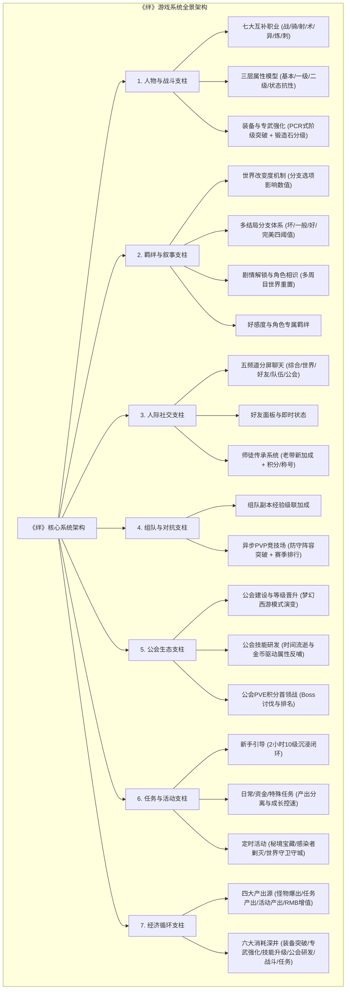
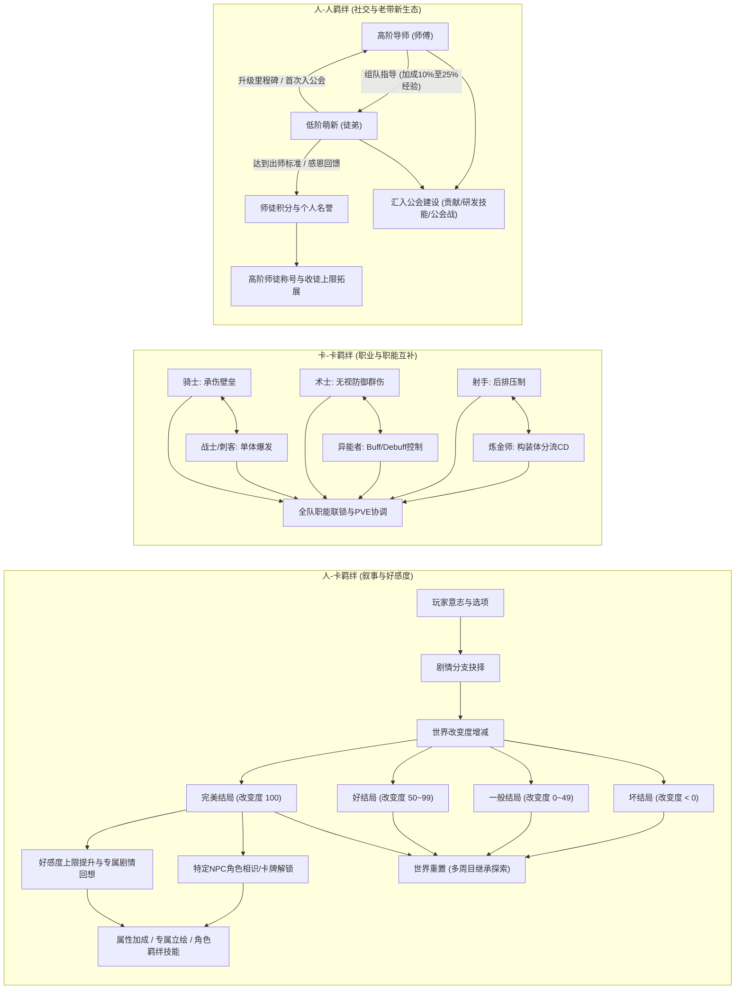
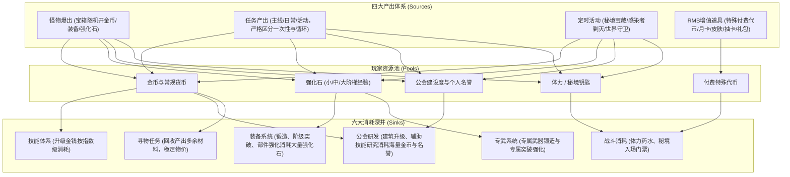
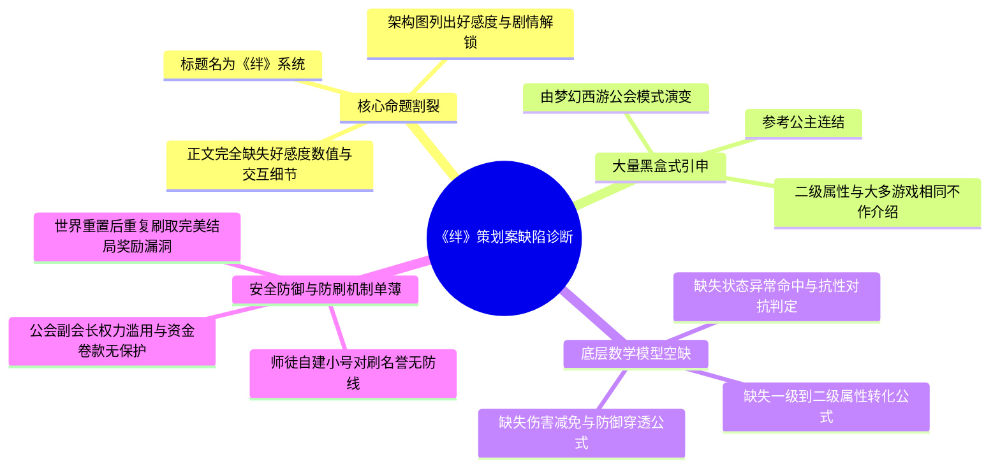

# 《绊》系统策划案 · 深度分析与正向系统设计能力评估报告

> **分析对象**：`E:\游戏策划案\拆解案（20份）\16、《绊》系统策划案.docx`  
> **文档类型**：原创正向系统策划案 / 商业化卡牌RPG立项级Game Design Document (GDD)  
> **评审视角**：资深游戏主策划 / 制作人 / 行业导师  
> **核心命题**：以“绊（Kizuna / 羁绊 / 关系链）”为母题的二次元多元宇宙卡牌RPG系统设计全景解构  

---

## 1. 策划案基本信息与架构全貌

### 1.1 文档元数据与立项定位
- **文档名称**：《绊》系统策划案
- **文档篇幅**：包含完整的文本概述、特色玩法、基础属性与装备体系、任务与交互生态、经济系统架构，内嵌 2 张核心拓扑图（游戏架构图、经济系统图）与 5 张设计数据表。
- **文档性质**：**正向立项级系统设计案（Game Design Document, GDD）**。本案不同于以往对竞品成熟系统的逆向拆解，而是策划基于特定的世界观母题与品类痛点，自顶向下进行正向推导、模块构建与生态搭建的原创方案。
- **立项概念与世界观基底**：
  - **题材背景**：取材于日本经典动漫《魔法少女奈叶》的“多元宇宙（Multiverse）”与“时空管理局”科幻概念。
  - **剧情主线**：采用“无限流”设定。远古时期深渊大肆入侵多元秩序世界，秩序英雄组建神秘组织击退深渊后全体湮灭失踪；当下神秘神明将玩家召唤至异世界，玩家在完成回归任务的同时，卷入发掘远古历史真相的阴谋中，通过与各异世界NPC产生多重交集与命运纠葛（即“绊”），最终决定个人与世界的终极走向。
  - **商业模式与产品形态**：2D轻量化配置卡牌RPG（以精致立绘降低设备门槛、聚焦音画演出代入感），采用主流的F2P（Free to Play）+ 增值道具收费（Gacha抽卡 + 月卡 + 皮肤外观 + 资源礼包）。

---

### 1.2 游戏整体架构拓扑图

根据文档内容与文中所附“游戏架构全景图”，《绊》由六大核心支柱模块交织构成。策划试图将**角色养成**、**网状叙事**与**MMO级社交交互**统一在“绊”的底层哲学之下：



---

### 1.3 “绊”系统分层拓扑与好感/剧情奖励流转模型

在立项逻辑中，“绊”绝不仅是一个狭义的“给NPC送礼物加好感”界面，而是贯穿**“人-卡”、“卡-卡”、“人-人”**三个维度的情感与数值网络：



---

## 2. 这篇策划案“好在哪里”（深度亮点剖析）

### 2.1 叙事哲学突破：以“世界改变度”构建非线性多周目沉浸感
传统商业化二次元卡牌网游（如《阴阳师》、《FGO》、《原神》）的主线剧情多为单线推进，玩家在剧情对话中的选项往往只是“同义反复”，对世界走向毫无影响。
本案最具前瞻性的正向设计亮点在于：**将单机视觉小说（Visual Novel）与日系经典RPG（参考《兰斯》系列）的“分支选择与世界改变度”机制，深度融合入二次元卡牌手游的骨架中**：
- **量化叙事（World Alteration Degree）**：
  策划设计了严谨的四级数值分水岭区间：
  $$	ext{坏结局 (Bad End)}: \Delta W < 0$$
  $$	ext{一般结局 (Normal End)}: 0 \le \Delta W \le 49$$
  $$	ext{好结局 (Good End)}: 50 \le \Delta W \le 99$$
  $$	ext{完美结局 (True/Perfect End)}: \Delta W = 100$$
- **“重置世界”与多周目收集闭环**：
  玩家通关某一结局后，系统开放“世界重置”机制。通过重置世界，玩家得以重新在不同命运节点上做出截然相反的抉择，从而邂逅不同阵营的NPC，最终解锁全角色的“相识与立绘收集”。这种将“剧情分支决策”与“卡牌角色获取/好感度解锁”深度绑定的设计，赋予了卡牌推图极高探索自由度，摆脱了单纯推关看剧情的单调性。

---

### 2.2 战斗职能互补：七大职业矩阵与异常状态的策略拼图
在战斗与职业系统的构思上，策划清晰地界定了七大职业的“强项”与“阿喀琉斯之踵”，避免了数值膨胀导致的全能卡出现：

| 职业 | 定位与核心特长 | 致命缺点 / 约束条件 | 战术职能与设计意图 |
| :--- | :--- | :--- | :--- |
| **战士** | 高物理伤害、强力点杀 | 仅能攻击单目标，缺乏清杂能力 | 针对Boss的攻坚攻刃手 |
| **骑士** | 高血量、高物理/魔法防御 | 基础速度极慢，输出能力极低 | 战线承伤核心，保护后排脆皮 |
| **射手** | 多目标打击、直切敌方后排 | 基础倍率一般，对重甲突破弱 | 压制敌方后排输出与辅助 |
| **术士** | 法术伤害**无视物理防御** | 能量消耗极大，启动节奏偏慢 | 针对重装骑士的绝对克制点 |
| **异能者** | 全队增益（Buff）、敌方削弱（Debuff） | 自身伤害极低，极度依赖队友 | 队伍数值放大器与机制反制核心 |
| **炼金师** | 召唤构装物分担仇恨/输出 | 技能CD过长，角色本体身板脆弱 | 战场杂兵干扰、空间分割与时机把控 |
| **刺客** | 极限爆发伤害、极高先手速度 | **血量极低**，容错率极差 | 抢先手秒杀核心威胁的刺客型博弈 |

策划同步规划了**七大状态异常攻击体系**（流血、减速、眩晕、麻痹、混乱、致盲、衰弱）。这种设计使得低星卡或特定功能卡可以通过状态控制与属性克制（如术士无视防御克制骑士、射手点杀后排术士、异能者致盲战士），在特定高难PVE与PVP竞技场中实现下克上，构建了富有策略张力的战斗生态。

---

### 2.3 社交链条闭环：将MMO式老带新与公会反哺注入卡牌生态
许多纯二次元卡牌由于过分强调单机体验，往往导致中后期长留存率低下。本案极具野心地引入了成熟MMORPG（特别是《梦幻西游》）的强人际网络：
- **师徒级联激励模型**：
  策划设计了精密的梯级经验倍率：师傅带徒弟组队打本基础加成 **+10%**；队伍中每多带一名徒弟，师傅额外获得 **+5%** 经验。更为关键的是，徒弟的每一次“成长事件”（等级里程碑突破、第一次加入公会、最终出师），都会转化为师傅的**经验回馈**与**个人名誉积分**。
- **师徒积分与社会声望变现**：
  名誉积分不仅用于兑换高级“师徒专属称号”，更直接提升**“收徒数量上限”**。这构成了典型的社交飞轮：
  $$	ext{大号带新} \longrightarrow 	ext{名誉积累} \longrightarrow 	ext{名望提升与上限拓展} \longrightarrow 	ext{招募更多新徒} \longrightarrow 	ext{形成长效老带新互助圈}$$
- **公会三维成长与属性反哺**：
  公会不只是聊天室，而是包含了“建设度”、“总贡献度”与“辅助技能研究”。公会投入金钱与名誉，随现实时间自然增长经验；研究产出的辅助技能反哺全员战斗属性。这种设计强化了玩家对组织的依附感，为后续的公会战（PVE积分排名争夺）提供了扎实的团队纽带。

---

### 2.4 经济循环的严密规划：“四源六汇”微观平衡
策划在文档中附有完整的“经济系统流转图”，清晰展现了成熟的货币与资源循环思路：



- **成长控速的顶层自觉**：
  在任务产出设计中，策划明确提出：*“不可重复的任务可同时产出多项；可重复的任务必须将产出分离，仅产出经验、金钱、活跃度之一，并且严格限制每日任务次数”*。这证明策划在立项初期就具备高度的**宏观调控意识**，绝不允许玩家无限制刷取某项核心资源导致数值通胀。

---

## 3. 体现了策划的什么核心能力（能力模型对照）

### 3.1 核心优势能力维度

| 能力维度 | 表现特征与本案实例 | 业界水平评级 |
| :--- | :--- | :--- |
| **品类杂交与玩法顶层架构能力** | 能够大胆跳出传统卡牌框架，精准将**《奈叶》多元宇宙题材**、**《兰斯》视觉小说分支结局（世界改变度）**、**《公主连结》品阶突破**与**《梦幻西游》公会/师徒社交**融为一炉，展现了宽广的单机与网游知识面。 | **高级策划 (资深级潜质)** |
| **系统闭环与生态互锁意识** | 在架构图与经济系统中展现出优秀的“飞轮思维”。角色战斗不是孤立的，它与任务产出、师徒组队、公会研发反哺、竞技场排名深度咬合，形成了自洽的系统动力学闭环。 | **资深系统策划水平** |
| **用户心理与成长心流掌控** | 针对新手的“2小时10级沉浸引导”、通过多结局刺激玩家的“全收集欲望”、通过师徒名誉与公会职位权力下放（副会长收人/开除/研究权限）制造社交阶梯与优越感。 | **优秀主策思维** |

---

### 3.2 深度诊断：主策视角下的硬伤与未成熟之处（严厉评审）

作为一份立项级正向GDD，本文档虽构想宏大，但若放在网易、腾讯、米哈游等头部工业化大厂的研发立项评审会上，会暴露出数个**致命级的硬伤与规范性缺陷**：



#### 缺陷 1：核心设计命题在正文中严重“断代”与“留白”
- **现象**：文档封面为《绊》系统策划案，架构图中明明白白绘制了“羁绊（好感度、剧情解锁）”独立分支，但通读正文全部130个自然段，策划用浓墨重彩写了职业、装备、师徒、公会、经济，**唯独没有专门章节来详述“好感度/绊系统”的具体玩法、数值获取途径、心智模型与送礼交互规则**！
- **主策定性**：这是正向策划案最忌讳的**“文不对题与模块烂尾”**。主策会质疑：本案到底是一款叫《绊》的泛卡牌游戏立项大纲，还是聚焦于“羁绊系统”的专项功能案？若为前者，命名不规范；若为后者，核心模块彻底失踪。

#### 缺陷 2：大量“黑盒式”借代，缺乏执行层落地逻辑
- **案中原文**：
  - *“装备主要用于角色阶级突破，参考公主连结”*；
  - *“公会建设主要由《梦幻西游》的公会模式进行演变”*；
  - *“二级属性与大多数游戏相同不作介绍”*。
- **主策定性**：**这是典型的“策划偷懒/甩锅式写法”**。程序员和数值策划在拿到该GDD时根本无法落地：
  - “参考公主连结”究竟是指 6 件装备满装后点击Rank Up吃掉装备返还部分强化经验？还是属性直接永久吸收？阶级突破后技能等级上限是否同步跃升？
  - 二级属性不作介绍，那么“攻击力”转化为最终伤害的公式是减法公式（$伤害 = 攻击 - 防御$）还是除法/乘法公式（$伤害 = rac{攻击 	imes K}{K + 防御}$）？“魔法抗性”抵消百分之几的法伤？“暴击伤害”的基础倍率是150%还是200%？
  - 这种描述导致程序无法排期、美术无法绘制UI线框、QA无法编写测试用例。

#### 缺陷 3：缺乏异常边界处理与防刷机制（Exploit Prevention）
- **师徒漏洞**：师傅带徒弟有经验加成、徒弟出师有高额名誉与积分。案中未对“同IP检测”、“师徒设备指纹”、“徒弟活跃度门槛”、“每日收徒出师CD”做任何防御设计。黑产工作室可轻易批量起小号，利用脚本挂机10级拜师，短时间内将师傅账号对刷至最高称号。
- **世界重置的刷子陷阱**：案中提到“完美结局可获得奖励，通关后可重置世界进入其他结局”。如果世界重置后，重走路线是否能再次获取相同首通代币？如果能，将直接摧毁游戏代币经济体系；如果不能，重置后的空窗期玩家动力何在？案中全无交代。

---

## 4. 学习如何写正向系统策划案（实战指南与方法论提炼）

从本案的构想亮点与结构硬伤中，我们可以提炼出一套真正适用于一线商业级项目的正向系统策划案（GDD）工业化撰写范式。

### 4.1 优秀正向系统策划案（GDD）的标准骨架模板

一份合格的商业级正向功能设计案，必须严格遵循以下**八阶递进结构**，绝不能留下“黑盒”：

```
1. 模块定位与核心设计目的 (System Purpose & Core Loops)
   1.1 玩法愿景与体验目标 (解决玩家什么心流痛点？带来什么心理预期？)
   1.2 目标用户与使用场景 (新手/中核/大R？单局前/中/后？)
   1.3 系统在全游戏中的交互与经济定位 (流入什么？流出什么？)

2. 业务流程与状态机拓扑 (Logic Flow & State Machine)
   2.1 主用户流程图 (Mermaid流程图：从入口到闭环)
   2.2 核心对象生命周期状态机 (如：师徒关系状态流转、结局分支状态机)

3. 界面交互与UI/UE规范 (UI Wireframes & Interaction)
   3.1 主界面与各级子弹窗布局线框图 (标明区域1~N)
   3.2 交互热区、微交互动效与反馈规范 (点击/长按/拖拽/置灰规则)
   3.3 界面间原路跳转与上下文保持逻辑

4. 核心功能规则细则 (Detailed Game Mechanics)
   4.1 属性/功能详细定义表 (严禁写“参考某游戏”，需逐条列清逻辑)
   4.2 阶梯阈值、解锁条件与周期结算机制

5. 数值模型与计算公式 (Mathematical Formula & Balance)
   5.1 基础属性向高级属性转化公式
   5.2 战斗结算公式 (减伤、抗性、暴击、状态异常判定)
   5.3 资源产出与消耗期望模型

6. 数据结构与协议设计建议 (Client/Server Data Structure)
   6.1 客户端请求与服务端推送协议时序
   6.2 角色元数据与存储字段建议 (给开发提供明确的数据字典)

7. 边界异常防御与防刷规则 (Edge Cases & Exploit Defenses)
   7.1 违规与灰产防范 (如自建小号刷师徒积分、断线重连、跨日结算)
   7.2 极限边界条件处理 (好友满员/公会被解散/重置时断网/跨服同步)

8. 埋点监控与运营指标 (Data Tracking & KPIs)
   8.1 漏斗转化指标 (功能开启率、首次参与率、留存关联)
   8.2 关键行为埋点事件清单
```

---

### 4.2 应借鉴的高分技巧与闪光点

1. **叙事与数值的强契合包装**：
   - 本案将“分支剧情”量化为“世界改变度”，并以此作为卡牌收集与好感解锁的钥匙。这种做法彻底打破了“二次元剧情与卡牌养成两张皮”的行业弊病，极具学习价值。在撰写任何情感类系统案时，切忌孤立做数值，一定要将剧情进展、角色情感锚点与属性/资源产出咬合。
2. **多层社交关系的递进沉淀**：
   - 社交设计不能只停留在“好友互相送友情点”。本案构建的“组队经验共享（临时关系） $
ightarrow$ 师徒老带新（垂直垂直强粘性） $
ightarrow$ 公会建设与首领战（横向群体荣誉）”，展现了一流的社交梯度构建意识。

---

### 4.3 必须规避的四大策划案致命雷区

> [!WARNING]
> **雷区一：以“参考某某知名大作”代替具体规则阐述**  
> 策划案是写给程序、美术、测试团队执行的施工蓝图，绝不是行业鉴赏随笔。写“参考公主连结”，程序根本不知道你到底要抄其Rank突破、装备合成碎片机制、还是属性封顶返还规则。**任何参考都必须拆解为具体的功能条目与状态逻辑落实在白纸黑字上。**

> [!CAUTION]
> **雷区二：核心命名与正文展开割裂（“画饼式设计”）**  
> 严禁在架构图中画出巨大分支（如“羁绊/好感度”），却在后文中因时间紧迫或逻辑未想通而完全不予展开。未完成的模块宁可在立项案中明确标注为“二期规划（Phase 2）”，也不可佯装已设计完成而通篇缺失。

> [!IMPORTANT]
> **雷区三：缺乏公式的“文字游戏”**  
> 罗列了7种属性、7大职业、7种负面状态，但没有一个明确的减伤函数与概率判定式，这种设计是“空中楼阁”。系统策划必须具备初步的数值演算能力，至少要给出战斗核心判定流（如判定命中 $
ightarrow$ 判定暴击 $
ightarrow$ 判定抗性 $
ightarrow$ 计算净伤害）。

> [!TIP]
> **雷区四：缺乏防刷与经济熔断机制**  
> 只要涉及“老带新奖励”、“多结局重置”、“离线时间产出”，就必须第一时刻在案子中写明防刷策略。例如：
> - 师徒关系生效条件：徒弟账号需绑定有效手机号，且账号创建时间与充值/活跃度达到硬性指标；
> - 师徒每日经验加成上限：设置每日经验池封顶值（Soft Cap），超出后衰减为名誉点；
> - 世界重置首通防护：首通完美结局的专属代币与稀有立绘标记为 `Unique_Claimed = True`，重置后仅产出常规周目资源，杜绝无限刷取。

---

### 4.4 针对求职者与项目实战的落地改造方案

若将此份案子改造为一份可直接打动腾讯IEG、网易互娱、米哈游、莉莉丝等名企评审的主策级作品集，建议采取如下**四步改造手术**：

1. **补齐“羁绊（绊）系统”的独立闭环规格说明书**：
   - 设计“羁绊等级（1~10级）”梯度表；
   - 明确好感度获取途径（看板娘每日互动点击、赠送特定偏好礼物、编入队伍通关战斗）；
   - 详述羁绊回馈矩阵（语音解锁、个人专属支线传记副本、属性百分比加成、全队羁绊光环）。
2. **绘制核心模块的Axure/Figma高保真UI线框图**：
   - 绘制主线剧情分支选择界面的UI布局（显示当前“世界改变度”指针仪表盘）；
   - 绘制师徒面板与称号进阶兑换商店的交互原型图。
3. **完成战斗底层伤害与状态机演算公式**：
   - 给出标准伤害公式：
     $$\text{Damage} = \max\left(1, \left(\text{ATK} \times \text{SkillRate} - \text{DEF}\right) \times \left(1 + \text{CritBuff}\right) \times \left(1 - \text{ResistRate}\right)\right)$$
   - 给出控制状态判定时序：
     $$\text{HitChance} = \max\left(0.1, \min\left(1.0, \text{SkillBaseChance} \times \left(1 + \text{AttackerBuff}\right) - \text{DefenderResist}\right)\right)$$
4. **撰写边界异常与网络断线处理规范**：
   - 规范世界重置时客户端与服务器校验时序，防止修改本地存档改变度作弊。
