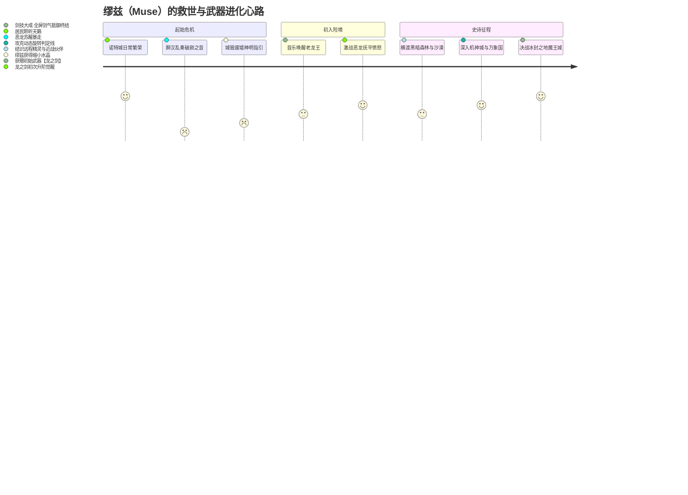
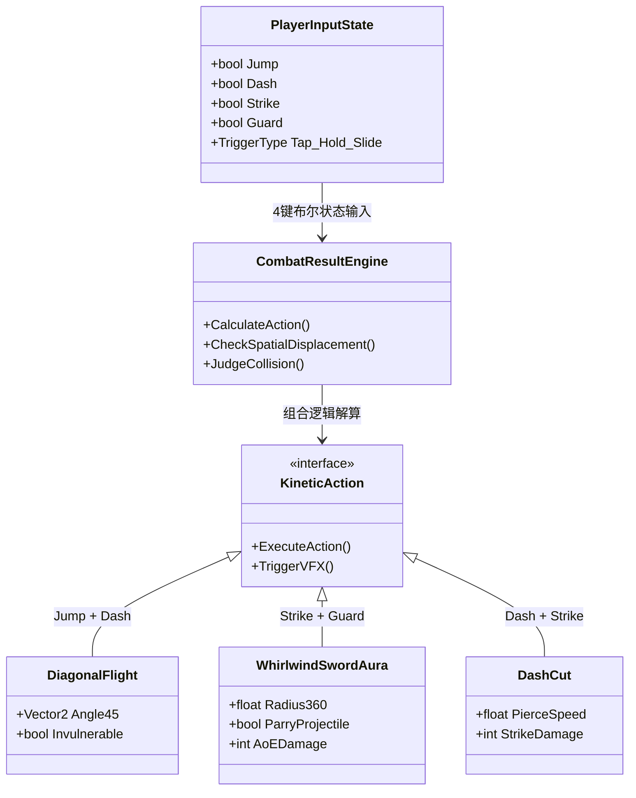

# 深度分析报告：《天堂之音》游戏概况设计

---

## 1. 概况设计案基本信息与架构全貌

### 1.1 文档基本信息与属性定性

- **文档名称**：《天堂之音》游戏设计方案
- **文档类型**：新项目立项概要案 / 高概念游戏设计方案（Pitch Document / High-Concept GDD）
- **分析对象游戏**：《天堂之音》（Voice / Sound of Heaven，原创案）
- **核心定位**：2D 横板二次元节奏动作跑酷战斗手机游戏（Anime 2D Rhythm-Action Runner）
- **目标平台**：移动端（iOS / Android，触屏操作）
- **目标用户群**：泛二次元手游玩家、节奏音游核心/进阶爱好者、追求节奏卡点与正反馈的动作游戏玩家
- **对标产品与灵感母体**：
  - **核心基底**：《Muse Dash》（喵斯快跑）—— 横板卷轴跑酷 + 音游节拍打击 + 二次元萌系视效
  - **机制升维**：《Phigros》—— 动态判定线位移、旋转判定面、非固定轨逆向视效
  - **动作要素**：《洛克人 Zero》/《空洞骑士》—— 冲刺、跳跃、空中位移斩、全方位剑气格挡

### 1.2 世界观叙事与情感基调

文档在第 2 节构建了一个具有经典日系幻想（JRPG）色彩的音乐物语：
- **世界设定**：受“上帝之音”恩泽而繁荣的音乐之都“诺特”（Note，音符的隐喻）。市民以城中最神圣的乐器“奏鸣水晶”与神明共鸣。
- **危机引线**：一名不谙音律的醉酒旅人胡乱吹奏水晶，刺耳难听的杂音惊醒并激怒了沉睡的巨龙，导致诺特城毁于一旦。
- **主角动机**：少女“缪兹”（Muse，希腊神话掌管音乐艺术的缪斯女神）在废墟中聆听到上帝的指引。因神明不可直接干涉世间规则，便将缩小的奏鸣水晶托付于她。
- **成长与征途**：缪兹以音乐抚慰唤醒老龙王获得初始武器“龙之剑”，战胜狂暴巨龙后获得剑体进化；后续横跨黑暗森林、永恒沙漠、机神之城、万象国度、冰封之地、魔王城等 7 大风格化领域，完成救世冒险。



### 1.3 核心玩法循环架构（Core Gameplay Loop）

本案的核心玩法跳脱出了传统音游“单纯按键消除 Note”的抽象反馈，将音乐的 BPM 节奏与角色物理动作、横板跑酷推进深度捆绑：

```mermaid
flowchart TD
    subgraph 局内战斗心流（In-Game Combat Loop）
        Start([关卡开始 / BGM播放]) --> AutoMove[角色与场景随音乐BPM自动前进]
        AutoMove --> Spawn[前方刷新障碍物 / 怪物 / 飞弹]
        Spawn --> Cue[屏幕出现节拍判定预警与指引]
        
        Cue --> PlayerInput{玩家4键 / 组合键卡点输入}
        
        PlayerInput -- 判定准确 --> HitSuccess[触发对应动作: 跳跃/冲刺/打击/格挡/组合剑气]
        HitSuccess --> Reward[增加分数Combo + 获得能量/防扣血 + 镜头弹性震屏]
        
        PlayerInput -- 判定失误 --> HitFail[触发受击/跌落]
        HitFail --> Penalty[扣除生命值HP + 损失积分Combo]
        
        Penalty --> CheckDead{生命值是否归零?}
        CheckDead -- 是 --> GameOver([挑战失败: 血量归零])
        CheckDead -- 否 --> CheckEnd{音乐是否结束?}
        
        Reward --> CheckEnd
        CheckEnd -- 否 --> AutoMove
        CheckEnd -- 是 --> Victory([关卡胜利: 评分结算 S/A/B/C])
    end

    subgraph 局外循环与商业化（Meta Loop）
        Victory --> ClearReward[产出金币/钻石/剧情碎片/消耗体力]
        ClearReward --> Growth[局外养成与消耗]
        Growth --> UnlockChar[解锁新角色DLC / 抽卡获取新机制英雄]
        Growth --> BuySkin[商城购买武器装扮与角色皮肤]
        Growth --> MusicPlayer[音乐鉴赏模式: 独立反复播放通关音乐]
        Growth --> HighDiff[解锁更高难度曲目/判定线逆向谱面]
        HighDiff --> Start
    end
```

### 1.4 操作映射与组合键矩阵模型

文档打破了传统跑酷音游（如《Muse Dash》的双键：上/下或左/右）简易构型，引入了类动作游戏经典的 4 键十字分布（屏幕左右各 2 键），并在此基础上衍生出**复合操作矩阵**：

| 按键分类 | 键位布局 | 基础单一功能 | 核心应对场景 | 组合键衍生高级机制（Combo Action） |
| :--- | :--- | :--- | :--- | :--- |
| **左手移动键** | 左侧·冲刺（Dash） | 快速向前突进，打破可破坏障碍物 | 撞碎横向障碍、穿越地刺安全窗 | **跳跃 + 冲刺**：<br>• 短按：向右上方 45° 强力斜冲<br>• 长按：斜向上方持续滑翔飞行 |
| **左手移动键** | 左侧·跳跃（Jump） | 快速垂直向上起跳，反向曳尾下坠 | 越过深渊断崖、避开地面突刺陷阱 | |
| **右手战斗键** | 右侧·打击（Strike） | 挥剑斩杀正面敌人，获取判定积分 | 击杀正面地面/浮空怪物，积累分数 | **攻击 + 格挡**：<br>• 短按：周身 360° 旋转剑气爆发（清场+自保）<br>• 长按：持续剑气风暴（穿行多段长条刺猬怪） |
| **右手战斗键** | 右侧·抵抗（Guard） | 举盾/格挡招架，免疫伤害防止扣血 | 抵挡敌方远程光球、激光束、弹幕 | |
| **全键跨区联动** | **左（位移）+ 右（战斗）** | 动作与位移融合：移动穿刺斩、滞空回旋斩 | 跨越两个高低平台间的浮空怪物击杀 | **三键及以上**：终极奥义爆发特效，应对 Boss 阶段转换 |

---

## 2. 这篇概况案“好在哪里”（深度亮点剖析）

### 2.1 高概念（High Concept）表达纯粹，品类缝合逻辑自洽

很多新手策划写案容易陷入“缝合怪”陷阱（为了创新而强加机制），但《天堂之音》的品类融合切中了一个极具商业前景与可玩性的细分生态 —— **硬核节奏动作跑酷**：
1. **视听与机制的天然同构性**：
   - 将音乐的**小节拍（Beat）**转化为跑酷的**地形障碍（Pitfall/Spike）**；
   - 将音乐的**强拍重音（Accent/Climax）**转化为**重击怪物与 Boss 的斩击点**；
   - 将音乐的**长音（Hold/Sustain）**转化为**长空格挡激光或滑翔飞行**。
2. **不仅停留在“有什么”，更阐明了“为什么这么做”**：
   - 文档指出：“一直处在同一位置打击效果不好”。为此策划专门设计了**“人物先飞出场景再跟上”的弹性镜头拉扯（Camera Catch-up / Spring Damping）**；
   - 快速跳跃与下坠设计了“反向曳尾”，其明确设计意图是：“快速跳跃的目的是不影响同时的冲刺打击抵抗效果，保障紧挨着的其他按键效果连贯性”。这种基于输入窗口连贯性的底层思考，展现了扎实的动作节奏感底蕴。

### 2.2 操作维度的微创新：由“两轨判决”跃迁至“四键空间联动”

主流同类游戏《Muse Dash》采用“双键两轨（地面怪/空中怪）”模式，虽然极易上手，但随着曲目 BPM 突破 180 以上，高难谱面往往演变为单纯的“双指高速交替抽搐”，玩家眼中只剩视觉色块，丧失了动作角色的形体代入感。《天堂之音》做出了关键性的手感跃迁：
- **左右脑协同模型升级**：左手统筹“空间位置（X/Y 轴位移）”，右手统筹“攻防博弈（攻/守二元状态）”。
- **多指微操上限释放**：支持双键并击（Dual-press）与滑键触发（Slide-trigger）。通过将按键设计为“紧挨着的方块”，兼顾了触屏单点与搓招滑动的便利性。
- **空间战术选择**：面对空中悬浮怪，玩家既可以选择“跳跃后打击”，也可以“跳跃+冲刺”斜冲贯穿，甚至可以“格挡强突”。这种由单一线性响应向“微战术分支”的转变，大幅拓宽了音游的表达空间。



### 2.3 吸收《Phigros》动态谱面精髓：关卡视觉维度的降维打击

文档在第 5-1 节敏锐地提出了音游圈极具视觉冲击力的机制 —— **动态判定线旋转与反向位移**：
- **传统局限**：一般横板跑酷永远是自左向右单向卷轴，几局之后极易产生视觉疲劳。
- **动态破局**：
  1. **判定线动态位移与旋转**：判定线不再固定在角色胸前，而是随着角色冲刺拉远，或随旋律高潮发生 45°~180° 旋转，迫使玩家视线动态追踪，建立提前预判心流。
  2. **时空反转（镜面传送门）**：角色遭遇镜子或传送门时，画面与角色瞬间转为从右向左逆向跑动，原本的按键习惯被空间镜像颠覆，创造出令人拍案叫绝的高难关卡杀招（Mind-trick Level Design）。

### 2.4 原型佐证力（Visual Pitching）：用草图与流程图击穿抽象迷雾

许多初级策划案最大的败笔是“全篇大道理，读者脑补不出画面”。而本案作者展现了极强的**视觉沟通欲望**：
- **全文配备 46 张图例**：从系统逻辑流程图、自制 Low-Fi 战斗原型合成图（角色贴图、按键布局、血条、连击数、陷阱箭头指向）、两套 UI 风格草案、登录页排版、到选曲结算大厅。
- **流程图逻辑闭环**：第 3-2 节的泳道逻辑图清晰定义了判定分支（是否准确点击 -> 增加积分/防止扣血 vs 扣血/无积分 -> 血量检测归零判定），展现了严密的程序员友好型逻辑思维。

---

## 3. 体现了策划的什么核心能力（能力模型对照）

通过对整份文档的行文逻辑、技术诉求、体验预期及系统编排进行逆向还原，可以精准映射出作者在不同策划维度上的专业能力水准：

```mermaid
radar
    title 主策划能力模型维度对照
    "高概念创意与世界观包装": 85
    "核心机制设计与手感推演": 88
    "系统闭环与逻辑严谨度": 75
    "低保真原型制作与视觉沟通": 90
    "商业化与外围留存架构": 65
    "工程落地与量化规范": 60
```

### 3.1 跨工种统合与立项推演能力（主策划 / 制作人视角）
1. **懂程序语境**：开篇直接锚定“2D 横板游戏，使用 Unity 等引擎制作”，并梳理判定触发条件与血量状态机，明确物理位移和 BPM 自动前进的协同逻辑，具备与 Client 端的沟通基底。
2. **懂美术诉求**：不仅提出“二次元唯美/动漫感”，而且细化到了“反向曳尾”、“按钮点击柔和过渡”、“简洁打击感 vs 战斗粒子元素”两套美术方向的对比选项，为主美预留了探索空间。
3. **懂玩家体验预期**：精准捕捉到“一直处在屏幕同一点打击会极其枯燥”这一横板痛点，主动通过镜头拉扯、位移爆发打破画面僵局。

### 3.2 机制层级解构与输入带宽把控能力（战斗 / 核心玩法策划视角）
策划清晰地对“动作输入认知负荷”进行了阶梯式规划：
- **L1 基础操作**：点按单一按键（短按应对飞弹、尖刺）。
- **L2 持续操作**：长按持续反馈（长按应对激光束、连续地形变动）。
- **L3 复合操作**：双键同步按下（组合产生第三种质变动作）。
- **L4 高难操作**：反向移动 + 旋转判定线 + 复杂怪物（多段攻击、自爆击退）。
这种层层递进的梯度规划，是关卡心流能够持续上扬的数学基础。

### 3.3 资深视角下的局限性审视与待补完缺陷（Critical Critique）

作为一份资深评审，必须客观指出该立项案存在的**深层设计隐患与商业化矛盾**（供后续迭代避坑）：

> [!WARNING] 核心设计隐患 1：音游核心驱动力与 F2P 体力系统的结构性冲突
> - **问题暴露**：第 8-2 节规划了“体力系统（进入关卡消耗体力，胜利返还部分，随时间回复）”。
> - **病理剖析**：音游的核心体验是**“高频反复练习以达成 Full Combo (FC) 或 All Perfect (AP)”**。一旦加入强体力限制，玩家死两把体力就空了，练习被强制切断，会引发音游核心受众的毁灭性差评；若体力无限，该系统又形同虚设。
> - **破局方案**：采用《BanG Dream!》或《PJSK》的**“火焰/能量加速收益模式”** —— 没体力依然可以无限畅玩打歌打榜，体力仅用于结算时多倍获取养成材料与抽卡道具。

> [!WARNING] 核心设计隐患 2：触屏人机工程学（Ergonomics）与误触盲区
> - **问题暴露**：手机横屏下，左下角并排放置两个方形按键（冲刺/跳跃），右下角放置两个（打击/抵抗）。
> - **病理剖析**：玩家拇指在快速点按时覆盖面积大，在高速 BPM（如 160+ 连续十六分音符）中，紧挨着的虚拟键极易发生误触；同时双指同按在单侧屏幕会导致手部肌肉极易痉挛。
> - **破局方案**：引入**手势手感重构** —— 例如将“跳跃”改为屏幕左侧上滑，“冲刺”改为左侧单击或右滑；或者支持全屏分块点按（左半屏为移动，右半屏为战斗，利用点按位置判定），彻底解放视线与拇指束缚。

> [!WARNING] 核心设计隐患 3：缺少关键底层数值框架（判定帧与判定窗）
> - **问题暴露**：案中仅有“是否准确点击”的概念，缺乏对音游生命线 —— **判定时间轴（Judgement Window）**的量化定义。
> - **病理剖析**：没有 Perfect（±30ms）、Great（±60ms）、Good（±100ms）、Miss 的毫秒级细分，也没有 offset 音视频校准机制设计，项目将无法进入实质性编码。

---

## 4. 学习如何写新项目立项案/概况设计案（实战方法论）

### 4.1 优秀高概念设计案（High-Concept Pitch GDD）标准黄金框架

从本篇《天堂之音》汲取长处、补齐短板，可提炼出在游戏大厂立项评审或独立项目立项时通用的**立项案模板骨架**：

```markdown
# [项目代号/名称] 游戏立项概况设计方案 (Pitch GDD)

## 1. Executive Summary（项目高概念综述）
   - 一句话卖点（Logline）：一句话向投资人/高管阐明“核心玩法+题材+差异化体验”
   - 商业定位与平台：F2P / 买断制 / DLC，iOS/Android/PC
   - 核心受众画像：核心圈层（种子用户） -> 泛圈层（破圈潜力）
   - 对标矩阵（Benchmark Matrix）：竞品对照（传承什么、革新什么、放弃什么）

## 2. Worldview & Art Target（视听风格与叙事包装）
   - 核心设定叙事动力：主角目标、核心矛盾、情感基调
   - 视觉基调定位（Visual Tone）：艺术风格、UI 风格、色彩倾向、情绪板（Moodboard）
   - 音频设计哲学（Audio Target）：音乐类型（电子/和风/管弦）、打击音效与混音优先级

## 3. Core Mechanics & Innovation（核心玩法与创新手感）
   - 核心循环图（Mermaid 业务流程闭环）
   - 输入与人机交互映射：键位分布、手势支持、认知负荷控制
   - 机制化学反应（Innovation Synergy）：双机制融合的逻辑推导（如：节奏 + 格挡连击）
   - 状态机与物理反馈：位移曲线、打击定帧、镜头动力学（震屏/慢动作/视角拉扯）

## 4. Level & Rhythm Matrix（关卡机制与节奏图谱）
   - 难度梯度曲线（Flow Curve）：简单障碍 -> 复合机制 -> 演出型机制
   - 谱面特色机关（Gimmick）：动态判定、反向卷轴、视差多重背景
   - 主题关卡推演：关卡场景、敌人攻击方式与音乐情感的契合映射

## 5. System & Meta Loop（外围系统与商业化）
   - 角色资产矩阵：角色技能差异、武器升级树、外观装扮
   - 经济模型与付费线：双代币流转、抽卡/BattlePass/DLC 曲包平衡
   - 玩家粘性系统：排行榜、打歌成就、社交与音乐播放器

## 6. Technical & Production Roadmap（技术要求与验证里程碑）
   - 引擎选型与核心技术风险（如：移动端音画同步延迟 Offset 算法）
   - Demo 阶段验证指标（原型白盒测试核心乐趣点）
```

### 4.2 应借鉴的高分技巧与闪光点

1. **“原型前置”原则（Prototype Speaks Louder Than Words）**：
   - 永远不要只用文字描述战斗，要像本文作者一样，即使用现有游戏素材拼贴、用简易画板制作草图，也要拼出**一张直观的带 HUD 的战斗原型效果图**。一眼胜千言。
2. **“按键动作化”与“组合质变”思维**：
   - 将抽象的交互指令赋予具象的动作意义。不是“按下 A 键消除黄色音符”，而是“按下冲刺键击碎巨盾”；通过“键位组合（A+B）”产生独立新动作，大幅增加系统纵深感。
3. **“从单调中找冲突”的动态破局手法**：
   - 善于发现竞品体验盲区。比如横板跑酷永远居中很无聊，就做“弹性镜头（冲刺时人先飞出去）”；传统音游单向掉落很死板，就做“旋转判定线与逆向传送门”。

### 4.3 新人写立项案必须避开的致命误区

| 常见误区 | 典型错误表现 | 专业纠偏解法 |
| :--- | :--- | :--- |
| **误区 1：贪多求全的“缝合怪”** | “既要原神的开放世界，又要只狼的打铁，还要音游的节奏” | **聚焦单点破局**：确立唯一的“核心体验支柱（Design Pillar）”，所有次要机制必须为核心体验服务。 |
| **误区 2：商业化与核心玩法的精神分裂** | 在需要高频刷分练习的音游里强行卡死体力，或者在纯操作游戏里卖数值碾压数值装备 | **商业化顺应品类规律**：操作类重外观（皮肤、特效、UI 主题）、内容消费（曲包、新机制角色）和便利性服务。 |
| **误区 3：忽视移动端物理限制** | 设计了 4 个紧密排布的按钮，要求玩家高频多指同时搓招 | **人机工程学校验**：必须在手机真机上打印手势热区图，确保双手大拇指能够舒适覆盖，留足防误触间距。 |
| **误区 4：空洞的情怀文学，没有量化规则** | “华丽的战斗、爽快的打击感、唯美的音乐” | **将形容词翻译为工程参数**：“30 帧挥刀动画、第 8 帧判定生效、击中产生 4 帧冻结定格、伴随 15% 屏幕振幅与低频击打音效”。 |

### 4.4 个人求职与独立项目实战建议

1. **求职作品集打造（Showcase Strategy）**：
   - 如果你拿一份纯文本策划案给面试官，通过率通常只有 20%；
   - 但如果你拿出一份类似于《天堂之音》带有**清晰高概念、完整 4 键组合状态机、46 张原型设计图、自制 UI 交互演进与动态判定线机制**的立项案，能立刻展现出你超越同龄人的“制作人潜质”与“方案可视化推动力”。
2. **从 Pitch GDD 迈向可开发 Alpha 的关键三步**：
   - **Step 1：做白盒验证 Demo（Greybox Testing）**：用 Unity 搭建最简单的方块和节拍，验证 4 键在触屏上的手部负荷是否成立。
   - **Step 2：输出标准谱面与判定表**：把“敌人和障碍”标准化为 MIDI 轨或 JSON 格式谱面数据结构（Time, Track, ActionType, HoldDuration）。
   - **Step 3：明确延迟校准管线**：移动端安卓设备碎片化严重，音频输出延迟从 20ms 到 200ms 不等，必须优先立项开发音频校准算法（Offset Calibrator）。

---

## 5. 总结与评审结语

《天堂之音》是一份**灵气十足、破局意图清晰、视觉表达极具说服力**的高概念立项案：
- 它成功锚定了二次元跑酷音游的蓝海升级赛道，将《Muse Dash》的动作轻快感与《Phigros》的谱面动态变奏进行了创造性的机制互融。
- 其通过自制 46 张概念原型图和严谨的状态判断流程图，展现了优秀的策划逆向推演与跨工种沟通素养。
- 虽然在移动端触屏人机工程学、毫秒级判定量化以及 F2P 体力循环与练习驱动的兼容性上仍有工程化补完空间，但这正是新项目立项从**“概念验证（Concept Pitch）”**迈向**“工程化制作（Production）”**的必经演进路径。对于任何希望迈向主策划、制作人或撰写自研项目案的从业者而言，本案都是一份不可多得的极佳范例。
