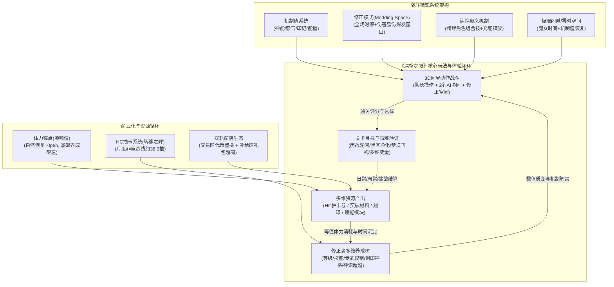
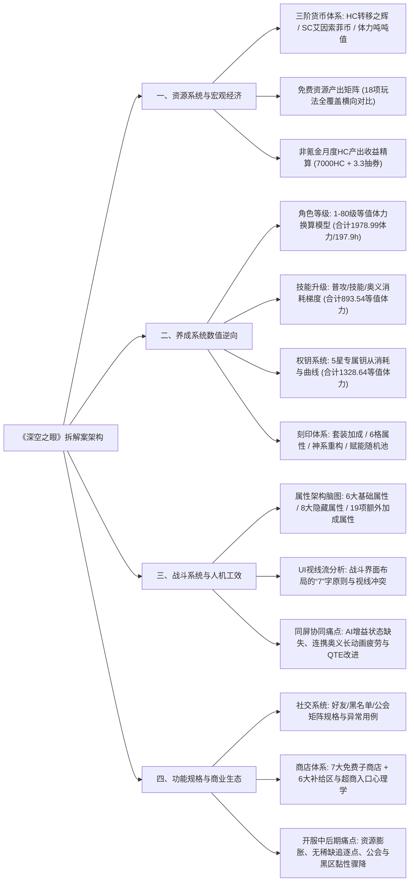

# 深度分析报告：18、深空之眼拆解练习

---

## 1. 拆解案基本信息与架构全貌

### 1.1 文档元数据与背景定位
- **文档名称**：`18、深空之眼拆解练习.docx`
- **文档类型**：3D二次元动作RPG系统拆解与数值反推练习案（兼具系统功能规格说明与商业生态洞察）
- **分析对象**：勇仕网络（Yongshi）研发、悠星网络与勇仕联合发行的3D科幻同屏连携动作手游《深空之眼》（Aether Gazer）
- **拆解作者定位**：具备扎实数值逆向能力与系统逻辑严密度的初倾/准专业级游戏策划（作品带有求职/实训作品集特征，包含真实账号测试记录与机型适配说明）
- **核心拆解模块覆盖**：
  1. **经济与资源循环系统**：硬通货（HC/转移之辉）、软通货（SC/艾因索菲币）、体力（吨吨值）、突破/升级资源拓扑与全玩法资源产出矩阵（免费产出表、月度HC收益测算）。
  2. **角色养成深度解构**：角色等级突破模型、技能升级消耗模型、权钥（武器/专武/钥从）消耗与成长曲线、刻印套装与词条重构体系。
  3. **3D动作战斗系统与人机交互**：战斗属性脑图（基础/隐藏/额外属性）、战前编队动线、三同屏战斗UI布局工效学（“7”字视线流）、连携奥义机制与AI队友反馈缺陷剖析。
  4. **外围社交与服务系统规范**：好友系统、聊天系统、公会（矩阵）系统、商店系统（交易区七大子店与补给区超商动线）、成就系统、邮件系统功能闭环设计。
  5. **原创设计尝试**：舰装旗语机制角色草案（文末附录）。

---

### 1.2 《深空之眼》系统核心流转与架构全貌图



---

### 1.3 核心模块拆解层级与内容拓扑图



---

## 2. 这篇拆解案“好在哪里”（深度亮点剖析）

### 2.1 逆向工程的严密性：独创的“等值体力（Stamina Equivalent）”量化模型
本拆解案最显著的专业亮点在于**彻底摆脱了新手策划纯文字搬运的“流水账”弊病，建立了极高专业度的数值逆向测算模型**：
1. **等值体力换算体系**：作者敏锐地抓住二次元动作卡牌游戏的核心隐形时间货币——**体力（吨吨值）**，将游戏内散乱的消耗品（金币、初/中/高/终阶经验仓、各阶突破构件、技能点）统一折算为等值体力与自然时间成本。
2. **材料价值换算比确立**：
   - 角色突破材料：记初阶:中阶:高阶:终阶 = 1 : 2 : 4 : 8；
   - 武器突破材料：记初阶:中阶:高阶 = 1 : 2 : 4；
3. **真实反推的数据看板（文档核心数据还原）**：

| 养成模块 | 等级区间 | 核心耗材总量 | 金币消耗量 | 等值体力合计 (pt) | 折合体力自然恢复时间 | 策划设计意图与曲线特征 |
| :--- | :--- | :--- | :--- | :--- | :--- | :--- |
| **角色等级** | Lv.1 - 80 | 752,610 经验 + 200 绿色突破材料 | 14,000 SC | **1,978.99 pt** | **197.899 小时**（约 8.24 天） | 经验消耗随阶梯指数递增，前30级快速破冰，后40级进入反比例沉淀期，为长线卡点。 |
| **角色技能** | Lv.1 - 35 | 普攻1249 + 技能各753 + 奥义1192（共4700技能点） | - | **893.54 pt** | **89.35 小时**（约 3.72 天） | 养成平滑且单级伤害提升显著，提供即时战斗正反馈，快速拉开高低星级体验差。 |
| **5星权钥** | Lv.1 - 60 | 99,800 经验 + 280 绿色突破构件 | 107,300 SC | **1,328.64 pt** | **132.64 小时**（约 5.53 天） | 攻击力线性增长与消耗体力加速增加，配合专武被动技能改变机制，构成核心付费坑点。 |

> [!NOTE] 
> 这种以“玩家体力自然恢复速率（1点/6分钟，10点/小时）”为标尺的分析法，是正规商业游戏数值策划进行**成长节奏规划（Progression Pacing）**与**时间预算控制（Time Budgeting）**的标准工程语言。

---

### 2.2 宏观经济与商业循环的精准测算
作者没有单纯罗列抽卡概率，而是系统梳理了**全游戏玩法资源产出矩阵**与**非付费玩家（F2P）月度硬通货（转移之辉）收益模型**：
- **免费月度HC供给模型**：
  - 每日签到：400 辉
  - 每日任务（40/天）：1,200 辉
  - 每周任务（1000/周）：4,000 辉
  - 梦境再构（150/周）：600 辉
  - 多维变量（200/周）：800 辉
  - 基础池券：3.3 张
  - **月度合计**：7,000 转移之辉 + 3.3 张基础抽奖券。按单抽 200 辉折算，非活动期纯月常收益为 **35 抽 + 3.3 抽 = 38.3 抽**。
- **商业化洞察**：作者指出《深空之眼》由于大保底机制相对明确（70抽保底，S级平均出率高），每月基础产出达小半个保底，配合活动基本能保证版本稳态抽卡；但反过来看，这也导致其长线拉收面临巨大压力。

---

### 2.3 犀利的“反直觉”商业与生态洞察（开服一个月后的死局诊断）
文档中最具资深策划思维的，是作者在“游戏性概述”和“商店系统”中提出的数条直切要害的诊断：
1. **“缺乏稀缺资源”带来的活动与追求崩塌**：
   - 拆解案敏锐指出：“*游戏内除了转移之辉、以及刻印赋能材料外几乎没有稀缺资源，均较为容易获取，使得游戏活动很难投放玩家所缺少的培养资源，游戏追求点较少。*”
2. **刻印保底与重构秘仪的过载贬值**：
   - 刻印分解转化（3星换5碎片、4星换10碎片、5星换5核心，15核心即可定点自选兑换）带来了极佳的初期体验，但**内容消耗过快**，导致开服仅一个月玩家主力角色的刻印全满，刻印副本沦为沉睡资产。
   - 黑区净化产出的“重构秘仪”由于神系定向概率高、投放过剩，在游戏中后期玩家仓库严重溢出，黑区商店彻底丧失兑换动力。
3. **公会（矩阵）系统的社交失活**：
   - 公会商店初期因五星刻印与金币稀缺尚有黏性；但一旦角色成型，公会货币无处可用，加之聊天窗口需二级点击开启，公会迅速沦为“单机打卡群”。
4. **礼包“掺水”与超商心理学识别**：
   - 分析了游戏日常应急冷却包（体力）放置在组合补给底层，运用了典型的**超市动线（Supermarket Layout）思维**——迫使玩家每日领取免费羊毛时，视线必须完整扫过首充礼包、月卡和高性价比组合包；同时犀利指出礼包中因缺少顶级硬核材料，经常“夹带私货”（强塞溢出金币与低级经验），导致中氪玩家算账后拒绝买单。

---

### 2.4 人机工效学视角下的战斗UI与机制批判
拆解案对战斗系统的分析不仅停留在“技能按键有几个”，而是从**玩家认知负荷（Cognitive Load）**和**视觉动线**切入：
- **“7”字型视线流的冲突**：
  - 传统动作手游（如《崩坏3》）中，左上角连击评级（Combo Score）仅为表现加成，不直接挂钩伤害倍率，玩家注意力可高度聚焦于中下区域的受击判定与右下技能CD。
  - 但《深空之眼》将**修正评级（C -> Ω）与全队伤害加成深度绑定**，评级越高增伤越爆炸。然而评级UI被放置在左上边缘，处于视觉余光盲区，强迫玩家在高速闪避、技能连招的同时频繁左上瞟视，**人为造成视觉动线割裂与疲劳**。
  - 作者具象化提议：将评分与时停系统信息“DATA ANALYSIS”对调，优化信息层级。
- **AI队友协同的信息黑盒**：
  - 游戏采用“1人主控 + 2人AI协同”的创新同屏架构，但**主控角色血条旁缺乏队友施加的光环BUFF与技能生效状态指示**，玩家无法精准把控AI队友（如潮音、大国主）的增伤爆发轴；
- **连携奥义的“审美疲劳”与QTE改良建议**：
  - 指出连携技（二人/三人奥义）虽然初期极具视觉冲击，但中后期高难本单局战斗释放频次过高，强行打断战斗心流且无操作反馈。作者前瞻性提出借鉴《天命之子》在必杀动画中加入轻度QTE判定的方案，提供80%~100%伤害浮动，重构玩家在等待动画时的心流参与感。

---

## 3. 体现了策划的什么核心能力（能力模型对照）

```mermaid
radar
    title 策划核心专业能力评估图
    "逆向工程与数值建模" : 90
    "体验走查与人机工效" : 85
    "商业循环与生态诊断" : 88
    "系统规范与边界设计" : 85
    "3D动作微观机制解构" : 65
    "方案迭代与再设计闭环" : 75
```

### 3.1 逆向工程与系统数值建模能力（优秀，得分 90/100）
- **指标拆解穿透力**：作者具备成熟数值策划的反推直觉，能从前端表象反推出底层材料等价公式与体力预算模型。
- **全局产销平衡观**：建立了完整的跨系统产出对比矩阵，能将不同玩法的产出类型（抽卡代币、常规养成、稀缺突破、长线随机词条）归纳为严谨的二维资产分布表。

### 3.2 玩家体验走查与人机工效学素养（良好，得分 85/100）
- **认知动线与疲劳度分析**：熟练运用人机交互原理（F/7型视线法则、拇指热区理论），对战斗界面、战前准备编队界面的按钮重心提出合理质疑。
- **战斗心流断点捕捉**：能敏锐发现连携技能动画过长对快节奏动作ACT的节奏割裂，洞察到“强强组合无连携、冷门组合强行连携”给核心硬核玩家带来的挫败感。

### 3.3 商业生态洞察与长留把控力（优秀，得分 88/100）
- **产销动态演进预判**：跳出“单点功能拆解”的狭隘视角，能站在公测1个月、3个月的生命周期维度，推演核心资源（刻印、突破材料）贬值后对游戏长线玩法（黑区、公会）的毁灭性打击。
- **付费心理学渗透**：深刻理解“超商货架效应”对游戏商城动线布局的指导意义，以及礼包“掺杂伪需求资源”对微氪/中氪玩家付费意愿的杀伤力。

### 3.4 逻辑严密性与功能策划规范性（良好，得分 85/100）
- **测试用例级的状态覆盖**：在好友系统、黑名单系统、公会管理中，详尽枚举了“好友列表满”、“对方列表满”、“频繁刷新”、“跨黑名单操作”等边界逻辑。
- **真实环境下的求证态度**：文中出现“因另一账号已被封禁，无法测试拉黑后申请规则”的实测备注，展现了追求技术确定性、实事求是的敬业素养。

### 3.5 局限性与不足之处（待提升维度，得分 65~75/100）
1. **核心战斗机制值的下潜不足**：
   - 《深空之眼》区别于其他动作手游的最大底牌是**四大机制值体系（怒气系-如震离/阿修罗、印记系-如风行/障月、神能系-如冰渊/提尔、能量系-如潮音）**的资源运转规则。拆解案在战斗部分将大量篇幅放在了战前准备UI与普通攻击特效描述上，未能对这四种截然不同的心流资源循环进行底层公式和状态机拆解。
2. **神格系统与修正空间（Modding Space）浅尝辄止**：
   - 游戏深度构筑核心“神格三岔分支”（类似天赋盘/暗黑词缀）以及标志性的“全队修正空间时停爆发”在拆解案中仅在框架图与零星文字中提及，未能展开深入剖析。
3. **结构前重后轻与文末未完工草稿**：
   - 前半部分数值与经济极其精彩，后半部分逐渐演变为基础系统（好友、邮件）的UI点击流水账，文末更遗留了“时间原因暂时未写”的舰娘角色设想草稿，破坏了整篇文档的专业完整性。

---

## 4. 学习如何写动作手游拆解案（实战指南与方法论提炼）

### 4.1 3D动作手游优秀拆解案标准骨架（可复用模板）

```markdown
# 模块一：宏观定位与产品生态
  1.1 核心客群画像与竞品生态位（与《崩坏3》《战双帕弥什》《鸣潮》差异化）
  1.2 核心玩法循环拓扑（战斗 <--> 关卡 <--> 资源 <--> 角色构筑）
  1.3 商业化底色与全生命周期产能评估（抽卡期望/月度资源产销平衡）

# 模块二：核心战斗系统微观拆解（ACT灵魂层）
  2.1 角色机制值体系分类与状态机流转（怒气/能量/神能/印记之循环模型）
  2.2 操作判定与物理反馈（打击感、前摇/后摇、取消帧、闪避慢动作/零时空间判定、霸体与冲击力）
  2.3 局内协同与特色机制（AI队友行为树与辅助逻辑、连携奥义机制、修正空间Modding Space）
  2.4 战斗交互与人机工效（HUD信息层级、视线流引导、拇指热区与误触防护）

# 模块三：养成体系与数值逆向模型
  3.1 角色养成管线与维度划分（等级/技能/武器权钥/芯片刻印/天赋神格）
  3.2 等值体力与时间成本反推模型（体力消耗曲线、材料等价系数、卡点节奏）
  3.3 随机追求池与深度（刻印词条重构、赋能洗炼概率分布与终局追求）

# 模块四：系统生态与功能规格
  4.1 挑战关卡矩阵设计（日常本/周常周期的公信力验证/高难Rougelike/爬塔）
  4.2 商业化货架动线与非稀缺资源避坑分析
  4.3 外围系统逻辑流转与边界状态机

# 模块五：痛点诊断与再设计方案（落地级别）
  5.1 当前版本的致命瓶颈（如资源通缩、长草期过长、协同机制割裂等）
  5.2 针对性改良案（含规则变更、数值重构、UI交互改版示意原型）
```

---

### 4.2 应借鉴的高分技巧与闪光点
1. **“等值体力法”——数值反推的终极核武器**：
   - 当你在拆解任何带有体力限制的手游时，永远不要孤立地看“升级需要5个紫色材料、2000金币”。务必建立换算表：**将所有材料换算为刷取它们所需的平均体力值，再换算为现实自然时间（小时/天）**。这能瞬间展现出你对系统卡点、长留规划的专业理解。
2. **全域资源产出矩阵（Cross-Play Matrix）**：
   - 用一张横向为货币/资源分类、纵向为全部核心玩法的矩阵表，直观呈现每类资源的产出来源与溢出情况。这是诊断游戏“资源调控是否失衡”最强有力的工具。
3. **结合人机工效学的UI Critique**：
   - 避免简单说“UI好看/不好看”。要用专业术语：**“F/7型视觉流动线”、“视线焦点跳跃率”、“主要操作热区与次要操作冷区”、“战斗HUD认知负荷”**，结合具体玩法机制（如评分增伤与UI摆放位置的冲突）展开辩证分析。

---

### 4.3 必须规避的拆解案核心误区
1. **警惕“伪拆解，真说明书”的流水账**：
   - 本文后半部分详细记录“点击发送好友申请、提示对方已满”属于典型的功能测试用例或策划案Specification，而在行业竞品拆解中，过多无思考价值的基础系统UI跳转记录会稀释文档的专业含金量。拆解的核心是**“为什么这么做”、“利弊是什么”、“如何改进”**，而非“界面上有几个按钮”。
2. **切忌“虎头蛇尾与草稿未清”**：
   - 策划求职作品集是你的“门面”。文末出现“时间原因暂时未写”、“随手记的两句灵感草稿”在面试官眼中是严重的专业态度减分项。如未完成，宁可删去该模块，保持整篇方案的工整与闭环。
3. **动作游戏拆解切莫“买椟还珠”**：
   - 拆解ACT手游，如果通篇不谈**取消帧（Animation Canceling）、闪避无敌帧、机制值产生与消耗循环、怪物霸体与破韧机制**，而把大半精力花在好友与邮件系统上，就会被资深战斗策划一眼看穿缺乏对动作底层的理解。

---

### 4.4 个人求职与实战落地应用建议
- **求职战斗策划岗位**：应将本文的UI走查升级为**角色技能帧事件拆解**（前摇/判定帧/硬直帧/后摇）、**四大机制值回转闭环图**，以及**AI队友在不同距离下的行为决策树**。
- **求职数值策划岗位**：全面借鉴本文的**等值体力折算模型**与**非氪月度抽卡期望模型**，并进一步推导出其战斗数值公式（防御减伤公式、属性克制与暴击期望乘区）。
- **求职系统/商业化策划岗位**：重点深化本文指出的**“长线缺乏稀缺追求点导致内容被光速消耗”**这一行业通病，给出具体的“新长线养成池设计”（如神格精炼、专属刻印觉醒）及“赛季制重置方案”。

---
*报告生成归档于：`E:\游戏策划案\拆解案分析报告\18_深空之眼拆解练习_深度分析.md`*
