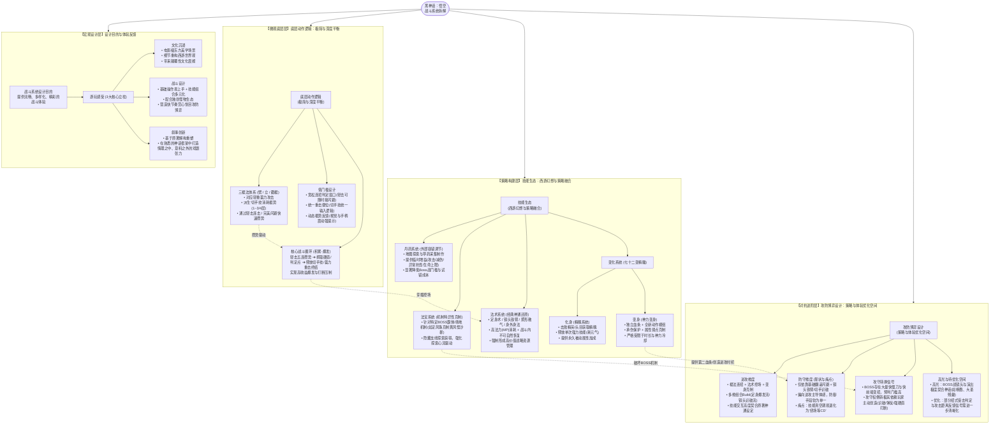
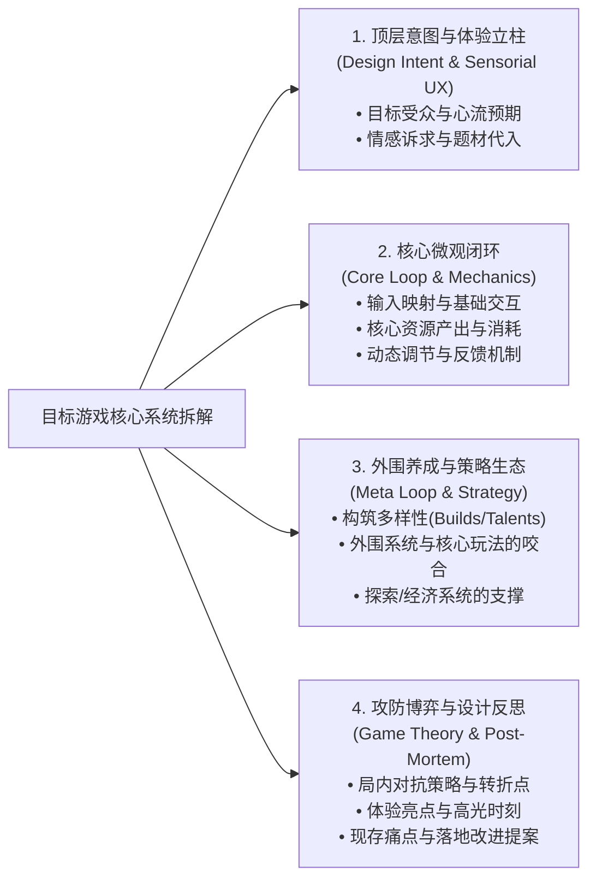

# 《黑神话：悟空》战斗系统逆向拆解架构图·深度专业分析报告

> **分析对象**：`19、黑神话悟空 系统拆解.png`  
> **文档载体**：单图流 / 高信息密度系统架构思维导图（System Mindmap / Architecture Blueprint）  
> **核心主题**：国产首款 3A 动作角色扮演游戏（Action-RPG）《黑神话：悟空》核心战斗系统与游玩体验全景解构  
> **报告撰写人**：资深游戏主策划 / 行业导师  
> **报告归档路径**：`E:\游戏策划案\拆解案分析报告\19_黑神话悟空系统拆解_深度分析.md`

---

## 1. 拆解图基本信息与全景架构

### 1.1 拆解图基本定位与信息元数据

| 维度 | 详细说明 |
| :--- | :--- |
| **文档类型** | 3A 动作系统逆向工程拆解图 / 核心机制思维导图（System Architecture Deconstruction） |
| **分析对象** | 游戏科学（Game Science）作品《黑神话：悟空》（*Black Myth: Wukong*） |
| **拆解核心** | 核心战斗底层机制（Core Action Loop）、技能与外围策略生态（Skill & Build Ecosystem）、攻防博弈与体验优化空间（Combat Game Theory & UX Analysis） |
| **视觉拓扑结构** | **双向发散式放射树状图（Bilateral Mindmap）**：以中央“黑神话：悟空 战斗系统拆解”为枢纽，左侧承接“设计目的与宏观体验感受”（Top-down Intent & Sensorial UX），右侧展开“三层递进式底层系统架构”（Bottom-up Mechanics: 底层动作 -> 技能生态 -> 攻防博弈） |
| **信息密度与层级** | 4 级树状深度，图元包含核心节点、机制定义、输入输出流转、具体实战案例及设计反思（痛点优化点） |

---

### 1.2 全景系统逻辑与拓扑结构重构

该拆解图展示了《黑神话：悟空》以**“棍势驱动”**为基础底座，以**“法术/变化”**为策略爆发，以**“攻防转换”**为博弈焦点的设计哲学。以下将图中的全部信息节点与隐含设计咬合关系重构为完整的 Mermaid 全景系统拓扑图：



---

## 2. 这张拆解图“好在哪里”（深度亮点剖析）

思维导图往往容易沦落为“游戏功能名词的无脑堆砌”（Feature Dumping），但这份《黑神话：悟空》战斗系统拆解图展现出了**工业级资深策划的高维解析视角**。其闪光点不仅在于结构整密，更在于对核心玩法机制与设计意图的深刻洞察：

### 2.1 视角穿透：从“功能罗列”上升到“设计哲学与目的导向”
1. **左侧锚定“体验目的”，右侧解构“技术实现”**：
   - 很多初级拆解者一上来就画 UI 界面或属性面板，而该图左侧第一级节点直接确立了核心立意——**“战斗系统设计目的：向玩家提供一个足够流畅、足够多样化、足够精彩的战斗体验”**。
   - 这种“以终为始”的 Top-down 视角，直接将右侧的底层动作、技能法术、攻防博弈统摄在“体验目的”之下。所有的机制（三棍法、切手技、变身、法术）不再是孤立的代码或数值，而是为了服务于这三项体验指标的落地支柱。
2. **文化赋能与机制设计的有机共生**：
   - 将“文化沉浸”与“叙事创新”作为系统设计的外延反馈来分析。深入指出了法术（定身术、毫毛分身）、法宝（定风珠克制黄风大圣）、七十二变（化身与神力变身）不仅是东方西游 IP 的符号化包装，更是**解决战斗策略维度、探索驱动力与 Boss 战解题机制的玩法核心**。

---

### 2.2 动作 ARPG 底层咬合机制的精准解构（The Core Action Loop）
该图对《黑神话：悟空》的战斗底层逻辑解构极为精准，准确抓住了游戏与经典魂系（Dark Souls/Elden Ring）及传统纯动作游戏（Character Action Games 如鬼泣、贝姐）的本质差异：

```
┌─────────────────────────────────────────────────────────────────┐
│                    《黑神话：悟空》核心微观战斗闭环               │
└─────────────────────────────────────────────────────────────────┘
         ┌──────────────────────────────────────┐
         │ 1. 基础资源积累阶段 (Light Attack Loop)│
         │ • 普攻五连击安全输出段                │
         │ • 穿插完美闪避 (残影聚势)             │
         └──────────────────┬───────────────────┘
                            │ 积攒棍势 (Focus 1~3/4 段)
                            ▼
         ┌──────────────────────────────────────┐
         │ 2. 攻防转换与派生阶段 (Branching Phase)│
         │ • 识破 / 切手技 (破棍式/退寸/搅阵)     │
         │ • 铜头铁臂弹反硬直 / 定身法定身输出   │
         └──────────────────┬───────────────────┘
                            │ 消耗棍势 / 释放法术
                            ▼
         ┌──────────────────────────────────────┐
         │ 3. 终结爆发与削韧阶段 (Heavy Finisher) │
         │ • 蓄力重击砸地 / 戳棍贯穿            │
         │ • 打出强硬直、部位破坏或击倒倒地     │
         └──────────────────┬───────────────────┘
                            │ 获得战略喘息 / 转换形态
                            ▼
         ┌──────────────────────────────────────┐
         │ 4. 战术救场与形态切换 (Tactical Switch)│
         │ • 释放化身精魄补充爆发 (幽魂大头等)  │
         │ • 开启神力变身 (广智/寅虎等独立血条)  │
         │ • 使用针对性法宝解除机制危机          │
         └──────────────────────────────────────┘
```

1. **“极简与深度平衡”的键位与输入抽象**：
   - 拆解图精准指出了游戏在输入端的精妙取舍：轻击负责连贯输出与攒势，**统一的重击键位**则通过不同的前置输入衍生出“切手技（破棍式、退寸、搅阵等）”或“蓄力重击”。
   - 这种设计将传统动作游戏繁杂的“搓招表（如搓半圈+按键）”扁平化为“轻击节奏+重击派生”，既保证了新手不会因操作繁复劝退，又通过棍势消耗与无敌帧切手赋予了硬核玩家极高的操作上限。
2. **三大资源槽的非对称平衡（Asymmetrical Resource Management）**：
   - **气力（Stamina）**：负责微观动作连贯性，高频流转。
   - **棍势（Focus）**：战斗节奏的蓄水池，鼓励“持续进攻+极限闪避”的高风险高收益机制（积极防御）。
   - **法力（Mana）**：宏观战略资源，**不可自然回复**。拆解图敏锐点出“高法力消耗 + 不可回复设定 = 强制资源管理”，防止玩家滥用法术导致战斗策略坍塌为无脑定身与复读。

---

### 2.3 敢于触碰痛点：客观批判与体验优化洞察
优秀的拆解绝不是一味的吹捧与溢美，而必须具备**制作人级别的审视与挑剔目光**。该拆解图在第三大支柱“攻防博弈设计”中明确开辟了**“策略与体验优化空间”**，直击发售后玩家社区与核心评测的核心痛点：
1. **防御维度的结构性缺陷（“绕场等CD”现象）**：
   - 拆解图一针见血地指出：天命人缺乏像《只狼》弹刀或传统 ARPG 举盾那样普适、低成本的常态化防御机制。防御手段主要依赖“基础翻滚闪避”与“高 CD / 耗蓝的铜头铁臂”。
   - 当玩家面对高机动、多段大范围连击的 BOSS（如百眼魔君、小黄龙、毒敌大王等），一旦法力耗尽或技能进入 CD，容错率骤降，最理性的解法往往退化为**“拉开距离、绕场跑动等技能冷却”**，严重打断了动作游戏本应具备的高频攻防心流。
2. **信息反馈信号与攻守时机的错位**：
   - 敏锐捕捉到 BOSS 战中“快慢刀极度夸张”、“无前摇突进招式”对玩家神经反射造成的疲劳感，指出部分技能受击判定盒（Hitbox）与模型攻击轨迹存在视觉反馈偏差，攻守时机过度依赖玩家主动赌“识破”或“铜头铁臂”，缺少递进式的博弈提示。

---

## 3. 体现了策划的什么核心能力（能力模型对照）

通过分析这一张单图，可以清晰折射出作者作为资深系统/战斗策划的深厚功底：

```
                      ┌─────────────────────────────────┐
                      │    资深策划系统拆解能力模型      │
                      └────────────────┬────────────────┘
                                       │
     ┌──────────────────┬──────────────┴─────┬──────────────────┐
     ▼                  ▼                    ▼                  ▼
【逆向工程解构力】     【机制咬合闭环力】   【高维抽象归纳力】 【业务反思与审美力】
  抽丝剥茧剥离表象      厘清资源输入与流转    构建清晰图谱框架   直击设计利弊与痛点
```

### 3.1 单机 3A / 复杂动作系统逆向工程解构力（Deconstruction Capability）
- **剥离外在表现，直达核心骨架**：面对《黑神话：悟空》极其繁复的画面表现、动捕特效与庞大妖怪资产，作者没有被表层的特效迷惑，而是直接提炼出三根主干——**底层动作（基础骨架）**、**技能生态（策略血肉）**、**攻防博弈（对抗灵魂）**。
- **颗粒度拿捏精准**：在每一个分支下，既有微观的判定机制（连招判定窗口、切手技消耗机制），又有宏观的生态定性（降低容错、强制资源管理、探索驱动），层级严密，毫无跨层混淆。

### 3.2 机制咬合闭环与资源流转分析能力（Systemic Synergy）
- 动作游戏绝非简单的动画状态机拼接。作者准确抓住了**“棍势驱动”作为发动机**如何与外围系统咬合：
  - 探索系统产出丹药与法宝 -> 解决 BOSS 机制克制难题；
  - 精魄系统击败怪物获得 -> 赋予常驻属性与即时爆发技能；
  - 变身系统引入独立血条 -> 弥补角色本体缺乏硬减伤机制的短板。
  - 这展现出策划在分析系统时，始终保持着强烈的**系统生态闭环思维（Ecosystem Loop）**。

### 3.3 架构可视化与导图信息设计能力（Information Architecture）
- **对称美学与逻辑流向**：左右两侧平衡感极佳。左侧回答“What we want to achieve（体验目标）”，右侧回答“How the system delivers it（系统实现路径）”，呈现出严谨的因果推演逻辑。
- **信息分层克制（Progressive Disclosure）**：避免了冗长段落，采用“核心主干 -> 机制定义 -> 机制价值/实战效果”的三级提炼法，阅读者在 30 秒内即可扫清整体骨骼，在 3 分钟内即可把握深层逻辑。

---

## 4. 学习如何用思维导图/架构图进行高效游戏拆解（实战指南与方法论）

在游戏公司日常研发与求职面试中，写几十页的 Word 拆解案往往因为篇幅过长而难以让用人部门/制作人快速抓住重点。**一张高信息密度、逻辑严密、兼具洞察的思维导图/架构图，往往具有击穿心智的穿透力**。

基于本文档的成功经验，提炼出可完全复用的导图拆解方法论：

### 4.1 优秀系统拆解思维导图的“四维骨架模板”

建议在拆解任何一款成熟中重度游戏（无论是 3A 单机还是商业化手游）时，采用如下“黄金四维框架”构建导图：



---

### 4.2 必须掌握的高分技巧与实战心法

1. **“机制定义 + 策划意图 + 实战案例”三位一体标注法**：
   - ❌ **低分写法（纯描述）**：“法宝：定风珠、避火罩，打特定 BOSS 可以用。”
   - ✅ **高分写法（如本拆解案）**：“法宝：针对性克制 BOSS（如定风珠对黄风怪），需探索隐藏区域获取，兼具策略性与探索驱动。”
   - *法则*：每个末端节点必须交代**“该机制解决了什么设计问题”**或**“带来了什么玩家心理变化”**。
2. **善用“矛盾对立统一”提炼核心母题**：
   - 拆解主干时，提炼出具有策划思考张力的副标题。例如本案中的：
     - `底层动作逻辑` ➔ **“极简与深度平衡”**
     - `技能生态` ➔ **“西游幻想与策略融合”**
     - `攻防博弈设计` ➔ **“策略与体验优化空间”**
   - 这种命名方式立刻彰显出拆解者具备制作人级别的高度，直接击中系统设计的平衡难题。
3. **设置专门的“优化空间 / 逆向反思”分支**：
   - 90% 的候选人拆解案只写优点，显得缺乏批判性思考。
   - 在导图末尾设置“设计痛点 / 体验失衡点 / 优化构想”分支，针对游戏出现的“断流”、“枯燥段”或“机制退化”（如本案指出的“绕场等CD”），给出 1~2 个具象的调优方向（例如：增加残血/极限闪避时的微量回蓝机制，或增强轻击最后一击的削韧效果以鼓励正面进攻），这是让求职者瞬间脱颖而出的“杀手锏”。

---

### 4.3 必须规避的四大典型误区

| 常见误区 | 典型表现 | 致命病因 | 改进对策 |
| :--- | :--- | :--- | :--- |
| **误区 1：界面流水账** | 按照游戏 UI 菜单（装备、背包、天赋、图鉴）从左往右抄录 | 停留于视觉表现层，完全没有抽象出核心机制与玩家心流 | 彻底抛弃 UI 结构，严格按照“输入层 ➔ 规则层 ➔ 反馈层 ➔ 生态层”来划分树干 |
| **误区 2：名词复读机** | 把技能名字、道具名、怪物名字从头到尾列一遍，无归类分析 | 缺乏数据与规则的抽象归纳能力，内容冗长且无信息增量 | 按功能类型聚合（如“位移类”、“无敌帧霸体类”、“场地解除类”），仅提取最具代表性的典型案例 |
| **误区 3：脱离闭环思维** | 动作拆动作、养成拆养成、地图拆地图，彼此完全割裂 | 没有理解现代游戏系统间的咬合关系（Synergy） | 用虚线关系箭头或专门的跨系统流转节点，明确说明 A 系统如何驱动 B 系统 |
| **误区 4：空洞评价套话** | “打击感很好”、“画面震撼”、“玩起来很爽”，缺乏技术定性 | 缺乏专业策划术语与可落地的拆解颗粒度 | 替换为“打击停顿帧（Hitstop）设计”、“受击硬直等级（Flinch/Knockback）”、“攻击前摇与取消窗口（Cancel Window）”等工程化术语 |

---

### 4.4 个人求职与实战项目落地应用建议

1. **作品集求职呈现策略**：
   - 制作思维导图拆解案时，建议采用 **“1+N” 结构**：
     - **“1” 是一张高精度的全景思维导图（如本案）**，作为封面或总览，方便面试官在 1 分钟内快速扫视你的全局架构能力；
     - **“N” 针对导图中的某 1~2 个深度分支（如本案中的“切手技与棍势循环”或“防守手段单一优化提案”）展开为 1~2 页详细的策划案**（附带输入时序图、状态流转图、配置表字段示例），展现你由面及点的扎实落地能力。
2. **立项前竞品技术调研**：
   - 在项目立项或攻坚阶段，主策应组织团队使用此类导图，将市面上同赛道 3~5 款标杆产品（如《黑神话：悟空》、《战神5》、《艾尔登法环》、《仁王2》）的核心战斗框架并列铺开，对比其资源循环（棍势 vs 怒气 vs 绿条 vs 残心）与防守模型（翻滚 vs 盾反 vs 弹刀），从而迅速定位自己项目核心玩法的差异化竞争点。
