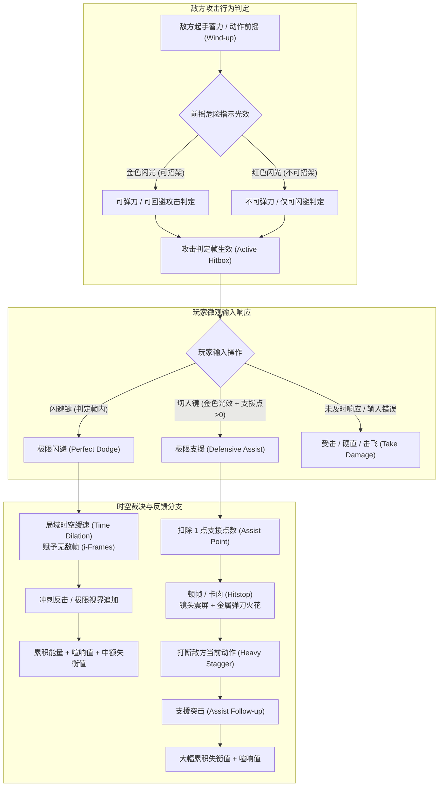
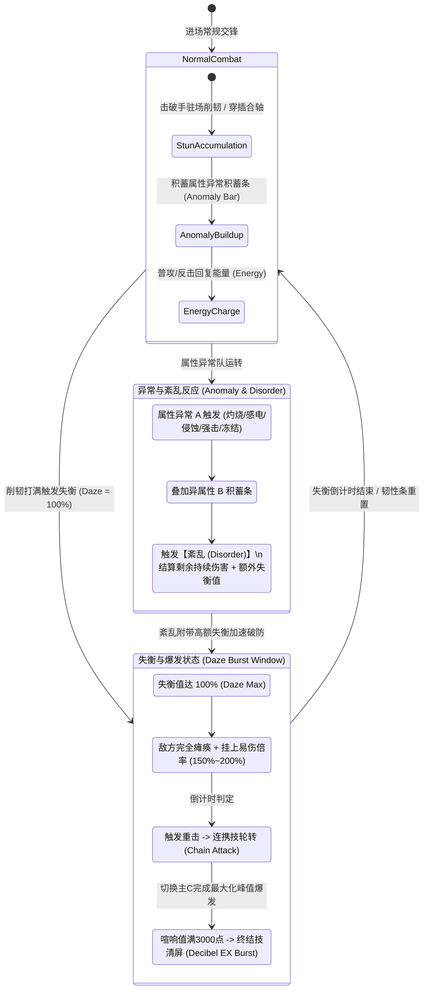
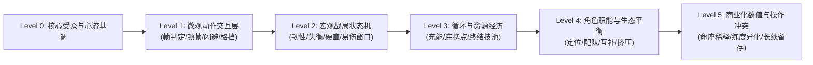

# 《绝区零》战斗系统分析——策略与操作的动态平衡：深度拆解与系统评测报告

---

## 1. 拆解案基本信息与架构全貌

### 1.1 文档基本信息与定位
- **文档名称**：`20、绝区零 战斗系统分析.png`
- **文档体裁**：高清脑图型战斗系统架构解构与设计批判评测案（Visualized Combat System Deconstruction & Post-Mortem Critique）
- **分析对象**：米哈游（HoYoverse）都市潮酷动作ACT游戏《绝区零》（Zenless Zone Zero, ZZZ）
- **核心模块**：底层动作博弈机制（极限闪避/极限支援/弹刀）、资源运转体系（失衡值/喧响值/能量/支援点）、角色生态定位（强攻/击破/支援/异常/防护）、以及动作性与数值养成之间的结构性矛盾。
- **行文逻辑骨架**：
  文档以“策略与操作的动态平衡”为最高纲领，采用“**宏观定位 -> 三维解构 -> 核心矛盾剖析 -> 角色生态问题 -> 商业化/数值冲突 -> 针对性改进提案**”的递进式批判架构：
  1. **核心设计定位**：差异化赛道定性（弱化元素反应，聚焦角色纯动作与即时爽快感），提炼失衡、弹刀与高密打击演出三大爽感水源；
  2. **战斗系统三维度矩阵**：首创“策略轴-操作轴-资源轴”三维解析模型，完成微观操作与宏观循环的解耦；
  3. **失衡系统核心矛盾**：深挖击破机制在长线实战中的病态异化（“修脚时长/爆发时短”与“高练度下失衡机制失效”）；
  4. **角色设计亮点与生态死穴**：解析五大职业职能闭环，直击防护角色的两难困局与击破/强攻占场时长的畸变割裂；
  5. **动作与数值矛盾**：揭示轻度连招交互与硬核决策缺失、以及米家传统长周期数值养成对纯ACT底层操作表达的稀释；
  6. **针对性优化建议**：提出分段失衡机制、玩家分层供给、防护功能升维与击破节奏再调校等落地策略。

---

### 1.2 《绝区零》核心战斗时序与状态流转全貌（Mermaid高精还原）

为了彻底解构原图中提炼的“失衡、弹刀、异常、连携、资源”三大维度，下方完整还原《绝区零》微观帧判定博弈与宏观战局状态机：

#### 【时序流转图 1：敌我微观交互判定与博弈时序】
展示从敌方起手提示（金光/红光）到玩家输入校验、时空扭曲、动作裁决的全流程：



---

#### 【状态流转图 2：宏观资源循环与失衡爆发状态机】
展示战场三轴（策略-操作-资源）在整个单局生命周期内的动态运转全貌：



---

## 2. 这张战斗分析图“好在哪里”（深度亮点剖析）

### 2.1 视角高度：跳出执行层，以“三维坐标系”抽象战斗本质
绝大多数初中级动作游戏拆解案往往陷入“**技能效果说明书**”或“**按键映射表**”的泥潭（如详细罗列普攻第1段到第5段动作倍率）。而本分析图的核心亮点在于其构建了**高度凝练的三维正交模型**：

| 维度 | 系统映射 | 运作逻辑 | 设计师的核心意图 |
| :--- | :--- | :--- | :--- |
| **策略轴** | 失衡值动态管理 / 属性异常与紊乱 | 玩家在战局中并非无脑连击，而是需要观察敌方韧性条与属性积蓄，在特定时钟节点进行策略爆发。 | **把控战局起伏与体验波峰**：赋予战斗“准备期-蓄力期-爆发期”的呼吸感。 |
| **操作轴** | 弹刀、极限支援、合轴换人时序 | 考验玩家对敌方帧前摇的动态反应，利用切换角色取消后摇（Cancel）实现双人同屏合轴输出。 | **确立操作上限与技巧表达**：让硬核玩家通过精准时序兑换无伤与DPS效率。 |
| **资源轴** | 喧响值（Decibel）、能量、支援点 | 终结技全队共享喧响值池，能量驱动强化特殊技（EX），支援点硬性约束容错率。 | **构筑资源自洽的经济循环**：杜绝无限弹刀与终结技泛滥，实现微观博弈的损耗与充盈平衡。 |

这种**将战斗系统解构为“策略×操作×资源”的立体网格**，体现了作者对现代动作RPG（ARPG）底层解耦的深刻理解。

---

### 2.2 矛盾洞察的穿透力：直击“失衡体系”与“数值成长”的内生悖论
本图最令人惊艳的并非“陈述机制”，而是其**敏锐且尖锐地指出了《绝区零》在中后期商业化数值膨胀下的生态恶化**：

```
                    【失衡系统在不同练度下的失效悖论】

  [低/平民练度]                                    [高练度 / 氪金毕业]
  Boss血厚韧高                                     数值严重溢出
       │                                                │
       ▼                                                ▼
  长达40秒的“刮痧修脚”                             无需等待Boss失衡
  只为换取10秒的爆发窗口                           纯靠主C站场高倍率伤害
       │                                                │
       ▼                                                ▼
  【体验极其疲乏冗长】                             【击破位完全失去出场价值】
  (失衡积累耗时 >> 失衡爆发时效)                   (失衡机制沦为摆设，闭环崩塌)
```

1. **“修脚”痛点剖析**：
   在常规ACT中，打击反馈是即时的；但在引入类似《魔兽世界》或《原神》式爆发窗口后，BOSS常规状态下具备高额免伤或韧性压制，导致击破手在积蓄失衡期间的战斗体验沦为纯粹的“打桩修脚”，动作带来的正反馈被漫长的准备期严重稀释。
2. **高低练度割裂与角色下岗**：
   作者一针见血地指出：当玩家通过米家“命座/专武/圣遗物驱动盘”达到毕业练度时，强攻主C直接在常规状态下将BOSS灌死。**“击破”作为五大基础职业之一，其核心设计定位被自身的商业化数值成长体系所自我否定**。这是极高水准的商业化与底层机制冲突推演。

---

### 2.3 角色生态批判：洞察防护角色“凯撒”的短期破局与长远鸩酒
分析图在“角色设计亮点与问题”中，对防护位（Defense）的剖析入木三分：
- **逻辑死结**：在纯粹依靠“极限闪避”和“弹刀招架”就能规避100%伤害的高操作上限游戏中，**纯防御型角色在逻辑上是冗余的**。高玩不需要护盾，新手需要增益与伤害。
- **凯撒（Caesar）的“毒药式救赎”**：
  官方为拯救防护位退环境，为凯撒注入了“超强霸体护盾 + 全队高额攻击力加成（增益） + 抗打断”的复合机制。作者深刻指出：**凯撒表面上盘活了防护位，实则是以“透支后续同定位角色设计空间”为代价**。一旦后续防护角色数值或增益不及凯撒，将彻底失去抽卡吸引力；若超越凯撒，则会导致全队常驻金刚不坏与数值膨胀失控。

---

## 3. 体现了策划的什么核心能力（能力模型对照）

通过分析这张高清思维导图，可以映射出该策划在ACT系统设计领域的深厚功底与能力画像：

```mermaid
radar-chart
    title 动作战斗策划核心能力模型雷达
    "微观动作手感解构 (打击感/卡肉/帧判定)": 92
    "宏观战斗时序与状态机建模": 95
    "数值-机制内生矛盾推演能力": 96
    "商业化与职业生态平衡洞察": 94
    "再设计与结构性重构落地能力": 88
```

### 3.1 逆向工程与动作底层微观把控能力
作者能够从《绝区零》令人眼花缭乱的光效、高频切人演出中，精准剥离出决定动作“打击感”与“节奏感”的物理与时间维度参数：
1. **动态时空扭曲（Time Dilation）与顿帧（Hitstop）**：
   明确区分了金色光效（弹刀）与红色光效（避让）的判定帧区间，理解弹刀时的**单帧卡肉（Hitstop 4~8帧）**、**镜头拉近（FOV Shift）**与**受击者刚体骨骼停滞**对打击爽感的物理支撑。
2. **预输入缓冲（Input Buffering）与取消帧（Cancel Window）**：
   拆解案指出的“合轴”操作，本质上是策划在动作状态机中预留了`Switch-Attack Cancel`接口——在角色A释放具有较长有效判定帧的技能期间，允许玩家切出角色B并列执行攻击，从而在微观时间轴上实现伤害判定重叠（DPS叠乘）。

---

### 3.2 玩家心理心流与正负反馈环架构能力
一个优秀的动作策划必须懂得如何**调度玩家的肾上腺素**：
- **极限博弈的正向强化**：
  闪避与弹刀属于高风险决策（输入早了打空，晚了吃打断受击），图解准确归纳了其“**高风险 -> 极高即时感官奖励（慢动作+音效炸裂+资源大幅充盈）**”的心流闭环。
- **挫败感与冗长体验的归因**：
  作者敏锐捕捉到了“负反馈黑洞”——当面对深渊高层BOSS高额失衡条时，重复单一的削韧动作导致心流骤跌进入**无聊区（Boredom Zone）**；而一旦好不容易打进失衡，因切人失误或能量不足未能打出连携，又瞬间跌入**挫败区（Frustration Zone）**。

---

### 3.3 架构重构与“手术刀式”再设计能力
优秀的评测绝不仅止于批评，更在于提供具有可行性的工程化解决方案。作者在【优化建议】中提出的改动极具落地价值：
- **“分段失衡条”机制**：
  借鉴《艾尔登法环》韧性暗条与《只狼》架势条的精髓，将冗长的单一段失衡条切分为2~3个阶段。每打崩一段，给予敌人中度硬直、掉落能量球并改变BOSS战斗阶段/受击动作，从而将“漫长修脚”改造为“阶梯式多波峰反馈”。这既保留了击破位的战略地位，又彻底消除了无聊垃圾时间。

---

## 4. 学习如何拆解与呈现高动作性战斗系统（实战指南与方法论提炼）

从本张高分脑图中，我们可以提炼出一套专门针对**动作游戏（ACT / ARPG）战斗系统拆解的标准方法论模板**，供策划同行在求职作品集或商业项目立项中直接复用。

---

### 4.1 高动作性战斗系统拆解：通用分析框架（可复用模板）



#### 模块一：微观输入与动作反馈剖析（Micro-Combat Layer）
- **输入层**：预输入缓冲窗口（Buffer Window）、按键连发与蓄力分级、动作取消逻辑（Dodge Cancel / Jump Cancel / Switch Cancel）。
- **判定层**：攻击盒（Hitbox）与受击盒（Hurtbox）匹配度、无敌帧（i-frames）起始点与持续帧数。
- **表现反馈层**：卡肉/顿帧（Hitstop，攻击方与受击方的不同冻结时间）、震屏（振幅、衰减、方向）、音效与受击火花粒子（Hit Spark）、动态慢镜头（Slomo/Time Dilation）。

#### 模块二：宏观博弈与战局状态机（Macro-Strategy Layer）
- **攻防博弈规则**：弹刀判定窗口（Parry Window）、招架反击、虚弱/处决机制。
- **韧性与削韧体系（Poise & Stagger）**：敌方霸体级别、常态削韧、失衡易伤倍率、重置保护机制。
- **元素/状态异常（Status Effects）**：积蓄槽阈值衰减、多重属性反应/紊乱结算。

#### 模块三：资源闭环与经济流向（Combat Economy Layer）
- **资源分类**：时间轴自然恢复资源（耐力/能量）、操作奖惩兑换资源（完美招架返还点数）、战斗终极蓄能（大招喧响值）。
- **资源瓶颈与溢出控制**：限制无限连携与全无敌覆盖的调控阀门。

#### 模块四：长线生态与数值映射（Metagame & Monetization）
- 角色定位互斥性评估（DPS vs Stun vs Support）。
- 氪金数值成长曲线是否会摧毁基础动作交互乐趣。

---

### 4.2 制作战斗拆解案的高分技巧与闪光点

1. **拒绝“文科生式抒情”，善用“工科生式矩阵”**：
   学习原图的“策略-操作-资源”三维表格。把混沌的战斗体验拆解为互相独立的坐标轴，瞬间建立逻辑壁垒。
2. **绘制精准的微观时序图与状态转移图**：
   用Mermaid或Visio画出“前摇提示光 -> 判定激活 -> 玩家输入分支 -> 顿帧演出 -> 资源发放”的完整时序。面试官一眼便知你懂动作引擎的实现机理。
3. **敢于挖掘“深水区矛盾”**：
   不要只夸游戏有多爽。真正体现资深策划水平的，是指出**游戏底层设计意图（Intent）与实际长线表现（Reality）之间的错位**（如失衡机制在毕业练度下的沦丧）。
4. **提出具有工程可行性的“反策划方案”**：
   提出修改方案时，切忌“推倒重来”。像原图那样提出“分段失衡条”，既不需要重构整个战斗底层，又能极大改善节奏，这就是具备可落地性的高情商案子。

---

### 4.3 必须规避的拆解误区（避坑指南）

| 常见误区 | 典型初级表现 | 资深策划的正确做法 |
| :--- | :--- | :--- |
| **误区一：说明书式流水账** | 详细抄录“普攻有5段，E技能是横扫，大招是全屏爆炸”。 | 提炼动作模块的**战术功能**（如：普攻前3段用于试探与微量攒能，第4段具位移避弹，第5段提供重削韧与后摇取消窗口）。 |
| **误区二：脱离商业化的纯单机视角** | 盲目以《鬼泣5》《只狼》的标准批判手游没有复杂的搓招指令表。 | 理解F2P服务型手游的**受众触达率**与**跨平台操作适配**（搓招在移动端虚拟摇杆上的灾难体验），分析其为何选择“单按键连击 + 切人合轴”替代传统连招。 |
| **误区三：忽略怪物设计的单向意淫** | 只拆解自机角色的技能有多帅，完全忽视怪物的攻击行为树（Behavior Tree）。 | 动作交互是**双向博弈**。必须将怪物的前摇帧、攻击欲望、硬直韧性与自机招架窗口放在同一时序下对比分析。 |
| **误区四：只见树木不见森林** | 纠结于某个数值倍率是否合理，看不到全队的输出轴与转火逻辑。 | 分析三口之家的切人轮转循环、合轴收益率与伤害窗口覆盖率。 |

---

### 4.4 在求职作品集与项目实战中的应用落地策略

1. **用于大厂动作/战斗策划岗位求职**：
   - 将此类分析图作为作品集的“核心论证页”，搭配录制的游戏实机逐帧拆解视频（标记判定帧数与Hitstop时长），能直接证明你具备顶尖大厂（米哈游、库洛、网易雷火、腾讯天美）战斗策划的微观调校与宏观架构双重视角。
2. **用于自研新项目立项预研**：
   - 在立项初期，团队往往容易沉迷于“做最爽的动作”。用本文的框架推演一遍：“我们的硬核操作是否与抽卡数值冲突？我们的职业划分是否存在某个沦为边缘人的定位？”能够为项目省下数以百万计的试错成本。

---

## 5. 总结与提炼

该份《绝区零》战斗系统分析思维导图，是一份**结构极其严整、切入点极其辛辣、思考深度极其罕见**的顶尖拆解案。它不仅系统化复盘了米哈游在动作移动端工业化上的顶尖表现力（高密度打击演出、极简弹刀博弈、顺畅合轴切人），更以敏锐的职业直觉，直击了“失衡疲劳”、“防护职能尴尬”、“动作爽感与数值抽卡冲突”等阻碍其长线口碑的核心症结。

这份分析案证明了一个朴素但至关重要的游戏设计真理：
> **真正的战斗设计，从来不是炫目的动作库与特效堆砌，而是在每一帧的时间切片里，让玩家的操作、策略与资源，与怪物的行为完成一场高潮迭起、严丝合缝的动态舞蹈。**
