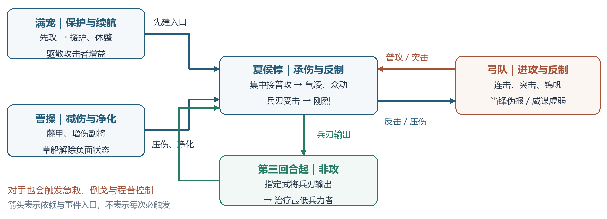
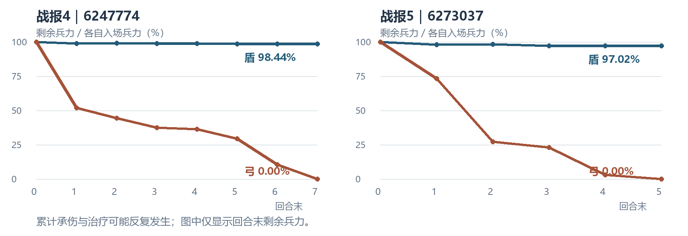
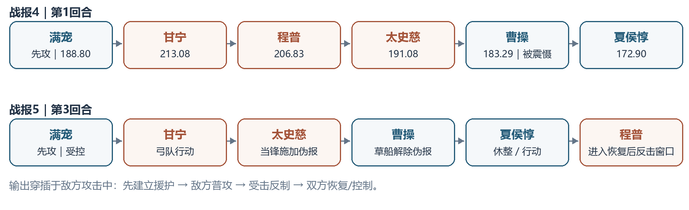

# 第三部分：阵容联动
## 反击盾（墩墩盾）对慷慨弓（甘太程）：为什么能打出低战损

**核心判断：本案例的低战损，来自“减伤压低单次损兵、援护集中普攻、受击反制削弱进攻方、治疗回填承伤”的连续联动。** 对手的攻击次数越多，既越有机会破防、触发突击和治疗，也越可能给反击盾提供输出入口。两场实际结算中，后者占优。

**【策划导读与原型对决】** 在战斗数值生态中，本案例代表了“高频突击爆发流（甘太程）”与“援护防守反击流（墩墩盾）”的原型博弈。攻击频次是双刃剑：既是多段突击与破防判定的放大器，也是被防守反击机制收取的“行动税”。两场实战仅 1.56% 与 2.98% 的极低净损兵，意味着该防守体系在宏观沙盘中具备统治级的“低损驻守连穿”能力，大幅降低主城补兵时间与粮草成本，成为阵地战的战略压舱石。

### 3.0 先确认：低的是净损兵，不是从未受伤

| 结算指标 | 战报4：6247774 | 战报5：6273037 |
|---|---:|---:|
| 反击盾入场 → 战斗末兵力 | 25,304 → 24,908 | 17,145 → 16,634 |
| 累计承伤 / 实际恢复 | 3,695 / 3,299 | 3,254 / 2,743 |
| 净损兵 / 入场兵力占比 | **396 / 1.56%** | **511 / 2.98%** |
| 弓队入场 → 战斗末兵力 | 19,523 → 0 | 17,649 → 0 |
| 最后出现战斗事件的回合 | 第7回合 | 第5回合 |

净损兵 = 累计损失兵力 − 实际恢复兵力。累计承伤包含治疗后再次损失的兵力，不能直接当作战后损失；净损兵也不等于永久死亡、征兵量或资源成本。本文依据每条“损失/恢复了兵力”的前后值复算，不拿治疗面板总量代替实际恢复。

**选择这两场的价值**：战报4展示联动完整运转；战报5展示当锋打断后，体系怎样恢复。但两场都是按低战损现象挑选的样本，不能据此估计胜率或声称“典型配置必定低损”。

**版本边界与混杂因素**：两份记录的北京时间分别为2026年9月22日18:26、22:25；具体赛季与客户端版本未确认。战报4反击盾兵力明显更多；战报5反击盾另有【八卦阵】15%双伤减免，弓队士气91.40、日志记载造成伤害降低6.02%。这些优势必须与阵容机制一起解释，不能把低损全部归功于配将。[证据：两场G0；兵力核算表]

<!-- PAGE -->

### 3.1 锁定配置：相同队名，分别记录

以下用“反击盾”（社区通称“墩墩盾”）与“慷慨弓”（经典“甘太程”演化变种）作为本文简称，以实际武将和槽位识别配置。位置按战报记录：曹操、甘宁为各自主将，其余为副将。**全部携带战法均为10级。**

| 队伍 / 武将 | 战报4：等级/进阶；入场兵力 | 战报5：等级/进阶；入场兵力 | 携带战法 |
|---|---|---|---|
| 盾·曹操 | 48/2；8,566 | 48/2；5,715 | 乱世奸雄、藤甲兵、草船借箭 |
| 盾·夏侯惇 | 48/5；8,161 | 48/5；5,715 | 刚烈不屈、众动万计、气凌三军 |
| 盾·满宠 | 48/5；8,577 | 48/5；5,715 | 镇扼防拒、蓄势待发、非攻制胜 |
| 弓·甘宁 | 50/2；6,443 | 48/5；5,631 | 锦帆百翎、草船借箭、锦帆军 |
| 弓·程普 | 50/5；6,465 | 48/4；5,264 | 勇烈持重、临危救主；第4场威谋靡亢，第5场雁行阵 |
| 弓·太史慈 | 50/5；6,615 | 48/5；6,754 | 神射、当锋摧决、摧锋断刃 |

【设计构型】盾队构成铁三角：曹操提供主将级指挥增伤与吸血抗性，满宠提供援护机制与持续休整，夏侯惇作为全队受击反制与兵刃反击的核心载体。反击盾三人均为盾S；弓队甘宁、太史慈均为弓S，程普在战报4为弓S（日志有兵种散记提升），战报5为弓A。同名武将也存在形态差异：两场甘宁的hero_type为10942/10032，太史慈为10022/10928；夏侯惇两场均为10923。本文沿用原始显示名，完整ID留在配置表中，避免按队名合并。

**属性记录（武力 / 统率 / 智力 / 速度）**

| 武将 | 战报4：R1统计快照 | 战报5：R1统计快照 |
|---|---|---|
| 曹操 | 194.86 / 449.44 / 265.38 / 183.29 | 同左 |
| 夏侯惇 | 363.85 / 306.57 / 161.11 / 172.90 | 同左 |
| 满宠 | 159.41 / 309.57 / 455.03 / 188.80 | 同左 |
| 甘宁 | 322.33 / 402.38 / 163.97 / 213.08 | 344.83 / 402.04 / 159.18 / 204.27 |
| 程普 | 213.46 / 403.83 / 229.11 / 206.83 | 181.42 / 337.96 / 206.99 / 136.21 |
| 太史慈 | 448.85 / 240.67 / 190.07 / 191.08 | 437.24 / 246.03 / 181.41 / 191.19 |

快照含已生效增减益，不能视作纯入场面板。例如战报4夏侯惇入场加成后统率356.57，太史慈两次神射各降25后，R1记录为306.57。兵书、装备、建筑和士气也参与结算；其原始日志随证据包保留，不以九个战法槽位代表全部配置。[证据：两场G0；逐回合属性快照；完整战法关联]

<!-- PAGE -->

### 3.2 画出联动：让承伤位置成为输出入口

**盾队的三人分工**：曹操用藤甲提供兵刃减伤，乱世奸雄增益副将输出并从副将伤害中恢复主将；满宠通过蓄势取得先攻与智统增益，先建立援护和休整；夏侯惇集中承接普攻，用气凌三军、刚烈不屈、众动万计反制。第3回合起，非攻再把指定输出者的兵刃伤害转为对最低兵力者的治疗。

**弓队的进攻与续航**：太史慈连击增加神射降属性、当锋伪报、摧锋压伤的机会；甘宁提供会心、倒戈并携草船、锦帆军；程普用临危承接普攻次数形成治疗，受击有机会震慑。战报4另有威谋虚弱，战报5另有雁行阵。反击本身也会喂给弓队急救与程普控制机会，不能只统计盾队触发。

| 实际结算的联动产物 | 战报4 | 战报5 |
|---|---:|---:|
| 气凌三军 / 刚烈不屈 / 众动万计伤害 | 5,782 / 10,637 / 5,416 | 5,339 / 10,569 / 3,274 |
| 兵书三里而还的额外反击伤害 | 1,212 | 959 |
| 镇扼休整 / 非攻有效治疗 | 2,516 / 728 | 2,439 / 266 |
| 曹操自带恢复 / 草船急救有效治疗 | 55 / 0 | 32 / 6 |

以上三项携带反制战法加兵书伤害，分别闭合为夏侯惇战法伤害23,047、20,141。**【策划机制剖析：承伤位反转为第一输出入口】** 夏侯惇的输出完全依托受击被动触发，把敌方的每一次普攻转化为己方伤害；满宠负责常态血线回填，曹操负责异常状态净化，二者分工将承伤位的兵刃损耗完全压制在可控范围内。低损的主要有效恢复来自满宠休整，草船在本样本中更应看净化价值（如战报5解除伪报），不能因为草船实际仅恢复6兵就判定其无用。

藤甲的收益也有对象条件：战报4入场日志记录其减伤增量47.96%，夏侯惇当时兵刃伤害修正合计为−56.46%；R1休整触发援其必攻后显示为−68.46%。这些是对应时点日志值，不能简单相加后当作整场固定免伤率。[证据：4-G0/E172–178、G1/E275–281；有效治疗来源与显式伤害表]

<!-- PAGE -->

### 3.3 截取事件链：第二次攻击，究竟帮助了谁

战报4第1回合，太史慈第一击后尚有3,266兵。第二击原先选择满宠，却被援护转向夏侯惇。下表把该分支的损兵、恢复和非兵力效果一起保留。

| 关键事件（战报4·G1） | 兵力变化 / 效果 | 对联动的解释 |
|---|---|---|
| E176–185：连击；满宠→夏侯惇 | 夏侯惇−134 | 援护改变承伤者；上一击众动的下次减伤在此消耗 |
| E187–195：倒戈→气凌 | 太史慈+49、−652 | 多一次普攻，多一次即时反击 |
| E200–201：镇扼、刚烈判定 | 刚烈本次未触发 | 不能把每次受击都算成固定群伤 |
| E202–230：摧锋三段及倒戈 | 曹操−62，满宠−0，夏侯惇−203；太史慈+23、+31 | 突击确有输出；满宠一段被装备抵御挡下 |
| E235–244：刚烈与曹操恢复 | 甘宁−484，太史慈−735；曹操+48、+7 | 兵刃突击又给刚烈一次实际触发机会 |
| E246–254：压伤→众动 | 夏侯惇伤害降低；太史慈−778 | 对手反制也生效；众动仍打出当次记录伤害 |
| E256–263：神射、妖气、临危判定 | 夏侯惇武统各−25；太史慈+14；临危未治疗 | 降属性与后续机会仍保留，不能只看当下损兵 |

**闭合该分支**：盾队损失399、恢复55，净损344；弓队损失2,649、恢复117，净损2,532。以“弓队净损−盾队净损”为盾队交换优势，得到 **2,188**。这证明本次第二击的即时兵力交换偏向反击盾；它不代表神射的全部未来价值为负。

**【行动频次代价的实证】** 太史慈第二击的初衷是借连击扩大破防与突击收益，但结算结果却使弓队单次净损高达 2,532，带来 2,188 的巨大逆差。这在数值设计上验证了：当防守方具备多重受击反制时，攻击段数越密，进攻方的生存容错率反而被压缩得越窄。

**从切片回到整场**：战报4太史慈由6,615兵降至R1末652兵，R2归零；战报5由6,754降至R1末5,028、R2末1,032，R4归零。破防与突击的主要载体被消耗，后续机会随之缩短。不能仅凭携带当锋，就假定其已及时压住整个受击网络。

<!-- PAGE -->

### 3.3 续：对手反制确实生效，为什么仍然低损

**战报5：当锋打断了反击，却没有撤销已经结算的伤害。**

| 时点 | 已核对事件 | 玩家能够读出的条件 |
|---|---|---|
| G1/E36–38、E87–88 | 甘宁先挂太史慈急救；随后夏侯惇镇扼使其急救消失 | 弓队“攻击→倒戈/急救续航”也会被驱散截断 |
| G2/E217–240 | 刚烈先造成程普−452、太史慈−667；随后当锋造成115伤害并施加伪报，援护、刚烈、众动、反击出现暂时失效日志 | 当锋命中较晚；不能追溯取消本次普攻已经引出的反制 |
| G3/E54–90 | 该回合又有援护转移；当锋再造成145伤害；摧锋命中满宠75、77 | 体系并非从伪报起所有保护都永久关闭，应逐事件看重施与失效 |
| G3/E198–205 | 曹操发动草船，伪报消失，刚烈、众动、反击继续生效 | 净化给反击网络提供恢复入口 |
| G3/E244–245 | 夏侯惇休整恢复700 | 已受伤仍可通过续航回填，打断不等于已形成不可恢复损失 |

**战报4：威谋也压制了反击。** G3/E112发动威谋；E125–127、E140–150及第4回合多处日志记录夏侯惇因虚弱而伤害减少、目标损兵为0。不能写成“被震慑或虚弱也照常满额反击”。但太史慈此前已在第2回合归零，这次虚弱没有保住早期的核心突击载体。

**【时序窗口博弈】** 伪报与净化的博弈本质是时序窗口的争夺。当锋无法逆转时间戳；突击方若无法在伪报窗口内击穿盾队，草船净化与满宠休整就会迅速“回填蓄水池”，使短暂停滞的反击链条重新闭合。反击盾怕的是关键窗口被切断；弓队需要把断链兑现成后续有效输出。

### 3.4 设置对照：先做可核验的局部比较

| 首回合双普攻分支 | 盾队净损 | 弓队净损 | 盾队交换优势 |
|---|---:|---:|---:|
| 战报4·第一击（E129–175） | 240 | 3,071 | +2,831 |
| 战报4·第二击（E176–263） | 344 | 2,532 | +2,188 |
| 战报5·第一击（E66–130） | 227 | 1,037 | +810 |
| 战报5·第二击（E131–196） | 446 | 875 | +429 |

表内已计入两个阵营在该分支中实际获得的治疗，包括刚烈伤及其他武将后触发的急救、临危。战报5第二击仍偏向盾队，但弓队当次恢复775，不能沿用战报4的交换数值解释它。[证据：首回合双普攻完整分支对照]

<!-- PAGE -->

### 3.4 续：移除组件能证明到哪一步

**对照一：第一击结束即停止，省去第二击及其已记录派生事件。** 固定第一击的实际结果，战报4两击合计的盾队交换优势为5,019，仅第一击为2,831；战报5为1,239与810。新增第二击在这两个局部窗口都使盾队取得更多兵力交换收益，同时给弓队保留降属性、计数、突击等其他收益。这是一项“删除事件分支”的机制对照，不是合法卸下自带神射的配将方案；也没有传播兵力、随机判定与状态变化到后续回合，不能生成新的胜负、净损兵或胜率。

**对照二：只剔除战报4第二击的气凌直接反击。** 固定该分支其他日志，删去E195对太史慈造成的652伤害，弓队净损由2,532变为1,880，盾队净损仍按344记，交换优势由2,188降至1,536。这里能量化的是气凌在已记录分支中的直接伤害贡献；不能据此声称卸下气凌后整场只少打652。更健康的太史慈可能改变后续输出、治疗与阵亡时点。

**合法换装与配将验证留给后续受控实验**：

| 可操作的替换 | 想验证的玩家问题 | 必须重新结算的结构变化 |
|---|---|---|
| 夏侯惇气凌→另一合法输出战法 | 降低对敌普攻的依赖，是否值得牺牲稳定反击？ | 普攻后立即反击减少，替代输出的概率、时间与触发入口改变 |
| 曹操藤甲→其他可用防护战法 | 是否愿意用对兵刃队的低损能力，换更宽的对手范围？ | 承伤基线、可恢复伤兵、输出者存活和火攻风险一起改变 |
| 满宠蓄势→其他可用辅助战法 | 先攻与智统增益，是否优于另一种保护？ | 满宠可能晚于敌方行动，援护、休整和驱散的覆盖窗口改变 |

**策划调优抓手（Design Tuning Levers）**：若需平衡该反击体系以避免环境过度固化，数值策划具备三个层级的调控旋钮：
1. **时钟判定与状态覆盖**：调整伪报或控制在结算栈中的静默优先级，限制受击反制在负面状态下的即时清算能力；
2. **伤害率与触发阈值**：微调气凌/众动的副将加成系数或满宠援护率，调控多动队承受的“行动税”上限；
3. **伤兵水池与死兵转化**：通过调节藤甲或被动减伤对战后死兵比例的干预，避免防守方在连续作战中维持过高的兵力恢复率。

<!-- PAGE -->

### 3.5 配速：先保入口，再判断净化窗口

**本阵容的输出并不只等夏侯惇行动。** 战报4第1回合实际为：满宠先攻建立援护 → 甘宁 → 程普 → 太史慈 → 曹操 → 夏侯惇。太史慈攻击期间就已触发气凌、刚烈、众动；夏侯惇到自己的行动阶段才获得本次休整治疗并尝试普攻。因此，“辅助行动→增益→输出→敌方反制”在这里要展开成“辅助建立承伤入口→敌方攻击→己方受击输出→敌方恢复/控制→己方治疗与行动”。

**为什么满宠188.80能先于甘宁213.08？** 本场蓄势提供先攻，日志明确先攻生效。把先攻与普通速度混成一条数值排序，会误判援护是否来得及覆盖首轮。先攻仍需看控制与实际触发，不等于保证每次全部辅助效果兑现。

**曹操的速度必须按要保护的窗口判断。** 战报5第3回合顺序为：满宠 → 甘宁 → 太史慈 → 曹操 → 夏侯惇 → 程普；曹操183.29先于夏侯惇172.90，草船解除伪报后，夏侯惇行动，随后程普攻击进入已恢复的反击窗口。但它救不了本轮更早发生的甘宁、太史慈攻击。

**【配速工程学本质】** 配速并非无脑追求先手一速，而是围绕“保护关键事件生命周期窗口”进行的属性置换（速度与统率/智力的边际权衡）。

| 配速目标 | 本场能确认的门槛 | 成本与失效条件 |
|---|---|---|
| 保住第一轮援护入口 | 满宠靠先攻，先于三名弓将行动 | 蓄势占战法槽并令满宠无法造成伤害；换掉它须重算顺序 |
| 曹操在夏侯惇行动前净化 | 当前183.29已高于172.90 | 仍需草船发动且选中目标；战报4R1曹操被震慑，速度不能保证净化 |
| 曹操插到太史慈前 | 按当前快照，需高于191.08/191.19，差值超过7.79/7.90 | 仅是同优先级静态敏感性门槛，非自由属性点需求；提前净化后仍可能再次中当锋 |
| 曹操在战报5甘宁之后、太史慈之前 | 静态顺序窗口为191.19＜速度＜204.27 | 可处理先前残留状态，却无法预防太史慈稍后新施加的伪报 |

投入速度若来自重分统率，会影响本场藤甲、草船的受统率影响部分；重分智力会影响曹操自带收益。装备、增减速与控制也会改变顺序。**先选想保住的事件窗口，再算成本，不能把“全队更快”当成统一优化方向。** 门槛比较尚未换装实测，不报精确加点方案。[证据：逐回合行动顺序；5-G3/E198–205；4-G1/E270–271]

<!-- PAGE -->

### 3.6 落到玩家选择：优势有条件，调整有损失

| 玩家判断 | 成立条件与样本依据 | 选择的代价或风险 |
|---|---|---|
| 面对依赖普攻、突击的兵刃队，优先保留援护反击结构 | 援护能建立，夏侯惇能承伤；两场第二击交换均偏向盾队 | 遇到少普攻、强谋略或持续断链对手，受击输出入口可能减少 |
| 夏侯惇优先保副将位置 | 本场气凌原文：副将伤害率74%，主将52%；曹操主将另有副将伤害回血 | 改主将会同时改变气凌与曹操主将联动，不能只比较单人面板 |
| 满宠蓄势先看先攻价值，再看面板 | 两场R1均先建立援护；战报5还驱散太史慈急救 | 放弃满宠直接输出并占槽；其规避不是每次必触发，本样本不能保证收益 |
| 草船是否值得留，重点看净化窗口 | 战报5草船解除伪报、反击恢复；有效急救仅6兵 | 有发动、选人和冷却限制；更快也可能在新控制前把净化交掉 |
| 避火与断链筛选应先于追求纸面反击次数 | 藤甲原文有灼烧额外损兵；当锋、威谋已有实际断链证据 | 本文没有火攻实战，不能给出损失量；改兵种战法会牺牲现有兵刃减伤优势 |
| 弓队应优先改变攻击质量与控制衔接 | 当锋要及时命中关键承伤者，并让后续输出赶在净化前兑现 | 单纯增加连击或伤害段数，可能同时增加反制入口；改装也可能损失倒戈、临危和突击机会 |

由单体结算回到三人队，最值得带走的判断是：**一次攻击的收益，要连同它改变的承伤对象、触发的敌方反应、双方恢复和状态窗口一起结算。** 本样本中，反击盾先把攻击导向可低成本承受的位置，再把受击变成伤害与治疗入口，最终留下396、511的净损兵。对手若改变伤害类型、及时切断援护或压住净化，这条收益链就需要重新评估。

### 证据与复核入口

正文的“4/5-Gx/Ey”分别对应战报6247774/6273037的事件组与事件号。战报4有1,658条数字组事件、254条兵力变化；战报5有1,579条、224条。共478条兵力变化逐条连续，终值与原始武将troops一致。total_events另含proto_data元数据，战报4为8条、战报5为6条，本账本未把它们当作战斗事件。

随附资料包括两份原始JSON及SHA256、36个战法槽位关联、逐回合属性与顺序、全场兵力账本、有效治疗来源、双普攻分支对照。战法描述来自既有本地静态库快照并按完整ID/等级关联；与本场日志吻合的结果作为案例证据，未将库快照或模拟器实现当作现行版本的独立证明。

第三部分止于“条件与选择”。第四部分再检验合法替换后的全场因果，第五部分再讨论环境与迭代；本章未用两场胜利外推环境胜率。
