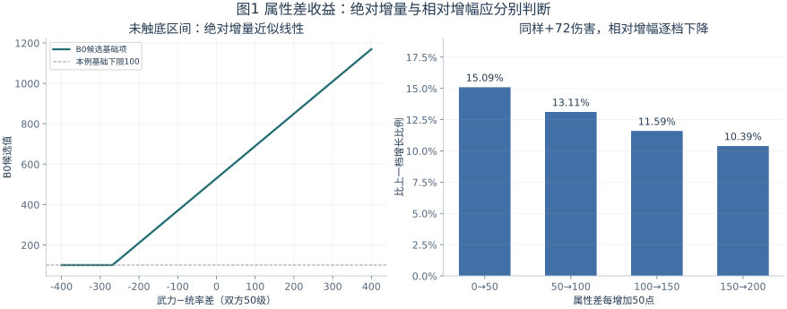
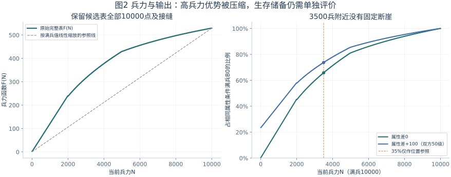
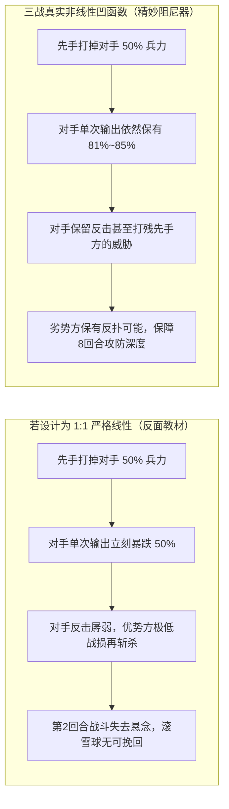
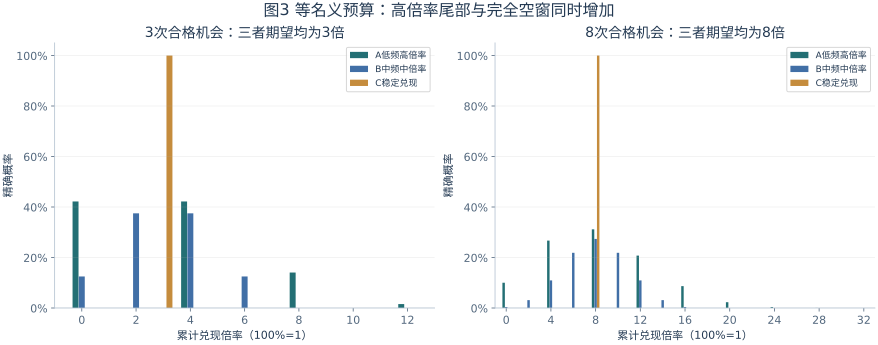

# 第二部分：单体结算与战法投放——从名义倍率到可兑现收益

> **本章核心主旨**：战斗数值从来不是孤立的面板运算，而是通过“行动时序判定”、“状态路由分流”与“伤兵容量约束”三层底层状态机逐步兑现。在单体结算与战法投放的微观战场上，多加属性、多带兵力、追求高倍率，分别能兑现多少真实战损？名义预算相同的战法，又为何会给玩家带来截然相反的战斗体验？
>
> 本章承接第一部分的宏观战损闭环与底层行动时钟，系统解构《三国志·战略版》的一击伤害拓扑、兵力非线性承伤输出弹性，以及战法名义预算背后的“方差心理学”。（数理推导基线与实证数据详见同目录《证据索引与口径说明.md》）

## 2.1 一击伤害构成：属性收益要区分绝对增量与相对增幅

### 一击伤害的分层拓扑与跨侧组合放大

在《三国志·战略版》的底层仲裁中，一次伤害结算绝非简单的“攻击减防御”，而是严格经过五道分层管道逐步展开。这些层次决定了面板上的“属性加成”究竟在哪个节点注入，以及它最终能否真实转化为敌方的不可逆兵损。

| 结算层次 | 核心输入参数 | 策划视角的比较与控制条件 | 机制定位与设计意图 |
|---|---|---|---|
| **1. 基础伤害** | 出手时当前实时兵力 $N$、双方攻防属性、武将等级 | 使用实时面板与瞬时兵力；持续伤害按快照规则 | 奠定伤害基数，通过兵力函数与等级系数拉开基础差距 |
| **2. 战法系数** | 战法名义倍率 $c$、目标判定数量 $m$、攻击段数 | 单段倍率不代表整场收益；多段与单段严格拆分 | 技能投放的初筛标尺，决定能量释放的爆发形态 |
| **3. 战法修饰** | 输出侧增减伤（造成伤害提高/降低）、承伤侧增减伤（受到伤害提高/降低） | 严格区分同侧加法对冲与跨侧乘法放大 | 队伍联动与辅助增益的核心乘区，放大多武将配合价值 |
| **4. 环境与特殊机制** | 兵种克制（1.12 / 1.00 / 0.88）、士气模型、固定减免、抵御/规避 | 克制与士气独立计算；特殊免伤不计入基础公式 | 战场宏观因子的外生调控，提供沙盘大地图对战博弈点 |
| **5. 实际扣兵** | 目标剩余兵力、伤兵生成率、过杀截断 | 过杀伤害不再计入实际战损与战功 | 战损转化的终点，与第一部分伤兵蓄水池无缝对接 |

在伤害修饰层级中，增减伤状态并非粗暴地全部混在同一个加法池中，而是严格遵循**“同侧加法对冲、跨侧独立乘算”**的乘区拓扑规则：

```text
输出侧综合因子 = 1 + max(−0.90, 造成伤害提高之和 − 造成伤害降低之和)
承伤侧综合因子 = 1 + max(−0.90, 受到伤害提高之和 − 受到伤害降低之和)
战法修饰总因子 = 输出侧综合因子 × 承伤侧综合因子
```

**策划深度解析：跨侧乘法的配队质变效应**
若队伍在输出侧提供 20% 增伤（如曹操【乱世奸雄】），承伤侧施加 20% 易伤（如折冲御侮降低防御后施加易伤），总修饰因子为 $1.20 \times 1.20 = 1.44$；若两项 20% 均堆叠在输出侧，总因子仅为 $1 + 0.20 + 0.20 = 1.40$。
这种跨侧乘算模型，正是 SLG 鼓励**“主 C + 增伤辅助 + 破防/易伤副将”**多核协作的数学根源：将增益分散配置在攻防两端，能产生突破单一加法池的指数级收益放大。
在实测高分离度战报（如典型案例 1109205）中，攻击方输出侧降低 13.30% 到期、承伤方保留 75.50% 减伤时，实测伤害比值为 1.1575，与跨侧乘法预测的 $1 / 0.867 \approx 1.1534$ 高度契合，彻底否定了单池加法模型的预测（0.245 / 0.112 = 2.1875）。

此外，兵种克制系数固定为 **1.12 / 1.00 / 0.88**，士气模型遵循 $0.30 + 0.007 \times \text{士气}$。这两者作为宏观环境因子，在基础伤害外围独立乘入，不与战法增减伤混编，确保了战场宏观博弈的清晰可预测性。

### 属性差模型：绝对收益恒定与相对增幅稀释的商业双赢

在基础伤害结算层，以兵刃普通攻击 V1 逆向模型为基准：

```text
X  = F(N) + 攻击方武力 × (0.6 + 0.02 × 攻击方等级) − 防守方统率 × (0.6 + 0.02 × 防守方等级)
M  = min(100, ceil(N / 50))
B0 = ceil(max(X, M))
```

其中 $N$ 为出手时的当前兵力，$F(N)$ 为兵力基数函数。双方达到 50 级满级时，等级系数收敛为 $0.6 + 0.02 \times 50 = 1.6$。这意味着：**在未触及保底区间的常规对抗中，攻击方每领先 50 点武力，基础项 $X$ 恒定增加 $50 \times 1.6 = 80$ 点，折算标准浮动后带来稳定的 72 点单次兵刃绝对伤害！**

以满兵 $N=10,000$、中立无克制、满士气环境为例，受控条件下的属性差收益如下表：

| 武力 − 统率属性差 | B0 基础项数值 | 单次基准基础伤害 | 比上一档绝对增量 | 相对上一档增幅 | 策划维度定位与机制诊断 |
|---:|---:|---:|---:|---:|---|
| **0** | 529 | 477 | — | — | 均势基准线，主要由 10000 兵力基础项 $F(N)=529$ 驱动 |
| **+50** | 609 | 549 | **+72** | **15.09%** | 相当于白板武将单项全加点（约 50 点）带来的基础伤害跃升 |
| **+100** | 689 | 621 | **+72** | **13.11%** | 相当于满红 5 星武将相对白板的净属性优势区间 |
| **+150** | 769 | 693 | **+72** | **11.59%** | 满红武将叠加阵营加成（10%）或兵种 S 级适性（120%） |
| **+200** | 849 | 765 | **+72** | **10.39%** | 极限属性碾压状态（满红 + 专属特技装备 + 兵书属性拉满） |



**【商业策划意图深度推演：大R保值与白板容错的精密平衡】**
从上述数理规律中，可以清晰洞见《三国志·战略版》在商业化投入与竞技平衡之间的顶级调谐智慧：
1. **大R投入的“绝对保值性”**：
   - 在整个属性对抗区间内，无论是白板加点还是满红抽卡获得的属性，每增加 50 点武力，带来的基础伤害增量永远恒定在 **+72** 左右，**绝对物理收益完全线性、绝不缩水**。这从底层数理上保障了高付费玩家抽取满红武将、追求极品属性装备的核心资产价值，彻底杜绝了“高属性被断崖式软上限吃掉”的付费挫败感。
2. **中小R体验的“底线缓冲池”**：
   - 既然绝对增量没有软上限，为什么平民白板在面对满红大佬时不会被“一刀秒杀”？秘密恰恰藏在高达 529 的满兵底数 $F(10000)$ 中！
   - 因为巨大的基础伤害底数存在，属性差带来的相对百分比增幅被大幅稀释（从 15.09% 逐档稀释至 10.39%）。满红比白板多出的 100 点属性，体现在单次基础伤害上仅为 $621 / 477 \approx 130.2\%$，即 **+30.2% 的面板基础优势**。
   - 这一差距完全可以通过一个高质量的兵种克制（$\pm 12\%$，一进一出相差约 24%）或一个优秀的指挥减伤战法（如【暂避其锋】、【抚辑军民】提供 40%~60% 减伤）实现平抑甚至反超。
   - **结论**：**“绝对增量恒定保障大R付费深度，基础基数托底守护中小R参与底线”**。这也是为什么高战必须依赖跨侧战法增伤与暴击，才能打出毁灭性战损。

### 保底机制的系统定位：消除零交互的挫败感

公式中的保底项 $M = \min(100, \lceil N / 50 \rceil)$ 表明，在高兵力对抗极高统率目标时，基础伤害层存在一个保底阈值（满兵时为 100）。
- **设计初衷**：在单体结算的物理层消除“绝对不破防（伤害为 0）”的极端挫败感，确保弱势武将或辅助平 A 时依然能提供最低限度的战场压力。
- **层级边界**：必须明确该保底仅存在于基础物理层。在后续的结算管线中，若目标持有【抵御】、【规避】或特定的完全免疫状态，伤害仍会结算为 0。保底机制旨在保护基础数值运算的下限，而绝不逾越战法机制的仲裁规则。

---

## 2.2 兵力与输出：非线性压缩兵量优势，赋予残兵反扑容错

### 兵力函数 F(N)：高兵力输出压缩与非线性弹性

在实测逆向得到的 1~10,000 完整兵力函数表 $F(N)$ 中，输出随兵力的变化呈现出极其显著的**凹函数（非线性压缩）**特征：

| 当前兵力 $N$ | 兵力函数 $F(N)$ 表值 | 占满兵 $F(10000)$ 比例 | 属性差 +100 时 $B_0$ 占满兵比例 | 策划视角的兵力弹性诊断 |
|---:|---:|---:|---:|---|
| **1,000** | 120 | 22.68% | 40.64% | 残兵濒死状态，基础项已大幅压低，主要依赖保底与属性差支撑 |
| **2,000** | 240 | 45.37% | 58.06% | 临界溃退线，仍保有近 6 成基础输出威胁 |
| **3,500** | 348 | 65.78% | 73.73% | 所谓“残血反杀”的黄金活跃点，输出并未腰斩 |
| **5,000** | 429 | **81.10%** | **85.49%** | **半血拐点**：兵力损失 50%，但单次基础伤害仍保留 81%~85% |
| **7,500** | 488 | 92.25% | 94.05% | 高兵力平缓期，补齐兵力主要为了扩充承伤血池，输出提升极为平缓 |
| **10,000** | 529 | 100.00% | 100.00% | 满编基准状态 |



**核心数理发现**：
兵力从 5,000 提升至 10,000，兵力足足增加了 **100%**，但 $F(N)$ 仅从 429 增至 529，增幅仅为 **23.31%**！
反之，一支原本 10,000 满编的部队被敌方爆发压制至 5,000 半血状态，其单次攻击的基础伤害依然保留了满兵时期的 **81.10%**（若武将自带属性差优势，更是能保留 **85.49%**）。

### 澄清“35%断崖”谣传与体感真实根因

在 SLG 民间讨论中，长期流传着“兵力低于 35% 输出会出现断崖式下跌”的说法。
然而对全量 $F(N)$ 表的逐项审查表明：在 $N=3,500$ 附近，3499、3500、3501 对应的表值分别为 348、348、349，曲线平滑连续，**底层代码根本不存在人为硬编码的“35% 断崖惩罚红线”**！

**为什么玩家在实战中会频繁产生“残血突然没输出”的体感挫败？**
回到第一部分的底层状态机与事件账本，这一体验的真实根因可以完全解构为以下三重机制并发：
1. **核心武将阵亡重伤的阻断屏障**：当队伍整体降至 35% 以下时，脆弱的核心主将往往已率先濒死甚至兵力归零。一旦阵亡，直接触发终战屏障或永久损失该武将的后续行动轮次，整体团队火力呈阶梯式暴跌；
2. **控制状态链的后置覆盖**：到战斗中后期，敌方携带的【计穷】、【震慑】等控制战法多轮判定生效，残血武将即便存活，也极大概率失去了主动战法或普攻的许可；
3. **前期爆发增益到期与防御壁垒成型**：前 3 回合携带的先攻、破防与增伤 Buff（如【白马义从】、【锋矢阵】、【八门金锁阵】）相继耗尽，导致中后期面板大幅回落。
因此，“残血输出暴跌”是**行动许可丢失与状态到期**的宏观表象，绝非底层兵力函数的骤变。

### 【策划意图推导：防滚雪球与先手收益的系统动态平衡】

为什么底层兵力函数必须设计成类似 $\sqrt{N}$ 的凹函数，而不是直接按兵力比例 1:1 线性缩放？



1. **非线性凹函数是战场的“动态阻尼器”**：
   - 如果兵力与输出完全线性绑定，先手方一旦打出先攻爆发，将直接削弱对手对应比例的反击伤害。这会引发不可逆的单向正反馈，使得任何先手爆发队伍都能无脑实现“滚雪球零损收割”，回合制博弈的深度将不复存在。
   - 凹函数设计使得残兵部队依然具备极高威胁的“尖刺反击能力”，强行将优势方的先手优势压缩在合理区间内，为防守方与慢速队保留了绝地反击的容错空间。
2. **先手压血依然具有不可替代的战略价值**：
   - 虽然后手残兵单次伤害保留度高，但由于其**生存储备（承伤血池）已经被大幅压缩**，已完全进入敌方的斩杀线窗口；只要遭遇一次合格爆发或暴击，就面临彻底减员出局的风险。
   - 结合第一部分的“战损即时间、即资源”闭环，压低敌方兵力不仅限制其当场战斗的存活，更直接重创了敌方部队回城补给与再次出征的宏观周转效率。系统在“防无脑滚雪球”与“奖励先手压血”之间达成了极具艺术感的动态平衡。

---

## 2.3 战法名义预算与方差心理学：先算期望，再借方差创造奇迹

### 名义预算模型：初筛指标与多维兑现链条

在战法设计的初始投放阶段，数值策划通常使用**名义预算**作为战法强度的初筛工具：

$$\text{单次行动的名义预算} = \text{发动概率 } p \times \text{技能单次倍率 } c \times \text{目标数量 } m$$

例如：一个发动率 $50\%$、单体造成 $200\%$ 兵刃伤害的战法，其单次名义预算为 $0.50 \times 2.00 \times 1 = 1.00$（即 100% 基准普攻当量）。
然而，名义预算仅代表该战法在“真空无干扰环境”下的单次期望，绝不等于整场战斗的实际战损转化。从名义预算到最终兑现，必须穿越五道严苛的实战物理闸门：

| 兑现影响维度 | 必须审查的核心问题 | 实战战法案例与反制场景 |
|---|---|---|
| **1. 发动机会窗口** | 能存活几个回合？有几次未被控制的合格判定机会？ | 面对【盛气凌敌】前2回合缴械，突击战法的发动机会直接从 8 次骤降至 6 次 |
| **2. 准备与时效** | 是否需要准备 1 回合？准备期间会不会被打断？ | 关羽【威震华夏】准备中被【落凤】计穷打断，不仅当回合空过，更净亏损上一回合的准备成本 |
| **3. 目标与过杀** | 伤害是精准定点打击，还是分散随机打在不同目标？ | 【避实击虚】精准锁定敌方统率最低单体实现定点爆头，而分散群攻往往因过杀溢出浪费大量数值 |
| **4. 反应与反噬** | 技能是单段大伤害，还是多段小伤害？ | 面对携带【草船借箭】、【抚辑军民】或夏侯惇反击的肉盾时，多段攻击将极其致命地为敌方“疯狂充能回血” |
| **5. 槽位与任务** | 携带该输出战法挤占了什么辅助/防御槽位？ | 纯堆输出战法导致缺乏净化与免伤，战斗被动拖入中后期被敌方控死 |

### 战法生态锚定：等预算下的三种典型战法形态

为了深入剖析发动概率 $p$ 与倍率 $c$ 在名义预算相同条件下的表现差异，我们构建三类完全对齐经典战法生态的基准模型（单目标、无准备、单次判定相互独立，单次机会期望均为 100%）：

| 战法形态分类 | 发动概率 $p$ | 触发倍率 $c$ | 每回合名义预算 | 对应三战经典战法生态锚点 |
|---|---:|---:|---:|---|
| **型 A：低频高倍率（高方差爆发型）** | **25%** | **400%** | **100%** | 锚定关羽【威震华夏】（35%准备全体大杀伤）、吕布【天下无双】（35%决斗3普攻）、【所向披靡】（30%全体246%） |
| **型 B：中频中倍率（平稳节奏型）** | **50%** | **200%** | **100%** | 锚定【避实击虚】（40%单体185%）、【落凤】（35%单体250%计穷）、【轻勇飞燕】等标准主动/突击战法 |
| **型 C：确定性兑现（低方差基石型）** | **100%** | **100%** | **100%** | 锚定司马懿【士别三日】（第4回合必中爆发）、【用武通神】（2/4/6/8回合必定伤害）等指挥/被动法核战法 |

在相同回合机会 $n$ 下，实际发动次数 $K \sim B(n, p)$，累计兑现总倍率 $Y = c \times K$：
- 期望兑现总倍率：$E[Y] = n \times p \times c = n \times 100\%$；
- 兑现方差：$\mathrm{Var}(Y) = n \times c^2 \times p(1 - p)$；
- 连续 $n$ 回合“完全空窗（一次不发动）”概率：$P(\text{一次不发动}) = (1 - p)^n$。

对前 3 回合（前期爆发黄金窗口）与完整 8 回合进行精确二项概率求解：

| 战法形态 | 前3回合空窗率 $P(K=0)$ | 前3回合期望倍率 | 8回合总期望倍率 | 8回合兑现标准差 $\sigma$ | 实战稳定性特征 |
|---|---:|---:|---:|---:|---|
| **型 A（关羽/吕布生态）** | **42.19%** | 300% | 800% | **489.90%** | 极端方差：近半数概率前3回合零贡献，一旦启动即毁灭性核爆 |
| **型 B（标准节奏生态）** | **12.50%** | 300% | 800% | **282.84%** | 中度可控：空窗概率较低，平稳输出 |
| **型 C（司马懿法核生态）** | **0.00%** | 300% | 800% | **0.00%** | 绝对确定性：旱涝保收，战损与回合数高度可预测 |



### 方差改变的是“达标概率”：高低方差的战术定位分化

图 3 深刻揭示了为什么**“平均期望相等，实战地位截然不同”**：
1. **高方差战法的“达标奇迹效应”**：
   - 设某次对决的战术目标是：**“前 3 回合必须累计打出至少 400% 爆发，方能穿透敌方主将的防御并实现爆头斩杀”**。
   - 此时，各战法的达标概率发生惊天逆转：
     - **型 A 达标率：57.81%**；
     - **型 B 达标率：50.00%**；
     - **型 C 达标率：0.00%**！
   - 因为型 C 虽然 100% 稳定，但其前 3 回合恒定只能提供 $3 \times 100\% = 300\%$ 的倍率，在 400% 的硬性斩杀门槛面前，**稳定反而意味着绝对无法完成任务**！只有高方差的型 A 与型 B，才有机会在前期连续 Roll 点成功，穿透敌方的减伤与兵力屏障，创造“奇迹战报”。
2. **低方差战法的“控损与多穿基石”**：
   - 反过来，若战术目标变更为：**“追求极致稳定，前 3 回合绝不允许出现零伤害空窗”**。
   - 型 C 达成率高达 100%，型 B 为 87.50%，而型 A 只有 57.81%（有高达 42.19% 的概率彻底挂机！这正是广大玩家调侃关二爷是“演帝”、吕布前几回合看戏的数学本质）。
   - 对于需要连续穿敌多队的高战大R而言，追求的是**战损的低波动与可预测性**。型 A 带来的 42% 空窗风险会导致部队在某一战突然翻车，直接中断连穿节奏；而型 C（如司马懿太尉盾）则能像瑞士钟表一样稳定收割，成为满红多穿阵容的不二之选。

### 准备机制的有限时间损耗与超额预算补偿

很多高倍率战法（如关羽【威震华夏】、所向披靡）均带有“准备 1 回合”的机制约束。
在无打断的受控教学模型中（每次空闲行动以 50% 概率启动准备，下次自身行动完成释放，释放当次不再判定启动，窗口终止未完成不计）：
- 通过多状态马尔可夫链与动态规划推导：在 8 次连续行动窗口内，无打断时的期望完成次数仅为 **2.445 次**（精确值 $\frac{313}{128} \approx 2.4453$）！
- 这显著低于无准备 50% 战法的期望值（$8 \times 0.5 = 4$ 次），实际完成频次折损了近 **38.9%**。

**【策划投放的溢价补偿逻辑】**：
准备机制不仅压缩了有限回合内的发动频次，更在准备回合暴露了整整一轮“极易被敌方计穷/震慑打断导致前功尽弃”的巨大风险敞口。
因此，数值策划在投放准备战法时，**必须给予超额的技能倍率（如【所向披靡】高达全体 246% 兵刃伤害，名义总倍率 738%）或附带极其霸道的全场控制效果（如【威震华夏】对全体施加缴械/计穷、【威谋靡亢】施加群体双虚弱）**，作为对其时间损耗与受控风险的超额风险溢价补偿！

### 【商业生态与方差心理学：弱者翻盘的多巴胺源泉】

在 GaaS（服务型）长线商业 SLG 中，为什么数值策划明知道关羽、吕布等武将方差极大、玩家体验波动剧烈，却依然要在核心投放池中长期保留这类“神经刀”战法？

```text
┌────────────────────────────────────────────────────────────────────────┐
│                   方差心理学在商业 SLG 生态中的定位分化                │
├────────────────────────────────┬───────────────────────────────────────┤
│    型 A：高方差爆发型（关羽 / 吕布）    │    型 C：低方差稳定型（司马懿 / 太尉盾） │
├────────────────────────────────┼───────────────────────────────────────┤
│ • 战略定位：弱者逆袭的“撬棒杠杆”       │ • 战略定位：强者连穿的“稳定基石”       │
│ • 用户圈层：中小 R、白板玩家、攻坚突击队 │ • 用户圈层：高战大 R、满红队伍、驻守多穿队 │
│ • 体验驱动：极端多巴胺刺激，造就奇迹战报 │ • 体验驱动：高掌控感与极低战损确定性   │
│ • 心理机制：可归因于“运气不好”，保护尊严 │ • 心理机制：数值与配将精密咬合的成就感 │
└────────────────────────────────┴───────────────────────────────────────┘
```

1. **极端方差是弱势群体的多巴胺发动机**：
   - 如果游戏里所有战法都是 100% 确定性的（如同型 C），战斗将彻底演化为残酷的“纯数值战力比大小”。在大R满红队伍面前，白板中小R的胜率将是绝对的 0%，生态底层玩家将在极短时间内因绝望而大量流失。
   - 35% 高方差战法的存在，打破了这种数值铁板。吕布一旦前 2 回合连续触发决斗，哪怕是白板也能以极快速度直接爆头斩杀敌方满红主将！
   - **“白板下克上斩杀满红高战”**的极小概率奇迹战报，是整个游戏最核心的社交裂变素材与多巴胺源泉。平民玩家凭借一张高光战报就能在同盟微信群吹水一整天，这种极度的心理成就感正是维系非大R玩家长线留存的绝对支柱。
2. **失败归因的心理保护伞**：
   - 高方差机制在心理学上还提供了天然的**“外部归因安全阀”**。当玩家携带关羽打输时，玩家会把失败归咎为“今天关二爷又演我了，纯粹是运气差”，而不是归咎于“我充钱不够，这个游戏逼氪”。这种心理缓冲极大地降低了战败挫败感，保护了玩家的自尊心与再战意愿。
3. **两类战法的商业生态帕累托共存**：
   - 追求单场“以弱胜强”的中小R，热衷于配置高方差阵容博取奇迹；
   - 追求单赛季“多穿战功”的高战大R，则热衷于配置【士别三日】、【用武通神】、【抚辑军民】等确定性极强的防御肉盾体系，用稳定的战损控制压制随机波动。
   - 两类战法形态在同一个沙盘生态中各司其职，共同构建了《三国志·战略版》兼具竞技深度、社交谈资与商业韧性的战斗数值宇宙。

---

## 本章核心决策基准

- **属性维度**：属性差绝对增量完全线性恒定，坚决保障高付费玩家的养成深度；同时依靠高额兵力底数稀释相对增幅，为白板与中小R保留凭借兵种克制与减伤战法防守反制的生存空间。
- **兵力维度**：兵力对输出的影响呈典型的凹函数非线性压缩，满兵降至半血仍保留 81%~85% 基础杀伤。该机制作为战场“动态阻尼器”，有效防止先手爆发无脑滚雪球，为劣势方保留残兵反扑窗口。
- **战法维度**：名义预算（发动率 $\times$ 倍率 $\times$ 目标数）仅为初筛门槛。面对不同任务阈值，高方差战法提供越级斩杀的爆发杠杆，低方差战法提供多穿驻守的稳定性基石；准备战法牺牲了有限回合窗口与被打断风险，必须享有超额的倍率与控制补偿。

下一部分将把这些微观单体基准带入 3v3 真实配将实战中，通过经典阵容切片，系统解构多武将联动中的“事件次数代价”与动态博弈价值。

---

## 资料索引与复现指南

本章所有受控算例与图表均可由同目录下的 `build_and_check.py` 脚本全自动验证与生成，数据源覆盖 1~10,000 完整兵力表与精确二项分布计算；底层算法模型、GitHub 提交锚点与详细学术分歧说明，详见同目录专有文献《证据索引与口径说明.md》。
