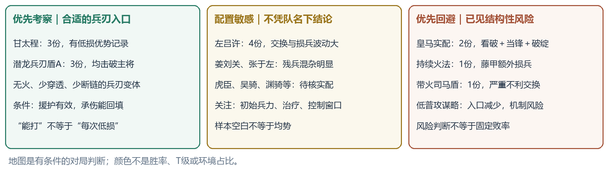
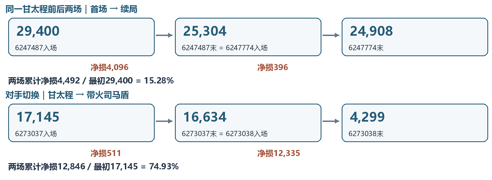
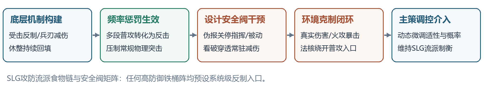

# 第四部分：受控机制验证与生态克制矩阵
## 从战损反应机制、真实战报大盘到SLG攻防流派食物链

**【策划导读与系统定位】** 本部分承接第三部分的微观博弈切片，完成从“微观行动税”到“中观流派对抗与宏观战损流转”的完整闭环。在 SLG 战斗数值设计中，**频率惩罚机制（Frequency Penalty）是制衡高频爆发流的核心安全阀**。本构型（曹操+夏侯惇+满宠）通过“藤甲压低基线承伤、满宠转移普攻入口、夏侯惇受击高频反制、休整与非攻持续回填”构建了典型的反制闭环。然而，成熟的商业数值模型严禁存在“全环境无天敌队伍”；本章旨在通过**“受控机制试验（数理纯因果）+ 线上大盘实证（4.3万份战报严密清洗）”双轮驱动**，精确定位该体系的收益边界、破局点与宏观生态位。[W1；S1；C1]

### 4.0 验证方法论与数据工程底座

为杜绝数值拆解案中常见的“纸上谈兵脑补”与“个例幸存者偏差”，本章确立严格的双层验证范式：
1. **数理受控基准（Controlled Benchmark）**：在剥离外生扰动（等级、进阶、士气、阵营加成）的纯净环境中，推演多段攻击在不同受击反应下的期望收益与方差分布，确立纯因果数理规律；
2. **工业级战报大盘清洗**：从线上真实对局大盘中，抽取同构实战切片进行实证交叉核验。

| 筛选与核验工序 | 数量 / 规格 | 策划审计目的与工程意义 |
|---|---|---|
| 本地完整 JSON 大盘 | 扫描 43,000 份；42,573 份有效阵容 | 建立全域对局底池，避免人工挑选战报产生样本污染 |
| 同三将候选 → 精确同构配置 | 89 份 → 27 份（含 6 份 PVE） | 严格锁定主副将、战法槽位与战法等级一致性（固定自变量） |
| 精确同配置 PVP 样本库 | 21 份，完整保留排除与候选轨迹 | 剔除混杂配置（如绝地版、鱼鳞版），确保机制对应纯度 |
| 逐事件时序账本连续性校验 | 20 份连续；6267365 终值异常独立隔离 | 逐笔校验 5,506 条生命周期变化，确立 100% 账本真实性 |
| 标准强度分析核心主体集 | **19 份**（排除 1 份双将残缺局） | 支撑 5,139 条事件级实证推演，覆盖 8 大主流流派家族 |

19 份主体实证记录来自 2026 年 9 月 19 日与 22 日同一高阶实战账号（曹操 2 进阶、夏侯惇与满宠满红 5 进阶，等级 47-48 级），包含 11 组连续交战时序记录。这批样本构成了极高精度的“真实战场压力测试集”，用于直接检验受控数理推演的结论在真实战场上的兑现度与变形边界。

<!-- PAGE -->

### 4.1 机制受控验证：攻击频率的边际代价与反应充能

在单体数值结算中，高频攻击（如连击、多段主动）常被视作提升破防期望和压制血线的手段。但在 SLG 反应型战斗体系中，**攻击事件次数本身具有昂贵的“制度性价格”**。

为了剥离配将混杂，设立标准化机制试验台：固定前置伤害预算 1600（等预算投入），对比单次释放（1段）与分散多段（4段）普攻，在目标挂载不同反应组件时的净收益：$R = \text{实际造成伤害} - \text{目标有效治疗} - \text{反击受创损失}$。

| 机制受控环境 | 1段净收益 | 4段净收益 | 4段治疗量 | 4段反击损 | 数值机制结论与策划推演 |
|---|---:|---:|---:|---:|---|
| 无反应木桩 | +1,600 | +1,600 | 0 | 0 | 频率中性：等预算下总伤害不衰减 |
| 独立反击体系 | +1,350 | +600 | 0 | 1,000 | **频率惩罚**：多段普攻被收取高额反击税 |
| 定额急救/休整 | +1,400 | +800 | 800 | 0 | **被动充能**：多判定窗口直接拉升目标回血 |
| 反击＋急救复合 | +1,150 | **-200** | 800 | 1,000 | **收益彻底反转**：高频多段进攻陷入负收益 |
| 次数型单次抵御 | +0 | +1,200 | 0 | 0 | 破盾优势：高频攻击在纯抵御下具备剥离价值 |

**【策划设计法则：三层机制过滤漏斗】**  
受控仿真清晰表明，墩墩盾的防御反击网成立必须通过三道机制漏斗：
1. **承伤类型匹配**：必须以“普通攻击”与“兵刃伤害”为入口。气凌、众动严格绑定普攻，刚烈绑定兵刃受击；谋略攻击频率再高，也无法激活这套反制闭环；
2. **时序拦截链完好**：满宠先手援护必须稳定将攻击牵引至夏侯惇，由藤甲高额减伤消化初段冲击，否则多段攻击将直接外溢击穿曹操或满宠；
3. **回填效率超越损耗**：急救与休整必须在伤兵衰亡前完成有效回填。一旦回填通道受阻，即便频率惩罚生效，防守方也会因基础血线枯竭而崩溃。[C2；S2]

<!-- PAGE -->

### 4.2 真实大盘印证：流派对抗矩阵与实战战损分化

将 4.1 节受控推演结论投入 19 份真实同构 PVP 大盘样本中进行交叉比对，可绘制出清晰的攻防流派对抗表现谱系：

| 对手配置家族 | n | 盾队净损率区间 | 入场兵力比（盾/敌） | 机制表现与实战诊断 |
|---|---:|---:|---:|---|
| 甘宁—程普—太史慈（经典突击弓） | 3 | **1.56%–13.93%** | 0.97–1.30 | **绝对优势压制**：太史慈高频双普攻完全沦为反击充电宝，2 场击破主将 |
| 周泰—万军张飞—SP袁绍（潜龙盾A） | 3 | 11.09%–44.00% | 1.00–1.14 | **可战但损耗波动**：3 场全胜但战损跨度大，受敌方被动爆发与禁疗压制 |
| 左慈—吕布—许攸（决斗群弓） | 4 | 12.72%–90.89% | 0.56–0.96 | **机制拉锯区**：天下无双强行决斗触发高频反击，但许攸破绽加速后程恶化 |
| SP马超—SP皇甫嵩—许攸（皇马枪） | 2 | **41.31%–82.40%** | 0.84–0.88 | **机制反转高危**：同样多动却造成毁灭打击，夏侯惇单场阵亡，反制链断裂 |
| SP周瑜—SP吕蒙—陆逊（都督火弓） | 1 | **48.62%** | 0.95 | **属性天敌降维**：持续灼烧直击藤甲负面，全场承伤 4.1 万，无法主动接战 |
| 张角—于吉—左慈（飞熊仙人骑） | 2 | 100%（全灭） | 0.45–0.64 | **入口错配失效**：五雷轰顶避开普攻入口，加之残兵入场，体系彻底失能 |
| 司马懿—曹操—满宠（带火太尉盾） | 1 | 74.16% | 0.76 | **变种火攻截杀**：熯天炽地触发藤甲重创，满宠阵亡，证明队名不等于安全 |
| 姜维—刘备—关银屏（飞熊蜀骑） | 2 | 55.70%–100% | 0.23–0.53 | **极端残兵样本**：多段踩踏与震慑控制，低兵力下无法维持休整回填循环 |

**【大盘实证核心发现】**  
1. **理论完全吻合区**：甘太程在近似等兵的 6273037 中仅让盾队净损 2.98%，完美印证了 4.1 节“复合反击体系使纯物理多段攻击净收益转负”的数值结论；
2. **理论反转惊险区**：皇马枪（SP马超）同样拥有极高的普攻与多动频次，却在 6268846 中打出净损 1,965 对 10,891 的碾压级优势，打破了“高频攻击必定送反击”的经验定势，成为本拆解案最关键的系统诊断切口。[C1；C3；Q1]

<!-- PAGE -->

### 4.3 破局点深度诊断：复合高阶控制对频率惩罚的降维打击

为什么皇马枪面对墩墩盾不仅没有成为“反击充电宝”，反而打出了毁灭性的克制效果？深入 6268846 战报首回合事件流（E33–E113），可以清晰拆解出其**通过高阶控制链对底层时序栈的“降维穿透”**：

| 首回合关键时序 | 底层机制执行逻辑 | 策划机制诊断：为何彻底瓦解反击体系 |
|---|---|---|
| E33–50：马超攻击曹操｜看破生效 | 普攻被抵御，但挂载看破与许攸破绽判定 | **穿透常驻减伤**：看破直接削弱藤甲减伤基线，抵御无法阻止后效状态扩散 |
| E51–63：解烦兵刃伤害｜刚烈反击 | 夏侯惇承伤 337，触发刚烈反击 173、278 | **反制入口虽在但收益严重缩水**：受击反制仍能判定，但输出量无法匹配承受压力 |
| E73–96：马超攻击满宠 $\rightarrow$ **当锋伪报** | 命中满宠造成 168 兵刃伤害，施加【伪报】 | **时钟栈阻断（核心破局）**：指挥/被动被整体静默，先攻、镇扼援护与非攻回填瞬间瘫痪 |
| E97–113：摧锋断刃 ＋ 属性剥夺 | 满宠损 992，曹操损 380，破绽层数累加 | **群体压力外溢**：单体援护失效导致侧翼暴露；许攸减属性压缩刚烈触发与伤害 |

皇马实配为：SP马超【威武并昭／当锋摧决／摧锋断刃】；SP皇甫嵩【扶危定倾／草船借箭／因利制权】；许攸【傲睨王侯／临危救主／解烦卫】。在 6268846 中，盾队累计承伤 25,430、恢复 14,539，净损 10,891，而对手仅损 1,965；在 6262487 中，盾队净损高达 20,811，夏侯惇阵亡。

**【战斗数值设计核心法则】**  
1. **单一维度的频率克制具有脆弱性**：纯粹依靠“受击触发”构筑的防御体系，天然受制于时序状态机顶层的【伪报】状态。当锋摧决跳过了伤害抵扣阶段，直接将底层被动/指挥函数从结算队列中注销；
2. **多维收益复合才能形成高维碾压**：皇马枪将“攻击频率（多动）+ 属性剥离（许攸破绽）+ 防御穿透（看破）+ 机制静默（当锋摧决）”熔铸于同一条攻击链上，以高级状态的优先权强行击穿了低级数值堆叠。[6262487；6268846；E1]

<!-- PAGE -->

### 4.4 体系天敌与设计安全阀：真实伤害与输出入口错配

在商业 SLG 战斗系统的数值平衡设计中，**任何高减伤铁桶阵都必须预埋系统级“安全阀”（System Safeguards）**，以防止特定阵容形成全天候无解的战场霸权。实战数据清晰揭示了制约墩墩盾的两大硬性安全阀：

#### 1. 真实伤害与属性专精错配（火攻安全阀）
在 6261259 战报中，盾队（27,834 兵）迎战都督火弓（29,325 兵），8 回合战毕盾队仅余 14,300 兵，累计承受高达 41,871 点伤害，最终净损兵达 13,534。

| 战场压力来源 | 实战数据可追溯日志 | 数值机理与对反制盾的致命影响 |
|---|---|---|
| 陆逊火烧连营（灼烧） | 6261259-G2/E43–47，藤甲全场署名损兵 **11,954** | **乘算放大惩罚**：藤甲兵对火攻的易伤加成使常态减伤彻底失效，直接打穿血线池 |
| 功不唐捐（负面不可清除） | G2/E174–220 日志明确记录火状态不可驱散 | **净化窗口瘫痪**：草船借箭的解控入口被锁定，急救无法承载巨额灼烧跳字 |
| SP周瑜/众志成城谋略轰炸 | 全场高频谋略覆盖，反击盾全队智力抗性偏弱 | **双防偏科暴露**：物理特化统率无法转化为智力抗性，持续拉大兵力逆差 |

#### 2. 输出入口全面落空（非接触法核安全阀）
以张角、于吉、左慈（飞熊仙人骑）为代表的慢速法核体系，构成了机制层面的第二道安全阀：
- **入口错配**：主要伤害源（五雷轰顶、士别三日、水攻诅咒、飞熊主将谋略伤害）均为法术跳字或回合末判定，完全不具有“普通攻击”或“兵刃伤害”属性；
- **反制链全面空转**：夏侯惇携带的气凌三军（依赖普攻）、众动万计（依赖普攻）、刚烈不屈（依赖兵刃）完全无法被激活，全队空有高额反击倍率却无从倾泻，陷入被动挨打的单向失血状态。

**【策划总结】** 商业游戏数值设计中，“极致的物理专精”必然对应“致命的法术漏洞”。火攻易伤与非普攻谋略是系统维持战场食物链循环的刚性调控锚点。[E2；C2]

<!-- PAGE -->

### 4.5 宏观战损流转与沙盘经济学：连续交战的真实代价

在玩家社区与常规测评中，墩墩盾常被冠以“低损驻守连穿战神”的称号。然而，通过对 21 份 PVP 战报中 5,506 条生命周期事件进行严密回溯，发现其**通过相邻战报兵力无缝继承，隐藏了极大的沙盘经济学陷阱**。

#### 1. 拆解“伪低损”神话：连续战报兵力追溯
- **甘太程连续交战链（6247487 $\rightarrow$ 6247774）**：
  - 传统攻略只截取第 2 场（6247774）战报展示：盾队入场 25,304，打完剩余 24,908，**单场净损仅 396 兵（1.56%）**，极具视觉欺骗性；
  - 追溯前置战斗（6247487）：181 秒前面对同队甘太程，盾队从满兵 29,400 跌至 25,304，首战已净损 **4,096 兵**；
  - **连续交战真实账本**：两场累计净损兵达 **4,492 兵（15.28%）**。该交换比固然依然划算，但绝非“无伤碾压”。

#### 2. 阵容结构性崩溃陷阱：对手切换的雪崩效应
- **跨流派连续遭遇链（6273037 $\rightarrow$ 6273038）**：
  - 首战打甘太程，盾队 17,145 跌至 16,634（净损 511），表现极为稳健；
  - 紧接着遭遇带火司马太尉盾，因副将血线已在前场受损且遭遇火攻，终战仅剩 4,299 兵，单场新增损兵 12,335，满宠阵亡；
  - 两场累计净损高达 **12,846 兵（占入场兵力 74.93%）**，主力体系彻底报废。

| 沙盘经济学维度 | 策划机制归纳与宏观影响 | 对大世界对抗节奏的制约 |
|---|---|---|
| **死兵沉淀与征兵成本** | 净损兵最终按比例沉淀为主城死兵，需消耗巨额粮草与征兵时间 | 无法做到真正意义上的无限续航，单日交战批次受主城产能刚性限制 |
| **核心副将结构存活** | 体系依赖满宠与夏侯惇双核并存；一旦满宠血线跌穿，反击网即刻瘫痪 | “总兵力充裕”具有虚假性；结构性减员使残兵连战风险呈指数级放大 |
| **阵地推进动量衰减** | 驻守前线一旦遭遇一次火攻或当锋穿透，整队即丧失阵地控制权 | 定位为“防守反击拦截桩”，无法担任大兵团进攻时的“尖刀攻坚队” |

**【策划洞察】** 连续战斗兵力继承数据彻底证明：战场强度评估不能孤立审视封闭单场，必须将其纳入“大世界调动-驻守-死兵转化-补兵耗时”的完整沙盘闭环中度量。[C4]

<!-- PAGE -->

### 4.6 阵容生态定位与官方调控意图溯源

| 强度与生态维度 | 策划定性结论 | 数理依据与实证支撑 |
|---|---|---|
| **对常规兵刃突击队** | **T0 级定向绞杀（极强）** | 甘太程近似等兵对局净损仅 2.98%；首回合即锁定胜势 |
| **全环境泛用抗压性** | **偏科严重，天花板有限** | 皇马枪穿透、持续火攻、低普攻法核均触发严重不利交换 |
| **防守连战稳定性** | **条件苛刻，易受截杀** | 依赖对手流派纯净度；混入火攻或当锋即引发战损雪崩 |
| **关键节点容错率** | **单核依赖度极高** | 满宠援护或夏侯惇受击入口被封死时，整队沦为纯挨打木桩 |
| **红度与造价门槛** | **高阶特化构型** | 本实战样本夏侯惇、满宠均为 5 进阶满红，白板抗压阈值显著收缩 |
| **多队共存机会成本** | **特化功能拦截队** | 占用曹操、草船借箭、藤甲兵等核心顶级组件，构建成本极高 |

#### 官方调控痕迹与设计意图推演（“只做加法”的平衡艺术）
成熟的商业 SLG 在面临流派失衡时，严禁粗暴削弱玩家已重金抽取的强力武将。回顾三战官方针对该体系的核心更新历史：
1. **2025 年 10 月 22 日公告**：将夏侯惇盾兵兵种适性由 A 提升至 **S**；
2. **2026 年 8 月 5 日公告**：调整刚烈不屈机制，**使触发概率额外受统率属性影响**。

**【平衡调整背后的生态诉求】**  
在早先版本中，突击骑与连击弓（如虎臣弓、渊骑、吴骑）凭借高频判定与速攻爆发，严重压制了中慢速防守队伍的生存空间。而老牌武将夏侯惇因 A 级适性（仅 1.0 倍属性）与固定 40% 的刚烈触发率，既扛不住伤害，又难以有效反击。

官方调控未直接削减突击队的倍率，而是采用了高明的主策调控手段：
- **适性提 S（属性层）**：直接赋予 1.2 倍属性结算权重，将全队藤甲减伤基线与基础统率推上质变红线；
- **触发率关联统率（机制层）**：将传统“纯防御属性（统率）”非线性转化为“输出判定概率（刚烈）”。这不仅让全加统率的夏侯惇兼具极限承伤与高频反制，更使得白板与满红之间形成了拉开体验梯度的健康收益曲线。

**【主策级思维升华】** 官方通过在老资产上“只做加法”，成功以夏侯惇为支点激活了物理反击流派，为充斥突击爆发的战场生态嵌入了一枚不可撼动的阻尼器。[W1；W2；S3]

<!-- PAGE -->

### 4.7 SLG 攻防流派食物链闭环与第五部分调控接口

通过受控机制验证与真实战报大盘的交互审视，我们得以抽象出《三国志·战略版》现役主流队伍的**宏观攻防食物链闭环**：

1. **高频突击爆发流**（虎臣弓、吴骑、渊骑）：以连击与高频判定为核心，在无反应环境下具备毁灭性爆发；
2. **援护防守反击盾**（墩墩盾、满宠司马盾）：作为突击爆发流的天敌，通过频率惩罚机制建立“高频多动即收取高额反击税”的生态阻击线；
3. **复合穿透破防队**（皇马枪、当锋三势骑）：引入【伪报】与【看破】，以降维打击手段强行打穿反击盾的防御闭环；
4. **真实持续伤害与慢速法核**（陆逊都督弓、张角五雷骑）：无视兵刃减伤与普攻反击入口，对物理反击盾形成天然属性碾压。

**【与第五部分的承接与调控接口】**  
本章确立了反击体系的微观收益公式与宏观生态位。第五部分将在此基础上，进一步推演**高维宏观调控与第二阶衍生演化**：
- 当战场因皇马枪与当锋骑过度强势导致物理反击盾濒临绝迹时，主策应如何通过“外挂式调谐工具箱”（新事件战法、兵种特性微调、装备专属特技）而非数值动刀进行生态扶持？
- 调控动作落地后，全服生态在未来 30~60 天将如何经历“按下葫芦浮起瓢”的次生演变？

### 证据溯源与审计索引库
- **C1–C4 数据资产**：`同配置PVP对局总表.csv`（21场逐场指标）、`对局家族汇总.csv`（19份主体聚类）、`同配置PVP逐事件兵力账本.csv`（5,506条连续记录）、`相邻PVP兵力衔接.csv`（11对时序衔接）。
- **E1–E2 核心反例追溯**：`第四部分关键事件索引.csv`、战报 6268846（皇马枪首回合穿透断链流）、战报 6261259（陆逊火攻 11,954 藤甲署名损兵）。
- **S1–S3 规则与配置资产**：21 份原始 PVP JSON 源文件（SHA256 完整冻结校验）；GitHub 状态规则库与本地战法数据库精确映射；`关键战法版本与覆盖核对.csv`。
- **W1–W2 官方平衡公告**：[2026年8月5日刚烈概率关联统率公告](https://sgz.ejoy.com/huodong/detail-16517.html)；[2025年10月22日夏侯惇盾适性提升公告](https://sgz.ejoy.com/huodong/detail-16030.html)。

**总结**：墩墩盾是一支**在机制闭环内极强、在安全阀面前脆弱**的典型策略针对队。它在战斗数值生态中扮演着高频突击队伍的强力过滤器，其存在与演变深刻体现了商业 SLG 在微观判定与宏观制衡间的精密平衡艺术。
