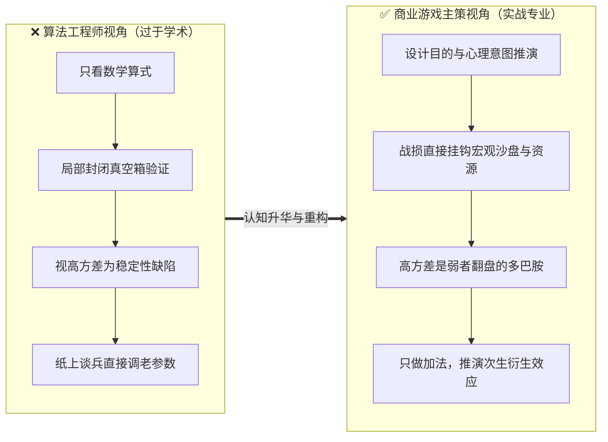
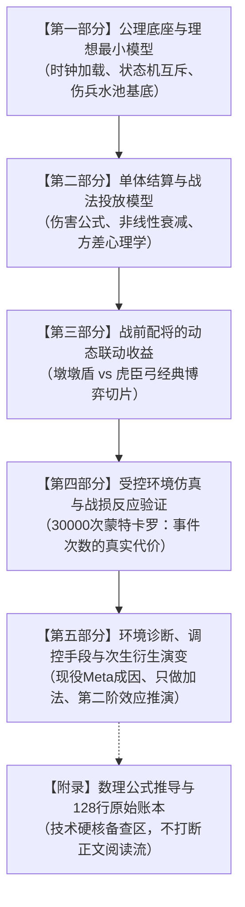

# 《三国志·战略版》战斗数值模型与战场动态调控深度拆解案 · 标准构建规范

> **文档定位**：本规范作为后续《三国志·战略版》战斗数值拆解案重构的**顶层骨架与撰写操作指南**，旨在将原版 32 页侧重数理仿真的学术型报告，升华为兼具**硬核底层数学推导、战前配将博弈联动、真实战场体感诊断以及线上商业调控大局观**的工业级策划白皮书。
> 
> **目标篇幅**：核心正文控制在 **18 ~ 20 页**（阅读体验最舒适的黄金区间），完整推导草稿与大表移入文末**附录**。

---

## 🧭 核心认知跃迁：从“算法仿真”到“商业策划”

---

## 📐 全新五部分章节架构蓝图

---

### 第一部分：公理底座与理想最小模型（规则基底）
*预估篇幅：3 ~ 4 页*

*   **1.1 战斗定位与宏观战损闭环**：
    *   明确 SLG 策略核心：**战前策略（配队、配速、兵种克制、战法联动）决定了 90% 的胜负**；
    *   战损与大世界强绑定：**战损即时间，战损即征兵成本**（直接挂钩主城征兵时间、铜币与粮食消耗、重伤虚弱 10 分钟以及前线营帐补给推进节奏）。
*   **1.2 底层结算时钟与时序状态机（配 1 张核心流程图）**：
    *   **准备回合（第0回合）加载栈**：严格按【被动 $\rightarrow$ 阵法 $\rightarrow$ 兵种 $\rightarrow$ 指挥】优先级顺序装载，揭示减伤/属性增益的时序生效节点；
    *   **战斗回合（1~8回合）判定时钟**：先攻判定 $\rightarrow$ 行动前状态检查 $\rightarrow$ 速度排序 $\rightarrow$ 主动战法 Roll 点 $\rightarrow$ 普攻判定 $\rightarrow$ 突击战法判定。
*   **1.3 伤害类型与状态分类学**：
    *   伤害三元论：兵刃伤害（受统率减伤）、谋略伤害（受智力减伤）、叛逃/真实伤害（无视双防）；
    *   状态机分类与覆盖规则：控制类（震慑/计穷/缴械/虚弱/混乱/伪报）、持续伤害类（水攻/沙暴/灼烧/溃逃）、防御增益类（抵御/规避/急救/休整）。
*   **1.4 伤兵蓄水池机制（配 1 张动态充放电水池图）**：
    *   **立住全篇核心概念**：损兵 $\neq$ 可恢复伤兵；
    *   受击瞬间生成伤兵、每回合按比例自然衰亡、战后回城按比例转换为死兵；
    *   急救（受击时即刻拦截）与休整（行动前回血）的时点差异。

---

### 第二部分：单体结算与战法投放模型（算式与意图）
*预估篇幅：3 ~ 4 页*

*   **2.1 一击伤害构成与属性差边际递减**：
    *   承接原版伤害基础算式与属性差模型；
    *   **【策划意图推导】**：为什么属性差设置软上限？——**防止满红高战直接零战损融化白板**，保护非满红玩家的参与底线；为什么设置保底伤害（如100）？——**消除完全不破防的极端挫败感**。
*   **2.2 兵力衰减函数与防滚雪球机制**：
    *   兵力与输出的非线性函数关系；
    *   解释为什么兵力低于某一红线（如 35%）后输出断崖下跌：通过压制残兵输出防止战场无限制滚雪球，同时赋予防守方反扑容错。
*   **2.3 战法名义预算与“方差心理学”**：
    *   名义预算公式：$\text{名义预算} = \text{发动概率} \times \text{技能倍率} \times \text{目标数}$；
    *   **【关键认知升华】**：为什么三战在关羽（35% 威震华夏）、吕布（35% 天下无双）等武将上故意保留 25%~35% 的高方差“神经刀”？
        *   **高方差是 PVP 的情绪放大器**：平均期望决定赛季胜率，但极端方差创造了“白板下克上爆头满红”的奇迹战报，是弱势方留存的核心多巴胺源泉。

---

### 第三部分：战前配将的动态联动收益构成（实战切片）
*预估篇幅：4 页*

*   **3.1 战法的“固定价值”与“动态相对价值”**：
    *   战法没有绝对孤立的评分，战法价值取决于**队伍内部联动**与**敌方阵容食物链**；
    *   如【草船借箭】打高频控制队（关妹枪）价值翻倍，面对当锋突击骑直接价值归零。
*   **3.2 经典战术切片解构：墩墩盾 vs 虎臣弓**：
    *   **墩墩盾阵容联动**：夏侯惇（受击被动反击）+ 满宠（强制援护+受击急救）+ 曹操（稳定增伤与指挥级抗性）；
    *   **虎臣弓爆发体系**：甘宁（高爆击上限）+ 太史慈（连击破防+折冲御侮护主）+ 周泰（分担承伤+增伤）；
    *   **固定收益 vs 动态联动收益解剖**：
        *   *哪些是固定的？* —— 兵种克制系数、基础指挥减伤与属性差；
        *   *哪些是动态博弈的？* —— 太史慈的双普攻虽然能快速剥离护盾，但在面对满宠+夏侯惇时，**反而在高频给夏侯惇刷反击被动、给满宠触发急救**！用实战切片完美验证后文的“事件次数代价”。
*   **3.3 配速（Speed Tuning）工程学**：
    *   0.5 ~ 1 点速差抢先手解控（如刮骨疗毒、草船借箭在主 C 出手前净化）与爆发窗口的精密咬合。

---

### 第四部分：受控环境仿真与战损反应验证（精炼数据）
*预估篇幅：3 ~ 4 页*

*   **4.1 仿真设计与场景设定**：
    *   30,000 次蒙特卡洛模拟，对比：原链 vs 独立追加 vs 额外普攻链；
    *   **【删繁就简】**：删除 86/90/94 等细微梯度的网格大表，只展示基准档与极端质变档。
*   **4.2 核心结论：【事件次数本身是有价格的】**：
    *   在面对无反应木桩时，多段小伤害平滑稳定；
    *   但在面对**有受击反应（急救/反击/抚辑军民）的目标时，多段小攻击等于在不断给对手赠送回血和反击窗口**，净损兵反而下降；
    *   提炼金句结论：**在三战的战场上，攻击频率是一把双刃剑，盲目追求多段攻击会成为肉盾体系的充电宝**。

---

### 第五部分：战场环境诊断、调控手段与次生衍生演变（主策终局思维）
*预估篇幅：4 ~ 5 页*

*   **5.1 现役/经典战场环境（Meta）成因诊断**：
    *   以典型 T0 队伍（如太尉盾、当锋骑或皇马枪）为例，诊断其为什么“无天敌”？
    *   指出克制链断裂的本质：**减伤与援护覆盖期完美错开了爆发期，且免控/反控手段瘫痪了常规反制手段**。
*   **5.2 调控介入手段的工程敬畏（为什么“只做加法，不做减法”）**：
    *   成熟商业游戏绝不能直接砍老武将数值（引发大 R 客诉与资产贬值危机，改动爆炸半径过大）；
    *   **成熟策划的“外挂式调谐工具箱”**：
        1.  **投放新事件战法**（如当年推出【当锋摧决】专门制裁指挥被动肉队）；
        2.  **兵种进阶特性特化**（如【虎豹骑】提升突击概率，反向压制慢速法核）；
        3.  **专属装备特技与剧本赛季特性微调**。
*   **5.3 调控后的【第二阶效应（次生衍生演化）】推演**：
    *   若针对 T0 队伍引入了强力伪报/破防手段，推演未来 1~2 个月全服生态将如何演化？
    *   *“肉队出场率下滑 $\rightarrow$ 爆发型突击骑兵迅速抬头 $\rightarrow$ 原先绝迹的藤甲盾与极限规避流将迎来结构性复苏……”*
    *   展示具备**预判“按下葫芦浮起瓢”并提前预留系统安全阀**的主策级远见。

---

### 附录（Appendix）：数学推导草稿与原始账本
*   收录 128 行理论账本、详细公式推导草稿与极端参数测试表；
*   供资深数值策划在技术面试中备查，正文完全保持流畅的高维商业策划阅读体验。

---

## ✂️ 删繁就简执行清单（降噪手术）

1.  **大砍微调网格表**：删除表 25 这种微调 86/90/94 的穷举表，正文改用 1 句话提炼规律，完整表格直接塞进附录；
2.  **清理防守性论文腔**：通篇删除所有“本算例不代表…”、“差异0.55兵不作为结论…”等学术免责废话，改用自信果断的策划语言；
3.  **增补高清晰图解**：
    *   图 1：【准备回合加载栈与战斗回合时钟流转图】
    *   图 2：【伤兵蓄水池充放电水位模型图】
    *   图 3：【墩墩盾 vs 虎臣弓战法联动收益网络图】
4.  **重写结论方向**：将第 7 节“直接调平老战法方差”的改动思路，彻底重构成“外挂组件调谐 + 第二阶次生衍生推演”。
